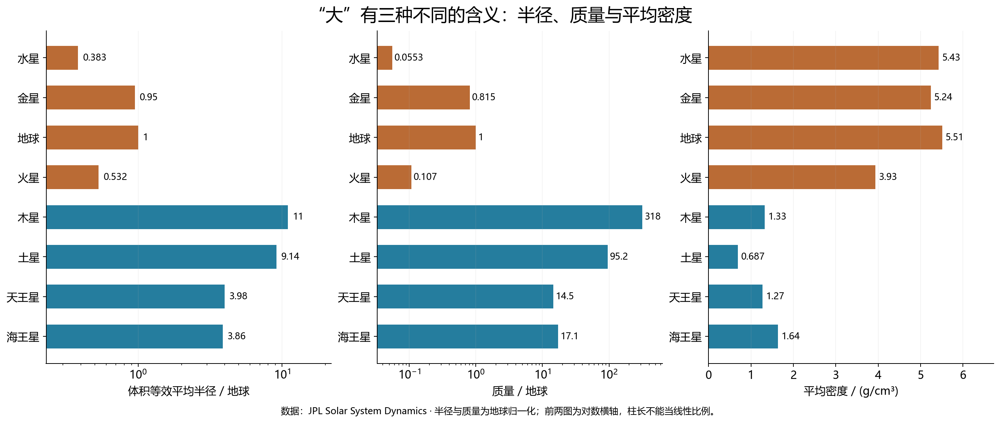
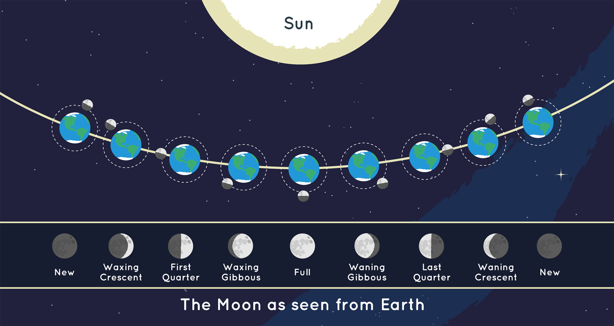
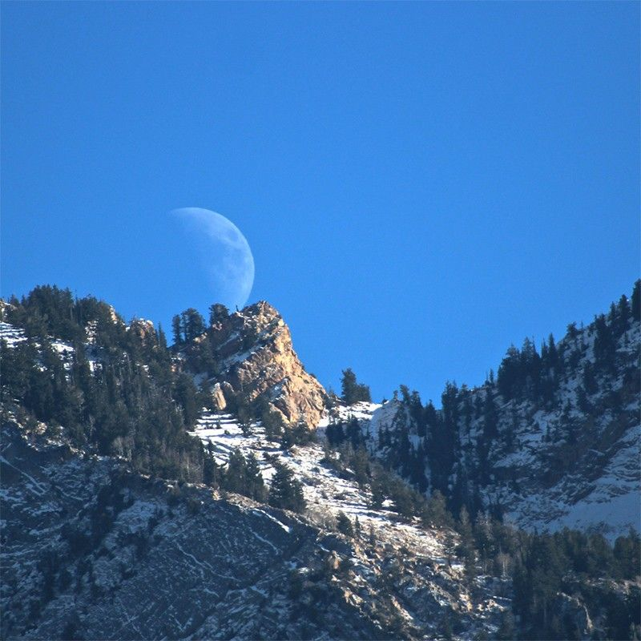
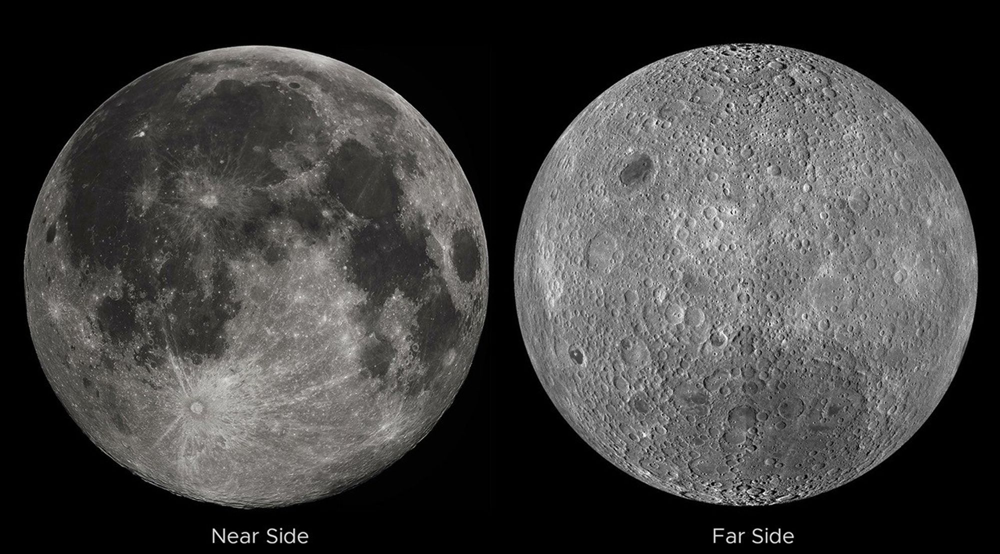

# 第 01—04 篇补充素材（v0.2）

核验日期：2026-10-02。保留 Pro 正文；本轮增补图像及图注。下载记录与失败记录见 `build/qa/v02-first4-downloads.json`、`v02-first4-alternate-downloads.json`。图像解码与实际视觉检查完成；这些是模型检查，人工审校和真实试讲均未进行。

NASA/SVS 的月相动画原页已阅读，但选定文件连接超时：保留[2026 动画入口](https://svs.gsfc.nasa.gov/5587/)，不标记为已下载。

使用规则：[NASA](https://www.nasa.gov/nasa-brand-center/images-and-media/)、[JPL](https://www.jpl.nasa.gov/jpl-image-use-policy/)、[ESO](https://www.eso.org/public/outreach/copyright/)。联合机构或第三方图片按完整署名处理，不能把 NASA 网站上的一切内容都标记为公共领域。

## HL Tau 的盘不是一张行星合照

ALMA 在约 1.28 mm 波段记录的年轻恒星 HL Tau 周围尘埃盘。亮暗环显示盘的结构；不能把每一道暗环直接认作一颗已经确认的行星。红橙色是毫米波数据的显示颜色。

- 原页：[HL Tau 的盘不是一张行星合照](https://www.eso.org/public/images/eso1436a/)
- 署名：ALMA (ESO/NAOJ/NRAO)
- 性质：毫米波观测赋色；1800×1800
- 使用条件：CC BY 4.0；遵循 ESO 版权页、保留完整署名
- SHA256：`e6e6b4c6eaa787b296d6f0256af7b75e3a9a348174a869fffb871a13d5069696`

## 柯克伍德空隙在轨道分布中

横轴为半长轴（AU），纵轴为每 0.005 AU 箱中的小行星数。3∶1 等标记对应与木星的平均运动共振；这是轨道参数分布，不是从上方拍摄的一圈圈空洞。该历史统计图仅 660×510，应以原生尺寸阅读，不用于当前小行星总数统计。

- 原页：[柯克伍德空隙在轨道分布中](https://ssd.jpl.nasa.gov/diagrams/mb_hist.html)
- 署名：Alan Chamberlin (2007), JPL/Caltech
- 性质：观测轨道统计；660×510
- 使用条件：JPL image-use policy；教学信息用途保留署名
- SHA256：`dd8986b2b5b9ebbcd043d12bdc96bf6d514aca83719be2aace3f59419b403731`

## 冥王星的复杂地表

新视野号 LORRI 的四幅影像与 Ralph 色彩数据合成，增强颜色强调地表差别。它揭示了一个有复杂地质的世界，却不能靠地表是否丰富决定“行星”这一动力学分类。

- 原页：[冥王星的复杂地表](https://science.nasa.gov/resource/pluto-dazzles-in-false-color/)
- 署名：NASA/JHUAPL/SwRI
- 性质：多幅可见光观测与增强色合成；1041×720
- 使用条件：NASA 媒体使用规则允许教育/信息性用途；保留署名、不得暗示背书；联合/第三方著作权另行判断
- SHA256：`4302e1bf7c633290d2545c83d9abd000f5ce223e7fa85c11130725d729ef8e9e`

## 八颗行星的半径、质量与密度

三种比较不能混用。前两幅横轴为对数刻度，具体比值看标注；密度横轴为线性刻度。半径采用体积等效平均半径，因此木星体积约为地球的 1321 倍。CSV 与 SVG 已随素材保存，可重新绘制。

- 原页：[八颗行星的半径、质量与密度](https://ssd.jpl.nasa.gov/planets/phys_par.html)
- 署名：课程编辑组（Codex 辅助）；原始数据 JPL Solar System Dynamics
- 性质：真实参数绘图；2720×1152
- 使用条件：课程原创数据图，保留数据来源
- SHA256：`d4d370578ce81d3e6ec35a3ee4087b52fa43aa062caa0023e627046f068e2640`

## 土卫六海面上的变化

卡西尼雷达观测的丽姬亚海，主体图与左侧多时刻局部图显示海面亮斑的变化。暗海面与亮斑反映雷达回波，棕黄色不是肉眼颜色；瞬变亮斑的具体机制仍存在多种解释。

- 原页：[土卫六海面上的变化](https://science.nasa.gov/photojournal/mystery-feature-evolves-in-titans-ligeia-mare/)
- 署名：NASA/JPL-Caltech/ASI/Cornell
- 性质：雷达后向散射赋色与多时刻合成；2000×1496
- 使用条件：NASA 媒体使用规则允许教育/信息性用途；保留署名、不得暗示背书；联合/第三方著作权另行判断
- SHA256：`09c192cdaabdd158497759d0082a90c506ba1993f20a551422cf2f28cc1aa2b3`

## Webb 展开天王星的环

2023 年 2 月 6 日 NIRCam 的 F140M（1.4 μm）与 F300M（3.0 μm）数据分别映射为青色与橙色。环提供理解行星赤道面与空间姿态的线索，但图面上下不能直接定义整个太阳系的顺逆行。

- 原页：[Webb 展开天王星的环](https://science.nasa.gov/asset/webb/uranus-nircam-image/)
- 署名：NASA, ESA, CSA, STScI; Image Processing: Joseph DePasquale (STScI)
- 性质：近红外双滤镜代表色合成；2000×2000
- 使用条件：NASA 媒体使用规则允许教育/信息性用途；保留署名、不得暗示背书；联合/第三方著作权另行判断
- SHA256：`e5f7a1a0e10a6e6c769b40ecbb2f4dd78ea2ada65f2e96efd69c113ea29f52a7`

## 照明半球与可见半球

上方用轨道位置解释照明，下方是地球所见月相；每个地球小图代表不同时间，不是同时存在的多个地球。下方左右亮的约定依赖图像朝向。图中距离和尺寸均未按比例。

- 原页：[照明半球与可见半球](https://science.nasa.gov/moon/moon-phases/)
- 署名：NASA/JPL-Caltech
- 性质：官方几何示意，尺寸距离未按比例；1700×904
- 使用条件：NASA 媒体使用规则允许教育/信息性用途；保留署名、不得暗示背书；联合/第三方著作权另行判断
- SHA256：`68f64b3e71071593ecee3d64a82bdf9a277827683bd0ccf8b2e7c9d1c5b58cd7`

## 下午的月亮并不违反轨道运动

犹他州 Wasatch 山脉上方的盈月。月球在白昼可见，取决于高度、与太阳的角距及天空对比，而不是一个只在夜间开启的发光机制。

- 原页：[下午的月亮并不违反轨道运动](https://science.nasa.gov/moon/moon-phases/)
- 署名：NASA/Bill Dunford
- 性质：可见光实景照片；800×800
- 使用条件：NASA 媒体使用规则允许教育/信息性用途；保留署名、不得暗示背书；联合/第三方著作权另行判断
- SHA256：`959e0f7a6d603d9f3b00df797c20400d927292e9d32786542d1d750600ec9d7d`

## 近地面与远地面都能被太阳照亮

左为近地面，右为远地面；深色月海的分布明显不同。远地面影像来自航天器观测，并不说明地球上能同时看见两面。这里“远”相对于地球，“夜”相对于太阳。

- 原页：[近地面与远地面都能被太阳照亮](https://science.nasa.gov/moon/moon-phases/)
- 署名：NASA LRO / Jatan Mehta
- 性质：LRO 月面数据拼接比较；2000×1109
- 使用条件：NASA 页面明示第三方署名；内部教学引用保留完整署名，第三方再发布授权待核，不能据 NASA 域名声称全部公共领域
- SHA256：`5f9acea27493b7f78988a740b3b325276d6745554f2401fd4f1a504a45fd039f`

## 全食、环食与偏食的圆面

左至右为日全食、日环食、日偏食，三幅照片的曝光及事件不同。环食留下的是太阳光球的一圈，不应把全食期间外部日冕与它混为一谈。此图不作为直接裸眼观察太阳的方法。

- 原页：[全食、环食与偏食的圆面](https://science.nasa.gov/eclipses/types/)
- 署名：左 NASA/MSFC/Joseph Matus；中 NASA/Bill Dunford；右 NASA/Bill Ingalls
- 性质：三幅不同事件的可见光照片并置；1706×570
- 使用条件：NASA 媒体使用规则允许教育/信息性用途；保留署名、不得暗示背书；联合/第三方著作权另行判断
- SHA256：`da97a32aa36fd2b8f3777751c42aad1bc21babc0d57356a50bf93bdb9e2941b8`

## 太阳上的金星剪影

2012 年金星凌日，金星是太阳圆面上方偏右的小黑圆。太阳由 AIA 304 Å（30.4 nm）通道记录并赋红色，不是肉眼可见红太阳；凌日是一个近处天体遮住部分远处光源的几何过程。

- 原页：[太阳上的金星剪影](https://science.nasa.gov/resource/2012-venus-transit/)
- 署名：NASA/SDO, AIA
- 性质：304 Å 极紫外观测赋色；4096×4096
- 使用条件：NASA 媒体使用规则允许教育/信息性用途；保留署名、不得暗示背书；联合/第三方著作权另行判断
- SHA256：`8fca643548d7bf1089e29f351428bf7a92a157588bf5a203a51eaf457e6e099c`

## 不同冲日的火星并不一样大

1995—2007 年七次冲日的地火位置与火星视大小比较。轨道平面位置用于解释距离差别，外圈火星照片展示不同视直径；这不是在太阳系外拍摄的单幅现场照。

- 原页：[不同冲日的火星并不一样大](https://science.nasa.gov/asset/hubble/relative-positions-and-sizes-for-1995-2007-mars-oppositions/)
- 署名：NASA, ESA and Z. Levay (STScI)
- 性质：轨道位置示意与多次 Hubble 照片合成；3000×2315
- 使用条件：NASA 媒体使用规则允许教育/信息性用途；保留署名、不得暗示背书；联合/第三方著作权另行判断
- SHA256：`deb5223f6f7dbc40c9bf3e2bee1f2fd3924d0116c21f835caf9fb7f92fe8c219`
