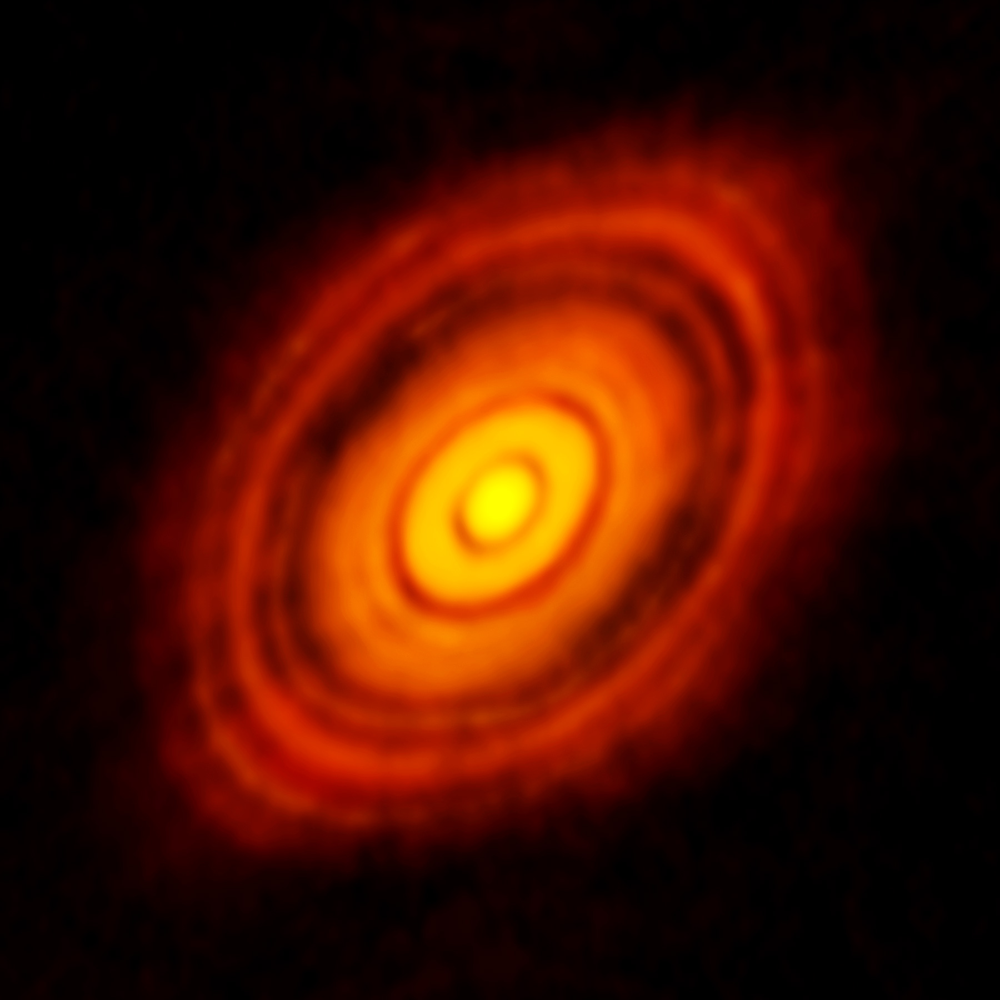
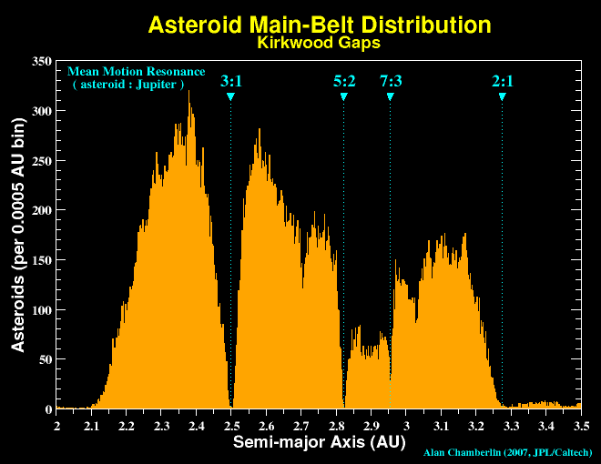
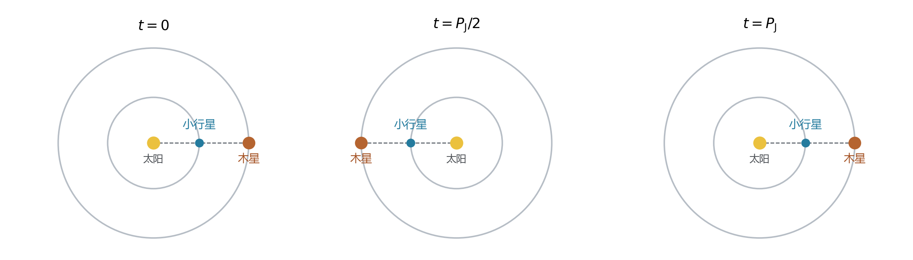
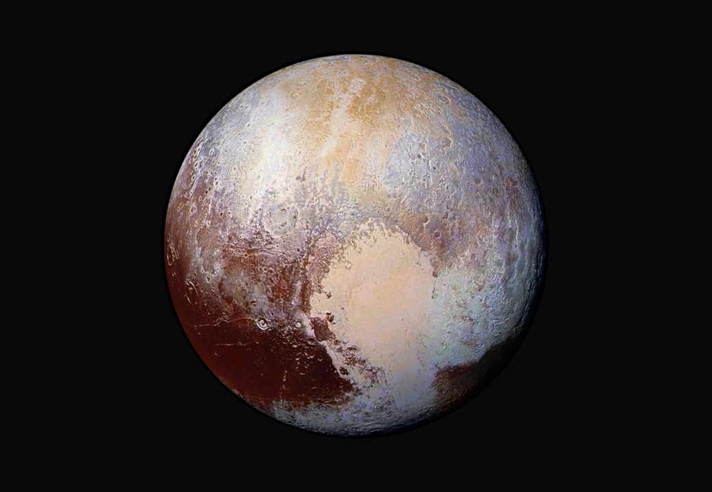

# 01 太阳系的结构与形成

地球附近的太空很空旷。月球已经远在三十八万多千米之外，而从地球轨道走到下一颗行星的轨道，还要跨越更大的距离。把视野继续向外推，四颗较小的岩石行星聚集在太阳附近，从木星开始则展开四颗体积庞大的巨行星；它们之间和更远处，还散布着小行星、彗星与冰质天体。这个系统在尺度、质量和材料上都有鲜明的层次。[1](../../assets/v02-reference/SOURCES-pro-01-04.md#s01)

今日的层次包含了形成过程留下的线索。行星的共同公转方向指向它们曾经共享的旋转环境，内外区域的组成差异与早期温度有关，一些轨道上的聚集和空缺则记录着长期引力作用。要读出这些历史，可以先建立一张有比例、有运动的太阳系地图，再追问哪些过程使物质沿着不同道路演化。

## 一个由太阳主导的引力系统

太阳占据太阳系总质量的约 99.8%，因此它的引力决定了系统中大多数天体运动的基本格局。太阳是一颗恒星，目前主要通过核心中的氢聚变释放能量；地球、金星等行星在可见光中主要反射太阳光，同时也以自身温度向外发出热辐射。月球作为地球的天然卫星，与地球共同组成一个较小的系统，再一起绕太阳运行。恒星、行星、卫星这些名称，分别把天体的物理性质和所在的轨道关系带入了描述。[2](../../assets/v02-reference/SOURCES-pro-01-04.md#s02)[3](../../assets/v02-reference/SOURCES-pro-01-04.md#s03)

引力作用是相互的。地球吸引月球，月球也吸引地球，二者绕共同质心运动；由于地球质量大得多，地月质心位于地球内部。太阳与行星也围绕太阳系质心运动，木星等大质量行星会让太阳的位置产生可测的变化。把太阳作为中心来画行星轨道，是利用太阳质量占优势所作的近似；当计算精密轨道时，每个重要成员的引力都要进入模型。[5](../../assets/v02-reference/SOURCES-pro-01-04.md#s05)

太阳系自身又是银河系的一部分。银河系包含大量恒星、星际气体和尘埃，太阳只是其中一颗恒星。我们在地球上望向天空，太阳系行星与远方恒星会投影到相近方向，但距离可能相差许多个数量级。天球上的位置适合描述看向哪里；建立太阳系结构时，还需要把距离放回来。[6](../../assets/v02-reference/SOURCES-pro-01-04.md#s06)

## 把尺寸和距离放到同一把尺上

取地球平均直径约 12,742 千米，将它缩成直径一厘米的小球。按相同比例，月球直径约为 2.7 毫米，与地球相距约 30 厘米；太阳直径约为 1.09 米，与地球却相隔约 117 米。海王星轨道要延伸到约三点五千米外。地月系统可以摆在书桌上，八颗行星的轨道则铺展到校园乃至城区的尺度。行星之间绝大多数地方，都是远比天体本身辽阔的空旷空间。[7](../../assets/v02-reference/SOURCES-pro-01-04.md#s07)[8](../../assets/v02-reference/SOURCES-pro-01-04.md#s08)

描述轨道时，天文学常用天文单位 AU。1 AU 精确定义为 149,597,870,700 米，大小接近地球轨道的半长轴。半长轴记为 $a$，它是椭圆长轴的一半，衡量整个轨道的大小；地球与太阳的瞬时距离则随位置改变。八颗行星由内向外依次为水星、金星、地球、火星、木星、土星、天王星、海王星，对应的半长轴约为 0.39、0.72、1.00、1.52、5.20、9.58、19.2、30.1 AU。内侧四颗行星的轨道全部落在约 1.5 AU 内，外侧轨道之间的间隔逐渐扩大。[7](../../assets/v02-reference/SOURCES-pro-01-04.md#s07)[8](../../assets/v02-reference/SOURCES-pro-01-04.md#s08)

距离也决定了信息传递的时间。光经过 1 AU 约需 499 秒，即八分十九秒；从太阳到约 30 AU 的轨道尺度，单程约需四个小时。深空探测器发出的信号必须穿过相应距离，地面指令也要经过传播才能抵达。实际通信延迟随地球和探测器的位置变化，任务设计因而需要给远方探测器安排自主执行的步骤。

尺寸图、轨道图和某一日期的天体位置图各有用途。展示球体表面时，图中会放大行星；展示外侧轨道时，内侧轨道容易挤在一起。后面的形成图和轨道图也会采用各自的简化，图中的标尺与几何关系决定了我们能够从中读出什么。

## 从引力走到轨道周期

行星的运动包含两件同时发生的事：它已有的速度使它继续前进，太阳引力使速度方向持续偏转。对近似圆轨道，速度大小可以保持不变，方向却始终在改变。半径为 $r$、速度为 $v$ 的圆周运动需要向心加速度 $v^2/r$；太阳提供的引力加速度为 $GM_\odot/r^2$。令二者相等，得到

$$
\frac{v^2}{r}=\frac{GM_\odot}{r^2},\qquad
v=\sqrt{\frac{GM_\odot}{r}}.
$$

这里 $G$ 是引力常数，$M_\odot$ 是太阳质量。轨道半径越大，圆轨道速度越小。再用一周路程除以速度，便得到周期

$$
P=\frac{2\pi r}{v},\qquad
P^2=\frac{4\pi^2}{GM_\odot}r^3.
$$

在太阳占主导的两体近似中，椭圆轨道也满足同样形式的关系，只需将 $r$ 换成半长轴 $a$。这就是开普勒第三定律。以地球年作为周期单位、AU 作为长度单位，太阳系小质量天体近似满足 $P^2=a^3$。半长轴为 30 AU 时，$P=30^{3/2}$ 年，约为 164 年，与海王星约 165 年的公转周期相近。外侧行星既要走更长的路径，又有更低的平均轨道速度，距离上的扩展于是伴随着时间尺度的迅速增长。[23](../../assets/v02-reference/SOURCES-pro-01-04.md#s23)

椭圆轨道还带来一周之内的快慢变化。天体靠近太阳时运动较快，远离太阳时较慢；太阳位于椭圆的一个焦点。描述一条轨道，半长轴给出大小，偏心率给出偏离圆的程度，倾角给出轨道面相对参照平面的方向。海王星轨道接近圆，一些长周期彗星的轨道则十分细长。它们共享引力规律，却可以在同样的日心距离附近以不同速度和方向经过。

这套动力学语言还能把今日运动与形成历史连起来。若所有天体都独立来自任意方向，它们的轨道方向会很分散；八颗行星却以相同方向绕太阳运行，轨道面也大体接近。这样的共同性，需要一个能够同时解释许多成员的起点。

## 旋转盘给出的共同起点

约四十六亿年前，一片气体与尘埃组成的物质云在引力作用下收缩。云原有的整体转动随收缩变得显著：物质向中心靠近时，角动量使其绕转加快。与此同时，气体和尘埃的碰撞把部分杂乱运动转为热，热又通过辐射散失。垂直于主要旋转平面的运动逐渐减弱，物质形成围绕年轻太阳的盘。大部分质量进入中央恒星，盘中的一部分物质则参与形成行星与小天体。[6](../../assets/v02-reference/SOURCES-pro-01-04.md#s06)

盘保留了系统整体的旋转方向。从盘中增长起来的天体继承了这一运动，因此具有大体一致的公转方向和接近的轨道面。这个共同环境同时容纳了差异：盘的温度、密度和物质流动随位置改变，气体含量又随时间演化。同在一张盘里形成的天体，能取得的固体材料和气体未必相同。

年轻恒星周围的盘可以通过观测研究。ALMA 对金牛座 HL Tau 的毫米波观测显示，尘埃辐射形成了一组明暗相间的环带。它提供了盘状结构和内部不均匀性的直接证据。环隙的成因则要结合波段、尘埃性质、气体运动与动力学模型判断，其中既可能包含行星与盘相互作用的影响，也可能包含尘埃演化的影响。[9](../../assets/v02-reference/SOURCES-pro-01-04.md#s09)

图：ALMA 在约 1.28 mm 波段记录的 HL Tau 尘埃盘。红橙色表示毫米波数据的显示强度，明暗环带呈现盘内结构。署名：ALMA（ESO/NAOJ/NRAO）。[素材出处与使用条件](../../assets/v02-first4-SOURCES.md#V02-L01-hl-tau)。

## 温度、固体原料与行星增长

原行星盘的内侧通常较热，外侧较冷。在能让岩石和金属成为固体、却仍使水等挥发物主要处于气相的区域，固体原料以耐高温材料为主。到了更冷的地方，水冰也能保存，加入颗粒和小天体的组成。某种挥发物可以稳定凝结为冰的温度边界，称为该物质的雪线；水、一氧化碳等物质分别有自己的雪线。盘变冷、恒星照明变化以及盘内物质重新分布，都能使这些边界移动。[10](../../assets/v02-reference/SOURCES-pro-01-04.md#s10)[11](../../assets/v02-reference/SOURCES-pro-01-04.md#s11)

水雪线外多了一种能够参与增长的固体材料，这对行星形成很重要。氢和氦虽然在总质量中占很大比例，却是气体；微小尘粒首先要形成能够进一步吸积的固体结构。较冷区域可利用的冰使固体物质供应增加，为较大核心的形成提供了条件。今天内侧的水星、金星、地球和火星主要由岩石与金属构成，外侧巨行星则保存了大量挥发性成分和气体，这一差异与盘中的材料分配相联系。[1](../../assets/v02-reference/SOURCES-pro-01-04.md#s01)

从尘粒到行星的增长经历了几个物理阶段。小颗粒接触时，表面作用可以让它们结合；颗粒长大后，碰撞也可能使它们反弹或破碎。气体阻力会改变颗粒的运动，让一些颗粒向内漂移，也能与局部聚集共同影响物质的分布。当形成足够大的微行星后，引力成为进一步聚集的重要力量。较大的天体会偏转附近物体的轨迹，提高相遇和吸积的机会；天体之间的碰撞逐步形成行星胚胎。颗粒跨越不同尺寸阶段的效率，仍是行星形成研究的重要问题。[12](../../assets/v02-reference/SOURCES-pro-01-04.md#s12)

在核心吸积图景中，巨行星先形成足够大的固体核心，随后吸引周围氢氦气体。包层能够散热和收缩时，更多气体才有机会进入并留在其中。核心的增长速度、盘中的气体供应及包层的冷却共同决定最终质量。原行星盘的气体会逐渐被恒星吸积、受辐射加热而流失或经其他过程消散，巨行星的成长因此有时间窗口。[12](../../assets/v02-reference/SOURCES-pro-01-04.md#s12)

木星和土星取得了大量氢氦，成为气巨星；天王星和海王星所含较重物质的比例更高，通常归入冰巨星。冰巨星名称保留了形成材料的含义，行星深处的水、氨和其他物质则处于高温高压环境，物态要由当地条件决定。两组巨行星的差异涉及核心形成、气体吸积和盘演化的具体历程，仍有多种模型接受观测检验。[3](../../assets/v02-reference/SOURCES-pro-01-04.md#s03)

增长还会改变轨道。行星与气体盘之间交换角动量，轨道可以向内或向外迁移；行星与小天体之间的引力散射也会重新分配能量和角动量。因而今天的位置同时保留了形成环境和后来迁移的信息。其他恒星周围发现的紧凑行星系统和靠近恒星的气巨星，为这些过程提供了不同于太阳系的检验对象。[13](../../assets/v02-reference/SOURCES-pro-01-04.md#s13)

## 小行星带中的增长与扰动

火星与木星之间的主小行星带，大部分成员分布在约二至三点多 AU 的区域。这里保存着早期小天体，也发生过长期碰撞、破碎和物质流失。轨道相近、光谱性质相关的一些小行星组成家族，可以追溯到共同母体的破碎。谷神星则大到足以在自身引力作用下形成近似球形，探测器还发现了盐和水参与其地质演化的线索。小行星带因此同时保存着较原始材料和已经经历内部演化的世界。[14](../../assets/v02-reference/SOURCES-pro-01-04.md#s14)[16](../../assets/v02-reference/SOURCES-pro-01-04.md#s16)

小天体能否合并长大，与相遇速度有关。速度较低的碰撞有利于合并，较强烈的碰撞则容易造成破碎。木星的引力扰动能够改变附近小天体的偏心率和轨道方向，影响彼此相遇的方式；加上早期行星演化和物质流失，这一区域没有像地球所在区域那样保留一颗大行星。木星的作用还在今天的小行星轨道统计中留下了清楚痕迹。

图：横轴为轨道半长轴，单位 AU；纵轴为每 0.005 AU 区间中的小行星数。3∶1、5∶2 等标记对应与木星的平均运动共振，低谷称为柯克伍德空隙。此图为 2007 年轨道样本的统计。署名：Alan Chamberlin，JPL/Caltech。[素材出处与使用条件](../../assets/v02-first4-SOURCES.md#V02-L01-kirkwood-gaps)。

共振从周期之间的简单整数关系开始。以图中约 2.5 AU 处的 3∶1 共振为例，小行星绕太阳三圈，木星约绕一圈。把两者暂时放在同一平面内，采用匀速圆周运动，并让它们起初位于太阳同侧。半个木星周期后，木星转过半圈，小行星转过一圈半，又来到太阳的同侧方向；再过半个木星周期，两者回到最初的配置。相遇方向在两个位置之间交替，木星的扰动便以重复的几何节奏作用在小行星上。

图：同平面匀速圆轨道中的 3∶1 周期关系，$P_{\mathrm J}$ 为木星公转周期。蓝点为小行星，橙点为木星；轨道半径比按开普勒第三定律取值，天体圆点被放大。[图源与推导](../../assets/rewrite-20261025/01/SOURCES.md#conjunctions)。

对真实的偏心轨道，扰动发生在轨道的哪个阶段，会影响小行星得到或失去多少能量和角动量。周期接近整数比时，这些作用有机会长期相关地累积，改变轨道的形状。某些共振区域可使偏心率增长到与行星轨道相交的程度，随后近距离相遇把小天体散射走。长期统计下来，相应半长轴附近便留下低谷。图中的低谷描述的是轨道参数分布；一颗偏心轨道上的天体仍会穿过一段很宽的实际空间。[15](../../assets/v02-reference/SOURCES-pro-01-04.md#s15)

## 冥王星与受保护的会合位置

共振也能维持稳定的相遇节奏。冥王星与海王星处于 3∶2 平均运动共振：海王星绕太阳三圈，冥王星约绕两圈。冥王星的轨道较偏心，一段时间内日心距离会小于海王星；两者却能长期避免危险的近距离接近。决定这种保护的，是周期关系与轨道相位共同受到约束。[20](../../assets/v02-reference/SOURCES-pro-01-04.md#s20)

一种描述方法是组合两颗天体的位置角。用 $\lambda_P$、$\lambda_N$ 表示冥王星和海王星的平均经度，$\varpi_P$ 表示冥王星近日点的方向，则共振角

$$
\phi=3\lambda_P-2\lambda_N-\varpi_P
$$

围绕 $180^\circ$ 摆动。平均经度是用平均公转速率推进的轨道位置角；在冥王星经过近日点时，$\lambda_P=\varpi_P$。若取摆动中心 $\phi=180^\circ$，就得到 $2(\varpi_P-\lambda_N)=180^\circ$，即海王星与冥王星近日点方向相差约四分之一圈。冥王星最靠近太阳的阶段，海王星恰好远在另一方向。真实共振角在一定范围内变化，近日点相对轨道面的高度也受到长期动力学约束，共同帮助两者保持分离。[共振相位研究](../../assets/rewrite-20261025/01/SOURCES.md#pluto)

因此，一组周期之比对应着一套长期重复的空间关系。小行星带某些共振使轨道逐渐进入不稳定区域，冥王星的共振则把危险的相遇配置避开。研究轨道稳定性，需要同时知道周期、偏心率、倾角以及这些角度如何配合。

图：新视野号 LORRI 的四幅影像与 Ralph 色彩数据合成，增强颜色突出地表材料与地形差异。署名：NASA/JHUAPL/SwRI。[素材出处与使用条件](../../assets/v02-first4-SOURCES.md#V02-L01-pluto-enhanced)。

冥王星还把动力学与天体分类联系起来。国际天文学联合会 2006 年采用的太阳系行星定义要求：绕太阳运行、具有足够质量而形成近似球形，并在轨道邻域中占据动力学主导地位。矮行星满足前两项，尚未在邻域中取得这种主导地位，而且本身不是卫星。冥王星和谷神星因而都属于矮行星。随着海王星外发现越来越多相近成员，这套分类把冥王星放回了一个庞大的外围天体家族之中。[18](../../assets/v02-reference/SOURCES-pro-01-04.md#s18)

## 外围小天体与来到地球的样品

海王星之外，柯伊伯带的主要部分约位于 30—50 AU，包含大量冰质小天体。其成员有不同的偏心率、倾角和共振关系；更远处及更细长的轨道上，还有其他外围天体。冥王星复杂的平原、山脉和冰川说明，外围世界也会经历活跃的地质过程。天体所在区域、轨道关系与内部历史，分别提供它身份的不同方面。[19](../../assets/v02-reference/SOURCES-pro-01-04.md#s19)[20](../../assets/v02-reference/SOURCES-pro-01-04.md#s20)

一些冰质天体进入内太阳系后，太阳加热使挥发物升华，带出尘埃，形成彗发和彗尾。被电离的气体受到太阳风及其磁场影响，形成离子尾；尘埃颗粒同时受太阳引力和辐射压力影响，形成常常弯曲的尘埃尾。彗星沿轨道运动时，太阳照明和释放物质的状态不断变化，原先暗弱的天体便可以展开很大的可见结构。[21](../../assets/v02-reference/SOURCES-pro-01-04.md#s21)

许多长周期彗星的轨道指向更遥远的来源。奥尔特云是依据这些轨道及动力学研究提出的、稀疏而近似球状的小天体储库，尺度可达数千至数万乃至约十万 AU。它的整体结构仍主要依靠间接证据和模型研究。银河系潮汐和经过附近的恒星能够改变这些遥远天体的轨道，使一部分进入可被观测的内太阳系。[22](../../assets/v02-reference/SOURCES-pro-01-04.md#s22)

靠近地球的小颗粒又提供了另一种接触太阳系材料的方式。空间中的颗粒或碎块称为流星体，进入大气后产生的发光现象称为流星，最后到达地面的残留物称为陨石。地球周期性地穿过某些母体留下的碎屑流，就会出现流星雨；近乎平行的运动路径经过透视投影，看起来汇聚到天空中的一个辐射点。能够回收的陨石则进入实验室，其矿物、同位素和年龄为太阳系早期的加热、碰撞与物质演化提供记录。[24](../../assets/v02-reference/SOURCES-pro-01-04.md#s24)

太阳系的外围还存在与物质流动有关的边界。太阳风向外膨胀，与星际介质相互作用，日球层顶标志着相应等离子体环境的转变；遥远小天体是否长期受太阳引力束缚，则取决于太阳、银河系和邻近恒星共同造成的动力学条件。沿着不同物理问题向外追踪，会得到不同的边界尺度。[6](../../assets/v02-reference/SOURCES-pro-01-04.md#s06)[22](../../assets/v02-reference/SOURCES-pro-01-04.md#s22)

从陨石样品到尘埃盘影像，从小行星轨道统计到冥王星的共振相位，太阳系的历史由多种证据共同约束。旋转盘解释主要成员的共同运动，温度和增长时序解释组成差异，引力扰动和碰撞继续重塑轨道与材料。地球就在这些过程之中获得了自己的质量、轨道与初始组成；这些条件随后如何演化为内部结构、大气和表面环境，是比较行星时将要追问的问题。

---

本篇参数、原始图片与基础文献见[科学来源索引](../../assets/v02-reference/SOURCES-pro-01-04.md)和[素材记录](../../assets/v02-first4-SOURCES.md)；共振示意的假设与相位研究见[补充来源](../../assets/rewrite-20261025/01/SOURCES.md)。
