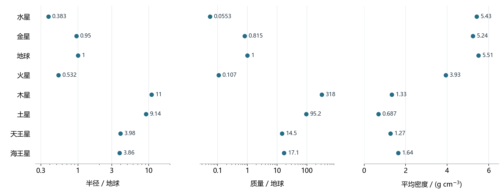
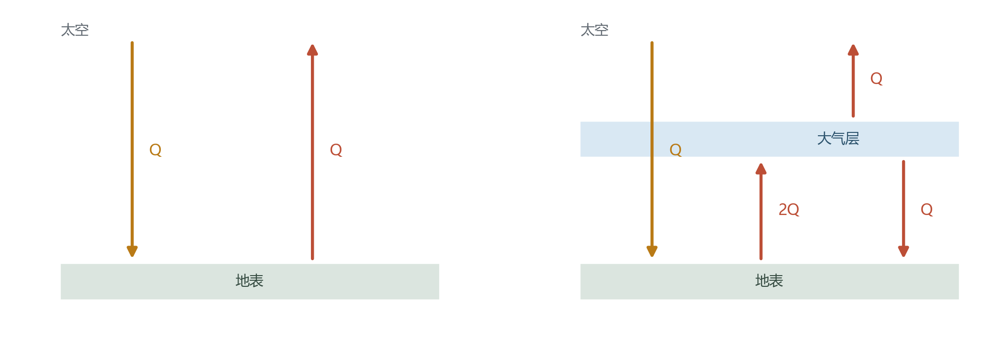
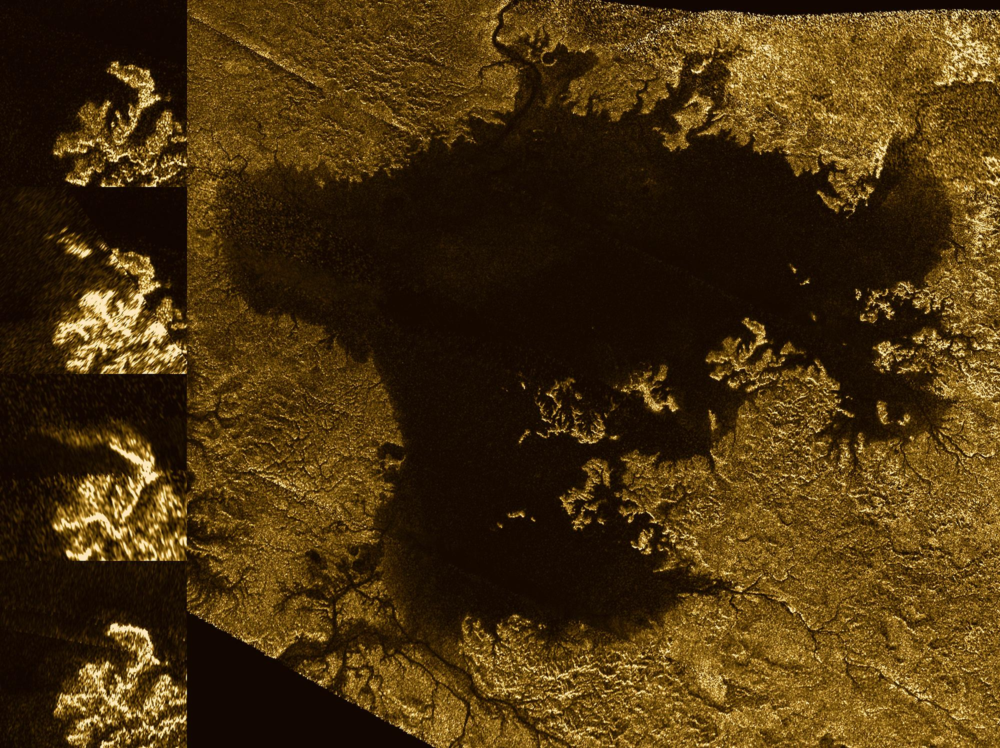

# 02 行星的内部、大气与环境

水星与月球都布满陨坑，水星内部却有比例很大的金属核心。金星和地球的直径相近，表面环境却分别是高温浓密大气与海洋、陆地相互交织的世界。木星的体积超过地球一千倍，平均密度只有地球的约四分之一。行星之间这些可测量的差异，把我们从照片上的颜色和轮廓带到更深的问题：它们由什么组成，内部处于什么状态，这些条件又怎样影响大气和地表？[7](../../assets/v02-reference/SOURCES-pro-01-04.md#s07)[25](../../assets/v02-reference/SOURCES-pro-01-04.md#s25)[27](../../assets/v02-reference/SOURCES-pro-01-04.md#s27)

比较可以从质量与半径开始。八颗行星中，木星的质量与体积最大，水星的质量与体积最小，地球的平均密度最高。质量与半径共同给出平均密度，也决定引力环境；内部热量与太阳照明则推动物质运动。把这些量连起来，行星的参数便能成为解释不同世界的依据。

## 从半径、质量到密度

近似球体的体积为 $V=4\pi R^3/3$。半径扩大两倍，体积扩大八倍；半径扩大十倍，体积扩大一千倍。木星的体积等效平均半径约为地球的 11 倍，因此体积约为地球的 1321 倍。它的质量约为地球的 318 倍，质量增长的比例小于体积增长的比例，平均密度便比地球低。[7](../../assets/v02-reference/SOURCES-pro-01-04.md#s07)

图：半径和质量均以地球为单位，采用对数横轴；平均密度采用线性横轴，单位为 $\mathrm{g\,cm^{-3}}$。半径使用体积等效平均半径。数据：JPL Solar System Dynamics。[参数表](../../assets/shared/v02/planet_parameters.csv)与[图源](../../assets/rewrite-20261025/02/SOURCES.md#planet-properties)。

快速自转的行星会沿赤道方向鼓起，木星和土星的赤道半径与极半径有明显差别。体积等效平均半径，是让一个球与真实行星具有相同体积时所需的半径。用这个 $R_\mathrm{mean}$，平均密度可写为

$$
\bar\rho=\frac{M}{V}
=\frac{M}{\frac43\pi R_\mathrm{mean}^{3}}.
$$

地球平均密度约为 $5.51\ \mathrm{g\,cm^{-3}}$，木星约为 $1.33\ \mathrm{g\,cm^{-3}}$，土星约为 $0.687\ \mathrm{g\,cm^{-3}}$。这些数值比较的是整颗行星中单位体积的平均质量，包含地表、内部各层及压力造成的物质压缩。地球表面常见岩石的密度低于地球平均值，便提示深处存在更致密的材料和状态。[7](../../assets/v02-reference/SOURCES-pro-01-04.md#s07)

密度背后有两项独立测量。半径需要把角大小与距离相联系，质量则由引力造成的运动来确定。观测者首先测量位置、时间、光谱或探测器信号，再通过物理模型得到这些参数。

## 用卫星运动测量行星质量

设一颗小质量卫星绕行星运动，在两体近似中，卫星轨道半长轴为 $a$，周期为 $P$。开普勒第三定律给出

$$
G(M+m)=\frac{4\pi^2a^3}{P^2}.
$$

其中 $M$ 是行星质量，$m$ 是卫星质量，$a$ 指二者相对轨道的半长轴。当 $m\ll M$ 时，可以近似取 $GM\simeq4\pi^2a^3/P^2$。同样大小的轨道，周期越短，就需要越强的中心引力。[5](../../assets/v02-reference/SOURCES-pro-01-04.md#s05)

以木卫一为例，它的轨道半长轴约为 421800 千米，公转周期约为 1.769 日。换成米与秒，$a=4.218\times10^8\ \mathrm m$，$P\simeq1.5284\times10^5\ \mathrm s$。代入得到

$$
GM_\mathrm{J}\simeq1.27\times10^{17}\ \mathrm{m^3\,s^{-2}},\qquad
M_\mathrm{J}\simeq1.90\times10^{27}\ \mathrm{kg},
$$

这里采用 $G\simeq6.6743\times10^{-11}\ \mathrm{m^3\,kg^{-1}\,s^{-2}}$。这个简化计算已经接近木星的实际质量。精密测量还会加入其他卫星的扰动、木星的非球形引力场等因素。[木卫一轨道参数](https://nssdc.gsfc.nasa.gov/planetary/factsheet/joviansatfact.html)

轨道尺度的可靠性尤其重要，因为质量与 $a$ 的三次方成正比。保持周期不变，若采用的 $a$ 增大 10%，推出的质量就乘以 $1.1^3=1.331$，增大约 33%。距离、轨道大小和质量之间会传递测量误差。许多动力学观测能够很精确地确定 $GM$，再借助实验测得的 $G$ 将它换算为质量。

对于水星、金星这样没有天然卫星的行星，探测器轨迹与其他天体的运动扰动同样能提供引力信息。探测器靠近行星时，其速度和方向受到吸引；无线电跟踪可以记录这种变化。轨迹对内部质量分布的细小差异也有响应，于是观测不仅能够给出总质量，还能约束内部结构。[7](../../assets/v02-reference/SOURCES-pro-01-04.md#s07)

## 材料、压力与内部的分层

水星平均密度约为 $5.43\ \mathrm{g\,cm^{-3}}$，与地球十分接近。水星的半径却只有地球的约 0.38 倍，质量约为地球的 0.055 倍。较小的水星仍具有很高密度，表明其金属核心占很大比例。比较地球与水星时，还需要考虑地球更强的自压缩。[25](../../assets/v02-reference/SOURCES-pro-01-04.md#s25)[26](../../assets/v02-reference/SOURCES-pro-01-04.md#s26)

行星内部每一层都承受着外层物质的重量。越向深处，压力总体越高，同种材料会被压得更紧。地球的质量大，自压缩作用比水星强，因此观测到的平均密度同时包含材料组成和高压状态两方面的贡献。研究者使用物质在不同温度、压力下的密度关系，计算去除自压缩影响后的模型密度；这样比较时，水星显示出更富金属的组成特征。

层状结构在早期热演化中逐渐建立。撞击、物质聚集释放的引力能，以及放射性元素衰变，都能加热年轻行星。当物质足够热，能够发生熔融和重新分配时，较致密的金属趋向内部，较轻的硅酸盐材料更多留在外部，这个过程称为分异。金属下沉又释放引力势能，继续参与热量预算。天体的尺寸、形成时机与散热能力共同影响分异的程度。[38](../../assets/v02-reference/SOURCES-pro-01-04.md#s38)

表面也会记录内部活动。熔岩可以覆盖旧地形，构造运动能改造地壳，撞击坑的保存程度则受到后续更新影响。水星与月球的陨坑外观相近，内部金属比例却有明显差别；地球表面受到更广泛的构造、侵蚀和沉积改造。图像展示地表记录，平均密度、磁场和精密引力测量则约束更深处。把这些证据放入同一模型，才能研究看不见的内部。

## 巨行星中的高压物质

木星和土星的主要成分是氢与氦，所以它们可以具有巨大体积和相对较低的平均密度。向木星内部深入，压力和温度上升，氢会经历与外层稀薄气体很不相同的状态，并在深处进入能够导电的金属态区域。外部看到的云带与风暴位于大气中，更深处是连续改变的高压流体环境。[31](../../assets/v02-reference/SOURCES-pro-01-04.md#s31)

这也决定了巨行星半径的报告方法。岩石行星有较明确的固体表面，巨行星则常以约定气压水平作为参考面，例如指定某一大气压力处的半径。这样的约定使不同观测能够比较，也使重力、温度等量拥有清楚的位置含义。

朱诺号对木星引力场的测量提供了内部模型的进一步约束。物质集中在何处，会影响探测器的运动；将轨迹数据与高压物质性质相结合，研究者得到重元素分布较为弥散、核心边界可能模糊的模型。重元素与氢氦的分布还涉及早期形成和后来混合过程，因此引力测量也能帮助研究木星的历史。[32](../../assets/v02-reference/SOURCES-pro-01-04.md#s32)

天王星和海王星的较重物质比例更高，通常称为冰巨星。这里的冰关联水、氨、甲烷等形成材料；这些材料进入行星内部后，物态由高温高压条件决定。两颗行星外层仍含氢和氦，甲烷吸收部分光参与塑造可见颜色。光谱中某种分子的特征强度还取决于吸收效率、波段和大气结构：甲烷或氨可以留下很醒目的特征，而数量占优势的氢氦在可见光中未必同样显眼。[34](../../assets/v02-reference/SOURCES-pro-01-04.md#s34)[35](../../assets/v02-reference/SOURCES-pro-01-04.md#s35)[75](../../assets/v02-reference/SOURCES-pro-01-04.md#s75)

## 引力束缚与大气的去向

质量和半径还共同决定表面的引力环境。对近似球对称的天体，在表面或外部半径 $R$ 处，忽略自转修正，引力加速度为

$$
g=\frac{GM}{R^2}.
$$

木星质量约为地球的 318 倍，半径约为 11 倍，两项合起来给出约 $318/11^2\simeq2.6$ 倍的引力加速度量级。采用具体参考半径和自转等口径时，常见数值约为地球的两倍半。地表附近物体的重量与这个加速度相联系，而物体本身的质量保持不变。[7](../../assets/v02-reference/SOURCES-pro-01-04.md#s07)

离开行星还涉及克服整个引力势阱。一个粒子从半径 $R$ 处出发，在随后只受该天体引力的理想条件下，要到达无限远且最终速度为零，初始动能应满足 $mv^2/2=GMm/R$，因此逃逸速度为

$$
v_\mathrm{esc}=\sqrt{\frac{2GM}{R}}.
$$

这个速度把天体质量、粒子出发位置与束缚强度联系起来。火箭持续推进的运动需要另外计算推力和能量输入；大气粒子则不断发生碰撞，并具有不同的运动速度。

在同一温度下，较轻粒子的典型热运动速度更大；温度升高时，各类粒子的热运动都增强。上层大气逐渐稀薄，部分向外运动且速度足够大的粒子可以逃逸。计算这种损失时，需要的是高层大气的温度和速度分布，以及相应高度的引力束缚。恒星高能辐射、带电粒子相互作用和撞击还会引起其他逃逸过程。[37](../../assets/v02-reference/SOURCES-pro-01-04.md#s37)

大气存量由来源与去向共同决定。火山释放物质，化学反应改变分子种类，凝结和岩石反应把物质储存在表面，逃逸又把一部分带向太空。行星磁场会改变带电粒子的路径及其与大气的相互作用，其效果要放进整套过程判断。金星缺乏地球式的全球内禀磁场，却保有浓厚大气；火星的观测则记录了太阳风与高层大气相互作用造成的损失。[27](../../assets/v02-reference/SOURCES-pro-01-04.md#s27)[30](../../assets/v02-reference/SOURCES-pro-01-04.md#s30)

## 阳光如何变成行星温度

太阳辐射向外传播，单位面积接收的能量随日心距离的平方反比下降。记垂直于阳光的单位面积每秒收到的能量为 $S$，单位为 $\mathrm{W\,m^{-2}}$。在圆轨道近似下，$S\propto a^{-2}$：距太阳变为两倍，太阳辐照度便降为四分之一。金星轨道约为 0.72 AU，所以它接收的辐照度约为地球的 $1/0.72^2\simeq1.93$ 倍；火星约在 1.52 AU，约为地球的 0.43 倍。

行星会反射部分阳光。用邦德反照率 $A$ 表示入射太阳总能量中被反射出去的比例。半径为 $R$ 的球截获阳光的面积是 $\pi R^2$，吸收功率为 $(1-A)S\pi R^2$；向外辐射的表面积是 $4\pi R^2$。先采用均匀温度、热辐射近似黑体、内部热源可忽略的模型，能量平衡给出

$$
(1-A)S\pi R^2=4\pi R^2\sigma T_\mathrm{eq}^{4},\qquad
T_\mathrm{eq}=\left[\frac{(1-A)S}{4\sigma}\right]^{1/4}.
$$

$\sigma$ 是斯特藩—玻尔兹曼常数，$T_\mathrm{eq}$ 用开尔文表示。分母中的 4 来自截光面积与整个球面面积之比。以地球附近 $S\simeq1361\ \mathrm{W\,m^{-2}}$、$A\simeq0.30$ 为例，计算得 $T_\mathrm{eq}\simeq255\ \mathrm K$，约为 $-18\ ^\circ\mathrm C$。它给出在这一吸收量下向太空散热所需的有效温度尺度，实际地表温度还取决于大气中的能量交换。[辐射平衡模型](../../assets/rewrite-20261025/02/SOURCES.md#radiation)

水星缺乏能够大量输送热量的浓厚大气，又有漫长的昼夜，因此白昼地表强烈加热，夜间显著冷却。金星有明亮云层，反射了很大一部分阳光；地表却处于约 460 多摄氏度的高温。要联系反射和地表温度，需要追踪被吸收能量随后怎样离开行星。[25](../../assets/v02-reference/SOURCES-pro-01-04.md#s25)[27](../../assets/v02-reference/SOURCES-pro-01-04.md#s27)

## 大气中的红外辐射交换

太阳温度高，辐射集中在比行星热辐射更短的波长范围；较冷的行星主要以红外辐射散热。大气对两段波长的吸收能力不同。水汽、二氧化碳等气体吸收并发射红外辐射，使地表、不同高度的大气和太空之间发生连续的能量交换。[28](../../assets/v02-reference/SOURCES-pro-01-04.md#s28)

可以用一个单层辐射模型说明这种交换。设大气对已被行星吸收的短波能量透明，对地表红外辐射完全吸收，并以均匀温度向上、向下发射。地表近似黑体，模型只包含辐射传热。记全球平均吸收的太阳功率为 $Q=(1-A)S/4$，地表温度为 $T_s$，大气层温度为 $T_a$。大气向太空发出 $\sigma T_a^4=Q$ 才能使整个系统平衡；同一层向下也发出 $Q$。地表同时收到太阳的 $Q$ 与大气的 $Q$，于是

$$
\sigma T_s^4=2Q,\qquad T_s=2^{1/4}T_a.
$$

地表可以比对外有效辐射的那一层更暖，而向太空排出的总功率仍等于太阳输入。大气增加了地表收到的向下红外辐射，地表升温后增强的向上辐射使各层重新达到能量平衡。[单层模型](../../assets/rewrite-20261025/02/SOURCES.md#one-layer)

图：稳态辐射模型，金色箭头为吸收的太阳辐射，红色箭头为红外辐射；$Q$、$2Q$ 为每单位面积的能量流率。两种模型采用相同的太阳吸收量，右侧大气对短波透明、对红外完全吸收。[图源与模型条件](../../assets/rewrite-20261025/02/SOURCES.md#one-layer)。

真实大气有连续的温度结构，不同波长的光可从不同深度逃向太空，对流和潜热输送也参与能量平衡。金星约九十多倍地球海平面气压的浓厚二氧化碳大气，具有很强的红外吸收；其高温表面与向太空散热的高层大气，通过辐射和大气运动连接。金星的表面温度需要这些垂直结构共同解释。[27](../../assets/v02-reference/SOURCES-pro-01-04.md#s27)

## 水、岩石与大气的长期联系

大气成分也随温度和地质过程演化。地球上的液态水让雨水、河流、海洋与岩石能够持续交换物质。含二氧化碳的雨水参与硅酸盐风化，反应产物经河流进入海洋，一部分碳最终进入碳酸盐沉积物。地质活动使碳在深部与地表之间继续循环，火山释放又把一部分二氧化碳送回大气。[慢碳循环](../../assets/rewrite-20261025/02/SOURCES.md#carbon-cycle)

这条物质循环能够影响长期气候。在液态水、可风化岩石和物质输送足够的条件下，温度上升通常会加快风化，水循环变化也会改变反应和运输效率。更强的长期碳移除可以降低大气二氧化碳，减弱温室效应；较冷环境下，这项移除减弱，持续的地质释放则有利于二氧化碳积累。这是一种负反馈，其作用涉及地质时间尺度，并随大陆分布、岩石供应和内部活动改变。[慢碳循环](../../assets/rewrite-20261025/02/SOURCES.md#carbon-cycle)

水汽还带来另一方向的反馈。温暖环境能够维持更多水汽，水汽增强红外吸收，又能促进升温。强烈加热条件下，更多水进入高层大气，紫外辐射将水分子分解，氢便有机会逃向太空。辐射、云、上层大气输送和逃逸速度共同决定水损失的效率。金星是否曾长期拥有海洋、何时失去大量水，仍是需要观测和模型共同约束的历史问题；高辐照、失水和碳储库变化提供了研究其环境分化的具体机制。[水损失研究](../../assets/rewrite-20261025/02/SOURCES.md#water-loss)

火星展现了较小岩石行星的另一条历程。其质量约为地球的十分之一，今天大气稀薄、表面寒冷，却保存着古老河道、沉积层和水活动相关矿物。MAVEN 的高层大气测量辨认了若干逃逸过程，并研究了太阳活动增强时的损失。由现代观测重建过去，还需要考虑年轻太阳的辐射、火星原有大气、内部补给与地表储存如何随时间改变。[29](../../assets/v02-reference/SOURCES-pro-01-04.md#s29)[30](../../assets/v02-reference/SOURCES-pro-01-04.md#s30)

金星、地球与火星因此形成了一组相互参照的实例。轨道控制接收阳光的量级，质量影响引力束缚与内部热演化，水和岩石参与物质循环，大气又改变地表散热和水的存在状态。一个过程改变之后，还会影响下一个过程的条件，这使几个起初相邻的世界在长期演化中走向明显不同的环境。

## 自转轴决定阳光怎样分配

总能量相同，分配到各纬度和各时段的方式也可以不同。行星自转决定昼夜轮换，自转轴相对轨道面的倾斜决定季节照明。用右手规则，手指沿旋转方向弯曲，拇指所指给出自转角动量方向；公转角动量方向则垂直于轨道面。两者夹角称为轴倾角，小于 $90^\circ$ 时为顺行自转，大于 $90^\circ$ 时为逆行自转。[36](../../assets/v02-reference/SOURCES-pro-01-04.md#s36)

地球轴倾角约为 $23.4^\circ$，金星约为 $177.4^\circ$，天王星约为 $97.8^\circ$。金星的自转轴接近公转角动量的反方向，天王星的自转轴则接近躺在轨道面内。地球绕太阳运行时，南北半球轮流倾向太阳，太阳高度和白昼长度随季节改变。天王星将这种季节差异推向极端，在约 84 个地球年的公转周期中，其极区经历漫长的持续光照或黑暗阶段。[34](../../assets/v02-reference/SOURCES-pro-01-04.md#s34)

图：2023 年 2 月 6 日 NIRCam 的 F140M（1.4 μm）与 F300M（3.0 μm）数据分别映射为青色与橙色。环呈现行星赤道面的空间姿态。署名：NASA、ESA、CSA、STScI；图像处理：Joseph DePasquale（STScI）。[素材出处与使用条件](../../assets/v02-first4-SOURCES.md#V02-L02-uranus-nircam)。

一个固定地点经历的太阳日，还由自转与公转共同决定。金星相对恒星自转一圈约需 243 个地球日，公转约需 225 日；逆行自转与公转配合，给出约 117 日的平均太阳日。水星则处于 3∶2 自旋—轨道共振：绕太阳两圈时相对恒星转过三圈，其恒星自转周期约为 58.6 日，平均太阳日约为 176 日。这样漫长的照明周期会影响地表加热与冷却。[25](../../assets/v02-reference/SOURCES-pro-01-04.md#s25)[36](../../assets/v02-reference/SOURCES-pro-01-04.md#s36)

旋转状态本身也是历史结果。潮汐可以交换自转与轨道角动量，碰撞能改变转轴，金星浓厚大气的热潮汐也参与其自转演化。金星缓慢逆行和天王星巨大轴倾角的来源研究，涉及不同初始条件和演化模型。今天测得的周期与轴向，为这些历史模型提供必须满足的终点条件。[40](../../assets/v02-reference/SOURCES-pro-01-04.md#s40)

## 环与卫星中的另一种环境

巨行星周围还存在许多具有自身环境的世界。四颗巨行星都拥有环系统，土星的环尤其醒目。环由大量颗粒和碎块组成，各自绕行星运动，卫星的引力又会塑造环的结构。行星附近既有稠密大气的流动，也有近乎真空中无数固体颗粒的轨道运动。[33](../../assets/v02-reference/SOURCES-pro-01-04.md#s33)

土卫六拥有浓厚大气，液态甲烷和乙烷参与河流、湖海与降雨循环。在那里的低温条件下，水冰构成坚硬地表材料，熟悉的蒸发、凝结、流动和沉积过程则由不同物质承担。研究其湖岸和河道，可以把地球上认识的物理过程放到另一种温度与材料条件下比较。[41](../../assets/v02-reference/SOURCES-pro-01-04.md#s41)

图：主体图与左侧多时刻局部图显示丽姬亚海中的亮斑变化。亮暗表示雷达回波差异，棕黄色为显示颜色；瞬变亮斑的具体成因仍有多种解释。署名：NASA/JPL-Caltech/ASI/Cornell。[素材出处与使用条件](../../assets/v02-first4-SOURCES.md#V02-L02-titan-radar)。

土卫二的冰粒和气体喷流，则把冰壳下方的材料送到探测器能够测量的位置。对冰卫星而言，潮汐形变与耗散能够提供内部热量，因而遥远、寒冷的表面之下仍可能维持液态水。太阳照明、内部储热与轨道供能在不同天体上各占怎样的比例，是研究这些海洋世界的关键。[42](../../assets/v02-reference/SOURCES-pro-01-04.md#s42)

从木卫一的轨道到木星内部，从水星的密度到金星大气，再到冰卫星内部的液态环境，比较的尺度不断改变，所用的物理关系却相互连接。质量和尺寸约束引力与压力，材料和温度决定物态，能量与物质交换推动环境演化。行星参数之所以值得测得越来越精确，正因为它们会改变我们对这些过程及其历史的理解。

---

原始参数与图片见[科学来源索引](../../assets/v02-reference/SOURCES-pro-01-04.md)及[素材记录](../../assets/v02-first4-SOURCES.md)；辐射模型、碳循环和水损失资料见[补充来源](../../assets/rewrite-20261025/02/SOURCES.md)。
