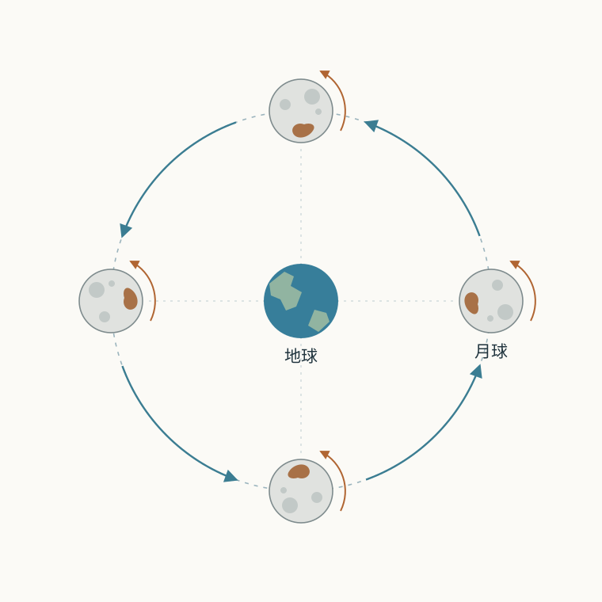
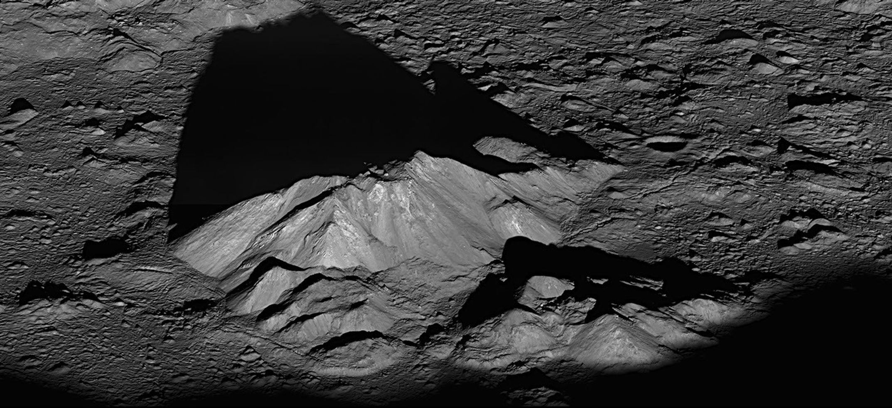

# 03 月亮的形状、转动与时间

连续一个月在日落后寻找月亮，会看到一条清楚的变化顺序：细月先出现在西方低空，随后每天离太阳更远，亮面渐渐展开；半个月左右，圆月在太阳落下时从东方升起。再往后，要等到更晚才见到月亮，清晨的天空逐渐成为观察它的好时段。与此同时，月面上熟悉的深浅斑纹始终大致朝向我们。照明的变化、出现的时段和地貌的朝向，共同记录着月球的运动。

月球离地球平均约 38.4 万千米，直径约 3475 千米，在天空中张开约半度的圆面。这个距离使它成为少数能用肉眼辨认表面结构的天体。深色的月海大多是古老玄武质熔岩铺成的平原，明亮的高地保留着不同的岩石组成和撞击历史；这些地貌也为追踪月球转动提供了标记。我们收到的月光，主要是月面反射的太阳光。月面整体反射率较低，它在夜空中的醒目外观，来自强烈的太阳照明以及暗背景提供的对比。[月球参数](../../assets/v02-reference/SOURCES-pro-01-04.md#s56)[月面与月光](../../assets/v02-reference/SOURCES-pro-01-04.md#s43)

## 受光半球怎样成为天空中的月相

太阳照亮月球朝向它的半球，地球上的观察者看见月球朝向地球的半球。月球沿轨道移动时，这两个半球的重叠部分改变，受光区域便在可见圆面上呈现出不同形状。为了看清主要几何，可以先把月球视为球体，采用平行阳光，并把日月食与微弱的地照放到后面讨论。

当月球在天空中靠近太阳方向时，受光面大多背向地球，可见圆面主要是夜面，这就是朔附近的状态。月球继续向东运行，越来越多的白昼半球进入视野，先形成蛾眉月，再成为上弦月和盈凸月。到达与太阳大致相对的天空方向时，受光半球几乎正对地球，形成望。随后受光部分逐渐退出视野，依次经过亏凸月、下弦月和残月，再回到朔。朔与望分别是天文学所说的新月和满月。[月相几何](../../assets/v02-reference/SOURCES-pro-01-04.md#s44)

<!-- V02-L03-moon-phases -->

*图 1：上方按时间顺序画出日地月的相对位置，下方对应地球所见月相。每组日地月位置代表一个时刻；尺寸和距离为示意比例，亮面在画面上的左右采用图中的固定朝向。Credit: NASA/JPL-Caltech。[素材记录](../../assets/v02-first4-SOURCES.md#V02-L03-moon-phases)。*

月面昼夜交界的曲线叫晨昏线。晨昏线在球面上近似为大圆，从侧面投影后通常成为椭圆的一部分；从恰好侧对阳光的方向观察，它才投影为贯穿圆面的直线，形成半圆形亮面。于是月相的曲边，包含着球体形状和观察角度的信息。

可以用相位角把这种关系写成一个量。相位角 $\alpha$ 是在月球处，指向太阳和指向地球的两条方向之间的夹角。满相对应 $\alpha=0^\circ$，半相对应 $90^\circ$，新相对应 $180^\circ$。球面投影给出的受光圆面面积比例为

$$
k=\frac{1+\cos\alpha}{2}.
$$

这里计量的是照片圆面中亮区所占的面积。晨昏线投影随 $\cos\alpha$ 伸缩：在半相时它穿过圆心，亮区占一半；从半相向满相变化时，椭圆边界逐渐退向夜侧边缘，增加的投影面积与 $\cos\alpha$ 成正比。计算月球的总亮度，还要把月面不同位置反射到观察者方向的光逐一相加，考虑入射角、地形阴影、反射性质与距离。因此，同样的几何面积也可以具有不同的亮度。[受光比例的定义](../../assets/v02-reference/SOURCES-pro-01-04.md#s57)

月面亮侧朝着太阳在天空中的方向。这个关系也能帮助我们辨认月相的空间姿态：月亮经过天空不同位置时，它相对地平线的转角会改变；从南北半球观察，画面方向也会不同。太阳与月球之间的实际方向关系贯穿这些变化。

## 月相与出现时段

月相由太阳、月球和观察者的相对位置决定，这些位置也决定月亮何时出现在天空。地球自转使天空大致每小时向西转过 $15^\circ$。如果月球位于太阳以东约 $90^\circ$，它就会比太阳晚约六小时经过当地子午线。太阳在地方正午经过子午线，上弦月便大致在傍晚经过，此时适合在下午和前半夜观察。满月与太阳大致相隔 $180^\circ$，经过子午线的时刻相隔约十二小时，所以满月在地方午夜附近处于当夜较高的位置。下弦月位于太阳以西约 $90^\circ$，它在清晨经过子午线，后半夜和上午都可能看见。

在低纬至中纬、地平线开阔的通常情形下，这些关系可以概括为：新月大致与太阳同时升落，上弦月接近中午升起、午夜落下，满月接近日落升起、日出落下，下弦月接近午夜升起、中午落下。具体升落时刻由当地纬度、季节和月球当日的方向共同决定；高纬地区的升落规律尤其需要代入实际位置计算。

<!-- V02-L03-daytime-moon -->

*图 2：犹他州 Wasatch 山脉上方的盈月。阳光照亮月面的同时，也照亮地球大气；月面与天空背景之间仍有足够对比时，白昼也能辨认月亮。Credit: NASA/Bill Dunford。[素材记录](../../assets/v02-first4-SOURCES.md#V02-L03-daytime-moon)。*

沿着这组位置关系继续推想，月相与观测时段便可以互相提示。傍晚西方的细月与太阳相距较小，会较早落下；傍晚东方已升高的盈凸月与太阳相距较大，能留在天空更长时间。严格朔附近，朝向地球的主要是月球夜面，月球又紧靠明亮的太阳方向，因此通常难以直接辨认。[月相与可见时段](https://science.nasa.gov/moon/moon-phases/)

在新月前后的细弯旁，有时还能看见其余月面的暗淡轮廓。光在这时沿另一条路径到达我们：太阳照亮地球，地球把一部分光反射到月球夜面，月面再把光反射回来，这就是地照。两次反射使它比月面直接反射的阳光弱得多。此时从月球近地一面看地球，地球正接近满相；地球的角直径约为地球上所见月球的 3.7 倍，投影面积约为 13.5 倍，云层和地表又能反射相当数量的阳光。地球的云量、地表分布及其朝向，使地照强弱随时间变化。[地照](../../assets/v02-reference/SOURCES-pro-01-04.md#s45)

## 恒星月与朔望月

把每晚月亮的位置标在同一张星图上，会看见它相对远处恒星总体向东移动。月球回到近似相同的恒星方向，平均用时 27.32166 日，这个周期称为恒星月。它记录的是月球围绕地球相对近似固定空间方向的公转。

月相恢复还需要太阳方向一同参与。在一个恒星月里，地球已经绕太阳前进约 $27^\circ$，从地球指向太阳的方向也转过了相近角度。月球回到原先的恒星方向后，还要继续前进，才能重新达到与太阳相同的相对方向。由一次朔到下一次朔的平均间隔因此长一些，为 29.53059 日，称为朔望月。[月球轨道与月长](https://eclipse.gsfc.nasa.gov/SEhelp/moonorbit.html)

采用共面、匀速圆周运动来估算，把恒星月记为 $P$，地球恒星年记为 $Y$。月球方向每单位时间转过 $2\pi/P$，太阳方向转过 $2\pi/Y$；月球相对于太阳的方向以两者之差变化。经过一个朔望月 $S$，这个相对角度积累一整圈，因此

$$
\left(\frac{2\pi}{P}-\frac{2\pi}{Y}\right)S=2\pi,
\qquad
\frac1S=\frac1P-\frac1Y.
$$

代入 $P=27.32166$ 日、$Y=365.256$ 日，得 $S\simeq29.53$ 日。恒星月和朔望月使用同一套运动，却分别以恒星方向和太阳方向作为周期完成的条件。真实月球沿椭圆轨道运行，还受到太阳等天体引力的扰动，单次朔望月的长度随之变化；29.53059 日是长期平均值。

月球平均每天相对太阳向东移动 $360^\circ/29.53\simeq12.2^\circ$。地球需要多转一段时间，月球才会再次经过当地子午线。以平均太阳日的 $15^\circ/\mathrm{小时}$ 作为地球追赶的转速，同时计入月球在追赶过程中仍向东移动，可得相邻两次月球上中天平均相隔约 24 小时 50 分。实际月出还取决于月球南北位置和地平线的交角，所以每日月出时间会围绕这种平均趋势变化。夜空中的移动、月相的推进与逐日改变的观测时段，由此接在一起。

## 月面标记追踪的同步自转

月相逐日变化时，雨海、澄海等大片月海仍大致位于圆面的相同区域。以一处面向地球的月海为标记，沿月球轨道追踪它：月球绕地球前进四分之一圈，要使该标记继续朝向地球，整个月球也须相对远处恒星转过四分之一圈。公转完成一圈时，自转恰好完成一圈。这种自转周期与公转周期相等的状态叫同步自转，对月球而言是 1∶1 的自旋—轨道关系。

*图 3：从月球轨道北侧俯视，四个位置表示同一颗月球的相继时刻，褐色区域标记同一处月面地貌。采用圆轨道模型，天体尺寸和距离为示意比例。[绘图说明与来源](../../assets/rewrite-20261025/03/SOURCES.md)。*

这里的自转周期相对于恒星计量，因而约等于 27.3 日。月面一处地点再次迎来正午，则要等待太阳方向在地月共同公转中重新配合，间隔约为 29.5 日。对远离极区且局部地平线开阔的月面地点，白昼和黑夜各持续约两周。近地面与远地面是按朝向地球的关系划分的地理区域，两者都经历这样的照明循环。[同步自转](../../assets/v02-reference/SOURCES-pro-01-04.md#s49)

<!-- V02-L03-moon-near-far-comparison -->

*图 4：左为近地面，右为远地面；LRO 月面数据的拼接图显示两侧月海、高地与陨坑的分布差别。近地面拥有更广阔的深色玄武岩平原。Credit: NASA LRO / Jatan Mehta。[素材记录与第三方使用条件](../../assets/v02-first4-SOURCES.md#V02-L03-moon-near-far-comparison)。*

从月球近地面的大多数地点看，地球会大致停留在天空的同一区域，而地球自转使大陆、海洋和云系轮流朝向月球。太阳则缓慢越过天空。一处地点面对哪个世界、何时见到阳光，在这里分别由同步自转和日地月的相对运动决定。

## 差异引力、形变与潮汐力矩

同步自转的几何清楚了，还需要解释两个周期如何在漫长历史中靠拢。地球施加在月球各处的引力加速度略有差别：近地侧较大，远地侧较小。月球整体随其中心一起绕行，把中心的共同加速度扣除后，近地侧相对中心趋向地球，远地侧相对中心远离地球。侧向区域则有朝向地月轴线的相对分量。这种沿轴拉伸、侧向压缩的差异作用，称为潮汐作用。

设地球质量为 $M$，地月中心距离为 $r$，在月球内部沿地月连线取一段远小于 $r$ 的距离 $x$。由 $g=GM/r^2$ 比较相邻位置，在一阶近似下得到

$$
\Delta g\simeq\frac{2GM}{r^3}x.
$$

这里 $x$ 表示沿轴线偏离月心的距离大小，$\Delta g$ 是该处与月心加速度的差的量级。距离的三次方出现在分母，反映的是引力随位置的变化率。岩石的弹性与内部黏性决定月球在这种作用下产生多大形变、响应有多快，以及每次变形会耗散多少机械能。[潮汐的差异引力](../../assets/v02-reference/SOURCES-pro-01-04.md#s47)

早期月球若自转比公转快，朝向地球的方向便持续扫过月面，月球各处经历周期性的拉伸和压缩。在简化的滞后响应模型中，自转把潮汐形变的长轴带到地月连线前方。地球对这一偏转形变的吸引，会产生使长轴重新朝向地球的力矩，其方向使月球自转减慢。材料反复形变时，内部摩擦把部分机械能转化为热，自转和轨道也交换角动量。持续作用下，自转角速度逐渐接近平均公转角速度。[NASA 对锁定过程的说明](https://science.nasa.gov/moon/tidal-locking/)

对于近圆轨道和接近垂直于轨道面的自转轴，同步状态使地球方向在月面近乎固定，主要的周期形变显著减弱。月球稍微拉长的永久形状还使其长轴朝向地球的姿态受到引力约束；偏离这个方向时，回复力矩使它产生小幅摆动。真实月球的椭圆轨道和倾斜仍会周期性改变引潮作用，岩石的弹性形变因此延续至今。月面反射器随这种形变上下移动，为测量内部弹性提供了依据。[月面形变的测距证据](https://www.jpl.nasa.gov/news/the-apollo-experiment-that-keeps-on-giving/)

月球也以相同的差异引力作用于地球。以随地心自由落体的参照来看，近月侧比地心更受月球吸引，远月侧比地心受到的吸引小，形成沿地月连线的两侧拉伸。太阳也产生潮汐；把质量和距离代入 $M/r^3$ 比较，太阳引潮作用约为月球的 0.46 倍。朔、望附近，日月的主要拉伸轴近乎重合，通常形成潮差较大的大潮；上下弦附近，两者的主要拉伸方向近乎垂直，部分抵消，通常形成潮差较小的小潮。海水在不同海盆中的传播、海岸形状、海底地形与地球自转共同决定当地潮时和潮差，实际潮汐预报需要把这些响应纳入计算。[NOAA：日月位置与潮汐](https://oceanservice.noaa.gov/education/tutorial_tides/tides06_variations.html)

## 天平动展开月面的边缘

同步自转固定了我们所见月面的大致范围，更细的影像序列还会显示月面缓慢向东西、南北摆动。这种天平动使一段时间内从地球累计能够看到的区域达到月球表面的约 59%。新增区域是一圈随着视角改变而逐渐露出的边缘地带。[累计可见范围](https://svs.gsfc.nasa.gov/10836/)

经度天平动主要来自公转与自转的不同节奏。月球沿椭圆轨道经过近地点时，绕地球的角速度较大；经过远地点时，角速度较小。其自身旋转却接近均匀，于是月面朝向与地月连线之间产生周期性差角。在轨道上运行得较快的半段，连线逐渐超前于平均自转朝向，随后在较慢的半段又被赶上。地球因此交替看见月球东西边缘后方的一些地貌。这个差角主要随近地点到近地点的周期变化，约为 27.55 日。[经度天平动可视化](https://svs.gsfc.nasa.gov/5195/)

纬度天平动来自月球赤道面与轨道面的夹角，约为 $6.68^\circ$。月球沿轨道运行时，地球方向有时位于月球赤道面的北侧，有时位于南侧，于是我们轮流略微越过北极和南极观察。地面台站还随着地球自转改变位置，产生较小的视差天平动；月球自转姿态也有真实的小幅振荡。把这几种运动一同纳入模型，就能计算某一天从某地可见的月面边界。[纬度天平动](https://svs.gsfc.nasa.gov/5199/)

探测器进一步改变了观察位置。飞到月球远侧上空后，相机能够拍下地面视线无法抵达的区域，建立全月图。两侧月海与高地的差异由此成为可比较的地质事实，进而约束月球地壳、火山活动和内部热演化的历史。[LROC 远侧拼接影像](../../assets/v02-reference/SOURCES-pro-01-04.md#s54)

## 角动量怎样从地球自转进入月球轨道

地球目前自转一圈只需约一天，远快于月球公转。在平均潮汐模型中，耗散使地球的潮汐形变相对地月连线发生相位偏移；把全球响应合并来看，其引力产生沿月球轨道前进方向的净力矩。月球获得轨道角动量，地球受到相反力矩，自转角动量减小。这里用于表示全球净效应的偏移隆起，需要与各港口实际高潮的位置分别计算。[潮汐力矩](https://farside.ph.utexas.edu/teaching/celestial/Celestialhtml/node54.html)

月球获得角动量后，轨道怎样变化，可以从牛顿引力直接算出。先忽略月球质量相对地球质量的小修正，把地球视为中心质量 $M$，月球质量记为 $m$，并采用半径为 $a$ 的近圆轨道。引力提供向心加速度，给出

$$
\frac{v^2}{a}=\frac{GM}{a^2},\qquad
v=\sqrt{\frac{GM}{a}}.
$$

轨道角动量则为

$$
L_\mathrm{orb}=mav=m\sqrt{GMa}.
$$

它随 $\sqrt a$ 增加。因此，净力矩增加轨道角动量，会推动长期平均轨道半径增大。沿一系列更大的近圆轨道比较，速度按 $a^{-1/2}$ 减小，周期按 $a^{3/2}$ 增长。月球受到向前的微小作用后，在轨道调整中升到更远处；更远的圆轨道所需速度较低。

这个过程的能量收支也能明确写出。圆轨道的动能为 $GMm/(2a)$，势能为 $-GMm/a$，两者相加得到

$$
E_\mathrm{orb}=-\frac{GMm}{2a}.
$$

当 $a$ 增大时，势能增加的幅度超过动能的下降，轨道总能量增加。能量来自地球自转。设传给轨道的平均力矩为 $\tau>0$，地球自转角速度为 $\Omega$，月球平均公转角速度为 $n$。力矩对转动做功的功率等于力矩乘角速度，于是地球自转能以 $\tau\Omega$ 的速率减少，月球轨道能以 $\tau n$ 的速率增加。差额

$$
\dot Q=\tau(\Omega-n)>0
$$

转化为海洋和固体地球中的热。地球旋转较快，交出的能量多于月球轨道得到的能量；角动量的转移与机械能的耗散，在同一过程中同时发生。上述关系是近圆、近共面的平均模型所给出的收支，实际演化计算还包括轨道偏心率、倾斜、太阳作用和随时间改变的潮汐响应。[推导依据与适用范围](../../assets/rewrite-20261025/03/SOURCES.md)

## 用光行时测量月球的远离

月球的轨道变化已经进入直接测量的范围。地面望远镜向月面角锥反射器发出激光脉冲，反射器把一小部分光送回原方向；记录发射与接收的间隔 $\Delta t$，便能测量台站至反射器的距离。最简单的关系为

$$
d\simeq\frac{c\Delta t}{2}.
$$

光速 $c\simeq299\,792\ \mathrm{千米/秒}$，以平均地月距离估算，往返用时约 2.56 秒。精密处理中，台站和反射器的位置、地球自转、月球姿态、大气传播、仪器延迟以及光传播的相对论修正，都要进入计算，才能把一次往返时间接到地月轨道参数上。[激光测距](https://www.nasa.gov/missions/laser-beams-reflected-between-earth-and-moon-boost-science/)

月球沿椭圆轨道的正常距离变化有数万千米，而现在的长期远离速率只有每年约 3.8 厘米。发现这个细小趋势，需要多年数据与完整轨道模型相互配合：先描述月内的周期变化及台站运动，再从长期观测中拟合轨道尺度的缓慢增加。测距还同时约束月球的转动、弹性形变和内部性质。[JPL：长期测距结果](https://www.jpl.nasa.gov/news/the-apollo-experiment-that-keeps-on-giving/)

若沿动力学模型向过去追踪，月球较近、地球自转较快是重要的演化方向。具体距离与年代的对应，还受古海洋分布、海盆共振、固体地球响应和早期轨道状态影响；每年的远离速率随着这些条件改变。更早的月球形成研究，把地月系统的动力学状态与月球样品组成放在一起比较。大碰撞模型描述年轻地球遭受碰撞、物质进入轨道并逐渐聚集成月球的过程；撞击体、碰撞角度和物质混合方式，需要共同满足这些观测约束。[月球形成与证据](../../assets/v02-reference/SOURCES-pro-01-04.md#s53)

## 从月面照明测量地形

月相的几何还可以向较小尺度延伸。晨昏线附近的太阳高度低，山峰和陨坑边缘把长影投到周围地面上；随着当地太阳升高，影子缩短，新的坡面受到照亮。满月附近，近地面许多区域接近正面照明，更适合比较月海和高地的整体明暗分布。月球自转与公转为这些地貌提供了重复变化的照明。[月面观察](../../assets/v02-reference/SOURCES-pro-01-04.md#s58)

*图 5：LRO 窄角相机于 2011 年 6 月 10 日拍摄的第谷环形山中央峰，低角度照明使山峰投下长影。这是探测器近距离斜视图，中央峰复合体横向约 15 千米。Credit: NASA Goddard/Arizona State University。[原页](https://science.nasa.gov/resource/tycho-craters-central-peak-on-the-moon/)；[素材记录](../../assets/v02-batch-D-SOURCES.md)。*

先取局部水平地面、竖直高度 $h$ 与平行阳光作为几何模型。太阳高度角为 $\beta$，地面影长为 $l$，山顶、山脚与影尖构成直角三角形，于是

$$
h=l\tan\beta.
$$

例如影长为 10 千米、太阳高度为 $10^\circ$，所得高度约为 1.76 千米。同一高度在太阳高度 $45^\circ$ 时只投下约 1.76 千米的影子。低角度照明将起伏转成更长的横向尺度，因此更容易在图像中辨认。

要将影长从像素换成千米，还需要观察距离和图像角尺度。对月面中央附近、投影缩短较小的地形，小角关系给出 $l\simeq d\theta$，其中 $\theta$ 用弧度。$1$ 角秒约为 $1/206265$ 弧度，在 384400 千米距离处对应约 1.86 千米。用于实际测高时，还须根据相机位置与月面坐标校正透视投影和局部坡度；图 5 的斜视照片尤其需要这些信息。光行时提供距离，图像提供角长度，照明方向把影长接到高度，几种独立观测便共同确定月面的三维地形。

月球极区的太阳长期贴近地平线，一些深坑底部因此受到持续遮挡，形成永久阴影区，低温有利于水冰保存。这些局部环境同样由太阳方向、月球姿态和地形共同决定。全月图像、轨道测量与光照模型结合后，月相所呈现的照明关系就能进一步用于研究一个具体坑底的环境。[月球水冰与阴影区](../../assets/v02-reference/SOURCES-pro-01-04.md#s55)

---

进一步观看：[NASA 月相循环](https://svs.gsfc.nasa.gov/4310/)；[2026 年月相与天平动可视化](https://svs.gsfc.nasa.gov/5587/)。后者根据轨道和月面数据计算，适合同时追踪亮面、边缘地貌与视直径的变化。科学来源沿用[原来源表](../../assets/v02-reference/SOURCES-pro-01-04.md)，补充推导、图源与查阅记录见[本篇来源](../../assets/rewrite-20261025/03/SOURCES.md)。
