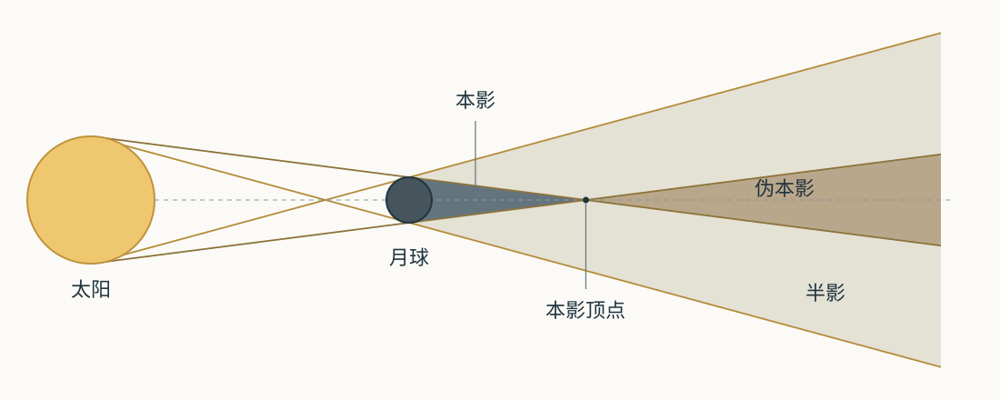
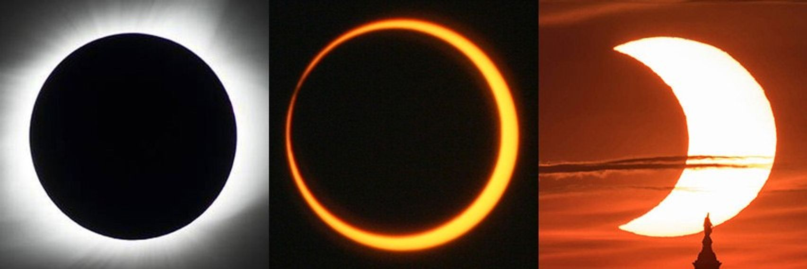
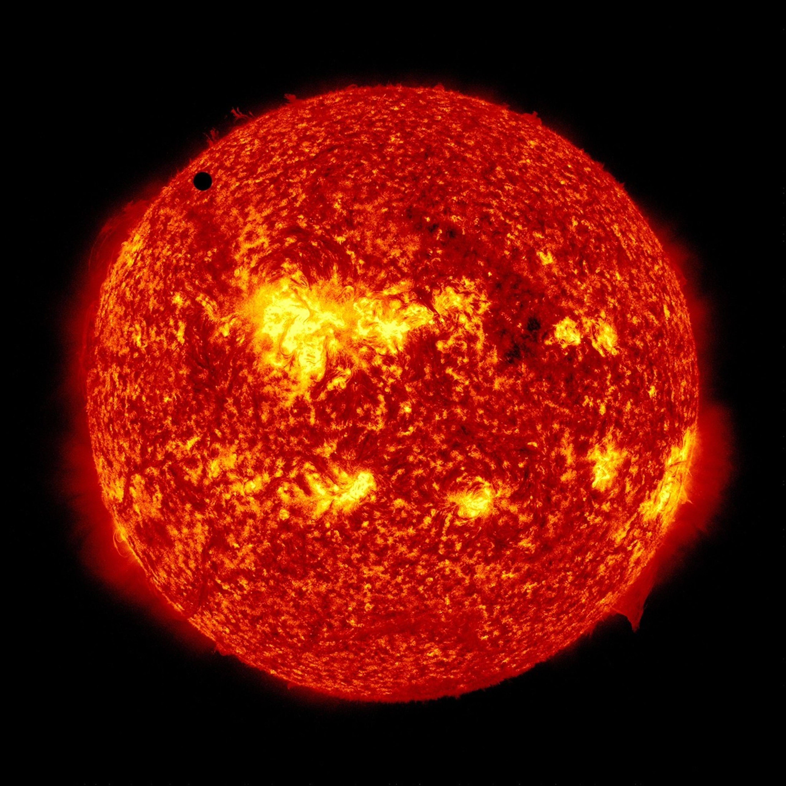
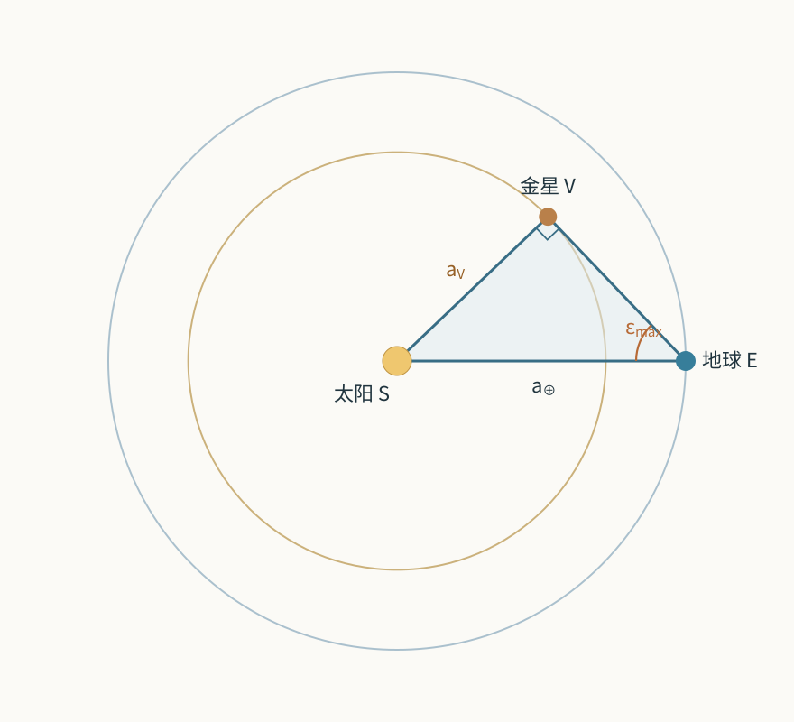
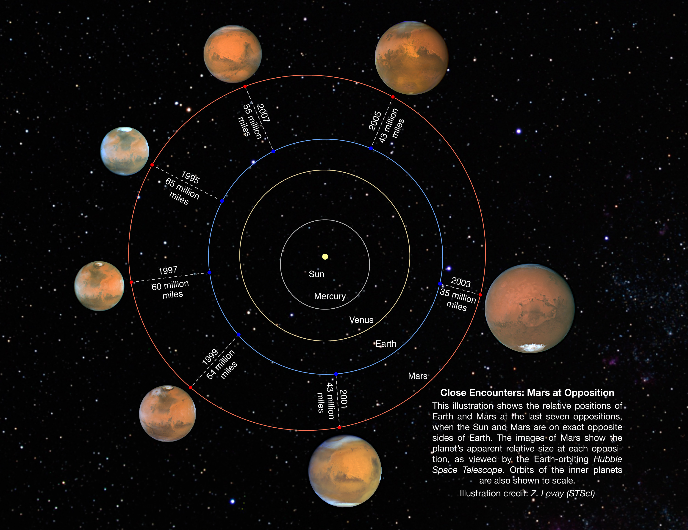

# 04 日月食与行星天象

日全食时，月球的暗圆面恰好盖住太阳，平日淹没在强光中的日冕显露出来。金星凌日时，太阳上只有一个缓慢移动的小黑点。到了火星冲日前后，火星整夜可见，相对恒星的移动还会暂时转向。将这些现象放回轨道中，差别来自天体的大小和距离、太阳的照明方向，以及地球这个移动着的观察位置。

从地球看见的首先是方向和角大小。轨道给出天体在空间中的位置，光线把这些位置转换成天空中的圆面、阴影和亮暗变化。沿这条关系展开，日月食的影锥、金星的相位与火星的视运动可以在同一组几何工具中得到解释；遥远行星的大小，也能由一次遮挡留下的光变测出。

## 角大小把尺寸与距离联系起来

设一个天体的实际直径为 $D$，到观察者的距离为 $d$。当 $D\ll d$ 时，角直径以弧度表示，满足

$$
\theta\simeq\frac{D}{d}.
$$

一弧度约为 $57.3^\circ$。太阳的直径约为 139 万千米，平均日地距离约为 1.50 亿千米，两者相除，得到约 $0.0093$ 弧度，即 $0.53^\circ$。月球直径约 3475 千米，平均距离约 384400 千米，同样得到约 $0.52^\circ$。太阳大约比月球大四百倍，也远约四百倍，所以两者在地球天空中的圆面十分接近。[太阳与月球参数](../../assets/v02-reference/SOURCES-pro-01-04.md#s02)[月球参数](../../assets/v02-reference/SOURCES-pro-01-04.md#s56)

月球沿椭圆轨道运行，地月距离在近地点和远地点之间改变，角直径也随之改变。用代表性的近地点距离 36.34 万千米和远地点距离 40.55 万千米计算，角直径约从 $0.55^\circ$ 变到 $0.49^\circ$。太阳角直径也随着日地距离略有变化。这几百分之一度的差别，足以决定两个圆面中心靠近时，太阳能否被全部遮住。[月球轨道](https://eclipse.gsfc.nasa.gov/SEhelp/moonorbit.html)

## 有限光源形成的影锥

先让月球运行到太阳与地球之间，并考察月球背向太阳的一侧。太阳圆面的上缘和下缘分别发出光线。连接太阳与月球两者同侧边缘的光线，向后延伸后会合，围出收窄的本影锥；在锥内观察，月球遮住整个太阳圆面。连接两者异侧边缘的光线，则围出向后扩展的半影外边界。本影之外、半影范围之内的位置，仍能收到太阳圆面一部分区域发来的光。

*图 1：通过太阳和月球中心的影锥截面，边界由太阳边缘发出的光线构成。尺寸和距离为教学示意比例，边界光线采用小角近似。[绘图与几何说明](../../assets/rewrite-20261025/04/SOURCES.md)。*

地面位于月球本影中的观察者看到日全食，位于半影中的观察者看到日偏食。当本影锥顶点落在地表之前，继续向后的中央区域里，月球的角圆面小于太阳，中心对准时仍留有一圈光球，这便是日环食。该中央区域称为伪本影，也称反本影。[食型与影区](../../assets/v02-reference/SOURCES-pro-01-04.md#s60)

影锥长度可以由相似三角形估算。设太阳半径为 $R_\odot$，遮挡天体半径为 $R$，两者中心距离为 $D$，遮挡天体中心至本影顶点的长度为 $L$。在小角几何下，

$$
\frac{R_\odot-R}{D}\simeq\frac{R}{L},
\qquad
L\simeq\frac{RD}{R_\odot-R}.
$$

代入月球半径约 1737 千米、太阳半径约 696000 千米，以及接近 1.50 亿千米的日月距离，得到月球本影长度约 37 万千米。它与地月距离恰好在同一量级，因此月球轨道中的远近变化、地球表面朝向月球一侧距月球更近的几何效应，都会显著改变本影能否到达观察地点。

地球表面有曲率，同一次中央日食的路径上，各处到月球的距离略有差别。当影锥顶点恰好落在这一距离范围内，同次日食可以在路径中段呈现全食，在其他部分呈现环食，这称为全环食或混合食。影区随着月球运动和地球自转扫过地面，形成食带。日全食带的狭窄，正是本影锥与地表相交面积较小的结果。

<!-- V02-L04-eclipse-types -->

*图 2：左至右分别为日全食、日环食和日偏食，来自不同事件与曝光。全食图外侧的弥散光来自日冕；环食图保留的亮环属于太阳光球。Credit: 左 NASA/MSFC/Joseph Matus；中 NASA/Bill Dunford；右 NASA/Bill Ingalls。[素材记录](../../assets/v02-first4-SOURCES.md#V02-L04-eclipse-types)。*

## 月球穿过地球的影子

把顺序换成太阳、地球、月球，地球就在背向太阳的方向形成影锥。月球在满月附近进入该影区，受到的照明发生变化。整个月面进入本影时发生月全食，部分月面进入本影时发生月偏食，只经过半影时发生半影月食；半影中的月面仍收到部分太阳直射光，亮度下降往往较缓和。[月食类型](https://science.nasa.gov/moon/eclipses/)

利用前面的相似三角形，还可以计算地球本影在月球距离处的宽度。设日地距离为 $D$，地球半径为 $R_\oplus$，月球距地心为 $r$，该处本影半径近似为

$$
R_\mathrm{u}(r)\simeq R_\oplus-r\frac{R_\odot-R_\oplus}{D}.
$$

取 $R_\oplus\simeq6371$ 千米、$r\simeq384400$ 千米，可得 $R_\mathrm{u}\simeq4600$ 千米。本影直径约为 9200 千米，是月球直径的 2.6 倍左右。月球能够整个进入这一影区，并在其中运行一段时间。这里以无大气的几何边界估算，实际月食分析会进一步处理地球大气对影区边缘的影响。

月食发生在月球所在地。地球上各地的观察者只要能看到月球，就能看到其照明的变化，因此月食可由广大的夜半球区域共同观看。日全食则取决于观察者是否恰好落在月球本影内。从月全食中的月面抬头看去，地球占据比太阳大得多的角圆面，挡在太阳前方；从地球回看，便是熟悉的满月渐渐变暗。

地球大气给这个几何影子加入了颜色。一部分阳光擦过地球边缘，沿长路径穿过大气，再经折射进入几何本影。较短波长的光较容易被散射出原方向，能继续到达月面的光常偏红，月面再将它反射回来。云、气溶胶和火山喷发物改变这些光路的透过率，使不同月全食呈现从较亮铜红到十分暗淡的多种外观。日出日落时发红的太阳光，与月全食中的红色月面，共享了长程大气传播的物理原因。[月食中的大气光路](../../assets/v02-reference/SOURCES-pro-01-04.md#s59)

## 轨道交点安排食季

前面的影锥描述了遮挡条件，月球轨道决定它什么时候满足这些条件。月球轨道面与地球绕太阳的轨道面——黄道面——相交，夹角约为 $5.1^\circ$。月球每月经过太阳附近的方向时，通常还位于黄道面的上方或下方；经过满月位置时，也会从地球本影上方或下方通过。轨道倾角对应的最大偏离，约为太阳角直径的十倍。

两个轨道面的交线在月球轨道上给出两个交点。月球从黄道面南侧越到北侧的是升交点，从北侧越到南侧的是降交点。朔发生在交点附近时，月球的影子才可能落到地球上；望发生在交点附近时，月球才可能穿过地球影区。这里有两项同时变化的条件：月球必须到达合适月相，太阳方向也要接近交点线。

地球绕太阳运动，使太阳的地心方向一年沿黄道走过一圈。当太阳方向靠近任一交点时，会出现一段适合发生食的时期，称为食季。日食发生的几何容许范围对应约一个多月的窗口；在这个窗口里，至少会经历一次朔。交点线又受到太阳引力扰动而缓慢向西转动，使相邻食季中心平均相隔约 173.3 日。要预报某地能否看到食，还需继续计算影区何时与该地相交。[NASA：食季与交点](https://eclipse.gsfc.nasa.gov/SEsaros/SEperiodicity.html)

食的近似重现需要月相、交点位置和地月距离再次配合。朔望月约为 29.53059 日，描述月相；交点月约为 27.21222 日，描述月球返回同一轨道交点；近点月约为 27.55455 日，描述月球返回近地点。三种周期存在近似整数关系：

$$
223\,P_\mathrm{朔望}\simeq242\,P_\mathrm{交点}\simeq239\,P_\mathrm{近点}
\simeq6585.3\ \mathrm{日}.
$$

经过约十八年十一天又八小时，月球再次以相近月相、相近交点和相近距离参与遮挡，形成沙罗周期。多出的约八小时使地球在相近几何重现时又多自转约 $120^\circ$，所以相邻成员的日食带会移到不同经度。三个周期的配合还有少量误差，食带纬度和食型也会随着系列逐次演变。沙罗周期由几个运动的近似重合产生，它同时解释了相似性与逐渐积累的差别。[沙罗周期](../../assets/v02-reference/SOURCES-pro-01-04.md#s62)

## 内行星的凌日

将遮挡太阳的天体换成水星或金星，光路仍由太阳、行星和地球构成。水星和金星的轨道都位于地球轨道以内，在下合附近来到太阳与地球之间。此时它们离地球远得多，角圆面只占太阳圆面的一小部分，经过太阳前方时表现为缓慢移动的小黑点，这种现象称为凌日。

下合与轨道交点同样要配合。只有下合发生在相应交点附近，行星的投影轨迹才穿过太阳圆面。金星轨道与黄道约有 $3.4^\circ$ 的夹角，使这样的相交机会十分稀少。2004 年和 2012 年的金星凌日相隔八年，是因为地球运行八圈的时间，接近金星运行十三圈的时间：$8\times365.256$ 日与 $13\times224.701$ 日只相差约 0.94 日。几何关系在八年后接近复现，残余误差又会逐次积累，因而这种短间隔常出现在一对事件中，之后相隔上百年才进入下一组。[金星凌日目录](https://eclipse.gsfc.nasa.gov/transit/catalog/VenusCatalog.html)

<!-- V02-L04-venus-transit -->

*图 3：2012 年金星凌日，金星是太阳圆面左上方的小黑圆。SDO 的 AIA 在 304 Å（30.4 nm）极紫外通道记录太阳，图中红橙色为该通道的显示赋色。Credit: NASA/SDO, AIA。[素材记录](../../assets/v02-first4-SOURCES.md#V02-L04-venus-transit)。*

从地球出发，水星和金星都能到达太阳前方；从更外侧的行星出发，则能看到其他内侧行星的凌日。可见的遮挡对象随观察位置改变，判断时只需依次检查轨道是否允许前后排列、角圆面是否相交。

## 最大距角与金星的相位

凌日揭示的是内行星最靠近太阳视方向时的一种排列。内行星在其他位置时，与太阳最多能分开多远，可以用一条切线求出。

把太阳记为 $S$，地球记为 $E$，内行星记为 $V$。在共面圆轨道模型中，地球位于内行星轨道之外。将视线从 $ES$ 的方向向一侧转开，只要它仍与内行星轨道相交，就有行星位置落在这条视线上；转到刚好与轨道相切时，太阳与行星的角距离达到最大。半径 $SV$ 垂直于切线 $EV$，因此三角形 $SEV$ 在 $V$ 点为直角。

*图 4：从轨道北侧俯视共面圆轨道。外圆半径为 1 AU，内圆半径为 0.723 AU，轨道半径按此比例绘制。$EV$ 与金星轨道相切，所以 $SV\perp EV$；$\epsilon_{\max}$ 标在地球处，比较指向太阳与金星的两条视线。天体符号尺寸放大。[绘图与计算](../../assets/rewrite-20261025/04/SOURCES.md)。*

地球处的角就是最大距角 $\epsilon_{\max}$，其对边是内行星轨道半径 $a_V$，斜边是地球轨道半径 $a_\oplus$，故

$$
\sin\epsilon_{\max}=\frac{a_V}{a_\oplus}.
$$

金星的轨道尺度约为 0.723 AU，圆轨道模型给出 $\epsilon_{\max}\simeq46.3^\circ$。水星取约 0.387 AU，得到约 $22.8^\circ$。真实轨道具有偏心率和倾斜，尤其水星距离变化较大，各次最大距角也随之变化。这一几何范围使内行星主要出现在晨昏天空：位于太阳以东时，日落后仍在地平线上方；位于太阳以西时，则在日出前升起。金星的晨星与昏星阶段因此随相对轨道位置交替。[轨道参数](../../assets/v02-reference/SOURCES-pro-01-04.md#s36)

同一个切线三角形还给出相位。在行星处，相位角是指向太阳的 $VS$ 与指向地球的 $VE$ 之间的夹角；在最大距角处，它等于 $90^\circ$，所以圆轨道模型预言此时金星约呈半相。从下合附近走向最大距角，金星的受光部分由细弯扩展到半圆；再向上合附近运行，亮面继续变丰满，金星也来到太阳另一侧，距地球更远。

因此，望远镜中金星的相位与视直径一起变化。下合附近它离地球近，圆面大，受光部分细；上合附近它离地球远，圆面小，受光比例接近一。若用圆轨道的近侧与远侧距离估算，两种距离分别约为 $1-0.723=0.277$ AU 和 $1+0.723=1.723$ AU，视直径的极限比约为 6.2。实际可观测范围还受太阳邻近方向的强光影响：上合附近的金星与太阳角距很小，严格共线时则位于太阳后方。[金星相位与历史图版](../../assets/v02-reference/SOURCES-pro-01-04.md#s66)

亮度同时受照明强度、距地球远近和相位反射规律影响。接近下合时距离较近，但亮区非常细；接近上合时受光比例较大，却离地球远。二者相乘后，最大亮度可以出现在较宽的弯月阶段。最大距角给出最远离太阳的视方向，亮度峰值则由反射光通量决定，两个条件分别对应不同的计算。[明亮弯月的观测实例](../../assets/v02-reference/SOURCES-pro-01-04.md#s67)

伽利略从 1610 年开始记录金星的相位，看到亮面从弯月经过半相而继续变丰满，并伴随视大小变化。这组现象要求金星能够到达太阳另一侧，与绕太阳运行的几何关系相符。经典托勒密体系把金星配置在地球与太阳之间，给出的相位范围与这组观测不符；哥白尼体系和让金星绕太阳、太阳再绕地球的第谷体系，都能安排出相应相位。金星观测因而具体约束了金星相对太阳的位置，进一步区分整个太阳系模型还需要其他证据。[Museo Galileo：金星相位](https://catalogue.museogalileo.it/indepth/PhasesVenus.html)

## 外行星的冲与会合周期 {#L04-C06}

地球位于火星轨道以内，因此能够运行到太阳与火星之间。此时从地球看，火星与太阳的方向接近相反，称为冲。冲日前后，火星大致在日落时升起、地方午夜附近经过子午线、日出时落下，整夜适合持续观察。地球与火星的距离通常也较近，火星视直径较大。[火星冲日](https://science.nasa.gov/asset/hubble/mars-oppositions-2016-and-2018/)

从一次冲到下一次冲，地球必须相对火星多转一圈。地球恒星公转周期为 $P_\oplus$，火星为 $P_M$，按平均圆周运动计算，会合周期 $S$ 满足

$$
\left(\frac{2\pi}{P_\oplus}-\frac{2\pi}{P_M}\right)S=2\pi,
\qquad
\frac1S=\frac1{P_\oplus}-\frac1{P_M}.
$$

代入 $P_\oplus=365.256$ 日、$P_M=686.98$ 日，得到约 780 日，即约二十六个月。月球的朔望月也由两种角速度之差得到；这里比较的是地球与火星的日心转动，周期完成的条件是重新形成相同的日地火相对方向。

<!-- V02-L04-mars-oppositions -->

*图 5：1995—2007 年七次冲日的地火轨道位置与火星影像。轨道图中的连线标出不同地火距离，外围照片按相同角尺度展示视直径差别。Credit: NASA, ESA and Z. Levay (STScI)。[素材记录](../../assets/v02-first4-SOURCES.md#V02-L04-mars-oppositions)。*

火星轨道的偏心率使它到太阳的距离随位置改变。若冲发生在火星接近近日点的时候，地火距离较小，火星可呈现较大的圆面；在轨道另一段发生的冲，距离可能大得多。冲日由天球方向关系定义，最近距离由地火距离达到极小值定义。真实椭圆轨道中，径向距离也在变化，两者的时刻通常相隔几天。图 5 中每次冲的视大小差别，正显示出这种轨道位置的影响。[不同冲日的距离与视大小](../../assets/v02-reference/SOURCES-pro-01-04.md#s69)

将角大小换成统一单位，还能估算观测需要的分辨能力。有利冲日时火星直径约二十多角秒，月球约半度，即约 1800 角秒。望远镜要把火星表面细节展开，需要在远小于月球圆面的角尺度上形成清晰图像。前面用于判断日食类型的 $D/d$，在这里转化为观测设备所面对的尺度要求。[火星角尺度](../../assets/v02-reference/SOURCES-pro-01-04.md#s70)

## 地球追越火星时的视逆行

连续几周把火星位置标在背景恒星之间，会看到它通常向东移动，在冲日前后暂时向西移动，之后又恢复向东。这个向西的区段称为视逆行。轨道倾斜还会加入南北位移，使连续位置图呈现弯曲甚至回环。

地球到火星的视线由两者的位置之差决定。写成向量，

$$
\boldsymbol r_\mathrm{视线}
=\boldsymbol r_M-\boldsymbol r_\oplus.
$$

火星改变位置，视线随之改变；地球改变位置，同样会转动这条视线。在冲附近，地球和火星位于太阳同一侧，两者切向速度大致平行。地球在内侧轨道运动较快，从地球看去，火星相对于自己产生向后的横向位移，投影到恒星背景上便表现为向西移动。

这一方向还能定量检查。在圆轨道模型中，冲的瞬间把太阳到地球、火星的方向取为 $x$ 轴正向，两颗行星都沿 $y$ 轴正向运动。地心火星距离为 $a_M-a_\oplus$，其横向相对速度为 $v_M-v_\oplus$，因此视线角速度为

$$
\dot\lambda_\mathrm{冲}
=\frac{v_M-v_\oplus}{a_M-a_\oplus}<0.
$$

引力圆轨道速度 $v=\sqrt{GM_\odot/a}$ 随轨道半径增大而减小，所以 $v_M<v_\oplus$，负号对应向西的视运动。代入地球约 29.8 千米/秒、火星约 24.1 千米/秒，以及约 0.524 AU 的距离差，可得约 $-0.36^\circ/\mathrm{日}$ 的量级。远离冲的位置时，两者速度在视线垂直方向上的投影改变，地球追越造成的向西分量减弱，火星恢复通常的向东视运动。整个过程由观察者和目标共同的轨道运动产生。[轨道规律与本节推导](../../assets/rewrite-20261025/04/SOURCES.md)

## 从凌日的黑点到凌星的光变

太阳系内的凌日可以分辨出行星剪影。研究遥远恒星时，通常只能测到整个恒星圆面的总光：行星进入前方，通量下降；行星离开，通量恢复。把通量随时间画成曲线，就得到凌星光变。重复的凌星给出轨道周期，下降的深度与持续时间则携带行星大小和通过路径的信息。[凌星测量](https://avanderburg.github.io/tutorial/tutorial.html)

先假定恒星圆面亮度均匀，行星不透光且完全进入恒星投影圆面，观测孔径中只含这颗恒星的光。恒星原通量 $F$ 与其圆面面积 $\pi R_*^2$ 成正比，被挡住的通量 $\Delta F$ 与行星截面积 $\pi R_p^2$ 成正比，所以相对深度为

$$
\delta=\frac{\Delta F}{F}
\simeq\left(\frac{R_p}{R_*}\right)^2,
\qquad
R_p\simeq R_*\sqrt{\delta}.
$$

半径比为 0.1 时，通量下降约 1%；半径比为 0.01 时，下降约万分之一。地球半径与太阳半径之比约为 0.0092，对应约 0.0084%、即百万分之 84 的下降。因而类地大小的行星需要极稳定的测光，而行星绝对半径还依赖对恒星半径的测量。

真实恒星从圆面中心到边缘的表面亮度通常逐渐减弱，这叫临边昏暗。行星遮住不同区域时，每单位面积挡去的光会变化，曲线底部因此带有形状。行星刚进入和即将离开的阶段，重叠面积逐渐变化，形成两侧斜坡；较靠近恒星边缘的路径较短，凌星持续时间也较短。将临边昏暗、半径比和通过路径一起拟合，可以把光变中的各项形状接到几何参数上。[光变模型](../../assets/v02-reference/SOURCES-pro-01-04.md#s74)

若给定恒星质量 $M_*$，周期 $P$ 还能通过开普勒关系确定轨道尺度。在行星质量远小于恒星质量时，

$$
a^3\simeq\frac{GM_*P^2}{4\pi^2}.
$$

周期与恒星质量确定轨道大小，凌星形状约束半径比与轨道相对视线的倾角；再用恒星光谱测量其视向速度的周期变化，可以估计引起恒星运动的伴星质量。把质量 $M_p$ 与半径 $R_p$ 合起来，得到平均密度 $3M_p/(4\pi R_p^3)$，从而研究岩石、金属、冰和气体可能占据的比例。[多种方法刻画行星](https://science.nasa.gov/exoplanets/how-we-find-and-characterize/)

测量链也说明数据之间怎样相互依赖。若恒星半径的估计增大 10%，同一凌星深度对应的行星半径也增大 10%；保持行星质量相同时，其平均密度就变为原先的 $1/1.1^3\simeq75\%$。恒星参数的精度因而直接影响行星结构的推断。

观测孔径中的混光还会改变深度。设实际被遮挡的光源原通量为 $F_A$，其他未变光源贡献 $F_B$，实际光源下降比例为 $\delta_A$，测到的总光下降比例就是

$$
\delta_\mathrm{obs}
=\frac{\delta_A F_A}{F_A+F_B}.
$$

一对较暗的食双星若与明亮恒星混在同一像点中，双星自身较深的食便会被稀释成很浅的变化。研究者据此设计后续观测：高角分辨图像寻找邻近光源，比较不同波段的深度，光谱分辨伴星成分和速度，测光图像中的位置变化帮助定位变暗发生在哪个光源上。对 GSC 03885-00829 的研究中，多色测光显示深度随波段改变，随后高分辨光谱确认了较冷恒星的光，支持一对 K 型矮星双星与较亮 F 型恒星混光的解释。[O'Donovan 等，2006](https://arxiv.org/abs/astro-ph/0603005)

凌星还提供了一条穿过行星大气的光路。部分星光擦过行星边缘，不同分子吸收特定波长，使该波长上的有效遮挡半径略大。比较凌星深度随波长的变化，可以建立透射光谱，并结合分子的吸收性质研究大气组成。云和霾改变光能穿透的高度，恒星表面活动也会改变入射光谱，因此大气模型要与这些因素共同拟合。由一个掩过光源的小圆面出发，测量逐渐深入到行星的轨道、尺寸、密度与大气。[凌星光谱](https://science.nasa.gov/exoplanets/how-we-find-and-characterize/)

## 太阳天象的观测条件

日食和凌日都涉及明亮太阳光球。日偏食、日环食与凌日的直接目视，全程使用合格且完好的专用太阳观测眼镜或手持观测片。望远镜、双筒镜和相机等光学设备，需要由熟悉太阳观测的人检查适配的专用滤光系统，并将滤光器牢固安装在入光前端；日食眼镜用于直接目视，不能与未经安全滤光的聚光光学设备叠用。日全食带内，只有太阳光球完全被月球覆盖的短暂全食阶段具备不同的直接观看条件，进入和离开全食须准确依据接触时刻与光球状态操作。[NASA 太阳观测指引](https://science.nasa.gov/eclipses/safety/)

---

相关图版与数据：[NASA 食型图版](https://science.nasa.gov/eclipses/types/)；[1995—2007 年火星冲日比较](https://science.nasa.gov/asset/hubble/relative-positions-and-sizes-for-1995-2007-mars-oppositions/)；[伽利略的金星相位记录](https://science.nasa.gov/resource/galileos-phases-of-venus-and-other-planets/)。原图署名与许可沿用[素材索引](../../assets/v02-first4-SOURCES.md)，新示意图、推导和补充资料见[本篇来源](../../assets/rewrite-20261025/04/SOURCES.md)。
