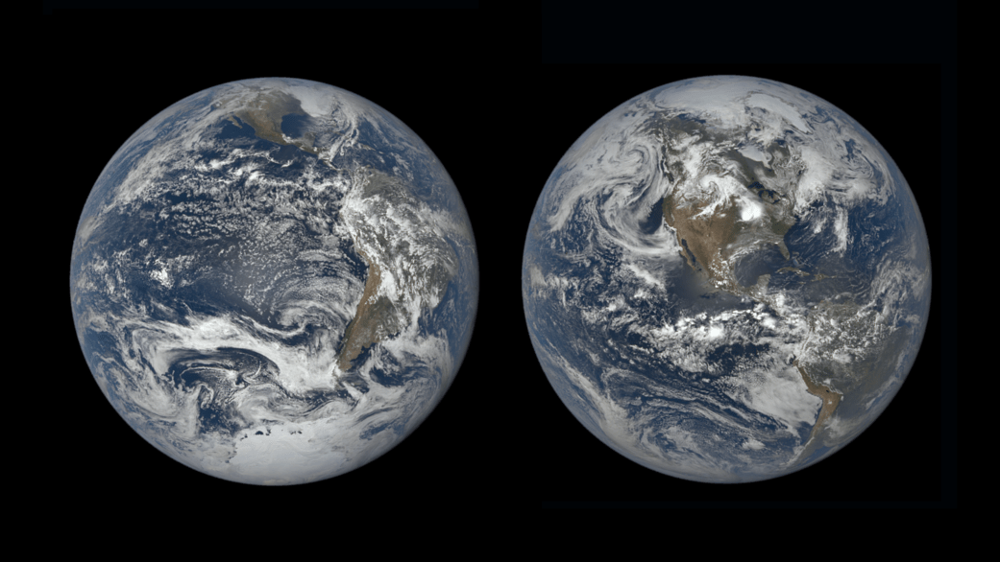
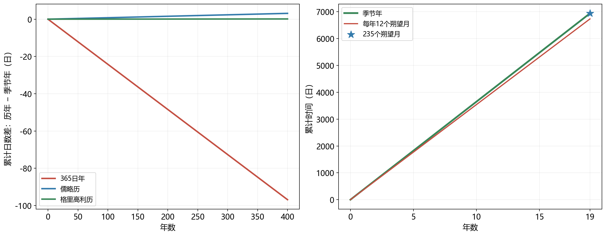

# 05 日历中的太阳、月亮与季节

同一个人可以记得自己的公历生日，也记得农历生日。前者每年落在相近的季节，后者在公历中的位置时早时晚；采用纯太阴历的节日，经过多年还会轮流出现在不同季节。这些日期都能准确约定一次见面，却保留着不同的天文关系：有的跟随季节，有的跟随月相，有的同时兼顾两者。

困难来自几个彼此独立的周期。地球自转形成昼夜，绕太阳公转与地轴倾斜共同形成季节，日地月相对位置的变化形成月相。一轮季节约有365.24日，一轮月相约有29.53日，把十二轮月相放在一起，又比一轮季节短了近十一日。日历必须把这些带小数的连续周期，编排成人人可以使用的整数日期。闰日、闰月，以及日期在季节中的移动，都是这种编排的结果。[历法与自然周期](../../assets/v02-batch-A-SOURCES.md#a05-01)

## 季节给一年确定了返回的目标 {#L05-C01}

在北半球中纬度，夏天的太阳升得较高，白昼较长；冬天的太阳位置较低，白昼较短。这样的变化每年重复，为农事、旅行和生活提供了很鲜明的周期。若想让日历中的六月始终接近相同的日照状态，就要先弄清太阳为什么会在一年间改变高度。

地轴与公转轨道面的法线约成23.4°。一年以内，可以把地轴在远方恒星背景中的指向看作近似不变。地球沿轨道运行时，这根保持方向的轴随地球来到不同位置：六月附近，北极一端倾向太阳；十二月附近，南极一端倾向太阳。于是，北半球与南半球轮流获得更有利的日照角度和更长的白昼。[地轴倾斜与季节](../../assets/v02-batch-A-SOURCES.md#a05-02)

阳光落地的角度直接影响单位面积的入射功率。设太阳高度角为$h$，即阳光方向与水平面的夹角；在忽略大气、地面水平的模型中，一束截面积固定的光斜落到地面，覆盖面积随倾斜而增大，单位面积收到的直射功率正比于$\sin h$。高度30°时，这个因子为0.5；高度60°时约为0.87。同样一束光，在后一种情况下集中到较小面积，照射更强。夏季的日行轨迹还有更长一段位于地平线上方，照射时间也随之增加。

地球在现代通常于一月初经过近日点、七月初经过远日点。距离变化会影响全球收到的太阳辐射，但南北半球在同一天具有几乎相同的日地距离，季节却相反。两半球的差异来自阳光在地表的分配。地面温度还要经过大气、海洋和陆地储热与输运的响应，因此最热、最冷的时段通常比日照极值更晚。

*图1：NASA/DSCOVR EPIC观测影像组合。左为2018年十二月至日前后，右为2019年六月至日前后。从近太阳方向观察，南北半球朝向太阳的程度随季节改变；大陆的位置也受拍摄时刻的地球自转影响。原图、署名与使用条件见[素材记录](../../assets/v02-batch-A-SOURCES.md#a05-03)。*

历法因而可以追踪太阳相对于地球赤道的方向，让日期与这套日照几何保持联系。太阳方向由南向北穿过地球赤道面所对应的时刻是春分；向北偏得最远时是夏至，之后依次经过秋分和冬至。这里沿用北半球的季节名称，同一组天文时刻在南半球对应相反的季节。至于各地何时下雨、何时开花，还取决于地方气候和当年的天气。

## 一天的长度来自两种转动

量太阳的周期，首先需要一天作为单位。连续两个地方太阳正午之间，就是一个真太阳日。地方太阳正午是太阳通过当地子午圈较高一侧的时刻；子午圈经过天顶和地平线南北点，给观察者提供一条固定在本地的南北参照。若同时记录遥远恒星通过这条参照的时刻，会发现恒星比太阳更早返回。

地球相对于遥远方向自转一周约需23小时56分4秒。在这段时间里，地球还沿绕日轨道前进，太阳方向相对于恒星平均向东移了约1°。地面已经重新朝向原来的恒星，接下来还要向东转过这一小段角度，太阳才到达相同的子午位置。平均一天约转360°，多转约1°需要接近四分钟，于是平均太阳日约为24小时。[恒星日与太阳日](../../assets/v02-batch-A-SOURCES.md#a05-06)

在自转、公转同向且近似匀速的模型中，记恒星日为$D_*$、平均太阳日为$D_\odot$、恒星年为$Y_*$，并把它们全部换成同一种时间单位。地面对太阳方向的返回频率，等于自转频率减去太阳在恒星背景中的周年移动频率：

$$
\frac{1}{D_\odot}=\frac{1}{D_*}-\frac{1}{Y_*}.
$$

这个关系也可以通过整圈计数理解。地球绕太阳一周时，太阳方向在恒星背景中完整转过一圈，所以相对于太阳计算的自转圈数，比相对于恒星计算的少一圈。两种日的长度只差几分钟，累计一年便成为一整天的圈数差。

恒星日因此很适合描述星空转到什么方向，太阳日则与昼夜生活联系得更紧。固定地点的一颗恒星，每天约提前四分钟通过子午圈，约一个月提前两小时。日历往后翻一页，晚间相同钟表时刻的星空也已经向前转过一段。这种积累稍后会帮助我们理解古人怎样用黄昏的星象判断季节。

实际太阳的运动还有快慢变化。地球在椭圆轨道上靠近太阳时运行较快，远离太阳时较慢；太阳沿黄道的移动投影到天赤道上，东西方向的角位移也会随位置改变。两种效应共同造成真太阳正午之间的间隔略有变化。为了均匀计时，可以设想一个沿天赤道匀速运动的平均太阳，由它定义地方平太阳时。真太阳时与平太阳时之差称为均时差，一年中可达到十几分钟。[均时差](../../assets/v02-batch-A-SOURCES.md#a05-07)

钟表使用的时区时间又把许多地方合在一起。地球向东转动，东边的地点先迎来太阳正午。相差15°经度，对应约一小时的地方平太阳时差；东经90°比东经120°偏西30°，使用同一时区钟表时，太阳正午便约晚两小时。要把日晷读数与钟表相比，既要考虑当地经度，也要考虑当天的均时差。天体的实际运动、均匀计时的定义和社会共用的时区，在一只钟表上叠加起来。

## 日历需要跟随哪一种年 {#L05-C02}

从远方恒星背景看，地球绕太阳完成一圈所需的时间叫恒星年，当前时代附近约为365.256日。若追踪太阳相对于季节基准的返回，得到回归年，其常用平均值约为365.2422日。两者相差约二十分钟。面向农事和季节的太阳历，需要贴近后一个周期。[年的定义与近似值](../../assets/v02-batch-A-SOURCES.md#a05-08)

差别来自季节基准本身的缓慢移动。地球赤道面与公转轨道面相交，交线的一端对应春分方向。地轴的长期进动使赤道面逐渐转向，春分方向也沿恒星背景缓慢移动。太阳下一次返回这个移动的起点时，相对于恒星尚差一小段才完成整圈。因此，保持日期与季节的关系，和保持日期与恒星背景的关系，会得到略微不同的年长。地轴怎样产生这种运动，将在参照系与测量的专题中展开。

还有一种实际有用的返回条件：从一次近日点到下一次近日点，得到近点年，约365.260日。地球轨道近日点的方向也会缓慢改变，所以它与前两种周期又有小差别。研究轨道、编排季节日历和比较恒星背景，分别需要选取相应的年。本文接下来的历法计算采用365.2422日的固定近似，用来比较制度在几十年到几百年间积累的差额；精密历算会处理年长随时代的变化。

## 把小数日安排成闰日 {#L05-C03}

假设规定每年都是365日。每过一年，日期序列就比365.2422日的季节周期少走0.2422日；四年少近一天，百年少约24日。到了下一次同名日期，季节还没有走到上一年的同一位置。持续积累下去，原本接近夏至的日期会逐渐落在更早的季节阶段。

最直接的补偿办法，是让若干年多出一天。儒略历采用四年一闰，平均年长为

$$
365+\frac14=365.25\ \mathrm{日}.
$$

它补上了绝大部分差额，只比所取回归年近似长约0.0078日，即每年约11分钟。四百年之后，这一点差额仍会积成约3.12日。历法改革于是需要进一步减少闰日的数量。

格里高利历，也就是今天通用的公历，保留四年一闰，同时规定整百年通常平年，能被400整除的整百年仍为闰年。一个400年区间本来可以有100个四年闰日，扣除其中三个，剩97个；平均年长成为

$$
365+\frac{97}{400}=365.2425\ \mathrm{日}.
$$

2000年能被400整除，二月有29日；1900年和2100年只有整百条件，二月有28日。百年例外是在四百年范围内删去多补的三天，使平均年长更接近季节周期。[公历闰年规则](../../assets/v02-batch-A-SOURCES.md#a05-09)

与365.2422日相比，公历平均年长约多0.0003日，即约26秒。在两个周期都保持不变的估算中，积累一日需要三千多年。这足以说明修正后的精度量级。更长时间尺度上的比较，还要计入地球运动和回归年的变化。

*图2：课程原创计算图。左图以365.2422日为季节年，三种历年的平均长度分别取365、365.25和365.2425日。右图采用平均朔望月29.5306日，比较$n$个季节年与$12n$个朔望月，并标出235个朔望月的累计时间。[SVG](../../assets/rewrite-20261025/05/calendar-fit.svg)与[绘图源](../../assets/rewrite-20261025/05/draw-figures.py)*

平均长度接近，并不要求每一年都同长。以某个重合起点开始，连续三个365日平年结束时，累积差额依次约为−0.2422、−0.4844和−0.7266日；第四个年若取366日，四年合计1461日，而四个近似季节年为1460.9688日，累计差额回到约+0.0312日。前三年逐渐欠下的小数日，在第四年用一个完整日期补回。

所以春分时刻可以在相邻日期之间移动，而同名日期仍长期维持在相近季节。日历安排控制的是累计偏差：平年让误差朝一个方向缓慢积累，闰年使它跳回。公历中的月份则是对一年日期的进一步划分，其月初与月相之间已经没有固定对应。二月加一天，修正的是整年与季节之间的比例。

这一处理与精密授时中的闰秒处在不同层次。历年的闰日协调年和日；原子钟以稳定的原子跃迁定义秒，地球的实际自转又会因内部、大气和海洋的角动量交换而略有快慢，协调原子计时与自转计时需要另一套制度。读一张普通日历所用的置闰规则，来自季节年的小数日；读精密时间资料时，则需看它采用哪一种时间尺度。[原子计时与地球自转](../../assets/v02-batch-A-SOURCES.md#a05-15)

## 月相怎样落进整数日期

月亮从朔经过上弦、望、下弦再回到朔，一轮平均约29.5306日。这个朔望月对应日地月照明几何的重复：从地心看，朔时日月黄经相同，望时两者黄经相差180°。月相循环为夜间生活提供了容易辨认的时间标记，历月由此获得自然依据。[朔望月与月份](../../assets/v02-batch-A-SOURCES.md#a05-10)

现代农历把朔发生的民用日期定为初一。朔本身是一个时刻，初一则是包含该时刻的一整天。采用的时区和日界一旦确定，就可以把连续的天体运动落入离散的日期格。下一次朔所在的日期成为下月初一，两次初一之间若有29日，本月就是小月；若有30日，就是大月。[朔日与大小月](../../assets/v02-batch-A-SOURCES.md#a05-12)

这里有两种变化同时起作用。首先，朔望月是实际天体运动的周期，受轨道形状与速度变化影响，每轮长度会在平均值附近变化。其次，一个时刻落在午夜前还是午夜后，会使它归入不同日期。历月的29日或30日，是天文事件经过民用日边界切分后的结果。只要掌握月初的定义，即使看不到新月附近的月亮，也能理解为何历书能够提前排出初一。

满月所在的日期同样由这两层关系决定。朔到望平均约14.76日，但这一段的实际长短会变；朔又可以发生在初一的清晨、午后或深夜。因此，望常落在十五、十六附近，具体月份由历算给出。一天内部的事件时刻，经过整数日期的表示，会留下约一天尺度的差异。日历适合安排某晚出门赏月，精确比较月相则需要进一步读到时刻。

如果每年固定取十二个朔望月，平均年长是

$$
12\times29.5306=354.3672\ \mathrm{日},
$$

比季节年少约10.875日。纯太阴历就接受这一长度，让月份持续跟随月相。同名节日相对于季节每年平均提前约十一日，经过多年便能遍历炎夏和寒冬。日期的移动由稳定的周期差累积而来；这类历法优先保存月份与月相的关系。

## 闰月把月份重新接到季节上 {#L05-C04}

中国农历同时要求月份跟随月相、年序跟随季节，因而采用阴阳合历。十二个月稍短，十三个月稍长，需要在一些年份安排十三个月。多出的月份仍是一轮真实的月相周期，它改变的是这一年对月份的编号与容纳数量。

用平均周期比较，十九个回归年约为

$$
19\times365.2422=6939.6018\ \mathrm{日},
$$

而235个朔望月约为

$$
235\times29.5306=6939.6910\ \mathrm{日}.
$$

两者只差约0.089日，也就是两小时多。十九年若一律十二个月，共有228个月；增加七个月便成为235个月。这给出十九年七闰的近似：在足够长的一段时间里，通过十二月年与十三月年的搭配，让月序仍停留在相近季节。[十九年近似](../../assets/v02-batch-A-SOURCES.md#a05-11)

平均数还能解释春节在公历中的早晚。一个十二月农历年约354日，比公历年短约十一日，所以下一次春节通常提前约十一日；一个十三月农历年约384日，比公历年长约十九日，下一次春节便通常推迟约十九日。早晚交替，使日期在冬末附近往返。具体相差几日，由这一年的大小月和公历年长决定。

要决定某一次究竟闰哪一月，还需要一个把月份连接到季节的标记。太阳在恒星背景中的周年路径称为黄道；从春分方向开始，沿黄道测量的角位置称为黄经。把一整圈360°每隔15°设一个节点，就是二十四节气。春分黄经为0°，夏至90°，秋分180°，冬至270°。其中每隔30°的一组十二个节点叫中气，依次包括春分、谷雨、小满、夏至等；另一组节点与它们交错排列。[节气的天文位置](../../assets/v02-batch-A-SOURCES.md#a05-13)

相邻中气的平均间隔约为$365.2422/12=30.44$日，略长于平均朔望月29.53日。两套时间刻度由此逐渐错开：一轮月份可以在某个中气之后才开始，并在下一个中气到来之前结束，于是整个月中没有中气。这种错开提供了协调月序的依据。地球在椭圆轨道上的速度会变化，太阳走过相同30°黄经所需的实际时间也随位置不同，现代编历采用每一次朔和中气的实际时刻。

现代农历先把包含冬至的月份定为十一月。从这个十一月开始，到下一个十一月之前，若有十三个农历月，就取其中第一个没有中气的月份作为闰月，并沿用前月的名称。冬至提供季节上的固定支点，朔给出月份边界，中气帮助选出应重复月名的位置。于是，两次冬至之间的月相虽然可能多走一轮，下一次冬至仍归入十一月。[紫金山天文台的编历说明](../../assets/v02-batch-A-SOURCES.md#a05-12)

十九年七闰解释的是平均周期为何容易协调；上述规则则把具体天文事件安排进每一年的日期。它们处在不同层次。两小时多的十九年平均差额已经表明，这个近整数比适合帮助理解，却仍需由逐次天象计算完成精确编排。朔与节气接近午夜时，统一的时区、日界和计算标准尤其重要，因为事件归入哪一天，会影响它属于哪一个历月。

二十四节气还保存着气候与物候经验。雨水、惊蛰、白露等名称来自特定地区对一年变化的观察；现代天文定义则给它们统一的太阳位置。一个天文时刻可以供各地共用，各地的气温、降水和物候按照自身环境作出响应。日历把这两类知识放在相邻位置，历算提供时间坐标，地方经验赋予它生活内容。

## 黄昏的星空也能记录季节 {#L05-C05}

太阳的位置随季节变化，夜空因此也发生可重复的更替。地球绕太阳运行，午夜朝向的恒星背景逐渐移动，白天被阳光淹没的星区与夜间显露的星区轮流交换。冬季傍晚的金牛与猎户，夏季傍晚的天蝎及其他星区，便成为一年中不同阶段的醒目标记。

在相同地点和相同钟表时刻比较，一颗恒星每天约提前四分钟经过子午圈，一个月约提前两小时。它在天空中的夜间位置因此逐渐西移。若改为每天黄昏观察，日落时刻本身也随季节改变，需要把这部分变化一并考虑；星象与太阳的相对位置仍提供了识别季节的基本线索。古人在能够精密计算周年运动以前，已经可以通过长期记录，把某些黄昏星象与农事、寒暑相联。

《诗经》中的“七月流火，九月授衣”，使用的就是这样的星象。“火”指大火，即心宿二、现代天蝎座α。它是一颗颜色偏红的亮星，容易在这一带星空中辨认。黄昏时，大火随着季节推移逐渐向西、向低处移动，成为天气将转凉、需要准备衣物的时间信号。[大火的天体身份与季节观测](../../assets/v02-batch-A-SOURCES.md#a05-14)

这一观察包含两个时间尺度。同一夜里，大火向西移动，记录的是地球自转；隔着许多天，在可比较的黄昏条件下，它的位置逐渐更西，记录的是太阳与恒星之间周年关系的改变。日周变化让人判断一夜走到了哪里，季节变化让人判断一年走到了哪里。同一颗星，配合不同的比较方法，可以承担不同的计时任务。

把诗句进一步对应到某个具体年代和日期，还需要知道作品的历史语境、采用的月序、地点与黄昏标准。数千年间的岁差也会改变恒星相对于季节的位置。天文几何解释了大火怎样发挥季节标记的作用，历史文本与古历研究则决定它在某一时代对应哪一段生活。

从黄昏的一颗星到日历上多出的一天，计时始终依赖可重复的天象。太阳历保住日期与季节的接近，纯太阴历保住月份与月相的对应，阴阳合历借助闰月把两者结合。自然提供连续变化的周期，人们选择日界、月名和年序，把它们变成可以共同使用的日期。理解了每一种历法所跟随的运动，生日的移动、春节的早晚和闰年的出现，就有了同一套可计算的来由。
