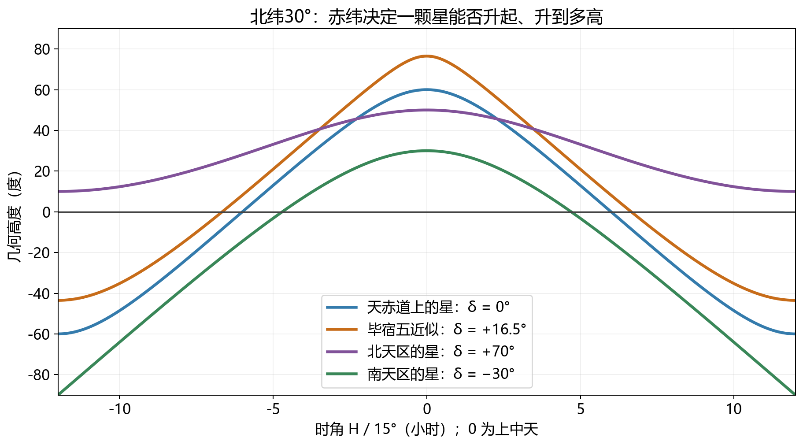
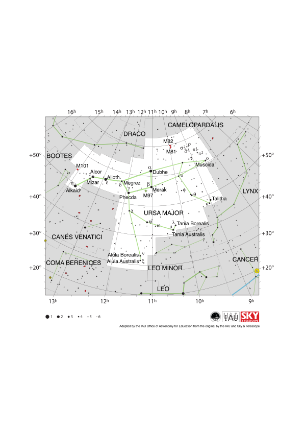
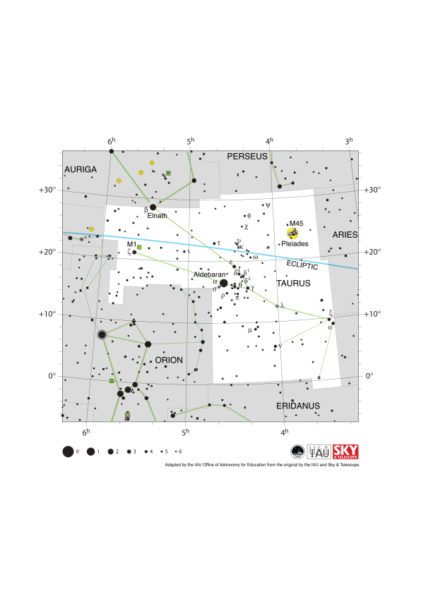
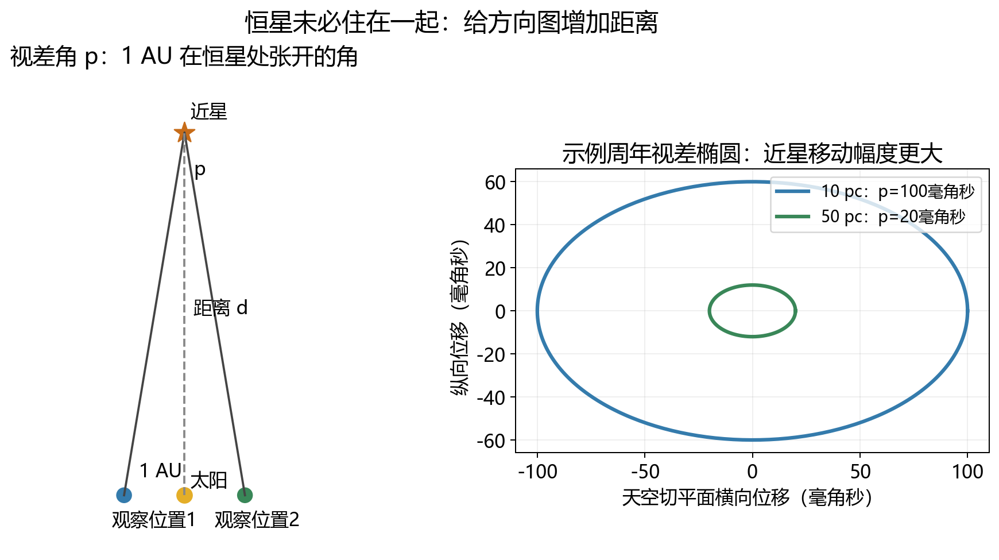
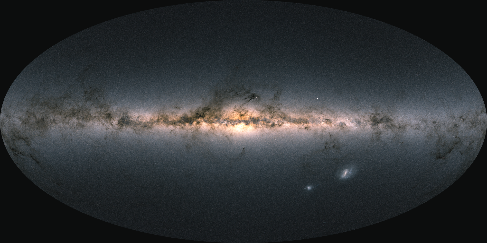

# 06 星图画的是什么：从北斗七星到三维银河

把一张星图举向夜空，第一件令人困惑的事情往往不是星名，而是整张图的姿态。纸上北在上，天空的北方却在地平线附近；冬夜的金牛座像一个歪斜的V字，过一阵又转了角度；同一组星在手机、纸质图和望远镜里甚至左右相反。星图没有失效，只是我们还没有分清它正在保存什么，以及怎样把纸面方向接到一个会自转的观察地点上。

一张普通星图首先是一张方向地图。它把从观察者出发的视线投到假想球面上，保留星星之间的角度关系，把真实距离暂时收起。这个办法使我们能描述升落、寻找目标与共享观测位置，却也容易让一组投影图案被误认为空间中紧挨着的一家天体。读懂星图之后，下一步恰好是把它省略的第三个维度放回去：视差与恒星运动会告诉我们，北斗或金牛的形状背后，还藏着真实的空间结构。[方向地图与天球](../../assets/v02-batch-A-SOURCES.md#a06-01)

## 先把距离收起来，留下两个角度 {#L06-C01}

想象站在一个空旷地点，把每颗恒星的方向延伸到一个包围自己的巨大球面上。天球就是这个方向模型。球的半径可以任选，只要所有方向从同一个中心出发；它不是宇宙的实际边界，恒星也没有真的贴在球壳上。天球上两点相隔10°，描述两条视线之间的夹角，而不是两颗恒星之间隔着某个固定长度。

我们日常也在做同样的压缩。远山与近处树木可能落在同一张照片上，图片清楚保存方向，却不能仅凭两者挨得近就知道它们相距多远。一个远星如果恰好在近星旁边，天球会忠实记录“方向近”；这不是图的错误，而是它选择的任务。只有再测出距离，才能恢复物理间隔。星图中点的大小通常编码视亮度，颜色可能表示类别或帮助识别，也不能直接把图上的大点解释为真实直径较大的星。

角度单位因此比厘米更重要。一整圈360°，一度有60角分，一角分有60角秒；满月的角直径约半度，即约30角分。人在天空中判断十几度的范围，与望远镜寻找数角分宽的天体，使用的是同一种几何，只是量级不同。伸手估角可以帮助粗略定位，但手指宽度、手臂长度与姿势人人不同，不能当精密角尺。准确星图用坐标网格、比例与投影定义替代这样的个人标尺。

对恒星，地球表面不同观察地点相比其遥远距离非常接近，所以方向可以近似共享。对月球等近天体，地心方向与某个地面地点实际所见方向却有可见差别，称为周日视差的一部分。天球既可以以地心为中心，也可以以观察者为中心，选择不同中心会改变近天体的方向。一本观星图册忽略它，可能仍足以识别恒星；一份掩星或月出预报则必须认真处理。[观测者位置与角度](../../assets/v02-batch-A-SOURCES.md#a06-02)

## 用地平线描述此刻，用地轴描述整夜

“向西南看，高度三十度”是最直接的定位方式。高度角 $h$ 从理想地平面量起，地平线为0°，头顶天顶为90°；方位角 $A$ 在这里采用从北点向东增加的约定，北0°、东90°、南180°、西270°。于是这句话可以变成接近 $A=225^\circ,h=30^\circ$ 的坐标。某些旧文献会从南点开始量方位角，使用数据时必须先读约定，数字相同不保证方向相同。[方位角约定](../../assets/v02-batch-A-SOURCES.md#a06-03)

当地地平面与天顶依赖观察者。换到南北不同地点，即使面对同一颗星，地平坐标也会改变；留在原地而等待两小时，坐标还会因地球自转改变。这种描述非常适合让一个人此刻把望远镜转过去，却不适合直接写成全年共享的星表地址。你把“东南30°”发给另一座城市的朋友，对方还需要知道你的时间、地点，以及描述的是否为几何高度。

天空中更长久的参照来自地轴。将地轴向北和向南延伸，分别得到北天极、南天极；将地球赤道面延伸，与天球相交的大圆是天赤道。地球自转时，地轴方向在一个夜晚近似不变，而地面观察者绕它旋转。远星于是看起来绕天极画圆。北天极附近的星画小圆，天赤道上的星画大圆；圆的一部分被地平线切掉，我们便看到升起与落下。[日周运动的方向](../../assets/v02-batch-A-SOURCES.md#a06-04)

目前北极星靠近北天极，所以看起来移动很小，但它仍不是精确极点。北极星是一颗真实恒星，北天极是地轴对应的几何方向，北斗则是另一组星构成的图案。不能说其他恒星真的绕北极星在二十四小时内公转：即便某颗星没有明亮的近极星帮助定位，它的日周轨迹也依然由地球自转与观察纬度决定。

## 为什么去南方，星空也跟着变

在近似球形地球上，北天极的几何高度等于当地北纬。北纬30°的观察者向北看，北天极约在30°高度；到北纬60°，它便抬高至约60°；赤道上它落在北地平线附近。地轴没有随旅行者改变，是旅行者脚下的水平面在球形地球上转了方向。这条关系既解释天空外观，也让测量近极方向成为确定纬度的一种方法。

若北天极离地平线较高，北极附近有一些恒星的日周圆完全处在地平线上方，称为拱极星。以北纬 $\varphi>0$、恒星赤纬 $\delta$ 为例，忽略折射与遮挡，$\delta>90^\circ-\varphi$ 的星不落；$\delta<\varphi-90^\circ$ 的星则永不升起。这不是北方星与南方星具有不同的物理寿命，而是观察者的地平面切割方向球面的结果。[升落与纬度](../../assets/v02-batch-A-SOURCES.md#a06-05)

在北纬30°，赤纬大于+60°的星近似拱极，小于−60°的星始终不升。到赤道，除极点方向外，几乎所有恒星都有升落机会，一年中也能接触更多南北天空；到北极，天空中同一颗星的高度近似不随一天改变，北天半球的星沿平行于地平线的圆运行。南半球则对应南天极。它没有像北极星那样醒目的近极标志，并不影响坐标和自转几何成立。

一颗星还可能升起，却只贴着地平线短暂经过。北纬30°处，赤纬−30°的星上中天高度约30°，赤纬−55°的星则仅约5°；空气消光、地形与灯光会让后者很难看见。所以“星表中它会升起”与“这个地点能方便地观测它”之间仍有差距。可见天空不是简单的一半星表加一个天气按钮，而是地球位置、时间和地面环境共同决定的。

*图1：北纬30°、球形地球、无折射模型。时角零为上中天，正时角表示已转到子午圈西侧。赤纬+70°曲线始终在零高度以上；−30°曲线仅有较短部分可见。毕宿五以约+16.5°示例，未做特定年代的精密星历计算。保留[SVG](../../assets/06/v02/star-altitudes.svg)与[绘图源](../../assets/05/v02/draw-batch-A.py)。*

## 同一个晚上在转，同一个季节也在换 {#L06-C02}

拍摄几小时的星迹照片会看到整幅天空转动，过几个月再于同一钟表时刻仰望，又会发现换了一批显著星区。这两种变化相联系，却不能混成“星座每天飞走了”。地球自转决定一个夜晚的日周运动；地球公转使太阳相对于恒星方向改变，于是我们每天的黑夜对着新的空间方向。太阳光淹没的星区与能在夜间看见的星区，随季节交替。

恒星比平均太阳每天约提前四分钟回到当地子午圈。半个月约一小时，一个月约两小时：今天22点看到的某种星空姿态，一个月以后约20点就能看到。这是一条近似比较关系，需要地点相同，并忽略岁差、自行、日期长度等更小影响；太阳系天体还有自身相对于星空的运动，不能把这条关系原样套给月球或木星。[恒星时](../../assets/v02-batch-A-SOURCES.md#a06-06)

这解释为什么一张活动星图常把日期与时刻画在两层可旋转圆盘上。调日期相当于改变太阳与恒星的相对位置，调时间相当于改变地球已转过的角度，两者组合决定此刻哪些方向高于当地地平线。活动星图只适用于一个纬度范围，地平窗口也有投影误差；它通常不自动更新行星、月球或临时彗星的位置。会转盘不等于已经得到任何地点、任何天体的精确观测预报。

“冬季星座”因此通常表示当地冬夜某个方便时段容易看见，并不是星座只在冬季存在。金牛座在北半球冬季傍晚位置便利，换到另一个季节，它可能白天被太阳掩盖，也可能必须凌晨才能看到。讨论能否观测时，应说清在什么纬度、什么日期、什么时刻，而不只报一个季节名。

## 一只勺子，可以属于一头熊 {#L06-C03}

古今不同文化把显著星点联系成动物、器物或神话人物，这些图案是识别方向的便利语言。现代技术上的星座则更严格：国际天文学联合会把全天分成88个有明确边界的区域。区域里的恒星、星云、遥远星系都可以说位于这个星座方向，不要求它们属于同一空间系统。边界铺满天球，也包括肉眼看起来没有任何醒目图案的地方。[星座与星群](../../assets/v02-batch-A-SOURCES.md#a06-07)

北斗七星是一组容易认出的星群，处于大熊座区域内；它不是现代88星座之外另加的第89个星座。夏季大三角则横跨几个星座，说明星群不必被限制在一个区域。连线画法可以因图册而异，正式边界却用于一致的天体归属。识别星图时，图案帮助迅速进入，区域和坐标帮助消除歧义。

这些区域不是根据真实恒星团聚情况划出的，但也不能走向另一个极端，说所有图案中的星都毫无物理关系。大熊座移动星群说明，有些亮星确实共享相近的空间运动与形成历史。天球图案与物理关系是两个不同层次，需要分别检验；有关系的星可以碰巧出现在熟悉图案里，熟悉图案却不自动证明所有成员有关系。

## 从北斗找北方，还能找到什么 {#L06-C04}

大熊座最醒目的入口是四颗星围成的斗与三颗星组成的斗柄。顺着斗口两颗指极星的方向向外延长，约五倍它们间距的位置附近可以找到北极星；这是粗略找向法，不能代替精确极轴校准。北极星属于小熊座，正好说明用一组星群导航时，经常会跨越现代星座边界。[大熊座正式星图](../../assets/v02-batch-A-SOURCES.md#a06-08)

*图2：IAU Office of Astronomy for Education adapted from IAU/Sky & Telescope，CC BY 4.0，原图未改。绿色连线是一种图案画法，虚线是星座区域边界，大点表示较亮的星。图的横轴赤经向左增加，纵轴赤纬向上增加，读图时应先区分这些编码。*

图上还会出现小椭圆、小圆圈与字母数字组合。M81、M82等不是北斗额外增加的恒星，而是这一方向上的遥远星系；M97是行星状星云，名字沿袭早期小望远镜里近似行星的外观，并不表示由行星组成。识别一张星图的符号类别，就能从肉眼图案继续走到不同尺度的天体。这里无需马上解释每种对象的形成，却已经能知道一块天空区域可以叠放许多彼此相距极远的东西。

北斗七星中五颗属于大熊座移动星群，另外两颗并不共享这一组合。它们现在在天空中共同形成一只勺子，不代表以后永远保持同样形状。由于恒星具有真实空间运动，长期累计的角位置变化称为自行。几十年的一般观星识别中，图案近似稳定；数万年尺度上，恒星相对于我们的横向运动可以明显改变图案。星名“恒星”保存了古人相对于行星快速游移的对比，不是说恒星在宇宙里绝对静止。

## 金牛座的V字，藏着一个前景天体 {#L06-C05}

金牛座可以从毕宿五附近的V字形亮星进入，再沿两侧寻找牛角方向，附近紧凑的昴星团提供另一个显著标志。毕宿五颜色偏橙红，对识别很有帮助，却不应该成为唯一判断依据，因为照片白平衡、曝光与显示器都会影响颜色。V字、两角与昴星团的相对位置，才是更能跨越不同图册的结构线索。[金牛座正式星图](../../assets/v02-batch-A-SOURCES.md#a06-09)

*图3：同上署名与许可，原图未改。图中黄道经过金牛座，标记M45的昴星团与毕宿五附近分散的毕星团不同；毕宿五在方向上靠近V字，却不是毕星团成员。星图同时提供区域、图案与真实星团三个层次，不能只把连线看作一头牛的轮廓。*

毕星团是一群在空间中相关的恒星，毕宿五却是更靠近我们的前景星。它恰好投影到这片区域，于是很自然地成了人们想象中牛的一只眼睛。如果只比较天空方向，前景星与星团成员看起来都参与同一个V字；加入距离和运动，才会发现不同的物理归属。昴星团则是另一个真实星团，其成员在天空集中，并具有共同的形成背景。星团是实体系统，星群是好认图案，星座是方向区域，这三个概念终于在同一幅图中出现了具体区别。

如果我们换到远离太阳系的位置，毕宿五与毕星团成员之间的相对投影会改变，金牛座图案也可能不再像牛。近邻恒星系统之间这样的改变未必马上巨大，但移动得足够远就不能期待继续沿用地球视角的星座连线。它们从来没有被焊接在一头实体金属牛上；图案有很强的观察位置依赖，物理星团关系却能用与视角不同的证据定义。

## 给星星一个可以共享的地址

要让杭州的观察者把目标位置告诉智利的观察者，不能只说“南方偏上”。赤道坐标利用天赤道与天极，给出赤经 $\alpha$ 和赤纬 $\delta$。赤纬类似地理纬度，从天赤道向北或向南测；赤经类似沿赤道测量的经度，传统零点选春分方向，向东增加。一圈常写为24小时赤经，因此1小时赤经对应15°，这里的小时是角度单位的另一种表达，不是“这颗星必须在凌晨一时出现”。[赤经与赤纬](../../assets/v02-batch-A-SOURCES.md#a06-10)

“赤经5小时、赤纬+20°”先确定天球上的一个方向，再结合观察地点与当时地球转到哪里，才得到当前高度和方位。当地恒星时可理解为此刻正在上中天的赤经；以小时作单位，$H=\mathrm{LST}-\alpha$ 给出目标时角，$\mathrm{LST}$ 是当地恒星时，$\alpha$ 是赤经。赤经绕一整圈后回到零，因此相减后要加减整24小时，把结果移到−12小时至+12小时范围：正时角表示目标在上中天子午圈西侧，负时角表示在东侧，零时角为上中天，±12小时为下中天。例如恒星时1小时、赤经23小时，直接相减得−22小时，等价时角应为+2小时。这样，星表的共享地址与人的此刻视野之间有了清楚的连接。

几何连接可以写为

$$
\sin h=\sin\varphi\sin\delta+\cos\varphi\cos\delta\cos H,
$$

其中 $\varphi$ 为观察纬度，$\delta$ 为目标赤纬，$H$ 为时角。让 $H=0$，便得到上中天高度；让 $h=0$，便能求理想地平线的升落条件。图1的几条曲线来自这个表达式。四个量中，纬度决定你站在哪里，赤纬决定目标的南北方向，时角决定自转已把你带到哪一侧，高度便是它们共同的可见结果。[从赤道到地平坐标](../../assets/v02-batch-A-SOURCES.md#a06-11)

精密星表还会注明坐标参考系与历元。地轴岁差会让基于某一年代赤道和春分点的网格改变，恒星自行则会改变星本身的位置；所以“旧星表的数值不同”并不必然意味着其中一份错了。现代位置天文学还使用以遥远河外源实现的近似固定参考系，将地球的运动与参考方向分开。日常找星暂时不需要掌握所有变换，但读取“J2000”或观测日期时，至少知道它们在交代哪个基准，而不是给星名附上一个型号。

## 为什么纸面东方会在左边

把球面展开为平面，不能同时保住每处角度、面积、距离和形状。小视场图经常使用以视场中心为基准的切平面投影，它在中心附近适合表示星点位置；全天图则需要将整个球面展开，必然更显著地变形。圆盘式星图的边缘星座可能被拉长，全天椭圆图两端的距离也不能直接用尺子量成真实角距。投影负责把方向搬到纸上，它造成的弯曲不必代表天体真的走了弯轨道。[全天图的含义](../../assets/v02-batch-A-SOURCES.md#a06-12)

在常见北在上的赤道星图里，东在左。这并没有与地理地图矛盾：地理地图通常想象从球体外向下看地面，星图则对应身处方向球面内、向外看天空，观看一面的方式不同。面朝南仰望时，东方就在左手一侧；面朝北时，东方又到右侧。把图举起并旋转到与视线相合，需要用地平方位或坐标轴确定姿态，不能把“上就是北、右就是东”当成所有图像的永久规则。

旋转与镜像也不同。旋转纸面会改变星群的朝向，却保留左右手性；镜像会把手性翻转，一张图的斗柄弯曲便可能朝另一边。望远镜的成像方向由光学系统与转接结构决定，有的倒像，有的左右反转。单凭“把图片转一百八十度”不能修复所有差异。寻找目标前读清图像方向，能少走很多无效的连线比较。

## 方向地图怎样获得第三个维度

地球绕太阳运行，使我们每隔半年从相隔约两个天文单位的位置看恒星。近星相对于更远背景会产生周期性位置移动，称为周年视差。这里规定视差角 $p$ 为从恒星看一个天文单位基线张开的角，即最大完整半年位移的一半，在基线与视线垂直的理想几何下成立。不是把两个观测位置间的总角移直接叫 $p$。[视差几何](../../assets/v02-batch-A-SOURCES.md#a06-13)

距离越远，同样基线张开的角越小。小角度下 $p\simeq1\,\mathrm{AU}/d$，角度需用弧度；将距离定义为秒差距pc、视差定义为角秒，就得到 $d(\mathrm{pc})=1/p(\mathrm{arcsec})$。一秒差距约3.26光年，名称本来就来自“视差一角秒”。假设测到0.020角秒，即20毫角秒，距离约50pc或163光年；若为0.100角秒，距离约10pc或32.6光年。数例说明一个几乎不动的小星点怎样变成空间中的对象，不是让视亮度冒充距离尺。[角秒与秒差距](../../assets/v02-batch-A-SOURCES.md#a06-14)

*图4：左为严重夸大角度的几何示意，太阳至一个观测位置的基线为1 AU，$p$ 在恒星处定义；右为示例视差椭圆，纵横比例选定用于说明方向投影，不是某颗真实恒星的观测拟合。椭圆形状依赖目标相对于地球轨道面的方向；图中只比较幅度与距离关系。保留[SVG](../../assets/06/v02/parallax.svg)。*

真实观测需要同时拟合恒星自身运动、观测设备与其他位置变化。视差一年往复，自行长期积累，一颗双星还可能绕共同质心摇摆；若只观察几个时刻，就容易把它们混在一起。误差很大时，把一个微小甚至因噪声出现负值的视差直接取倒数，也会产生荒谬距离。几何公式仍正确，但参数估计需要处理测量误差、零点与样本选择，不能让公式替代观测分析。[Gaia视差误差研究](../../assets/v02-batch-A-SOURCES.md#a06-15)

ESA的Gaia以精密反复测量，把大量星点的位置、视差和自行放到同一套数据中。这才让我们有条件检验哪些星共享距离与运动，把投影上的拥挤区域拆成前景、星团、银河结构与更远背景。测量距离之后，同样视亮度也能对应不同的本征发光能力；这会进一步通向恒星性质，却仍从“这张图里的星到底在哪里”这个问题生长出来。

*图5：ESA/Gaia/DPAC，CC BY-SA 3.0 IGO；Acknowledgement: A. Moitinho。Gaia EDR3超过18亿颗星数据生成的全天方向图，亮度与颜色按区域合并，不是一台相机一次拍下的全景，也不是距离切片。图中横向银河平面与暗尘带展示选择投影后的结构；星点真实距离还在另一些数据栏中。[原页与解释](../../assets/v02-batch-A-SOURCES.md#a06-16)。*

看这幅图时，银河横着并不表示银河系在宇宙中有一条绝对水平线，而是制图者选用了便于呈现银河的方向与投影。黑暗区域也不全是没有恒星，前景尘埃能遮住远方星光。每一个视觉特征都必须问它来自对象、观测选择还是绘图方式。

## 同一个方向图案，如何检验是否一起运动

距离之外，运动也能把视线上的偶合与真实群体分开。自行表示天体在天空中的角位置随时间改变，常以每年多少毫角秒计量。它与一年内反复往返的视差不同：简单模型中的视差是一条闭合周年轨迹，自行则使这条轨迹的中心继续漂移。长期追踪同一颗星，需要同时拟合两种变化，而非从两张照片的一次位移就任选一种解释。[恒星位置随时间的变化](../../assets/v02-batch-A-SOURCES.md#a06-17)

角速度还不是实际横向速度。想象两颗星在一秒内横向各走同样距离，较远的一颗在天空中只改变较小角度。对小角度，横向位移近似等于距离乘以角变化。由于秒差距的定义，一颗距我们10秒差距的星，自行若为每年0.1角秒，便相当于横向每年移动约1天文单位，即约4.74千米每秒。这是为解释单位而设的算例，不是北斗某颗星的实测速度；从自行转成横向运动，距离是不可少的一项。

即使两颗星的自行箭头相似，也还不能立刻断言它们属于同一个星团。透视效应可能让同一群体不同方向的投影箭头不同，而不同距离的星也能恰巧具有相近角速度。完整的空间速度还包含朝向我们或远离我们的分量，通常由光谱中的多普勒变化获取。距离、两维自行、视向速度加上年龄和化学成分等证据，才能更有力地检验共同起源或共同运动。[空间运动所需的信息](../../assets/v02-batch-A-SOURCES.md#a06-18)

最初北斗七星让我们认出一个图案，坐标让我们共享方向，视差让我们加入距离，运动又让我们理解图案会改变。一张星图于是成为进入三维天文学的门，而不是需要死记形状的终点。
