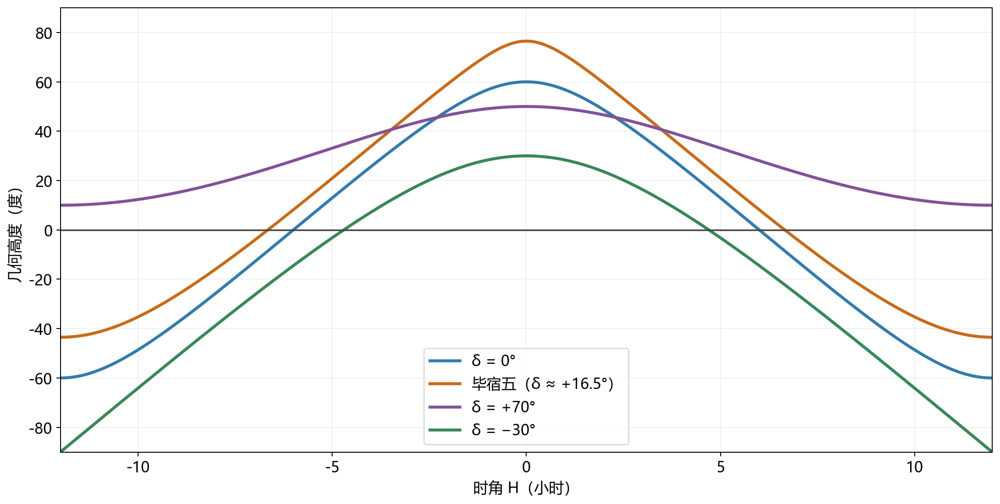
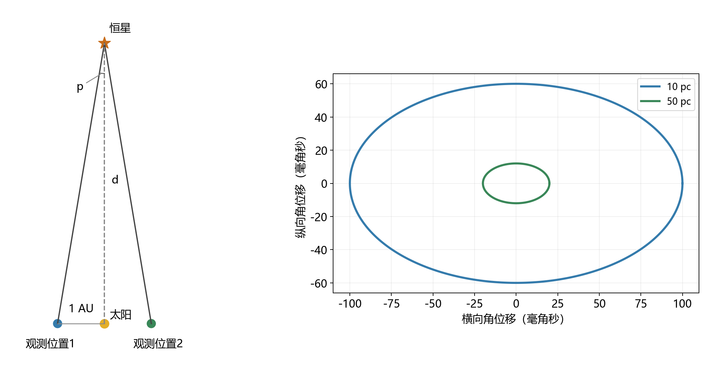

# 06 星图上的方向、距离与恒星群体

冬夜的金牛座在天空中形成醒目的V字，北斗七星围出一只长柄勺。只要认出其中几颗亮星，就能沿它们的相对位置寻找附近目标。然而，几小时后，同一组星已经换了朝向；来到另一座城市，它们的高度也变了。星图上的图案保持着熟悉的形状，实际夜空却在转动。

一张星图把许多天体放在同一平面上，记录的是从我们这里看去的方向。要把它接到眼前的天空，需要知道观察地点怎样随地球转动；要进一步理解图中恒星的关系，还需要测出星图暂时省略的距离。北斗和金牛恰好提供了两种很好的线索：熟悉的图案中既有共同运动的恒星，也有投影在同一方向的前景天体。

## 把视线画成一张图 {#L06-C01}

设想从观察地点向每颗星画出一条视线，再让这些视线与包围观察者的球面相交。得到的点便组成了天球上的星图。这个球面用来表示方向，半径可以任意选择；每条视线与球面的交点，只取决于朝哪边看。两颗星相隔10°，表示两条视线的夹角是10°。[天球与角位置](../../assets/v02-batch-A-SOURCES.md#a06-01)

这样的表示与日常摄影很接近。照片里的近树和远山可以彼此紧挨，实际却相距很远；天空中的两个点也可能分别来自太阳系附近和遥远银河。方向信息很适合寻找目标，因为观察者首先需要把眼睛或望远镜指向某处。距离则要用另外的测量加入。

天球上的基本尺度是角度。一整圈有360°，一度分为60角分，一角分再分为60角秒。满月的角直径约为0.5°，也就是30角分。用这个大小作比较，一块宽5°的星区大约能横放十个月面。进入望远镜视场以后，同样的角度关系仍然适用，只是尺度常缩小到角分乃至角秒。

星图上的点还承担其他信息。通常点越大，表示从地球看去越亮；一些图用颜色标明不同类别，用圆圈、椭圆或方框区分星团、星系和星云。图例与角度网格因此同样重要：前者说明符号代表什么，后者说明相隔多远。先把这两类编码读清，便能把一张图从星名表变成可使用的方向地图。

对于遥远恒星，地球表面不同地点之间的距离相对星距很小，观测者可以近似共享一套方向。月球离我们近得多，从地心与某个地面地点看去，方向会有可测的差别，这属于周日视差。恒星图的寻找任务通常可以使用共同星表，月球掩星、月出等精密预报则要把观察地点带入几何计算。[观测中心与近天体方向](../../assets/v02-batch-A-SOURCES.md#a06-02)

## 先用地平线确定此刻的视线

在一个开阔地点，地平线与头顶给出最直观的方向基准。高度角$h$从理想地平面向上量，地平线为0°，天顶为90°。方位角$A$沿地平面量；本文从北点向东增加，北、东、南、西依次是0°、90°、180°和270°。于是，西南方高度30°可以写成$A\approx225^\circ,\ h\approx30^\circ$。[高度与方位](../../assets/v02-batch-A-SOURCES.md#a06-03)

这套地平坐标直接对应人的动作：先转向西南，再把视线上抬30°。它的基准属于所在地点。沿地球表面向南或向北旅行，脚下水平面的朝向随球面改变，同一颗星的高度也会改变；留在原地等待，地球自转又会把观察者带到新的朝向。一个完整的地平位置，因而同时需要地点和时刻。

实地找星时，山脊、楼顶和树冠给视野加上了不规则边界，几何地平线仍是角度的零点。某颗星的高度已经为正，却可能还在山后。把场地遮挡和天体方向分开记录，就能知道等待多久可能看见目标，以及换一个位置是否会改善视野。

为了让不同地点的观察者共享目标位置，还需要一套随地球自转保持较稳定关系的参照。地轴正好提供了它。

## 天极、天赤道与恒星的地址

把地轴向两端延伸到天球，得到北天极与南天极；把地球赤道面延伸，与天球相交得到天赤道。地球在一个夜晚近似绕固定的轴转动，因此从地面看，遥远恒星围绕天极画出一圈圈日周轨迹。靠近天极的星画小圆，位于天赤道上的星沿大圆运行。地平线切过这些轨迹，便形成升起和落下。[日周运动与天极](../../assets/v02-batch-A-SOURCES.md#a06-04)

赤纬$\delta$表示天体方向与天赤道之间的角距离，北侧为正，南侧为负，范围从−90°到+90°。赤纬70°的星距北天极20°，因此它的日周轨迹就是围绕北天极、角半径20°的小圆。赤纬先把一颗星放到特定的日周圆上，再加上沿圆周的另一个位置量，就能确定其方向。

这个量是赤经$\alpha$。它类似地理经度，沿天赤道从春分方向向东计量。天球一周通常写成24小时赤经，因此1小时赤经等于15°。这里借用小时、分、秒表达角度，是因为地球自转不断把不同赤经带到子午圈上；一圈24小时的记法能方便地连接角位置与通过时刻。[赤经与赤纬](../../assets/v02-batch-A-SOURCES.md#a06-10)

传统赤道坐标的零点春分方向，是太阳由南向北穿过天赤道时所处的方向。这样，赤纬依靠天赤道确定南北位置，赤经依靠春分方向确定沿赤道的位置。一颗赤经5小时、赤纬+20°的星，无论在杭州还是智利查询，都可以在同一套星表中找到这个方向；各地看到它的高度、方位，则由当地地平面与这套坐标的相对朝向决定。

地轴与春分方向会缓慢变化，恒星也有自身运动，所以精密星表还要注明参考框架和位置对应的历元。它们为数据提供共同的方向基准与时间基准。普通找星图在几年内通常足以辨认图案，更精密、跨度更长的比较，则需要把这些变化一起处理。

## 地球转到哪里，目标就位于哪里

观察者的子午圈经过天顶和南北天极，随地球转动而扫过不同赤经。此刻在子午圈较高一侧的赤经，称为当地恒星时$\mathrm{LST}$。某颗星相对于这个子午方向的转角称为时角$H$，向西为正。在两者都用小时表示时，

$$
H=\mathrm{LST}-\alpha.
$$

例如，某星赤经为5小时，当地恒星时为7小时，时角就是+2小时：它已经转到子午圈西侧30°。当地恒星时为3小时，时角则为−2小时，位于东侧30°。赤经绕一圈回到零，相减时也按24小时循环。恒星时1小时、赤经23小时，对应的时角为+2小时。[恒星时与时角](../../assets/v02-batch-A-SOURCES.md#a06-06)

接下来可以把时角变成高度。采用球形地球、远方恒星和无折射的几何模型，记观察纬度为$\varphi$。天顶是当地竖直方向，它在赤道坐标中的赤纬恰好等于$\varphi$。当天体上中天，即$H=0$时，天体与天顶处在同一条子午圆上，两者的角距离为$|\varphi-\delta|$。高度与天顶距互为余角，因此

$$
h_{\max}=90^\circ-|\varphi-\delta|.
$$

在北纬30°，赤纬+20°的星最高可到80°，赤纬−30°的星最高到30°，赤纬−55°的星只到5°。这些数说明了同一地点寻找不同天区的难易：目标在星表中可以升起，留给实际观察的高度仍可能很小。

若要计算一夜中其他时刻，可把目标与天顶分别看作长度为1的方向向量。在以赤道面为基准的坐标中，取本地子午方向为横轴，目标沿这条轴的分量为$\cos\delta\cos H$，沿地轴的分量为$\sin\delta$。天顶位于本地子午面内，在相应两方向的分量为$\cos\varphi$与$\sin\varphi$，垂直于子午面的分量为零。两向量的点积等于天顶距的余弦，也就是高度的正弦，于是得到

$$
\sin h=\sin\varphi\sin\delta+\cos\varphi\cos\delta\cos H.
$$

纬度给出观察者竖直方向，赤纬给出目标所处的日周圆，时角给出目标走到圆上的哪一段。三个量共同决定高度。取$H=0$，这个式子回到上中天高度；让$H$随自转连续增加，就得到整条高度曲线。[坐标到高度的几何关系](../../assets/v02-batch-A-SOURCES.md#a06-11)

*图1：课程原创几何计算图。观察纬度固定为北纬30°，毕宿五赤纬采用+16.5°近似值；时角零点为上中天。模型采用球形地球与无折射地平线。[SVG](../../assets/rewrite-20261025/06/star-altitudes.svg)与[绘图源](../../assets/rewrite-20261025/06/draw-figures.py)*

## 纬度决定能见到哪一部分天空

在北半球，北天极高出北方地平线的角度等于当地北纬。这个关系来自地球球面的几何：观察者竖直方向与赤道面的夹角为纬度，而地轴垂直于赤道面；把相应的余角关系转到天球，就得到天极高度。北纬30°处，北天极约高30°；北纬60°处约高60°；赤道上，它落在北地平线。

北天极周围角半径很小的日周圆，可能完全位于地平线上方，其中的恒星叫拱极星。赤纬为$\delta$的北天恒星，距北天极$90^\circ-\delta$。若这个距离小于天极高度$\varphi$，整圈就都在地平线上方，即

$$
\delta>90^\circ-\varphi.
$$

在北纬30°，赤纬大于+60°的星近似拱极。另一个方向上，若一颗星连上中天时高度都小于零，它便始终处在地平线下；由上中天高度可得，北纬$\varphi$处赤纬小于$\varphi-90^\circ$的星永不升起。北纬30°的这一界限为−60°。等号对应日周轨迹恰好与理想地平线相切，实际能见度还受到折射、地形和大气消光影响。

旅行由此改变了可见天区。向赤道靠近，北方拱极区域缩小，更南方的恒星逐渐升起。站在赤道，除天极方向外，几乎所有恒星都有升落机会；站在北极，地平线与天赤道重合，北天恒星的高度一整天近似不变。南半球则由南天极承担相应的几何角色。地球表面的位置，直接决定一张全天星表中哪些部分能够进入视野。

## 日期与时刻共同转动星图 {#L06-C02}

一个夜晚内，星空主要随地球自转而转动。相隔数月，在同一钟表时刻抬头，又会看到另一批显著星区。地球公转使太阳方向在恒星背景中逐渐东移，黑夜所朝向的空间方向也随之改变。太阳附近的星区处在白昼，太阳对面一带的星区则在夜间显露。

恒星比平均太阳每天约提前四分钟返回当地子午圈。因此，同一地点今天22时见到的恒星排列，一个月后大约20时就已转到相近姿态。这个近似关系把日期与钟表时刻连起来，也解释了活动星图上为什么常有两层可旋转的刻度：日期表示一年中太阳与恒星的相对位置，时间表示当天地球已经转到哪里。星图的地平窗口再按照使用纬度裁出可见范围。

金牛座在北半球冬季傍晚位置便利，常被称为冬季星座。在别的季节，它可能接近太阳方向，也可能需要等到凌晨才能看到。选定一个日期后，还要选定时间，才能确定它是否出现在便利的高度。月球、行星以及彗星相对恒星还会自行移动，它们的位置由相应日期的星历补入活动星图。

纸面姿态也需要与视野相配。常见北在上的赤道星图，东方位于左边：面朝南仰望时，东方正好在左手一侧。地理地图通常从球外向下看地面，星图则从天球内部向外看，视角的变化带来不同的方向排列。把图举向天空，依据图上的南北方向旋转，便能让图案与视野逐渐重合。

球面展开成平面还会产生投影变形。一个小视场可以近似铺在切平面上，全天图则必须明显改变一些形状和比例。圆盘边缘的图案可能被拉长，图上的直尺距离要结合坐标网格才能换成角距。望远镜又可能旋转或翻转图像：旋转保持图案的左右手性，镜像会改变手性。寻找目标时，把光学系统的成像方向与星图方向对应起来，星点之间的几何关系才能顺利用于跳星定位。[星图投影与方向](../../assets/v02-batch-A-SOURCES.md#a06-12)

## 北斗、星座边界与实际天体 {#L06-C03}

熟悉的连线图案常被叫作星座，现代天文学对星座还有更精确的区域定义：全天划分为88个边界确定的区域，任意方向都归入其中之一。北斗七星是一组显著星群，位于大熊座区域内；夏季大三角跨越多个星座。连线帮助辨认，区域边界则让天体归属具有统一约定。[星座与星群](../../assets/v02-batch-A-SOURCES.md#a06-07)

### 从北斗寻找北方 {#L06-C04}

北斗的四颗星围成斗，另外三颗组成斗柄。沿斗口两颗指极星的方向向外延长，约五倍两星间距处，可以找到小熊座的北极星。北极星当前靠近北天极，因此在一夜里移动很小，适合用作粗略指北的标志。精密定向采用北天极的实际方向，北极星则是帮助眼睛接近这一方向的亮星。

*图2：IAU Office of Astronomy for Education，改编自IAU/Sky & Telescope，CC BY 4.0。横向为赤经，向左增加；纵向为赤纬，向上为北。绿色线条连接熟悉图案，虚线给出星座区域边界，点的大小表示视亮度。原页与署名见[素材记录](../../assets/v02-batch-A-SOURCES.md#a06-08)。*

沿图中的北斗继续寻找，还会遇到M81、M82和M97等标记。M81与M82是遥远星系，M97是行星状星云；它们与北斗诸星共享的是天空方向。星图把不同距离、不同物理类型的对象放在同一张方向图里，观察者再根据符号、亮度和视角大小选择器材与目标。

北斗本身又包含真实的空间联系。七颗主要亮星中有五颗属于大熊座移动星群，具有相近的空间运动；斗口的天枢与斗柄末端的摇光不属于这组成员。于是，一个肉眼图案既可以包含共同运动的恒星，也可以包含方向上恰好参与排列的其他恒星。[大熊座移动星群](../../assets/v02-batch-A-SOURCES.md#a06-08)

### 金牛座的V字与前景恒星 {#L06-C05}

金牛座可以从橙红色亮星毕宿五附近的V字形进入，再沿两侧寻找牛角，旁边紧凑的昴星团提供另一个醒目标志。将V字、牛角和昴星团的相对位置一起比较，即使图纸旋转，仍能辨认出这片星区。

*图3：IAU Office of Astronomy for Education，改编自IAU/Sky & Telescope，CC BY 4.0。黄道以蓝线表示，M45为昴星团；毕宿五附近的毕星团分布更疏。图中坐标、亮度符号与边界的读法同图2。原页见[素材记录](../../assets/v02-batch-A-SOURCES.md#a06-09)。*

组成V字的许多恒星属于毕星团，毕宿五却是位于星团前方、离我们更近的一颗恒星。它投影在这个方向，成为图案中最醒目的点。昴星团则是另一个实际相关的恒星群体。由此，三个常用概念在同一张图中有了各自的对象：金牛座是方向区域，V字是易于辨认的图案，毕星团和昴星团是具有物理关联的群体。

判断这些归属，需要给方向图加入距离。看起来相邻的两颗星，若距离相差很大，空间中便可以相隔很远；相反，成员分布较广的近邻星团，即使在天空占据较大角范围，也可能形成共同的空间系统。

## 用地球轨道测出第三个维度

改变观察位置，近处物体相对于远背景就会移动。双眼交替看一根手指，手指的投影位置会跳动；把手指移远，跳动幅度缩小。天文学把这种几何关系称为视差。地球绕太阳运行，每隔半年可以从轨道两侧观察同一颗星，形成约两个天文单位的基线，近星相对于远背景的位置便产生周年往复变化。[ESA视差几何](https://www.esa.int/Science_Exploration/Space_Science/Gaia/Parallax)

取基线与恒星方向垂直的几何构型，规定太阳到一个观测位置的1 AU基线，在恒星处张开的角为视差角$p$。半年两端的最大完整位移约为$2p$。设恒星距离为$d$，直角三角形给出$\tan p=1\,\mathrm{AU}/d$；恒星视差很小，以弧度计可用$\tan p\simeq p$，所以距离与视差近似成反比。

秒差距正是按这个关系定义的距离单位：1 AU基线张开1角秒所对应的距离约为1 pc。一弧度约有206265角秒，因此1 pc约为206265 AU，也就是3.26光年。使用秒差距和角秒，关系简化为

$$
d(\mathrm{pc})=\frac{1}{p(\mathrm{arcsec})}.
$$

视差20毫角秒等于0.020角秒，对应约50 pc，即163光年；视差100毫角秒对应约10 pc，即32.6光年。同样的地球轨道基线，在较近恒星处张开的角较大，因而距离越近，往复移动越明显。[距离单位与换算](../../assets/v02-batch-A-SOURCES.md#a06-14)

*图4：课程原创几何示意。左图放大视差角，$p$对应1 AU基线；右图给出同一示意方向上，10 pc与50 pc目标的周年视差椭圆，分别取100与20毫角秒。椭圆轴比取0.6，表示地球轨道在该方向上的投影。[SVG](../../assets/rewrite-20261025/06/parallax.svg)与[绘图源](../../assets/rewrite-20261025/06/draw-figures.py)*

真实恒星的周年轨迹还叠加自身运动，因此距离测量依靠一年中多个时刻的连续观测。目标接近地球轨道面的法线方向时，视差投影较接近圆；目标接近轨道面时，投影压扁成较细的椭圆乃至线段。拟合时利用地球已知的轨道位置，寻找具有对应周期和相位的移动分量，便能把视差幅度从观测中分离出来。

测得的视差还带有误差。当误差远小于视差时，取倒数能够给出直观、稳定的距离；当视差已与误差相当，倒数变换会放大不确定性，需结合测量误差与合理的距离分布估计。Gaia资料中的视差还存在依赖亮度、颜色和天空位置的系统偏差，精密研究会对此校正。[视差误差与系统偏差](../../assets/v02-batch-A-SOURCES.md#a06-15)

## 距离和运动共同识别恒星群体

恒星的实际空间运动会使它的天球位置长期变化，横向的角位置变化叫自行，常以每年多少毫角秒表示。周年视差在一年中往复，自行则使这条周年轨迹的中心持续漂移。多年位置记录把两者区分开来，也让北斗这样熟悉的图案显露出缓慢变形的过程。[位置、视差与自行](../../assets/v02-batch-A-SOURCES.md#a06-17)

自行先给出角速度，距离把角速度换成横向速度。小角度下，横向位移约等于距离乘角位移。依据秒差距定义，距离10 pc的恒星，若自行大小为每年0.1角秒，横向位移就是每年约1 AU。把天文单位换成千米、年换成秒，得到约4.74千米每秒。因此，用$\mu$表示自行矢量的大小，以角秒每年计，横向速度可写为

$$
v_\mathrm{t}(\mathrm{km\,s^{-1}})\simeq4.74\,\mu(\mathrm{arcsec\,yr^{-1}})\,d(\mathrm{pc}).
$$

距离相同而自行较大的星，横向运动较快；横向速度相同而距离更远的星，自行较小。要检验一个星团的成员，需要把距离和角运动合在一起。完整空间速度还包含朝向我们或远离我们的分量，通常由光谱的多普勒变化获得；成员的年龄、化学成分也能为共同起源提供补充证据。[空间速度所需的信息](../../assets/v02-batch-A-SOURCES.md#a06-18)

共同运动在天空中的投影也有几何结构。同一群恒星沿相近的空间方向运动，因为它们分布在不同视线上，自行箭头可以呈现汇聚或发散；距离不同又会使箭头长度改变。把这些投影效应与实际三维速度相联系，才能比较一组星是否共享运动。毕宿五与毕星团的区分、大熊座移动星群的识别，正是从熟悉图案继续追索物理关系的过程。

*图5：ESA/Gaia/DPAC；Acknowledgement: A. Moitinho；CC BY-SA 3.0 IGO。Gaia EDR3中超过18亿颗星的方向、亮度和颜色按天空区域合成这幅全天图；距离和自行保存在相应的测量数据中。横向亮带是银河平面方向，暗带主要显示星际尘埃对背景星光的遮蔽。[原页与素材记录](../../assets/v02-batch-A-SOURCES.md#a06-16)*

这幅方向图展示了银河在我们视野中的整体结构。将每颗星的视差加入，能够沿视线区分前景与背景；再加入自行与视向速度，便能研究星团、恒星流以及银河内部的运动。最初的星图帮助我们在夜空中找到一颗星，精密的位置测量则把这颗星放回有距离、有速度的空间。北斗的一只勺子和金牛的一个V字，由此连接到同一个问题：这些光点在宇宙中怎样分布，又怎样一起运动。
