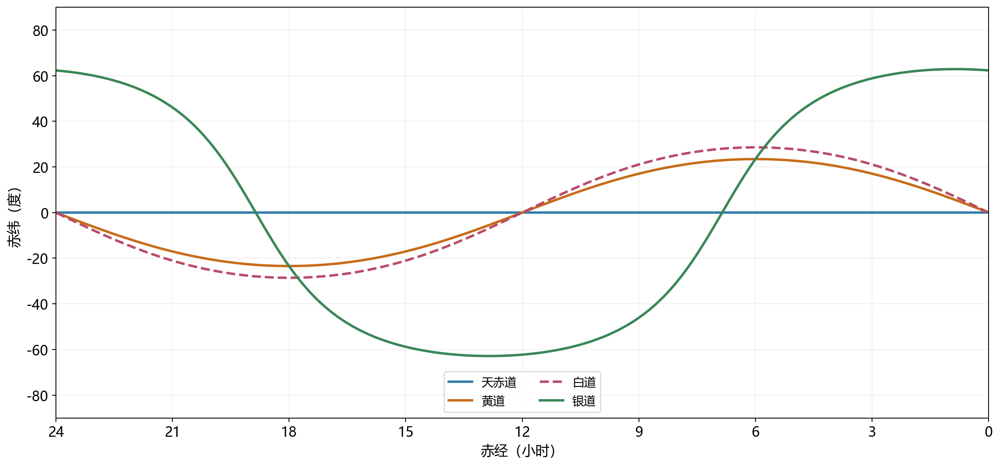
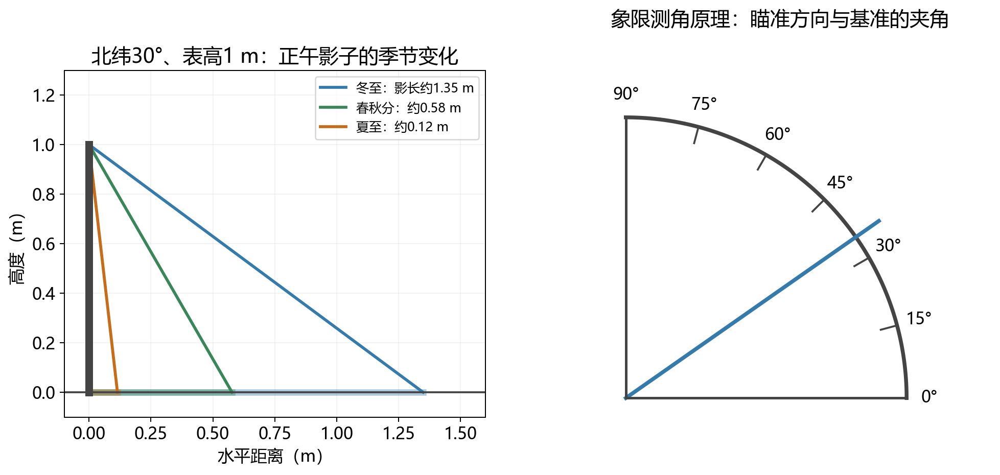
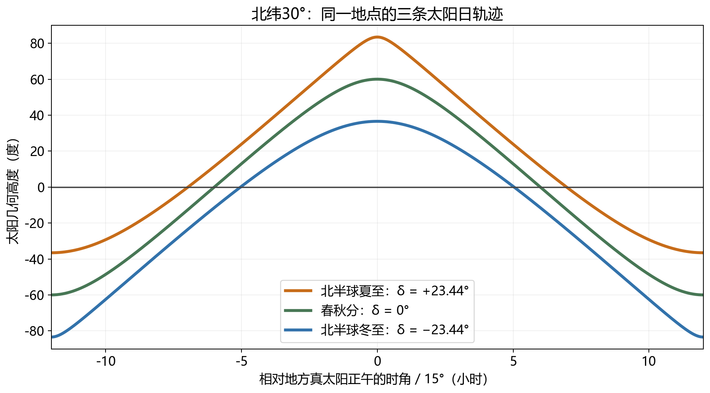
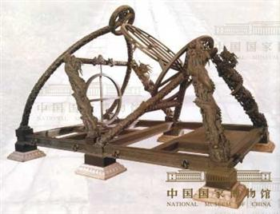
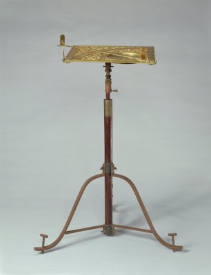
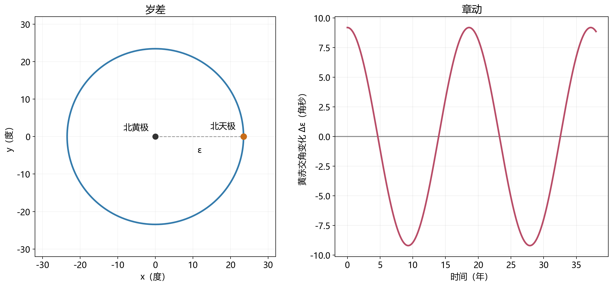

# 07 天空的参照面与地上的测量仪器

竖起一根表，太阳的高度就变成地面上的影长；转动一套带刻度的环圈，恒星的方向就变成能够记录的角度。两种仪器外观差别很大，测量时却都需要先建立参照：表要竖直，读影的地面要水平，环圈的转轴和零刻度要朝向确定的方向。天空中的天赤道、黄道和其他参照圆，正是在这样的需要中获得用途。

参照面通常取自实际物理结构。地球自转提供赤道面，地球公转提供黄道面，月球轨道和银河盘又提供另外的方向。选取与研究对象相联系的平面，可以让运动规律变得简单，也方便把规律做进仪器。随着测量精度和时间跨度提高，这些基准本身的缓慢变化还会进入观测结果：一根指向地轴的机械转轴，最终连接着地球的内部结构和太阳、月球施加的引力。

## 沿地轴建立测量的方向 {#L07-C01}

地球赤道面垂直于自转轴，并经过地心。将它向外延伸，与天球相交便得到天赤道；地轴两端对应北天极和南天极。过球心的平面切出天球上的大圆，大圆把所有方向分成两个半球。以天赤道为零测量的南北角位置，就是赤纬$\delta$。[自转轴与天赤道](../../assets/v02-batch-A-SOURCES.md#a07-01)

这个选择把一天中的恒星运动整理成简单的形状。在一夜的近似下，恒星方向与地轴的夹角几乎不变，地面观察者随地球转动，便看到恒星沿固定赤纬的小圆运行。赤纬70°的恒星距北天极20°，它画出的日周圆就具有20°的角半径。不同恒星速度看起来各异，却都属于同一次地球转动。

把机械转轴安放得与地轴平行，再让瞄准装置围绕这根轴转动，就得到赤道式仪器的基本结构。另一根与极轴垂直的轴用来选择赤纬；选好目标后，在理想恒星跟踪中，只需使装置绕极轴按相应角速度转动，便能持续朝向同一颗星。自然界的自转轴，由此转化成地面仪器的一根轴。[地平与赤道测量关系](../../assets/v02-batch-A-SOURCES.md#a07-02)

地平式仪器采用另一组更贴近场地的基准：竖直轴控制方位，水平轴控制高度。这两根轴便于安装和理解；跟踪一般恒星时，高度和方位会同时改变，需要两轴协调。赤道式与地平式装置各自把一种坐标关系做成了机械结构。选择坐标因此也影响观测操作，而仪器最终测得的仍是同一条天体视线。

实际安装时，竖直与水平可以借助重力确定，极轴方向则要依靠天文定向。刻度的精细程度只有在基准已正确安放时才有意义：极轴偏离，会让恒星逐渐离开预期轨迹；底座倾斜，会给地平高度引入系统偏差。一次可靠测量，需要把定向、瞄准和读数联在一起。

## 黄道把太阳的位置与季节相连 {#L07-C02}

地球绕太阳公转，从地球看去，太阳方向便在恒星背景中沿周年路径移动。这条路径近似为大圆，叫黄道，它对应地球公转轨道面。黄道与天赤道相交，两平面之间的夹角称为黄赤交角$\varepsilon$，目前约为23.4°。[黄道定义](../../assets/v02-batch-A-SOURCES.md#a07-03)

两条大圆的交点给出春分和秋分方向。太阳由天赤道南侧进入北侧的交点是春分方向，沿黄道从这里向东量取的角位置是黄经$\lambda$。春分、夏至、秋分、冬至依次对应0°、90°、180°和270°。黄经表达太阳沿年度路径走到哪里，赤纬表达它偏离地球赤道多少；将两者连接，就能把日历上的季节位置转成地面日照的几何量。

这个连接可以用一个方向向量说明。以春分方向为横轴，在黄道面内取一条与之垂直的轴。太阳的单位方向向量在这两轴上的分量分别是$\cos\lambda$与$\sin\lambda$。黄道面绕交线相对赤道面倾斜$\varepsilon$，第二个分量便有$\sin\lambda\sin\varepsilon$投到赤道面的北侧。单位方向向量的北向分量又等于$\sin\delta$，所以

$$
\sin\delta=\sin\varepsilon\sin\lambda.
$$

春分时$\lambda=0^\circ$，赤纬为零；夏至时$\lambda=90^\circ$，赤纬达到$+\varepsilon$；冬至时则达到$-\varepsilon$。这条关系采用一年内黄赤交角固定的近似，显示太阳赤纬怎样随周年位置变化。椭圆轨道使太阳黄经的增长有快慢，因此等黄经间隔的节气所占天数也会略有差异。[黄经、赤纬与季节](../../assets/v02-batch-A-SOURCES.md#a07-04)

赤纬再与观察纬度结合，得到太阳的地方高度。设纬度为$\varphi$，在球形地球和无折射模型中，太阳上中天时与天顶的角距离为$|\varphi-\delta|$，故正午几何高度为

$$
h_\mathrm{noon}=90^\circ-|\varphi-\delta|.
$$

北纬30°处，春秋分正午高度约60°，夏至约83.44°，冬至约36.56°。同一地点的季节变化，就这样从23.44°的平面夹角转化成影长与受光角度的显著改变。

黄道还为寻找太阳系天体提供方向。主要行星的轨道总体接近同一平面，在天空中便多出现在黄道附近。各轨道的倾角和地球的观察位置共同决定具体偏离；黄道作为参照，把不同天体的角位置放在同一套太阳系几何中。

## 月球轨道与银河盘提供另外的参照 {#L07-C03}

月球轨道面与黄道面平均相差约5.1°。它在天球上对应的近似大圆称为白道，白道与黄道的两个交点就是轨道交点。月球沿轨道运动，方向有时在黄道北侧，有时在南侧；当新月或满月发生在交点附近，日地月的南北偏离较小，才容易出现日食或月食。[月球倾角与食的几何](../../assets/v02-batch-A-SOURCES.md#a07-05)

5.1°在整圈360°中只占一小部分，但太阳和月球的视直径都约为0.5°，轨道的最大南北偏离相当于约十个太阳直径。遮掩需要比较的是这个更小的角尺度。轨道面之间一个看似温和的倾斜，因而足以让大多数朔望避开食。

太阳引力还会扰动月球轨道，使交点沿黄道缓慢退行，约18.6年转一圈。白道相对于天赤道的朝向随之改变，月球能达到的最大南北赤纬也在变化。在简化几何中，两平面的倾斜可以相加或部分抵消，对应约$23.4^\circ+5.1^\circ$与$23.4^\circ-5.1^\circ$的极端倾角。月球升落位置的长期变化，由此同时联系地轴和月球轨道两套方向。[交点运动与倾角范围](../../assets/v02-batch-A-SOURCES.md#a07-06)

### 沿银河盘选取坐标 {#L07-C04}

银河在暗夜中形成明暗不均的宽带。太阳位于银河系盘状结构内部，朝盘面方向望去，视线通常穿过较长的恒星和星际物质分布。为了描述这种分布，天文学规定银道面，并以银纬$b=0$的大圆作为银道；银经$l$沿它计量，零点规定在银心附近方向。[银道坐标](../../assets/v02-batch-A-SOURCES.md#a07-07)

银道的基准来自银河系整体结构，天赤道来自地球自转，黄道来自太阳系局部轨道。它们属于不同物理系统，彼此有各自的倾角。采用常用J2000方向关系，银道面与天赤道的夹角约为62.9°。将银河放在一幅全天图的中间，能直接看出天体是否集中在盘面附近，因而特别适合研究银河结构。

照片中银河亮带的轮廓还取决于恒星分布、尘埃遮挡和观测波段，银道面则提供统一、可重复使用的坐标基准。对于天空方向，观察者仍在太阳系附近，银心是天空中的一个方向；研究恒星绕银河中心的三维运动时，可以再把空间坐标原点移到银心。方向参照和空间原点各有自己的用途。

*图1：课程原创方向图，采用赤经—赤纬平面投影。黄赤交角取23.44°，白道相对黄道倾角取5.145°并选择一组示意交点，银道采用常用J2000银极方向。[参数来源](../../assets/v02-batch-A-SOURCES.md#a07-08)、[SVG](../../assets/rewrite-20261025/07/four-circles.svg)与[绘图源](../../assets/rewrite-20261025/07/draw-figures.py)*

沿这些参照圆测量，会得到适合不同问题的坐标。天赤道使恒星日周运动容易表达，黄道把太阳周年运动和季节连在一起，白道显示月球相对于食所需平面的偏离，银道则便于组织银河中的对象分布。接下来要把这些方向关系落到仪器上，太阳的影子提供了最直接的一种方法。

## 太阳高度怎样变成一条影长 {#L07-C06}

取一根竖直的表，立在水平面上。阳光沿近似平行的方向照来，表顶、表脚与影子端点形成直角三角形。表高记为$H$，影长记为$L$，太阳高度为$h$，则

$$
\tan h=\frac{H}{L},\qquad L=H\cot h.
$$

竖表提供竖直方向，平面刻度提供长度单位，太阳方向便转化为可在地面读取的距离。表与读影的圭结合，构成圭表的基本工作方式。[圭表与测影](../../assets/v02-batch-A-SOURCES.md#a07-13)

在北纬30°，一米高的表在太阳上中天时，冬至影长约1.35米，春秋分约0.58米，夏至约0.12米。太阳越高，影子越短。在这个纬度，正午太阳全年位于天顶南侧，影子向北；进入热带后，太阳赤纬可以超过当地纬度，太阳在一年中有些日子从天顶北侧上中天，正午影子便转向南方。影长与方向一起记录太阳的季节位置。

*图2：课程原创几何图。左为北纬30°、高1米的竖表，冬至、春秋分和夏至的正午光线与影长按上述关系绘出；右为以水平线为基准测量仰角的象限功能示意。横纵坐标以米计，模型采用水平地面和无折射太阳方向。[SVG](../../assets/07/v02/shadow-angle.svg)*

测量也可以反过来使用。若一米高的表产生0.58米长的影子，太阳高度约为$\arctan(1/0.58)\approx60^\circ$。已知观测日期所对应的太阳赤纬，再记录太阳位于天顶哪一侧，就能由正午高度关系求出当地纬度。若地点已知，同一组测量则可用于推断太阳赤纬，并追踪季节。一个高度观测把纬度与太阳位置联系起来，求其中一个量时，另一个量需要由日期、地点或其他观测提供。

持续记录一天中的影长，可以寻找太阳上中天；连续记录数月的正午影长，可以看到向冬至增长、向夏至缩短的趋势。极值附近变化较慢，因此可靠的极值时刻通常要从前后多次数据的趋势中求得。表的竖直程度、地面的水平程度、刻度和影端的识别，都会进入误差。太阳有约半度的视直径，影子的边缘也带有半影，实际读数需要对这样的边界采用一致方法。

这些细节同时说明了增加仪器尺寸的作用。更高的表能把同样的角变化放大成较大的长度变化，便于读数；结构的弯曲、基座沉降和地面不平却也会随装置进入测量。尺度放大需要与稳定结构和校准配合，才能转换成精度。

## 从太阳日轨迹计算白昼长度

一根表只在太阳位于地平线上方时投下日影。太阳何时升起、何时落下，可以由同一套参照几何计算。记太阳相对本地子午圈的时角为$H_\mathrm{a}$，上中天为零，向西为正。这里给时角加下标，以区别前面表示表高的$H$。纬度$\varphi$与当天近似固定的太阳赤纬$\delta$共同决定太阳高度：

$$
\sin h=\sin\varphi\sin\delta+\cos\varphi\cos\delta\cos H_\mathrm{a}.
$$

这条关系把太阳方向和当地竖直方向作投影比较。太阳升落于几何地平线时，$h=0$；于是，在存在通常日出日落的情形下，升落时角的绝对值$H_0$满足

$$
\cos H_0=-\tan\varphi\tan\delta.
$$

太阳从$-H_0$走到$+H_0$，在地平线上方跨过$2H_0$。用平均每小时约15°的角速度换算，几何白昼长度近似为

$$
T_\mathrm{day}\simeq\frac{2H_0}{15^\circ}\ \mathrm{小时}.
$$

北纬30°处，夏至取$\delta=+23.44^\circ$，算得约13.93小时；冬至取$\delta=-23.44^\circ$，约10.07小时；春秋分赤纬近零，结果为12小时。太阳正午较高、日行轨迹位于地平线上方的部分较长，在同一个模型中共同出现。[高度、时角与升落](../../assets/v02-batch-A-SOURCES.md#a05-04)

*图3：课程原创计算图，纬度固定为北纬30°，赤纬分别取+23.44°、0°和−23.44°。横轴以地方真太阳正午为零，用每15°对应一小时表示时角；与零高度线的交点给几何升落时刻。计算采用一天内赤纬固定、球形地球与无折射近似。[SVG](../../assets/05/v02/sun-paths.svg)与[绘图源](../../assets/05/v02/draw-batch-A.py)*

实际历表的日出通常采用太阳上边缘出现，并计入标准大气折射。太阳中心在几何地平线略下方时，上缘已经可以看见，因此按这种定义得到的白昼通常比几何结果稍长。山地遮挡和当天折射状况还会改变现场的可见时刻。模型给出共同的几何基础，观测条件再决定实际事件怎样出现。[日出日落的定义](../../assets/v02-batch-A-SOURCES.md#a05-05)

到高纬地区，日行圆可能整圈位于地平线上方或下方，出现极昼、极夜。在公式中，这表现为$-\tan\varphi\tan\delta$落在余弦取值范围之外，升落交点消失。太阳最大赤纬约23.4°，由此得到回归线；与它互余的约66.6°则给出理想极圈纬度。地球上几条重要纬线，都可以追溯到同一个平面夹角。

## 两地的影子与地球尺度

一处影长让我们知道太阳相对于当地竖直方向的位置；两处影长则能比较两地竖直方向的差别。太阳距离远，照到相隔数百千米地点的光线可近似平行。若两地位于同一经线附近，在同一天各自的太阳正午测量，高度差便包含了地球曲面的信息。

先取两地正午太阳都在天顶同一侧的情形。因为太阳赤纬相同，正午高度关系中的赤纬项相减后消去，太阳高度差的绝对值等于两地纬度差的绝对值。若太阳分别位于两地天顶的不同侧，则用带方向的天顶距比较，仍能得到两地竖直线的夹角。这个角就是地心看两地的夹角。

设沿经线的地面距离为$s$，夹角为$\theta$，把地球近似为球体，则$s$占整条经线周长$C$的比例，与$\theta$占360°的比例相同：

$$
C=s\frac{360^\circ}{\theta}.
$$

以$s=800$千米、$\theta=7.2^\circ$为例，得到$C=40000$千米。这是一组说明几何关系的数值：角差由太阳测得，地面距离另行测量，两者结合便给出地球尺度。

埃拉托色尼的著名估计采用了类似思路。它的力量来自把远方太阳提供的近似平行光，和地面距离联系起来。历史结果的具体数值还涉及古代长度单位、地点与路线的确定；这些史料问题与几何方法各自贡献一部分证据。[古代地球尺度测量](../../assets/v02-batch-A-SOURCES.md#a07-14)

这也使测影具有双向用途。已有地球尺度和观测地点，可以预测太阳高度；已有太阳位置和影长，可以推地点；已有两地的角差与距离，又能估地球尺度。相同的几何关系，根据哪几个量已经知道，承担不同的测量任务。

## 把参照圆做成可以瞄准的仪器

太阳能在地面留下影子，恒星则需要直接瞄准。浑仪把天球上的参照圆做成环圈，配合转轴和瞄准装置，指向天体后从刻度读取角位置。它的机械关系与前面的天球几何一一对应：与地轴平行的极轴给日周转动提供基准，赤道环给赤纬测量提供零面，其他环圈帮助确定瞄准方向。浑象则侧重把天体位置标在球面上，展示整套空间方向关系。

环圈越多，越能直接表现不同参照关系，也越可能造成遮挡与转动上的约束。郭守敬创制的简仪把主要测量结构分开，分别组织赤道方向的测量、地平方向的测量和定向功能。这样的安排使瞄准更便利，也让不同测量任务拥有较清楚的机械路径。[简仪的结构](../../assets/v02-batch-A-SOURCES.md#a07-15)

*图4：中国国家博物馆“元代简仪（模型）”。模型表现元代仪器设计的整体结构；相关现存实物为明代1437—1442年间仿元制制作。图像及文物说明见[原素材记录](../../assets/v02-batch-A-SOURCES.md#a07-15)。*

观察这类仪器，可以沿测量顺序理解各部分：先由底座与定向结构建立基准，再用转轴和环圈选择天体方向，最后在刻度上读取角度。构件变形会改变基准之间的夹角，转轴松动会影响重复瞄准，刻线和读数方式决定能分辨的角间隔。仪器记录的一行数值，背后是这些机械条件共同维持的关系。

象限仪采用更集中的任务：用四分之一圆上的0°至90°刻度，测量瞄准线与水平或竖直基准的夹角。重力坠线可以给出竖直方向，照准器定义视线，二者在弧尺上形成可读的角度。图2右侧已经画出这种功能关系。

*图5：故宫博物院御制方矩象限仪，清康熙时期。器物带有罗盘、坠线、照准器和游标等结构，用于测量天体高度和天顶距等角量。[文物条目与素材记录](../../assets/v02-batch-A-SOURCES.md#a07-16)*

故宫的器物说明记载，这件方矩象限仪由清宫造办处仿照西式仪器制作。它同时保留了技术传播和本地制作的历史信息。圭表、浑仪、简仪和象限仪各自组织了不同的测量几何；把它们放在实际用途与交流史中比较，便能看到天文观测如何在不同技术传统之间发展。

## 地轴的长期变化进入观测结果 {#L07-C05}

仪器可以把极轴校准到地球的自转方向，但若把观测记录跨越数百年乃至数千年比较，会发现这个方向相对于恒星背景缓慢改变。地球自转使赤道区域略微隆起，太阳与月球对这部分质量施加的引力，给地球带来改变轴向的力矩，形成地轴岁差。[NASA关于岁差与章动的说明](https://earth.gsfc.nasa.gov/geo/multimedia/nutation-and-precession)

日月引力在地球近侧和远侧的大小、方向略有差别。对具有赤道隆起的地球，各部分质量的位置又与自转轴相联系；当外部天体的方向倾斜于赤道面时，这些引力对地心的转动效应可以累加，产生力矩。引力的合力改变地球整体的运动，引力矩则改变地球的旋转状态。

理解轴向如何响应，还需要把旋转看作具有方向的运动。自转物体的角动量$\boldsymbol L$近似沿自转轴，大小与转动惯量和角速度有关。外力矩$\boldsymbol\tau$决定角动量的变化：

$$
\frac{\mathrm{d}\boldsymbol L}{\mathrm{d}t}=\boldsymbol\tau.
$$

对接近球形、以对称轴旋转的地球，日月作用在赤道隆起上的平均力矩，主要改变角动量方向。一个短时间内，垂直于$\boldsymbol L$的力矩分量产生横向的$\Delta\boldsymbol L$，新的角动量便转过一个小角度，近似为$|\Delta\boldsymbol L|/|\boldsymbol L|$。旋转持续进行，轴向同时逐渐转动。

这类运动可由旋转陀螺获得直观印象：重力矩持续改变角动量方向，陀螺轴端绕竖直方向进动。地球的力矩来自日月对非球形质量分布的作用，实际受力结构与陀螺不同，但角动量随力矩转向的关系相通。地球近似对称的赤道隆起、倾斜的自转轴以及外部引力，共同决定它的长期轴向运动。

在最简单的平均模型中，地轴绕公转轨道面的法线进动，北天极绕北黄极走过角半径约23.4°的圆，周期约26000年。于是，地球赤道面在空间中缓慢转向，当前靠近北天极的北极星，也只是在这一段历史时期适合承担指北标志。其他时代，天极会经过恒星背景中的其他位置；有些时期附近有醒目的亮星，有些时期则较为空旷。

*图6：课程原创模型图。左图以北黄极为中心作等距方位投影，径向距离表示天球角距，岁差圆的半径$\varepsilon=23.44^\circ$；右图取振幅9.2角秒、周期18.6年的单个余弦项表示章动的主要倾角分量，相位任意。[参数来源](../../assets/v02-batch-A-SOURCES.md#a07-11)、[SVG](../../assets/rewrite-20261025/07/precession-nutation.svg)与[绘图源](../../assets/rewrite-20261025/07/draw-figures.py)*

天赤道转向，黄道与天赤道的交点也随之移动。传统赤道坐标以春分方向作为赤经零点，所以即使暂把恒星方向固定，坐标数值仍会随基准的转动而变化。前一篇历法中回归年与恒星年的小差别，正是在追踪移动季节基准和固定恒星背景时出现的结果。

月球轨道又在倾斜的平面内运行，交点缓慢退行，给地球施加的力矩随时间变化。平滑岁差上因而叠加了许多较小的周期摆动，称为章动。其中一个主要周期约为18.6年，主要黄赤交角分量的振幅约9.2角秒，即约0.0026°。这远小于月球约0.5°的视直径，却足以影响精密测角。长度一米的指向杆若转动一角秒，端点横向移动约五微米；角秒尺度已经把机械稳定性与方向建模紧密联系起来。

## 从机械基准到空间参考框架

现代精密天文学使用遥远河外天体建立空间方向基准。国际天球参考系ICRS以这类远方源确定近似稳定的坐标方向；地球在其中的姿态，再由岁差、章动以及实际观测的地球定向参数来描述。星表中的空间方向因此可以和某一日期、某一地点的仪器指向相连接。[国际天球参考系](../../assets/v02-batch-A-SOURCES.md#a07-10)

这里还要比较自转轴相对于地壳的位置，这种变化称为极移；地球自转快慢也有微小变化。岁差与章动描述轴在空间中的方向变化，极移描述轴相对于地面的变化，自转速度则决定地球绕轴转到了哪个角度。它们共同影响地面仪器此刻朝向哪里，需要由持续观测更新。[地球定向资料](../../assets/v02-batch-A-SOURCES.md#a07-12)

一根表把太阳方向变成影长，一套环圈把恒星方向变成角度，现代观测则把地球的姿态与遥远天体构成的参考框架联系起来。测量精度提高以后，原先足够稳定的基准会显露出新的变化，而这些变化又成为可以研究的物理现象。地轴从仪器赖以定向的参照，变成研究引力、旋转和地球结构的对象，正是这种进展的一部分。
