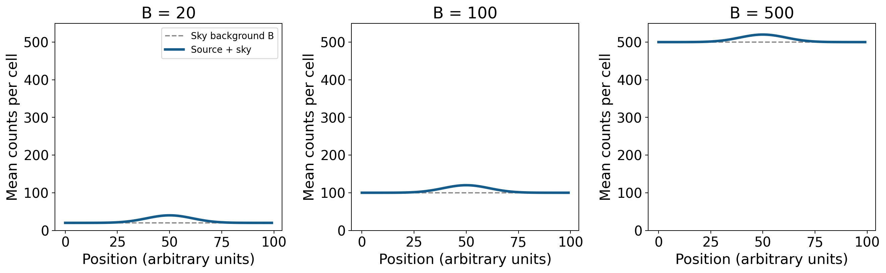

# 08 星光穿过大气与眼睛

冬夜的猎户座星云在望远镜里显出一片淡淡的辉光，附近的恒星则是几个集中的亮点。月亮升起以后，星云外缘逐渐难以辨认，那几个亮点仍然清楚；另一个没有月光的夜晚，星云可能显得更宽，靠得很近的两颗星却始终晃成一团。观测中的这些变化，分别发生在光量、背景和图像形状上。要解释它们，可以沿着光抵达观察者的过程，依次考察大气、天空背景与眼睛。

对一片星云，我们希望察觉它比周围天空多出的微弱光；对天空中靠近的一对恒星，我们希望分开两个很接近的方向；对月球，我们希望看清坑壁与阴影的边界。这些目标对观测条件提出了不同要求。知道要求从何而来，便能根据当夜的天空安排观测，也能理解同一架望远镜为何在不同夜晚表现不同。

## 一条随时间改变的视线 {#L08-C01}

天体在星图上有位置，在本地天空中又有随时间变化的高度。高度角 $h$ 从地平线的 $0^\circ$ 量到天顶的 $90^\circ$；地球转动时，恒星沿着各自的周日轨迹升高、过中天、降低。视线经过的树木、楼房和山脊先决定目标是否露出，视线穿过的大气则继续影响所见图像。

目标经过本地子午线而达到最高位置，称为上中天。设场地纬度为 $\phi$，天体赤纬为 $\delta$，忽略折射，上中天高度为

$$
h_{\max}=90^\circ-|\phi-\delta|.
$$

这个关系来自天赤道、天极与当地地平面的几何。在北纬 $30^\circ$ 的场地，赤纬为 $0^\circ$ 的目标最高达到 $60^\circ$，赤纬为 $-30^\circ$ 的目标最高只有 $30^\circ$。两者即使在大气外一样明亮，到达地面的光也经历了不同长度的空气路径。某些目标在整个夜晚都升不到很高的位置，选择更合适的地理纬度便有实际意义。

季节改变了夜半所朝向的恒星背景。冬季夜晚可以在较高位置观察猎户座，几个月后，它与太阳在天空中的方向接近，主要出现在白昼。月球和行星还会相对恒星背景移动，具体时段由当日星历确定。一场观测因此同时包含两种时间安排：让目标达到较高位置，以及让这一时刻落在合适的夜色与月光条件中。

## 高度、空气柱与星光的损失

先将大气近似成一层层水平的薄层。沿天顶方向穿过每层空气，路程最短；视线倾斜后，在每层中走过的距离按相同几何比例增长。把沿视线的空气柱量除以天顶方向的空气柱量，得到无量纲的相对大气质量 $X$。在中高空的平行层近似中，

$$
X\simeq\frac{1}{\sin h}.
$$

天顶的 $X=1$，高度 $60^\circ$ 时约为 $1.15$，高度 $30^\circ$ 时为 $2$，高度 $15^\circ$ 时约为 $3.86$。高度越低，继续降低同样的角度所增加的空气路径越多。接近地平线时，计算需要采用含地球曲率、大气分层和折射的模型；这里的关系适合估计中高空的路径变化。

*图 1｜左图为平行大气模型的 $X=1/\sin h$；右图固定三个假定消光系数，计算地面通量与大气外通量之比。模型取无云、消光系数恒定的条件。课程原创计算图，生成源见[原素材记录](../../assets/v02-batch-B-SOURCES.md)。*

光在这条路径上可以被气体吸收，也可以被分子和气溶胶散射到其他方向。沿原方向收到的光量随之减少，这称为大气消光。若各段空气性质相同，每多经过同样一段空气，留下来的光都再乘同一个比例；若每段保留九成，经过两段后便留下 $0.9^2=0.81$。因此，传播损失是逐段相乘的。

天文学常用星等表示这种变化。星等差与通量比之间的关系是 $\Delta m=-2.5\log_{10}(F_2/F_1)$，其中星等增大表示收到的通量减小。对性质稳定的大气，同一波段每单位大气质量造成的减光记为 $k$，单位为星等每大气质量，则

$$
m_\mathrm{ground}-m_\mathrm{above}=kX,
\qquad
\frac{F_\mathrm{ground}}{F_\mathrm{above}}=10^{-0.4kX}.
$$

用对数来表示亮度，逐段相乘的损失就成了星等中的逐段相加。取一个假定的 $k=0.20$，同一天体在高度 $30^\circ$ 和 $60^\circ$ 时的大气质量相差约 $0.85$，低处额外变暗约 $0.17$ 星等，其通量是高处的约 $86\%$。高度降到 $15^\circ$ 时，相对 $60^\circ$ 的通量比例进一步降到约 $61\%$。即使天空没有云，目标升高也能带来可测量的变化。

实际的 $k$ 随波段、气溶胶含量和大气状态改变。用已知亮度的标准星在不同高度的观测，可以拟合星等对 $X$ 的变化，求出当夜的消光系数，并把地面测量还原到大气外。[ESO 的 La Silla 消光资料](https://www.eso.org/sci/observing/tools/Extinction.html)给出了一个台站不同波长的历史测量，显示蓝端消光较强，同时说明火山等自然过程会改变这些系数。消光既是观测条件，也是测光时需要测定的一项物理量。

波长不同，传播还会有另一种差异。空气折射率随波长改变，蓝光与红光受到的折射角略有不同，低空行星的两侧因而可能出现不同颜色的边缘。这种大气色散把原本来自同一位置的光分开；前面的消光则改变各波长留下来的光量。两种效应同时存在时，低空目标既可能偏红，像也可能沿着接近竖直的方向被拉开。[ESO 的差分折射图](https://www.eso.org/sci/facilities/paranal/decommissioned/vimos/inst/atmos.html)展示了这种位移随天体方向和时刻的变化。

## 天空背景怎样进入视线

大气中的散射也把别处的光送入视线。城市灯光向上或向水平传播，被空气中的分子和悬浮粒子散射，其中一部分朝向观察者，于是星云周围的天空增加了一层亮度。月光通过同一机制照亮夜空。薄云和气溶胶既能削弱目标光，又能把地面与月球的光散进观测方向，二者叠加，对淡目标尤其明显。

附近一盏灯还有一条更短的路径：它可以直接照进眼睛，在眼内散射并产生眩光，同时改变眼睛的适应状态。用遮挡物挡住这盏灯，能减少局部干扰；远离城市，则能减少更大范围灯光造成的天空辉光。场地选择中的遮光与远离光源，分别作用于这两条路径。

*图 2｜Paranal 的建筑灯光、山脊与银河。ESO/P. Horálek，[原发布页](https://www.eso.org/public/images/potw1936a/)，CC BY 4.0。可见光夜景摄影，沿用机构 4000 像素版本，未裁切或重新赋色；画面亮度由曝光和显示处理共同形成。*

由此可以分别描述透明度和背景亮度。透明度较高时，目标的光能较充分地穿过大气；背景较暗时，观测方向额外贡献的光较少。城市在晴朗、少尘的夜晚可以有较高透明度，却仍有明亮背景。偏远地点遇到薄云时，背景可能较暗，星光的透过率却降低。专业台站因此把透明度、月光和大气湍流列为不同的[观测条件](https://www.eso.org/sci/observing/phase2/ObsConditions.html)。

月光造成的背景随月相、月球高度、目标与月球的角距离以及大气状态变化。上弦月落下以后，后半夜可以留下较暗的时段；满月附近，月球通常在夜间较长时间位于地平线上方，淡星云的观测窗口便缩短了。对于月面本身，主要信号正是反射的太阳光；对亮行星和明亮双星，足够强的目标光也使它们较能耐受明亮背景。于是月亮出现以后，把观测重点转向月面地形或行星细节，是由信号性质决定的安排。

远离人工灯光并避开月光以后，仍有天然的天空背景。高层大气中的原子和分子在激发、复合及化学反应过程中发出气辉；行星际尘埃散射太阳光，形成黄道光；视线中尚未分开的恒星和星系也贡献光。地面观测不断压低人工背景，最终会逐渐接近这些天然背景所给出的条件。气辉还可用于研究高层大气的组成、温度与运动，见[NASA 的气辉说明](https://www.nasa.gov/solar-system/why-nasa-watches-airglow-the-colors-of-the-upper-atmospheric-wind/)。

*图 3｜高层大气的红绿气辉与远处银河同时入画。Y. Beletsky (LCO)/ESO，[原发布页](https://www.eso.org/public/images/potw1638a/)，CC BY 4.0。沿用机构 4000 像素可见光全景版本，未裁切或重新赋色；相机记录和显示使微弱颜色变得显著。*

## 从总光量走到面亮度与对比度

一颗恒星在小望远镜里通常成像为一个小光斑。一片星云却将光铺在很大的角面积上。即使两者送来的总光量接近，星云每一小块区域为天空增加的光仍可能很少。辨认这样的扩展天体，要考察面亮度，即每单位角面积的通量。

设两个均匀目标总通量相同，一个占 $10$ 平方角分，另一个占 $100$ 平方角分，后者平均面亮度只有前者的十分之一，对应每单位角面积相差 $2.5$ 星等。真实星云和星系内部的面亮度又有起伏：明亮核心先显现，较暗的外缘随后逐渐浮出。观测能达到的面亮度决定了我们看见多大一片结构，因此同一星系在不同天空条件下会呈现不同的可见范围。

把同一波段、同一角面积内的目标增量记为 $S$，周围天空的背景记为 $B$，目标所在区域的总亮度为 $S+B$。相对于背景，增加的比例是

$$
C=\frac{(S+B)-B}{B}=\frac{S}{B}.
$$

若星云外缘贡献 $S=20$，背景为 $B=100$，外缘只比周围亮 $20\%$。月光使背景升至 $500$ 时，这个增量比例降到 $4\%$。星云较亮的中心仍能与背景分开，外缘则更难被眼睛察觉。随着背景变化，原本连续的亮度分布在视觉中呈现出不同边界。

*图 4｜同一个人工高斯形目标，峰值增量固定为 20，背景依次为 20、100、500。虚线表示背景，实线表示目标加背景，峰值对比度分别为 1、0.2、0.04。三图采用相同纵轴；该图表示平均信号的叠加，视觉阈值与光子涨落另由相应模型描述。课程原创计算图。*

相机可以估计背景的平均值，再从图像中减去它。光子到达的数量还会逐次起伏：在独立到达的泊松计数模型中，平均计数为 $N$ 时，标准差为 $\sqrt{N}$。目标光与背景光都参与这项涨落。因此，即使已经很准确地知道平均背景，目标测量仍带有来自全部光子的随机变化。

取固定的测量区域，累计目标计数为 $N_S$、背景计数为 $N_B$，在光子噪声占主导、背景均值估计足够精确时，信噪比近似为

$$
\mathrm{SNR}=\frac{N_S}{\sqrt{N_S+N_B}}.
$$

当背景计数远大于目标计数，背景增加四倍会使同一次曝光的信噪比约减半。若目标和背景的计数速率分别为 $s$、$b$，曝光时间为 $t$，代入 $N_S=st$、$N_B=bt$，得到

$$
\mathrm{SNR}=\frac{s}{\sqrt{s+b}}\sqrt{t}.
$$

在这组稳定条件下，把降到一半的信噪比恢复到原值，需要把曝光时间增加到四倍。这给出了暗天空对于淡目标摄影的直接价值。实际相机还包含读出噪声、暗电流与背景估计误差，[STScI 的曝光计算说明](https://ssb.stsci.edu/cdbs/perigee/jyounger/PhaseI_IHB_JavaHelp/WFPC2/ch6_exposuretime10.html)将这些来源分别计入。分多次曝光便于控制饱和、筛选受扰动的图像，每次读出也会增加一项噪声；合适的单次曝光长度由这些量共同决定。

滤镜从另一个方向改变对比。发射星云的一部分光集中在特定谱线，选择相应窄波段可以保留较多目标光，同时减少宽波段背景。恒星和多数星系的光分布在较宽波段，缩窄通带也会减少大量目标信号。滤镜的收益取决于它让 $S$ 和 $B$ 各留下多少。测光、光谱和图像处理会进一步使用这种波长选择。

## 湍流、闪烁与视宁度 {#L08-C03}

空气的温度和密度随位置变化，折射率也随之起伏。来自遥远恒星的光，在进入大气时可以近似看成平面波：同一振动阶段的各点组成一个接近平面的波前。穿过不同空气块以后，各处积累了不同的光程，波前出现倾斜和凹凸。倾斜使像的位置移动，较细的起伏使光在像面上重新分布；这些变化又随气流持续演化。

肉眼看到恒星忽明忽暗，称为闪烁。在传播过程中，波前扰动使地面不同位置接收到的光强出现起伏；气流移动时，眼睛进入较强或较弱的区域，收到的光量随之改变。恒星的视直径极小，近似只有一个入射方向。行星圆面则包含许多略有差别的方向，各部分产生的强度变化有一定的平均作用，所以通常闪烁较弱；在低空和强扰动条件下，行星也可出现明显闪烁。

望远镜还会把同样的波前扰动表现为光斑晃动、变形与展宽。若长时间记录一颗恒星，许多瞬时图像叠在一起，便得到一个较宽的平均光斑。描述大气湍流造成的像宽时，常用视宁度：以指定波长和方向下的长曝光点源像的半高全宽作为角尺度。半高全宽是光强降到峰值一半时，剖面两侧位置之间的距离，通常以角秒表示，$1^\circ=3600''$。两角秒的像宽意味着来自一个极小方向的光被摊在了这样大的范围内。[ESO 的观测条件定义](https://www.eso.org/sci/observing/phase2/ObsConditions.html)还区分了大气视宁与仪器最终记录的图像质量，后者同时包含光学、调焦和跟踪的影响。

对相隔很近的双星，展宽后的两个光斑会互相重叠；对月球，亮坑壁的光会与旁边阴影混合，细小边界的反差减弱。淡星云的大尺度辉光却可能仍然看得见，因为它关心的角尺度比这类扰动宽得多。因此，透明但湍流较强的夜晚仍适合观察较大的弥散结构，明亮行星的精细纹理则更依赖稳定的空气。

湍流也发生在观察者附近。白天受热的屋顶与路面在夜里放热，上升气流改变其上方的折射率；刚从温暖室内搬出的镜筒内部，同样可能存在温差和流动。选择视线避开热屋顶、让器材温度逐渐接近环境，能够减少局部扰动。专业望远镜进一步测量波前并实时校正，形成[自适应光学](https://www.eso.org/public/teles-instr/technology/adaptive_optics/)；它的工作方式将在下一篇接入望远镜的成像过程。

## 适应黑暗的眼睛 {#L08-C02}

星光终于进入眼睛以后，能否被察觉仍随时间变化。从明亮房间走到夜空下，开始只能看见亮星，稍后出现更多暗星，这一灵敏度恢复过程称为暗适应。瞳孔扩大增加入光量；视网膜中的光敏色素再生，以及视觉通路对信号的处理，也在继续调整。

视锥通路适于明亮条件下的颜色与细节辨认，视杆通路在很暗环境中有较高的弱光灵敏度。实验测量常显示先较快、后较慢的阈值下降，充分的视杆暗适应可以延续数十分钟。所需时间受此前光照的强度和时长、观察波长、目标大小以及视网膜位置影响。这些因素共同解释了为什么离开灯光后需要持续停留，以及突然查看明亮屏幕后，暗星会暂时变得难以察觉。[Kalloniatis 与 Luu 的暗适应综述](https://www.webvision.pitt.edu/book/part-viii-psychophysics-of-vision/light-and-dark-adaptation/)展示了相关实验曲线。

视网膜的空间分布还提供了一种观察淡目标的方法。凝视时，目标落在以视锥为主的中央凹；略微移开视线，可以让它落到视杆较丰富的区域，这就是侧视。看淡星云时，缓慢调整凝视方向，有时能让一片微光更稳定地出现。观察明亮月面的细小坑壁时，则可以利用中央视觉的精细分辨能力。两种观看方式分别使用了视网膜的不同特点。

在视杆主导的弱光条件下，颜色辨认能力下降，许多星云因而呈现灰白的辉光。摄影的探测器可以在一段曝光中累计光子，再把不同波段记录映射为颜色；目视与摄影由此呈现不同的外观。实际目视的重点可以落在辉光分布、暗带位置、亮核与邻星之间的关系，这些结构同样承载着信息。

观测中用微弱红光照明，是利用夜视对长波光的相对低灵敏度，使读图和记录对暗适应的干扰较小。灯光保持在刚够看清纸面的水平，朝向纸面和脚下；整理器材或辨认台阶时，则让照明满足实际动作的需要。持续的弱照明环境，使眼睛能在几次查看星图之间维持较高的弱光灵敏度。相关现场用法见[NPS 的观星照明说明](https://www.nps.gov/articles/dark-adaptation-of-the-human-eye-and-the-value-of-red-flashlights.htm)。

## 让每个目标获得合适的条件

回到最初的三类目标。观察星云外缘时，先寻找目标较高、月光较弱且透明度较好的时段；到场后遮住直射灯光，并留出连续的暗适应时间。这样同时提高了到达的目标光、降低了背景、改善了眼睛的检测阈值。若目标上升的同时月球也将升起，就需要比较减少消光与增加背景的两项变化：星云外缘可能更受益于前半夜的暗背景，即使那时高度略低。

观察一对明亮而靠近的恒星时，重点转向光斑的稳定和分离。让目标升高，避开局部热气流，调整好焦点，然后持续看一段时间，可以发现两颗星在较稳定瞬间分开，在较强扰动时重新混合。月面的细小结构也有相似表现。亮度充足使这些目标有条件采用较大的图像尺度，具体倍率则由望远镜口径、成像质量和眼睛共同决定。

观测记录可以保留这种比较过程。写下时间、地点、目标高度、月球和云况、器材与倍率，再标出看到的亮核、暗带、星点或坑壁；若做了调整，也记下调整前后的变化。描画星云时，先用邻近恒星固定位置，再画出可反复确认的辉光范围；记录双星时，注明两个亮点的相对方向及分离是否稳定。下一次在不同背景或视宁条件下重复观察，这些记录就能显示哪些结构随条件显现，哪些位置关系始终保持。

同一片天空因而可以被多次、逐层地读出。暗背景让微弱外缘浮现，稳定空气使紧邻的结构分开，充分暗适应提高眼睛对微光的灵敏度。下一步，望远镜将收集比瞳孔更多的光，并把来自不同方向的光安排到合适的位置和尺度上。

---

资料与图源：[参考说明](../../assets/rewrite-20261025/08/SOURCES.md)；[原来源与素材记录](../../assets/v02-batch-B-SOURCES.md)、[原素材表](../../assets/v02-batch-B-ASSETS.csv)。
