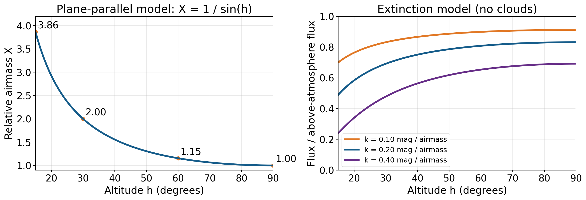
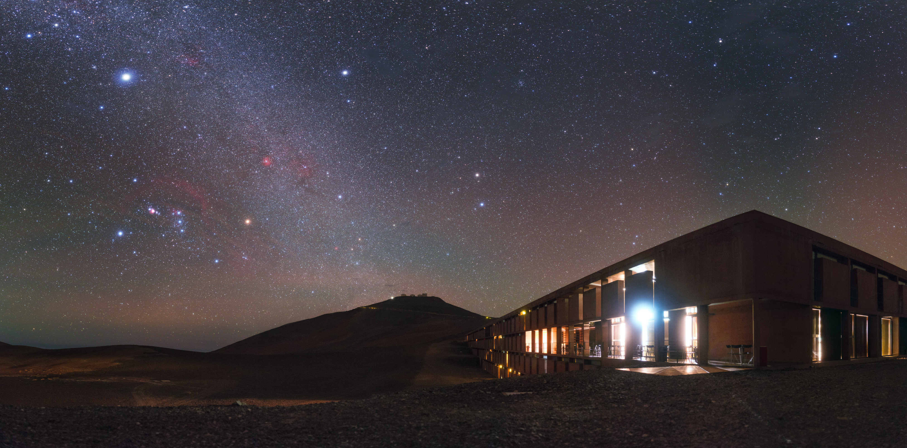
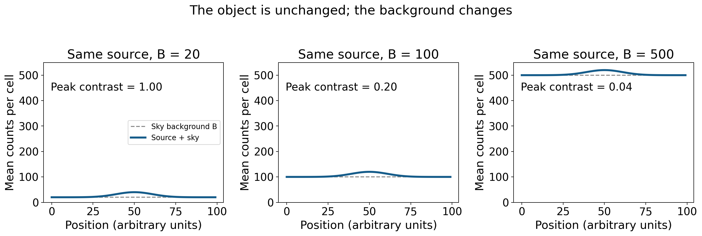
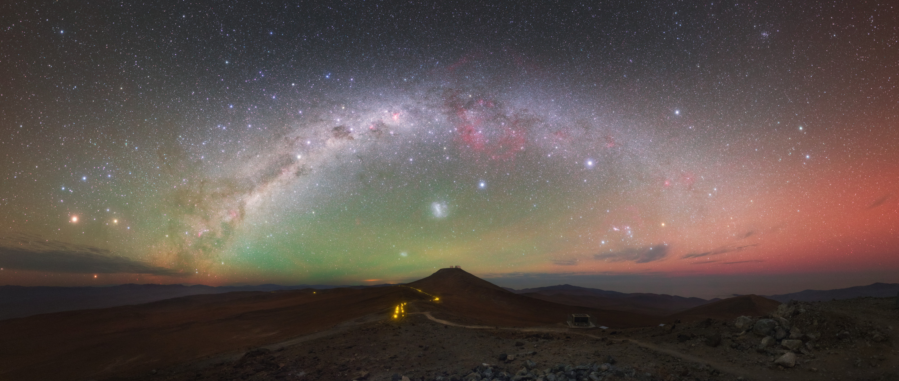

# 看见星光以前：一夜观测中的大气、背景与眼睛

同一颗星，在城市窗边只是一点勉强辨认的微光，到了远离灯火的地方却可能成为银河背景上的醒目标记。同一架望远镜，昨夜显示出木星云带的细纹，今晚却像隔着流动的水面。同样写着“晴”的天气预报，有时适合拍暗弱星云，有时只适合看看月球。这些差别不是天空随意给观察者的奖励，而是光从天体到眼睛的途中，经历了不同的损失、叠加与扰动。

准备观测因而不只是寻找一块空地。我们面对的是一个连贯的物理过程：目标在什么方向，光穿过多少空气，天空自己贡献多少光，大气怎样改变图像，仪器与眼睛又怎样提取信号。只要把这些环节分开，一次没有看到预期目标的夜晚也可以留下有用的判断：究竟是天体太低、背景太亮、图像太不稳定，还是目标本来就不适合用这种方式看？[ESO 对观测条件的分别定义](https://www.eso.org/sci/observing/phase2/ObsConditions.html)也是按这些物理差别安排研究观测。

## 先把目标放回具体的天空 {#L08-C01}

天体的位置不是星图上一个与场地无关的点。对站在地面的人，更直接的量是高度角：视线与水平面的夹角，地平线为零度，头顶为九十度。一颗星在星座中的位置基本不变，随着地球自转，它在本地天空中的高度却持续变化。是否“今晚能看”，至少要变成“在这座城市、这一时段、这个方向能看”。太阳系行星和月球还在相对恒星背景运动，不能每年照搬同一张晚间目标表。

天体通过本地子午线、来到一天中较高的位置附近，称为上中天。对常见的非拱极目标，这通常是避开低空影响的好时机。若观察者纬度为 $\phi$，恒星赤纬为 $\delta$，忽略折射，最高高度可写为 $h_{\max}=90^\circ-|\phi-\delta|$。赤纬是天体相对天赤道的南北角位置，与地理纬度有相似的几何含义。取一个北纬三十度的假想场地，赤纬零度的目标最高约六十度，赤纬负三十度的目标最高仅三十度。两个目标即使同样明亮，光抵达地面的处境也不一样。

季节改变的是夜晚朝向哪些恒星方向，而不是某个星座在夏天停止存在。冬季傍晚适合看的猎户座，几个月后可能靠近太阳方向；夏季银河中心方向的观测窗口又不同。换到另一半球，地平线上下的名单也会改变。于是选择季节和时段，实际是在选择一条可用的视线。山、楼和树是这条视线上的近处遮挡；大气是更长的一段传播介质。前者常常先决定有无，后者继续决定质量。这个几何关系足以用于安排，但具体月球、行星和活动时刻仍须查相应日期的星历，不能把本文的假想例子当作某个夜晚的预报。

“等升高一点”也不是无限等待。目标升高可能意味着月亮随后升起、云层到来，或最佳时段已经进入返程时间。现实观测需要在几个变化过程之间取舍：把低空难题减少一半，却迎来更明亮的月光背景，并未必值得。一个实用安排应知道自己在优化哪种信号，而不是只最大化某一个参数。

## 为什么低空的光更难走到我们这里

地球大气大部分质量集中在较低高度，朝天顶看，相当于沿比较短的路径穿过这层空气；斜向地平线看，路径变长。天文学把一条视线沿途空气柱的数量，与当地天顶空气柱相比，定义为相对大气质量 $X$，也常直接称空气质量。它是无量纲比值，和日常空气污染等级不是同一回事。

若把大气近似为水平、平行的层，且目标离地平线足够远，简单几何给出 $X\simeq1/\sin h$。天顶 $X=1$，高度六十度约为 $1.15$，三十度为 $2$，十五度约为 $3.86$。这解释了为什么高度从六十度降到三十度的影响，比看示意图时觉得“只下降了一点”更大。接近地平线时，这个公式会错误地趋向无穷大；真实大气厚度、地球曲率和折射都不能忽略，实际计算须换模型。它在这里提供的是中高空的量级关系，不是地平线附近的精密表。

*图 1｜左：平行大气近似下高度与相对大气质量。右：三个假定消光系数的无云模型，纵轴为地面收到的光与大气外光的比值。曲线是计算示意，不是杭州实测；未计云、折射及随时间变化的气溶胶。课程原创，绘图源保存在同目录。*

分子和气溶胶可以把光散射到别的方向，气体也会在特定波长吸收光，合起来造成大气消光。若一个波段中每单位大气质量造成的消光是 $k$ 星等，大气造成的总减光近似为 $kX$；通量保留比例为 $10^{-0.4kX}$。星等是对数亮度单位，完整定义将在星光文章中展开，此处只需知道零点五星等对应约百分之六十三的光留下来。这种表达把“空气更厚”接成了可以测量的光量变化。

举一个明确设定的例子：取 $k=0.20$ 星等每大气质量，同一天体在三十度和六十度高度间，大气质量相差约 $0.85$，所以低处额外损失约 $0.17$ 星等，收到的通量约为高处的百分之八十六。十五度相对六十度则额外损失约 $0.54$ 星等，保留约百分之六十一。这些数不是通用天气常数。ESO 的 [La Silla 消光测量表](https://www.eso.org/sci/observing/tools/Extinction.html)给出不同波长的历史实测值，也明确提醒火山等现象会改变条件，需要当夜重新测量。山顶、海边、尘雾天气不能共享一张固定表。

消光还与颜色有关，蓝光通常比红光更容易受可见波段散射影响。低空星体因此可能显得偏红。不过，颜色变化还可能来自大气对不同波长的折射差异：星体的蓝色与红色像不完全重合，行星边缘可能出现彩边。那是位置偏移，不只是“蓝光被削弱”。[ESO 的差分折射资料](https://www.eso.org/sci/facilities/paranal/decommissioned/vimos/inst/atmos.html)展示了波段、天体高度与观测时段怎样共同影响光谱仪接收的光。大气在同一条视线上可以同时改变光量、颜色和位置。

## 晴朗、透明与黑暗，回答不同的问题

厚云容易辨认，薄云却可能仍让亮星清楚可见，同时显著影响暗目标。雾、烟尘和潮湿空气中的气溶胶，也能散射光并改变背景。“透明度好”是说星光在指定波段比较容易通过，“天空黑”则是说视线背景贡献的光比较少。一个没有路灯的地方可以因为薄云而不透明；一座城市可以在透明的冷空气中有很清晰的亮星，却仍有很亮的天空背景。仅凭肉眼看到几颗亮星，无法把两个条件合并判断。

人工光造成的天空辉光，也不是灯光越过了星星、把它们物理抹掉。灯向上或向水平发出的光被大气散射，一部分进入我们看天的视线，叠加在目标信号之上。附近灯还可能直接进入眼睛，造成眩光；关掉直射眼睛的一盏灯，常能改善感受，却未必显著降低整座城市贡献的天空辉光。遮住近处光源与远离整体光污染，是作用尺度不同的两件事。[NPS 的暗夜观测说明](https://www.nps.gov/subjects/nightskies/stargaze.htm)也强调场地灯光与周围城市的影响。

*图 2｜ESO/P. Horálek；[原发布页](https://www.eso.org/public/images/potw1936a/)，CC BY 4.0。可见光夜景摄影，下载机构 4000 像素发布版，未裁切或重新赋色。建筑灯与银河同时入画，帮助区分近处直射灯光和天空背景；照片曝光与处理不等同肉眼亮度，不能拿画面像素直接计算天空照度。*

月光也参与这个过程。月球是被太阳照亮的反射体，当它位于地平线上方时，月光经大气散射，使背景变亮；影响大小还与月相、高度、目标与月球的角距离、大气透明度有关。“避满月”是简化的规划经验，不是只看日历上的月相名称就能获得精确背景。上弦月可能在前半夜造成明显影响，待它落下后，后半夜条件又改变；满月夜月球通常在夜间较长时间可见，暗弱弥散目标的窗口就少得多。

对于月球本身，明亮背景却不是同样的问题。我们要看的信号就是月面反射光，明暗交界附近的阴影还能强调地形起伏。行星细节、亮双星等目标也比极淡的星系外缘更能耐受亮背景。这没有把城市观测降为“只能凑合”，而是说明不同目标需要不同的条件。天气、地点不完全理想时，重新选择物理上合适的目标，往往比坚持原来的长名单更有收获。

## 为什么“总亮度不太暗”的星系仍然难看见

一颗遥远恒星，在普通小望远镜下常被成像为小光斑；一个星系却把光分散到一片很大的角面积。把整片星系的光加起来，可以得到不算很暗的总星等，但每一小块天空里只增加了很少的光。判断弥散天体能否从背景中辨认出来，必须看面亮度，也就是单位角面积贡献的通量，而不只看整团光的总和。

暂设两个天体总通量相同，一个铺开在十平方角分，另一个铺开在一百平方角分，且暂时视为均匀。后者平均每单位面积只有前者十分之一的信号，平均面亮度相差二点五星等。真实星系并不均匀，亮核容易先被看见，外层旋臂可能仍隐藏在背景中。所以有人报告“看到了仙女座星系”，另一个人说“看不到照片中的大盘和尘带”，可以同时诚实。两人可能看到的是相同天体的不同亮度层次。

用最简单的叠加模型表示，若目标的单位面积信号为 $S$，背景为 $B$，该处总亮度就是 $S+B$，目标相对背景的增量对比度为 $C=S/B$。背景变为五倍，目标并未改变，对比度却降到五分之一。这就是为什么一片原本稍亮于背景的外缘，会在月光下消失，而亮核还在。此处 $S$、$B$ 必须用同一波段、同一角面积和同一单位；将总星等与每平方角秒的面亮度混除，无法得到这个对比度。

*图 3｜同一人工高斯形目标，峰值增量固定为 20；背景分别取 20、100、500。三图纵轴相同，虚线是背景，实线是目标加背景，峰值对比度为 1、0.2、0.04。它是均值叠加的定量模型，不是星系实拍，也未模拟人眼阈值或相机随机噪声。*

相机为什么不能直接把亮背景减掉，就完全恢复暗处效果？平均背景可以估计并减去，但光子到达具有统计涨落，已经发生的涨落不会一起消失。在忽略读出噪声和背景估计误差的理想计数模型中，若测量区域累计目标计数为 $N_S$、背景计数为 $N_B$，信噪比近似为 $N_S/\sqrt{N_S+N_B}$。背景占主导时，固定目标与曝光，背景增加四倍，信噪比约降到一半；想恢复它，往往需要约四倍曝光。这里讨论的是独立光子计数的简单模型，人眼不能直接套用相机公式，但“减均值不等于减噪声”具有普遍意义。[STScI 的成像信噪比推导](https://ssb.stsci.edu/cdbs/perigee/jyounger/PhaseI_IHB_JavaHelp/WFPC2/ch6_exposuretime10.html)把这些项进一步区分。

## 没有城市灯，天空仍然会发光

若灯光和月光都避开了，天空也不会成为理想的绝对黑色屏幕。高层大气的原子、分子可以发出微弱的气辉；太阳光被行星际尘埃散射形成黄道光；大量无法单独分开的恒星和星系也贡献背景。气辉与极光的产生条件、形态并不相同，不能把夜景里的绿色一概叫作极光。在精密观测中，这些自然背景既是噪声来源，也能成为研究对象。

*图 4｜Y. Beletsky (LCO)/ESO；[原发布页](https://www.eso.org/public/images/potw1638a/)，CC BY 4.0。可见光夜空全景摄影，机构 4000 像素版本，未裁切或重新赋色。红绿气辉与银河同时可见；相机敏感度和后期显示使微弱颜色显著，不能预期肉眼会呈现同样饱和度。*

这张图最值得看的，不只是银河很壮观，而是“优良暗夜”与“天空有背景”可以同时成立。图中天空的色带并不是远方银河发出来的同一种光，它们有不同距离、不同机制。当天然背景已经占据主要地位时，继续遮住一盏很远的小灯，对极限观测的提升就不像城市里那样巨大。条件改善存在阶段，真正的限制会随着环境改变而转移。

窄带滤光也体现同样的选择。若目标是一种在特定谱线发光的气体星云，窄带可以较多保留该线，同时拒绝一部分宽波段背景；若目标是连续光谱的星系，滤镜也会丢掉很多目标光，并不会普遍把城市变成暗夜。滤光的收益必须比较信号与背景的波长分布，而不能把“让画面变黑”本身当作成功。什么能留下来，要由天体的发光机制决定。

## 星星闪烁与图像模糊，是大气的两种表现 {#L08-C03}

气流中温度和密度的起伏会改变折射率，星光通过大气时，原本比较平整的波前受到随位置、时间变化的扰动。波前可以理解为同一振动阶段所形成的面；它的倾斜和起伏改变光接下来传播与汇聚的方式。肉眼看到的星光一会儿亮、一会儿暗，称为闪烁，主要表现为收到光量的变化。望远镜中光斑漂移、膨胀、结构抖动，则关乎图像形状与位置的变化，常用视宁度描述。

恒星对大气传播而言通常近似点源，来自极窄的方向；行星则有有限的角直径，属于扩展光源，肉眼未必能分辨其圆面。圆面不同部分的光穿过不完全相同的路径，部分变化得以平均，所以行星通常闪烁较弱。但“行星不会闪”不是严格规则，低空与强扰动时仍可能闪；“凡闪烁都是恒星”也不成立。[OpenStax 关于大气影响的说明](https://openstax.org/books/astronomy-2e/pages/6-2-telescopes-today)与[ESO 对自适应光学的介绍](https://www.eso.org/public/teles-instr/technology/adaptive_optics/)支持这一点源、扩展源与传播扰动的联系。

视宁度常以恒星长曝光像的半高全宽表示：在光斑亮度下降到峰值一半处量得的宽度，单位为角秒；一度等于三千六百角秒。报出“两角秒的视宁”，是在说一个极小方向上的星光被铺成这样的角尺度，不是恒星本身直径两角秒。实际像宽还包含仪器衍射、调焦、光学误差与追踪误差；大望远镜测得的图像质量，也不必与某个小型大气监测仪的数字完全相同。因而观察到星点很大，不能立刻全归罪于天气。

这解释了透明度与视宁度为什么能走向不同结果：空气很清晰，却有强烈温度起伏，可以看见许多星，行星细节仍然摇晃；空气不那么透明但较稳定，亮行星图像可能反而锐利。专业台站分开记录这些条件，社团观测也可以从“今晚总体不好”推进到更具体的判断。靠近热屋顶、热路面、尚未与环境温度接近的镜筒，还会加入局部气流；搬到无遮挡但热气上升的位置，未必比原处好。对视宁问题，黑暗不是直接的治疗。

## 眼睛也在随时间改变 {#L08-C02}

走出明亮房间，开始时只能看见亮星，过一阵才浮现更暗的星，这叫暗适应。瞳孔扩大增加入光量，但不是全部解释。视网膜中的视锥细胞支持明亮条件下的颜色与精细辨认，视杆系统在较暗环境中对弱光更敏感；光敏色素和后续神经处理也逐渐恢复适于弱光的状态。暗适应从环境改变后便开始，并不是等二十分钟才突然开机。

实验中常见一段较快的视锥适应与较慢的视杆适应，后者能继续改善数十分钟。具体曲线取决于之前光照强度、持续时间、测试波长及视网膜位置，不能用一个固定分钟数保证人人“适应完毕”。因此观测前少接触强光、现场避免突然亮屏，有真实生理意义。[Kalloniatis 与 Luu 的 Webvision 综述](https://www.webvision.pitt.edu/book/part-viii-psychophysics-of-vision/light-and-dark-adaptation/)同时解释了这些依赖条件。把“瞳孔已经够大”当作“暗适应已经完成”，会遗漏较慢的过程。

微弱目标有时偏着看反而更清楚，叫侧视。我们直接凝视时，目标像落在中央凹附近，那里适合精细明视觉；轻微偏移视线，可让信号落到视杆较丰富的区域。这个方法对淡星云的一点模糊亮斑有用，对已经明亮的月面细节却未必更好，因为夜视的灵敏与精细分辨不是同一优势。偏得太远，细节也会减少，不需要把侧视理解成“永远别看目标”。

弱光下许多星云显得灰白，也是这个系统的结果。摄影能够长时间累积信号，再把不同波段显示为鲜明颜色；人眼当场观察并没有同样的积累和显示过程。看到灰色的猎户座星云并不意味着仪器失灵，网上彩色照片也不必是假图。二者回答的是不同记录方式下可以获得多少颜色信息。调整预期，反而能让真实看见的亮核、暗带和细微结构更值得辨认。

观测活动常选微弱红光照纸面，是利用夜视对长波红光相对不敏感的特点。亮度依然关键：足够读图即可，不能照同伴眼睛，过亮红灯也会干扰暗适应。[NPS 的照明说明](https://www.nps.gov/articles/dark-adaptation-of-the-human-eye-and-the-value-of-red-flashlights.htm)给出同样的亮度限定；其中把过程简化成视紫红质的叙述，不应替代完整视觉生理。路面安全又有自己的要求，需要照清台阶时就应提供足够照明。保护夜视不是摸黑冒险的理由，更不意味着红光能防止望远镜看太阳的危险。

## 把条件组织成一夜的选择

假设在北纬三十度的冬季夜晚，想看猎户座方向的一片弥散星云，也想比较亮双星的分离情况。这里不指定某个实际日期，因此月球与时刻必须另查星历。对星云，先确认它能在较高位置出现在月光较弱的时段；对双星，则更关心图像是否稳定，以及两点间隔能否大于仪器和大气造成的有效模糊尺度。一份目标表可以相同，排序却随条件变化：薄云让星云难以辨认时，明亮目标仍可能可用；透明却抖动的空气，让淡星云的检测保留机会，却损失双星的细结构。

对长曝光摄影，还要把“多拍一会儿”的收益说清。在目标与背景速率都稳定、光子涨落占主导的近似下，两者计数都随时间增加，而涨落只随计数平方根增加，因而信噪比大致随曝光时间平方根增长。曝光四倍通常换来两倍信噪比，而不是四倍；若背景随月升或薄云变化，或者仪器追踪发生漂移，这种简单比例就不再完整。长曝光还可能饱和亮核。多张较短曝光可以筛除明显失效的帧并提供时间上的检查，却会重复引入读出噪声，不能宣布无条件比一张长曝光优越。

目视观察无法把这些计数公式原样搬进大脑，但它同样需要管理时间：暗适应与目标升高往往都要等待；在亮目标旁频繁开强光找星，会抵消等待的一部分收益。安排一段安静观察，逐渐确认亮核、邻星与淡外缘，比不断在器材、手机和天空之间切换更有利于形成可信印象。真正的规划不是把任务塞满夜晚，而是让每个目标获得与它所需证据相配的条件。

## 一次观测可以怎样留下证据

观测记录最有价值的部分，往往不是“震撼”“模糊”等评价，而是别人能够理解你处境的信息。记录时间、场地、目标高度的大致范围、月球是否在天空中、明显云况、器材口径与倍率、看见的结构，以及采取了什么调整，便能区分“换了目镜以后看起来更大”和“稳定时真的分出了更细结构”。目视画图不要求像照片一样漂亮，却可以诚实保留位置关系与可辨认细节。

还要区别识别、检测与测量。发现一块淡斑，是检测到了信号；通过位置和邻近星形确认它是某个星系，是识别；报告可复核的角尺度或亮度变化，则进入测量。三者的证据需求逐级增加。看见亮点就称它为某颗行星，或在不稳定图像中声称辨认出一条极细纹，都可能是把预期放进了记录。适当比较相邻时刻、改变倍率、用邻星定位，能够帮助判断；但没有出现的结构不需要为了补全照片而画上去。

同样值得保留失败。若目标在树后，记录的是几何与场地限制；若月亮升起后外缘消失，记录的是背景变化；若亮双星时分时合，记录的是图像质量的波动。它们不是天体自身一定发生变化的证据。分清变化发生在哪里，正是观测由“看到一个景象”变成“理解一条信息”的起点。

星光到达以前的漫长旅途属于宇宙，但最后这段空气、仪器和眼睛同样决定我们能读到什么。暗处适合淡信号，稳定空气适合细结构，高处常减少传播损失，适应后的眼睛更善于察觉微光；这些条件相互补充，却不能互相代替。下一次看到一颗闪烁的星，或者发现照片上的星系在目镜里只剩淡淡核心，我们已经可以沿这条光路追问，而不必用“设备不够好”解释所有差别。

---

**来源与素材记录。** 本文的逐项核验范围及离线图文件见 [批次 B 来源表](../../assets/v02-batch-B-SOURCES.md)与[素材表](../../assets/v02-batch-B-ASSETS.csv)。原试题的观测照明、闪烁问题只是写作起点；具体活动的天气、星历和现场安全需按实际日期核查。本文尚未经过真实人工审校或试讲。
