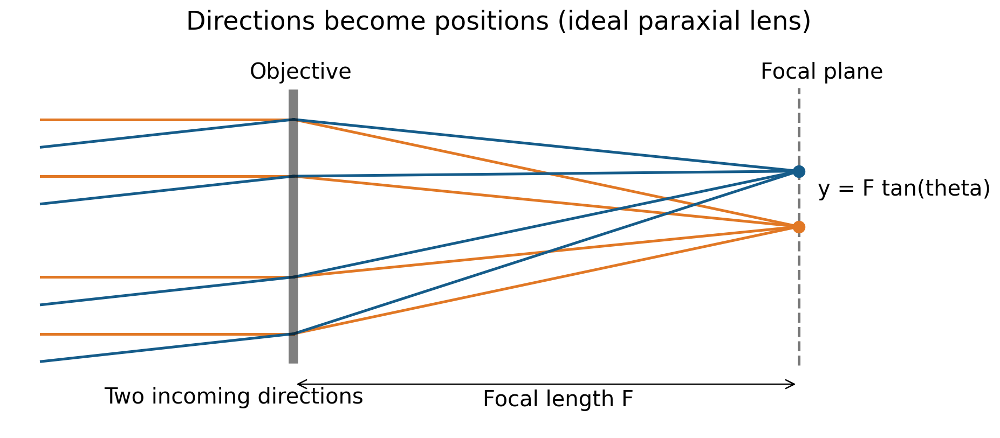
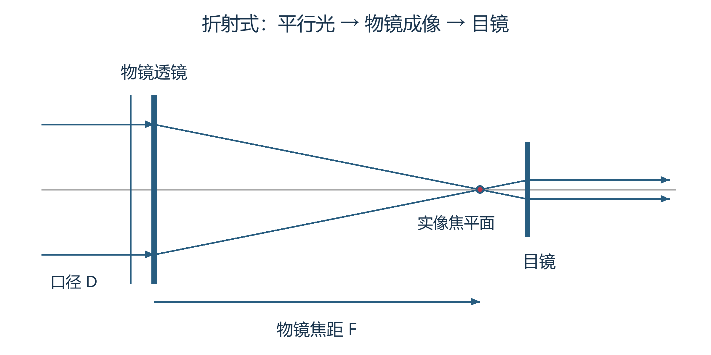
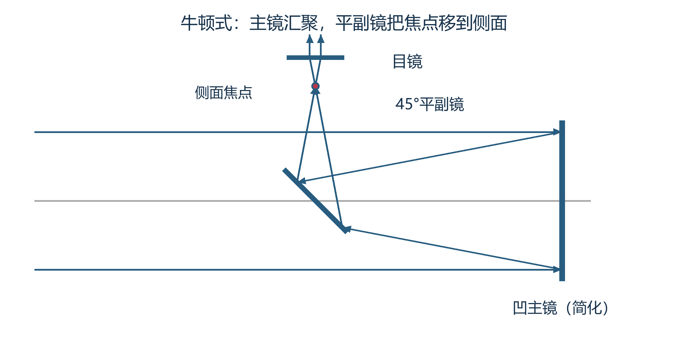
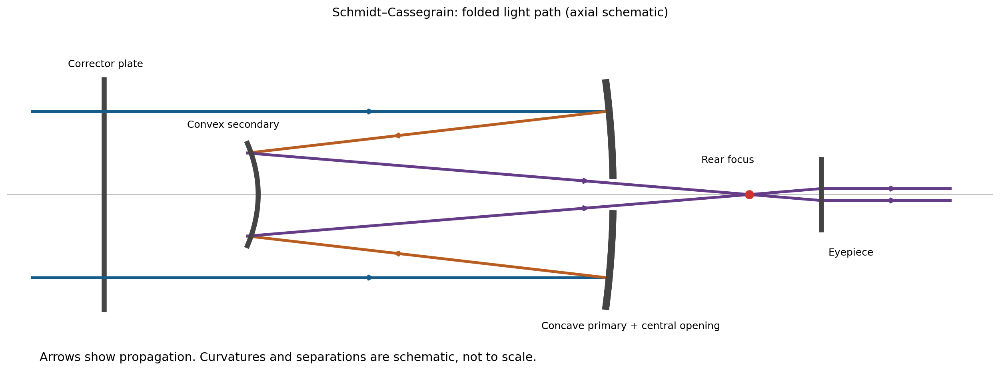
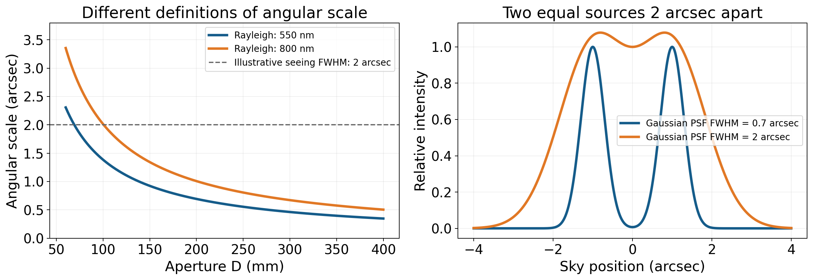

# 望远镜怎样把星光变成细节

在望远镜的参数表里，“几百倍”最容易引起注意。它仿佛承诺把遥远世界拉到眼前：既然一百倍能看见木星圆面，五百倍似乎就该看见更多。但把一幅已经模糊的照片放大，并不会自动出现被抹掉的纹理。望远镜的真正问题也是如此：它收到多少光，能够保留多细的方向信息，又怎样让眼睛或探测器使用这些信息？倍率只是其中一个环节。

这三个问题分别对应集光、分辨和显示尺度。它们相互联系，却不可以用同一个数字代替。大口径常能收集更多光，长焦距会把同样的天体投影成更大的像，换目镜能改变眼睛看到的角大小；至于像是否清楚，还要面对衍射、像差、大气与机械稳定性。沿着光从入射到记录的路线追踪，镜筒外观就会逐渐变成有理由的结构，而不是一组待记忆的器材名称。[OpenStax 的望远镜原理](https://openstax.org/books/astronomy-2e/pages/6-1-telescopes)提供这一收光、成像与检测的基本框架。

## 星光为何能够汇成一个像 {#L09-C01}

一颗星向许多方向发光，抵达望远镜的只是极小的一部分。由于距离远远大于镜面尺寸，同一颗星到达镜面各处的光线方向几乎相同，可以近似画成一束平行光。透镜通过折射、凹镜通过反射，使这一束光会聚到某个位置。对于轴上方向，这个位置叫焦点；从略偏离轴线的方向入射，汇聚位置便向旁边移动。天体不同部分的方向差异，于是转成像面上的位置差异。

“焦点”并不意味着望远镜把所有星星混到同一点。每个入射方向有自己的像位置，许多位置构成一幅像。在理想近轴模型中，若天体方向相对光轴偏离角度 $\theta$，有效焦距为 $F$，焦平面上的像位置近似为 $y=F\tan\theta\simeq F\theta$。最后一步要求角度很小，而且 $\theta$ 用弧度；弧度就是用圆弧长度除以半径表示角度。焦距与像位置必须使用相同长度单位。

*图 1｜理想近轴透镜模型。橙色为轴上方向，蓝色为略倾斜方向，各自的几条光线汇向各自像点。纵向尺寸与焦距不按真实器材比例；未计衍射和像差。课程原创，PNG、可编辑 SVG 与绘图源均保留。*

以视直径约半度的月球为例，半度约为 $0.00873$ 弧度。焦距一千毫米时，月球像的直径约为 $8.7$ 毫米；焦距两千毫米时约为 $17.5$ 毫米。月球没有变大，也没有更靠近我们，改变的是镜头把方向映射成长度的比例。直接把相机放在这个位置，就能够记录图像；不一定需要目镜，更不一定需要一只眼睛先看过它。

这里还有一个常见混淆：焦平面不是所有真实光学系统中天然平整的一张理想纸。有些系统的最佳成像位置随视场方向变化，形成像面弯曲；专门的平场镜可以减轻这种差别。相机传感器通常是平面，中心调得清楚而边缘星点变大，可能正是因为最佳成像面没有与传感器完全重合。这不是天体边缘“比较模糊”，而是映射过程本身有条件。[Celestron 对光学系统与场曲的说明](https://www.celestron.com/blogs/knowledgebase/understanding-focal-reducers)解释了不同系统所需的校正并不通用。

## 折射、反射与折反射，改变了哪段光路

折射式望远镜用透镜作为主要收光成像元件，光穿过前端物镜后向后会聚。结构直观，但玻璃折射率与波长有关，一片普通透镜对红蓝光的焦距不同，可能给亮星或月缘带来彩边，这叫色差。多片不同玻璃、适当曲率的组合能够减轻色差；代价涉及设计、加工和材料。不存在“只要是透镜就完全不清楚”的结论，也不存在一片普通凸透镜对所有颜色完全等效的保证。

反射式主要靠镜面成像，光不用穿过整块厚玻璃。镜面反射的几何规律不像玻璃折射那样产生同类色差，镜子又能从背面支撑，这些特点有利于制造大口径。牛顿式使用后端凹主镜汇聚入射光，再用斜放的平面副镜，在焦点之前把光转向侧面。副镜不是凭自己的平面曲率再创造一次汇聚，只是把原先将到达的焦点搬到方便接收的位置。目镜在前侧，是这条折返光路的外部结果。

折反射式则把透镜或校正板与反射镜组合。例如常见施密特—卡塞格林系统，光穿过前端校正板，抵达主镜，再由副镜反回，穿过主镜中央孔在后方成像。校正板承担像差补偿，副镜还参与改变光束会聚与系统有效焦距；因此镜筒可以比较短，有效焦距却很长。它不是把一支长镜筒随意折成三段之后性能全不变，具体镜面形状、间距和校正都重要。[Celestron 的光学结构说明](https://www.celestron.com/blogs/knowledgebase/the-ultimate-guide-to-celestron-optical-tubes)给出这类系统的实际组成。

*图 2｜前两幅为课程原有原创光路图；第三幅是本轮重绘的施密特—卡塞格林简图，保留可编辑 SVG 和生成源。远处轴上光近似平行；箭头表示传播顺序，曲面、距离与口径简化，不是可据以加工的光学设计图。第三幅只代表折反射系统中的一个例子。*

同一大类内部仍可以有多种设计。有些反射系统将相机直接放在主焦点，有些通过几面镜把光送到仪器平台；有些折反射的前板厚而弯曲，与施密特校正板不同。外壳颜色、筒长和附件位置能提供线索，却不能仅凭一张外观照判定所有内部结构。理解光路带来的收益，是知道应找什么证据，而不是让某一个外形变成绝对分类标准。

## 倍率把谁的角度放大了 {#L09-C02}

直接观看远处天体，眼睛接收到的方向范围很小；目镜把物镜已经形成的像转换成适合眼睛接收的光束，让它看起来占据更大的角度。通常的调节方式把物镜的实像放在目镜焦面附近，出射光对每个像点又近似成为平行束，便于眼睛在较放松的状态下观看。望远镜的角放大率比较的是这个出射角与原天体视角。

在这种近轴条件下，倍率大小 $M\simeq F/f_e$，$F$ 为望远镜有效焦距，$f_e$ 为目镜焦距。两者用同一单位，倍率没有长度单位。若 $F=1950\ \mathrm{mm}$，$f_e=40\ \mathrm{mm}$，得到 $M=48.75$，约四十九倍；一旁的口径 $130\ \mathrm{mm}$ 不进入这个除法。若换二十毫米目镜，倍率约为九十八倍；物镜的收光直径却没有因此翻倍。

焦距相同、口径不同的两架镜，配同一目镜可以有同样倍率，但收到的光与理想分辨能力不同。口径相同、焦距不同的两架镜，也能通过不同目镜配出同样倍率。在讨论“这次用多少倍”时，把物镜、目镜和口径都交代清楚，才知道实际比较了哪项能力。镜筒长度更不能直接替代有效焦距，折返光路早已提供反例。

目镜还决定可见的角范围。目镜给眼睛呈现的开阔范围称为视场，天区中真正覆盖的范围则是实际视场。在适当近似下，实际视场约等于目镜视场除以倍率；更严格的计算使用焦平面处限制图像范围的视场光阑直径。倍率提高时，往往只能看更小一片天空，目标随地球自转离开视野也更快。把一整个疏散星团放进视野，与看木星云带的小细节，并不需要同一个尺度选择。

倍率太低可能使已有细节小到眼睛不能辨认，太高则会把有限光分散到很大的视角，并放大抖动和模糊。中间有一个随目标、眼睛、光学与天气变化的适用范围。厂商列出的最高倍率，是在特定理想条件下的参考，不能保证每夜都有效。[Celestron 的目镜说明](https://www.celestron.com/blogs/knowledgebase/how-to-determine-which-eyepieces-to-use-with-your-telescope)明确把大气稳定、冷却与光轴校准列为条件。实际图像提供的反馈，比一项最高数字更有意义。

## 出瞳：收进来的光能否进入眼睛

从目镜后面离开的一束光有有限直径，这个直径称为出瞳。对通常的天文望远镜，出瞳直径 $d_{\rm exit}\simeq D/M$，$D$ 为有效口径，$M$ 为倍率。它也可写成 $f_e/(F/D)$。眼睛需要放在合适位置，才能接住这一束光；出瞳不是焦平面上的月球像，也不是目镜玻璃本身的直径。[厂商给出的定义与例子](https://www.celestron.com/blogs/knowledgebase/what-is-exit-pupil-and-eye-relief-for-sport-optics)支持这一几何关系，个体瞳孔尺寸则不能一律固定。

一架二百毫米镜用四十倍时，出瞳约五毫米；用一百倍时约二毫米；用二百倍时约一毫米。如果观察者当时瞳孔只有五毫米，而仪器出瞳达到八毫米，外侧的一部分光束会落在虹膜上，不能进入眼睛。对于简单无中央遮挡系统，有效使用的口径近似只剩原口径的五分之八。因此无限降低倍率，不能让眼睛无限收到更多光；它很可能只让视野更宽，同时浪费部分口径。

出瞳还说明为什么相同镜子提高倍率后，月面和星云常显得暗一些。已经分辨为面状结构的目标被扩大，光分配到视网膜更大范围；在出瞳小于眼瞳等条件下，其视网膜照度大致随出瞳面积变化。五毫米变成二点五毫米，面积变成四分之一。月球仍然是同一月球，暗下来来自显示尺度与光束限制。未分辨恒星的情况不同，光主要仍集中在小斑中，不能把扩展目标的面亮度结论直接套给所有星点。

## 大镜能让暗星云像白天一样亮吗

理想、被动的光学系统不能无条件提高扩展光源的表面亮度。与裸眼相比，只要眼睛已经接收了足够大的光束，望远镜主要把目标做大，并扣除一定光学损耗，不会把每单位视角的光凭空增加。这并不与“大口径有助于看见淡星云”矛盾。较大的像使更多结构超过眼睛对小角尺度的辨认限制；大镜还能在相同出瞳、相近面亮度下，允许更高倍率，展示更大的目标。

例如一百毫米镜在五毫米出瞳时是二十倍，二百毫米镜在相同出瞳时是四十倍。若透过率近似相同，两者对均匀扩展目标的视网膜照度相近，后者却把目标角直径扩大到前者两倍。它同时收集四倍总光，又铺开到约四倍面积，两项正好对应。这种具体比较，比笼统说“大镜一定更亮”更能说明器材差别。[出瞳公式](https://www.celestron.com/blogs/knowledgebase/what-is-exit-pupil-and-eye-relief-for-sport-optics)与收光面积、角面积关系共同给出这一推论。

目标和天空背景都通过同一套光学系统，单靠换目镜，不能把均匀星云与均匀背景的物理对比度凭空提高。实际可见性仍可能改善，因为人眼的辨认阈值依赖像的角大小和亮度；点状恒星与背景也有不同的尺度变化。滤镜则是另一路机制，它改变接收波段，收益依赖目标和背景光谱。所以“背景变黑”和“目标信息增加”需要分别判断。光学能够重排已有信息，不能让不存在的光到达。

## 口径为什么能影响细节 {#L09-C03}

几何光线图把同一方向的光汇到数学上的点，但光有波动性。通过有限口径的光会形成衍射图样，点光源也被铺成中央亮斑与较弱的环纹，这叫艾里图样。两颗方向接近的恒星，其图样会重叠；随着间隔缩小，两颗星逐渐难以分开。即使玻璃完美、调焦准确、没有大气，仍然存在这个尺度。它不是加工失败，而是有限口径接收光波的结果。

对无遮挡理想圆孔、单色光，常用瑞利判据定义一个分辨角尺度：$\theta_R\simeq1.22\lambda/D$，其中 $\lambda$ 为波长，$D$ 为口径，两者单位必须一致，所得角度为弧度。换为角秒须乘约 $206265$。这里的一点二二来自圆孔衍射结构，不能随便换成任何镜面的通用系数；中央遮挡、目标亮度差与具体测量方法还会改变细节。[OpenStax 大学物理的圆孔推导](https://openstax.org/books/university-physics-volume-3/pages/4-5-circular-apertures-and-resolution)交代了该判据的定义。

以 $\lambda=550\ \mathrm{nm}$ 为例，一百毫米口径的瑞利尺度约一点三八角秒，二百毫米约零点六九角秒。固定口径，把波长改为八百纳米，衍射尺度增大到原来的约一点四五倍。这就是“口径更大、波长更短，理想角分辨更好”的准确含义。较小的角尺度表示可以处理更近的方向差异，不能误读为能力变差。

*图 3｜左：圆孔瑞利尺度，虚线只表示一个假定两角秒的视宁半高全宽，二者定义不同，不能直接当同一种严格分辨阈值。右：间隔两角秒的两个源，分别以 0.7 与 2 角秒半高全宽的高斯点扩散函数模拟；每个单源峰值归一，比较形状，不比较总通量，也不是艾里精确计算。*

焦距可以把同一个衍射角尺度投影为更大的毫米斑，但不改变原来能分开的天空方向角。因此在理想衍射语境里，直接决定角极限的是口径与波长，不是单独的焦距。实际系统的成像面位置、像差、机械稳定性当然仍会影响图像；把相机法兰距装错可能造成失焦，把它说成影响理想衍射公式的独立参数却不准确。一项参数是否重要，要看我们究竟在讨论哪一个受限模型。

## 为什么专业镜面比人还大

光量方面，理想收光面积为 $A=\pi D^2/4$。口径从一百毫米变为二百毫米，面积增加四倍；若透过率、遮挡和曝光时间相同，来自同一天体的总计数也约增加四倍。这有利于检测暗星、测量微弱谱线、缩小随机误差。它与理想分辨角改善两倍是不同的增长关系：一个跟面积走，一个跟直径的倒数走。

*图 4｜ESO/G. Huedepohl (atacamaphoto.com)；[原发布页](https://www.eso.org/public/images/recoating-ut4/)，CC BY 4.0。Yepun 主镜重新镀铝后的摄影，原发布版 1200×797，未裁切、未重新赋色。人和维护结构提供尺寸参照；镜面在照片中因透视呈椭圆，实际口径是圆形的约 8.2 米。*

八点二米镜与二百毫米镜的直径比为四十一，无遮挡面积比约一千六百八十一。这个数字没有保证每幅照片都锐利一千多倍，却意味着在适当条件下可以收到大量更多的光。专业望远镜常把光交给光谱仪、精密成像器或时间测量装置，需要的不只是人眼当场看见一颗亮星。微弱信息分到很多波长通道之后，每个通道都更缺光，大镜的价值因而特别明显。

实际收光还要乘反射率、透射率与探测效率。几面镜连续反射、滤光片筛选波段、中央副镜遮挡，都能减少最终计数；副镜支架和口径形状还影响衍射纹。相片里星点周围的十字尖刺，往往与光学支撑的形状有关，不是恒星伸出的物质。一个“口径”的数字给出重要能力，却未记录完整系统的所有行为。

## 大气什么时候成为更强的限制

若今晚未经校正的恒星长曝光像宽约两角秒，把口径从一百毫米加到二百毫米，理想衍射尺度虽然从一点三八变到零点六九角秒，实际图像仍可能主要由大气决定。增加口径仍有集光价值，也可能在短时稳定瞬间看到更多细节，但不保证长曝光像宽按口径比缩小。眼睛看到的是大气与仪器共同形成的像，不是单独的理论曲线。

自适应光学会测量波前扰动，快速改变可变形镜的形状，尽量抵消它。自然导星或人工激光导星提供附近方向的测量参照，校正效果依赖波段、视场和大气分层；它不是对任意方向同时抹去整个大气。主动光学则主要维持大镜面较慢变化的正确形状，两种方法的时间尺度与任务不同。[ESO 的自适应光学说明](https://www.eso.org/public/teles-instr/technology/adaptive_optics/)与实际测试展示了这条工程路线。

*图 5｜ESO/P. Weilbacher (AIP)；[原发布页](https://www.eso.org/public/images/eso1824b/)，CC BY 4.0。VLT MUSE/GALACSI 测试拼图，左开自适应光学、右未开。发布页列出约 551—920 nm 的可见光及近红外通道；这是处理后的科学影像拼图，不是肉眼色彩标准。下载 2416×1248 机构版，无改动。*

图中最有力的比较，是口径与目标没有因左右分栏而改变，细节却因校正大气扰动而大幅改善。云系不必等待海王星靠近地球才突然长出，它们一直贡献光，只是未校正的像把结构混在了一起。相反，把右边模糊圆面直接数码放大，无法获得左边的细节。这里真正新增的是被系统保留下来的方向信息。

## 相机像素怎样接住这些信息

相机不是把焦平面的连续图像无限精细地存下来，而是用像素划分区域，每个像素累计其中的光。若像素边长为 $p$，有效焦距为 $F$，在小角度近似下，一个像素对应的天空角尺度约为 $206265\,p/F$ 角秒，两者长度单位一致。四微米像素配一千毫米焦距，需把四微米写成零点零零四毫米，得到约零点八三角秒每像素。

若实际光斑宽两角秒，它跨约二点四个像素；焦距减为五百毫米时，同一光斑仅跨约一点二个像素，形状很难可靠记录；加到两千毫米，则跨约四点八个像素，却没有改变天空上那两角秒的光斑。第一种改变改善了不足的采样，第二种可能主要把相同信息分到更多像素，同时减少视野和每像素计数。像素总数、像素尺寸、焦距与真实图像尺度必须一起考虑。

“每个光斑至少两像素”是常见经验，严格的奈奎斯特采样条件则与最高空间频率、点扩散函数和像素响应有关，不能把所有半高全宽都直接当成一个完美硬阈值。[Hubble ACS 的成像说明](https://hst-docs.stsci.edu/acsihb/chapter-5-imaging/5-3-wide-field-optical-ccd-imaging)就分别给出像素角尺度与随波长变化的采样状况。同一台相机在较短波长下，更细的衍射图样可能采样不足；这不是蓝光失去清晰潜力，而是探测器没以足够细的网格接住它。

摄影中的焦比 $F/D$，又描述入射光锥与像尺度的关系。固定像素大小、透过率和扩展目标面亮度，像素的收光速率大致随 $(D/F)^2$ 变化：焦距较短或口径较大，都可能让单像素接到更多光。但焦距变短也扩大了每像素覆盖的天区。把两张照片缩放到同一角尺度后比较，不能再直接使用原像素的倍数；对点源总光量，也不能一律只看焦比。“快镜”为什么快，需要先说明固定了什么。

## 光学完美以外的误差

有些误差可以通过它们在图像中的分布获得线索。若画面中心星点圆而边角有方向一致的拖尾，要考虑离轴像差；若整幅图的星点都向同一方向拉长，要考虑追踪和振动；若调焦能使中心变细，却使边缘更粗，则要检查最佳成像面的弯曲。它们是诊断线索，不能从单帧照片直接保证唯一答案。空气扰动与光学误差也可能同时存在，控制一个条件再比较，才有机会区分原因。

光轴校准，通常称准直，是让相关光学元件依设计保持合适的位置与方向。反射系统的主镜、副镜若倾斜失配，良好设计也不能自动提供良好图像；调焦只是移动接收像的位置，不一定能补偿倾斜。镜筒刚从较暖室内搬到寒冷室外时，内部温差与热气流又会随时间改变。等待热状态接近环境后进行比较，常比在最初几分钟不断提高倍率更有解释力。校准和冷却也正是前面厂商目镜说明所列出的成像条件。

这些限制共同作用时，最好不要简单把所有角尺度相加。若两个独立模糊过程都能近似为高斯卷积，方差才近似相加，宽度的平方随之相加；艾里环纹、拖线与彗差并不都是高斯。更完整的计算要用各环节的点扩散函数逐步卷积。我们不必立刻完成那套计算，却已经可以理解：不同来源的“二角秒”不必以同一种方式损害信息，仪器说明中的理想极限也不是最后图像的全部答案。

即使避开衍射和大气，我们也要检查像差。球差使靠近轴线与镜面边缘的光不能精确汇在同一点；彗差使离轴星点出现类似彗星的拖尾；场曲使不同视场位置最佳焦面不同。它们不是同一个“模糊”的别名，因此校正方法也不同。调焦能把一个像面移到传感器上，却不能消除所有波长与视场位置的像差。应按设计说明匹配光学组件，而不是把任何能拧上的透镜都当作有效升级。

追踪误差又有自己的特征。由于地球自转，固定镜头中星体位置持续变化，长曝光会把它画成轨迹；跟踪系统试图补偿这个变化，却也有剩余误差。风、平台振动和触碰器材能造成额外抖动。一个非常昂贵、理论分辨率很好的镜子，仍能因安装不稳而记录出长条星点。能否把收到的光放到正确位置上，和收到多少光一样实际。

最终，望远镜可以成为测量系统的一部分：成像相机记录位置与形状，滤光片比较各波段亮度，光谱仪把光分到更窄的波长通道，探测器再将它转成可统计的信号。[OpenStax 对检测仪器的说明](https://openstax.org/books/astronomy-2e/pages/6-3-visible-light-detectors-and-instruments)介绍了这一从视觉观察到永久记录的转变。研究的目标可以是千万分之一的亮度变化，或一条谱线很小的位移，并不总是得到一张看起来更大的照片。

这套集光与会聚能力也使太阳观测格外危险。未经检查的望远镜、双筒镜或相机光学取景器，不能因为眼前戴了日食眼镜就对向太阳；专用安全滤光系统必须与设备匹配，通常在入光前端阻挡危险辐射，由受训人员安装检查。普通太阳镜、红灯和临时深色材料没有这种作用。[NASA 的太阳观看安全说明](https://science.nasa.gov/eclipses/safety/)明确区分裸眼滤镜与集中光线的光学设备。懂得公式不是一次现场操作许可。

当月球首次在目镜里显出坑壁阴影，震撼并不来自一个倍率数字独自工作。光先被口径收集，方向被光学系统映射，细节接受衍射、大气和误差的筛选，最后被适当尺度送进眼睛。理解这条路线，便能知道什么时候该改变倍率，什么时候该等待稳定空气，什么时候该改善采样，也能看懂专业望远镜为什么把那么多精力花在镜面、检测与校正上。它们要保留的是宇宙发来的信息，而尺度只是读懂信息的一种安排。

---

**来源与素材记录。** 具体核验范围、假定算例及本地素材见[批次 B 来源表](../../assets/v02-batch-B-SOURCES.md)与[素材表](../../assets/v02-batch-B-ASSETS.csv)。正文为内容初稿；已有投影片仍是上一版本，尚未同步。人工审校与真实试讲均待进行。
