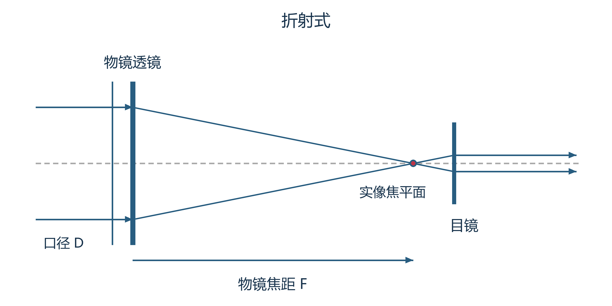
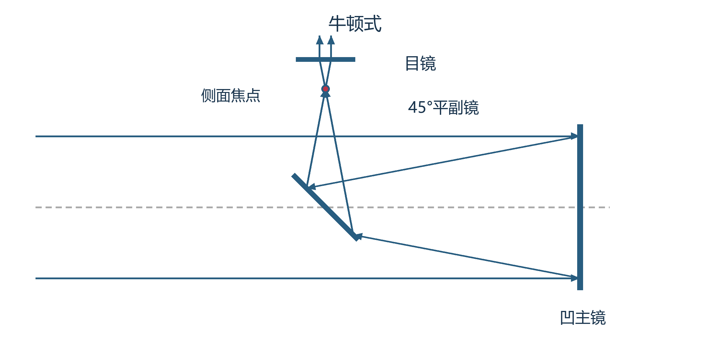
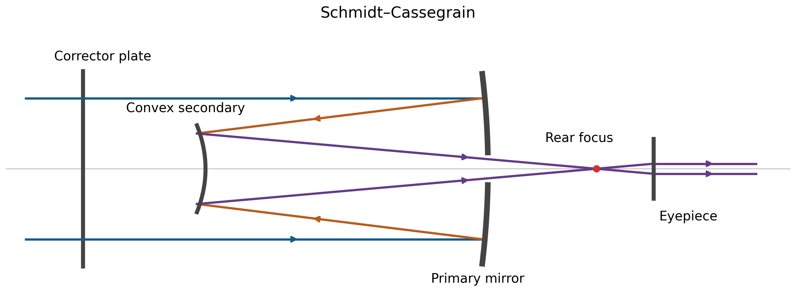
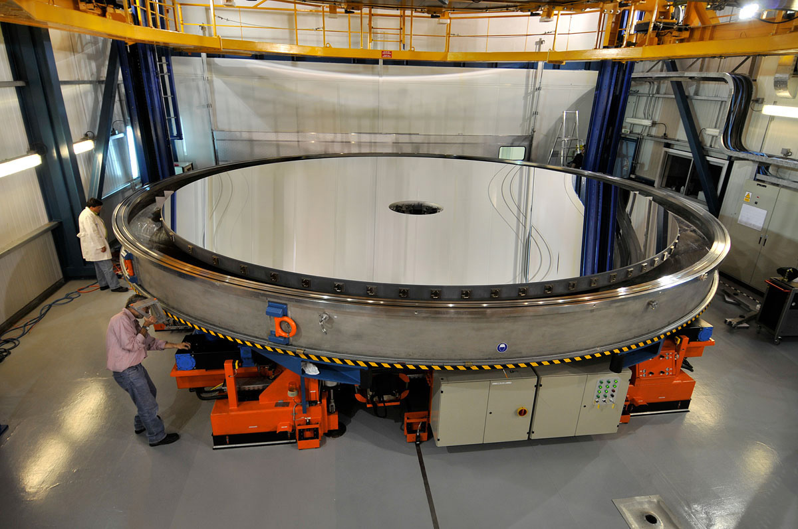
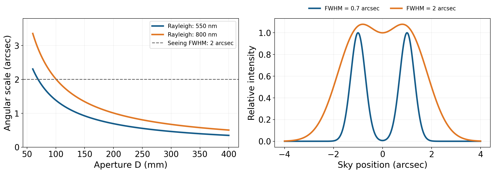
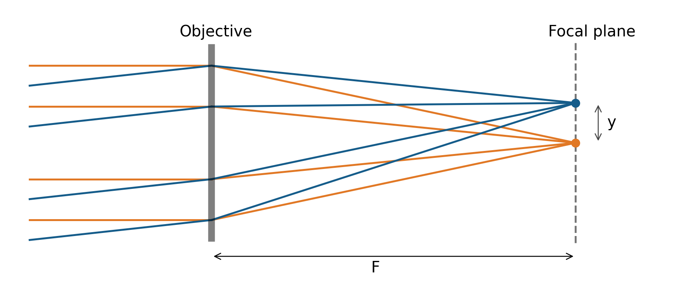
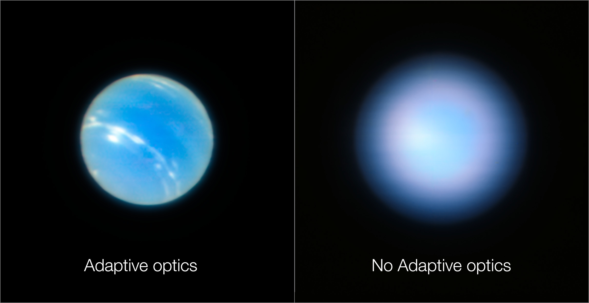

# 09 望远镜怎样形成图像

月球在裸眼中是一小片明亮圆面，望远镜却能显出坑壁、山峰和横过月海的纹理；一对靠近的恒星可以分成两个亮点，淡星云则显出更宽的辉光。这些变化由一整条光路完成：物镜收集光，把来自不同方向的光会聚到不同位置，目镜或相机再接收这幅像。沿这条光路，可以理解口径、焦距、倍率和像素分别决定了什么。

月球、双星与星云将提供三种持续的参照。月面有明亮的扩展结构，双星提供两个相近的方向，星云则以较弱的面亮度铺在较大天区中。同一个仪器参数改变以后，这三个目标会有不同反应；这种反应正好显示了参数背后的光学作用。

## 光线会聚与三种基本光路 {#L09-C01}

一颗恒星发出的光向四周传播，望远镜只截取其中很小的一束。由于恒星距离远大于镜面直径，同一颗星到达镜面各处的光线近似平行。透镜的折射或凹镜的反射使这些光会聚，形成一个像点。另一颗星来自略有不同的方向，它的平行光束就汇聚到邻近位置。月球圆面上的每一小块也各自提供一个方向，众多像点共同组成月球的实像。

折射式望远镜用前端物镜透镜收光并成像。光进入玻璃又离开玻璃时，传播方向依折射定律改变；适当选择曲面，就能使轴上平行光会聚到后方焦点。在可见光中，普通玻璃对蓝光和红光的折射率不同，单片透镜对它们的会聚位置也不同，因此明亮边缘可能出现彩色晕边。把不同玻璃、不同曲率的透镜组合起来，可以让几个波长的焦点更接近，减轻色差。

*图 1｜折射式的近轴光路。物镜先形成实像，目镜再把该像点的光变成适合眼睛接收的近似平行束。课程原创示意，长度与口径按便于阅读的比例绘制。*

反射式望远镜以凹主镜收光。镜面各处的法线方向不同，平行入射光依反射定律转向并会聚。反射的这一几何关系适用于不同颜色，也允许用背面的结构支撑较大镜面。牛顿式把凹主镜放在镜筒后端，光向前返回；一块斜放的平面副镜在光束会聚前将它转向侧面，焦点和目镜便位于镜筒前部的一侧。主镜决定主要的会聚过程，平面副镜改变光到达焦点的路径。

*图 2｜牛顿式光路。主镜使光会聚，约 $45^\circ$ 放置的平副镜将会聚光束转向侧面。凹主镜的轮廓在图中作了简化，光线箭头表示传播次序。课程原创示意。*

折反射式把透镜或校正板与反射镜组合。以施密特—卡塞格林系统为例，光先经过前端校正板，抵达后方主镜，再反射到前方的凸副镜，随后穿过主镜中央的孔，在镜后会聚。校正板补偿主镜等元件形成的像差，凸副镜改变会聚光束的方向和锥角，使系统获得较长的有效焦距。多次折返将光路容纳在较短镜筒里，因此这类望远镜的有效焦距可以明显大于筒长。[Celestron 的光学结构说明](https://www.celestron.com/blogs/knowledgebase/the-ultimate-guide-to-celestron-optical-tubes)给出了这些元件的实际组合。

*图 3｜施密特—卡塞格林系统的传播次序：前端校正板、凹主镜、凸副镜、后方焦点。色线用于区分先后光程；曲面与间隔为示意。课程原创，保留可编辑 SVG 与[绘图源](../../assets/rewrite-20261025/09/create_figures.py)。*

这三种结构最终都将天空方向变成像的位置。眼睛可以通过目镜接收这幅像，相机则可以直接放在相应像面。为了判断图像能有多亮、多细，还要考察进入光学系统的那束光有多宽。

## 口径先决定收到多少光

望远镜的口径 $D$ 是主要入光孔径的直径。对于无遮挡圆形口径，面积为

$$
A=\frac{\pi D^2}{4}.
$$

若某颗星在望远镜处每单位面积、每秒送来 $\Phi$ 个指定波段的光子，系统从入射到记录的总效率为 $\eta$，曝光时间为 $t$，则平均记录的目标计数为

$$
N=\Phi A\eta t.
$$

口径由 $100\ \mathrm{mm}$ 增加到 $200\ \mathrm{mm}$，在其他条件相同时，面积和目标总计数均增加到四倍。这个结果既适用于一颗星，也适用于固定天区内的一块月面或星云。对于暗恒星，更多光有助于检测；对于已能检测的天体，更多计数通常有助于减小相对随机误差。在目标自身光子涨落占主导的情况下，信噪比约为 $\sqrt N$，四倍计数对应两倍信噪比。

*图 4｜VLT 的 Yepun 主镜重新镀铝后的维护摄影。口径约 $8.2\ \mathrm{m}$，旁边的人与维护设备提供尺度。ESO/G. Huedepohl (atacamaphoto.com)，[原发布页](https://www.eso.org/public/images/recoating-ut4/)，CC BY 4.0；沿用 1200×797 发布版，未裁切或重新赋色。*

图中的 $8.2\ \mathrm{m}$ 主镜与一架 $0.2\ \mathrm{m}$ 望远镜相比，直径比为 $41$，几何面积比为 $41^2=1681$。光谱仪将收到的光分到许多窄波长通道，每个通道只分到一部分光；测量暗星的谱线、遥远星系的运动时，这样大的收光面积便十分有用。

真实仪器中，副镜遮挡、镜面反射损失、透镜和滤光片的透射损失，以及探测器效率共同决定有效收光。若中央遮挡直径为 $d_s$，其余部分近似完全通光，几何面积变为 $\pi(D^2-d_s^2)/4$；其后的各项效率再依次相乘。把这些量分开，就可以从口径估计到达焦平面的总光量。

## 有限口径怎样限制方向分辨 {#L09-C03}

光还有波动性。来自同一颗星的光波经过有限口径，在焦点附近相互干涉：有些方向上的振动相互加强，有些方向上相互抵消。理想圆孔接收单色点源时，形成一个中央亮斑及周围逐渐减弱的亮环，称为艾里图样。中央亮斑有有限宽度，所以两颗方向接近的恒星各自形成的图样会重叠。

这个宽度为何与口径有关，可以从孔径两侧的光程差估计。偏离中心方向一个小角度 $\theta$ 时，两侧光程差的量级是 $D\theta$。当它达到一个波长的量级，不同位置的光开始显著抵消，因此图样的角尺度应当与 $\lambda/D$ 成正比。对理想无遮挡圆孔作完整计算，中央峰到第一暗环的角半径为

$$
\theta_R\simeq1.22\frac{\lambda}{D}.
$$

这里 $\lambda$ 与 $D$ 用相同长度单位，角度为弧度。乘以 $206265$ 可换成角秒。瑞利判据取一颗点源的中央峰落在另一颗的第一暗环上，作为两颗点源恰能分辨的参考尺度；这个构造尤其适合讨论亮度相近的点源。[圆孔衍射与瑞利判据](https://openstax.org/books/university-physics-volume-3/pages/4-5-circular-apertures-and-resolution)给出了相应图样。

在 $\lambda=550\ \mathrm{nm}$ 时，$100\ \mathrm{mm}$ 口径对应约 $1.38''$，$200\ \mathrm{mm}$ 对应约 $0.69''$。口径加倍使衍射图样的角尺度减半，两颗较近的恒星因而更容易显示各自的峰。固定口径而把波长增至 $800\ \mathrm{nm}$，角尺度则增大到原来的约 $1.45$ 倍。月面和行星由许多不同亮度的小区域组成，衍射使相邻区域的光混合，细纹的反差随之下降；它们的可见细节还取决于结构本身的亮度差。

*图 5｜左图计算圆孔在 550、800 nm 的瑞利尺度；虚线给出一个假定的 $2''$ 大气像宽作为量级参照，该宽度采用半高全宽定义。右图用间隔 $2''$ 的两个高斯光斑说明展宽怎样减浅双峰间的凹陷，单源半高全宽分别取 $0.7''$ 与 $2''$。各单源峰值归一，图中比较形态。课程原创计算图。*

中央遮挡和副镜支架还会改变衍射图样的光量分配。支架可以在亮星周围形成方向明确的衍射尖刺，遮挡则会调整中央斑和环纹中的能量比例。图样的形状由整个入光孔径决定，观察明亮双星或低反差月面细节时，这些差异会以不同方式表现出来。

## 焦距把天空角度变成毫米尺度

口径已经给出收光面积与衍射角尺度。接下来要确定这些光在像面上占多少毫米。对光轴附近的理想成像，入射方向与光轴的夹角为 $\theta$，有效焦距为 $F$，像点离轴距离为

$$
y=F\tan\theta\simeq F\theta.
$$

最后一个近似要求小角度，并将 $\theta$ 写成弧度。两颗恒星相隔 $\Delta\theta$，它们的像中心便相隔约 $F\Delta\theta$；月球的角直径同样乘以 $F$，得到整个月面像的直径。有效焦距由这种方向到长度的映射定义，也适用于光路多次折返的系统。

*图 6｜理想近轴透镜将轴上方向与略倾斜方向分别汇聚到两个像点。纵向尺寸作了放大，便于显示位置差 $y$；图中只表示几何成像。课程原创示意。*

取月球角直径 $0.5^\circ$，约为 $0.00873$ 弧度。焦距 $1000\ \mathrm{mm}$ 时，月球像直径约为 $8.7\ \mathrm{mm}$；焦距 $2000\ \mathrm{mm}$ 时，约为 $17.5\ \mathrm{mm}$。对相隔 $2''$ 的双星，这两个焦距下的像中心间隔则分别约为 $9.7\ \mu\mathrm m$ 和 $19.4\ \mu\mathrm m$。同样的天空角度，经较长焦距成像后，在探测器上占据更大的长度。

衍射斑也按同样比例放大，其焦平面第一暗环半径约为 $1.22\lambda F/D$。因此，焦距加倍时，双星的像中心间隔和每颗星的衍射斑半径一起加倍，两者的比例保持不变；原来的方向分辨关系被以更大的毫米尺度呈现。这个尺度是否合适，要由后面的眼睛或相机来决定。

相机传感器的尺寸有限。设传感器宽度为 $L$，它覆盖的天空宽度近似为 $L/F$ 弧度。同一块传感器上，焦距加倍使每个天体的线性像尺度加倍，同时使横向视场减半。月面局部需要较细的取样，大范围星云和疏散星团则需要足够大的视场；焦距的选择因此与所研究的角尺度直接相连。

## 目镜倍率与出瞳 {#L09-C02}

为了用眼睛看像，通常把目镜放在物镜实像之后，使这个实像接近目镜前焦面。来自某一像点的光经目镜后成为近似平行束，眼睛便能在较放松的状态下观看。若目镜焦距为 $f_e$，像点高度为 $y$，出射光束与轴线的夹角约为 $y/f_e$；物镜接收时的天体角度则约为 $y/F$。二者相除，得到角放大率的大小

$$
M\simeq\frac{F}{f_e}.
$$

一架有效焦距 $1950\ \mathrm{mm}$、口径 $130\ \mathrm{mm}$ 的望远镜，配 $40\ \mathrm{mm}$ 目镜时为 $48.75$ 倍，约 $49$ 倍；换成 $20\ \mathrm{mm}$ 目镜时约为 $98$ 倍。物镜形成的月球实像保持原来的尺寸，目镜让它以更大的视角进入眼睛。较小的月面坑或双星间隔因此可以达到眼睛更容易分辨的角尺度。

目镜还限定看见的范围。眼睛从目镜中看到的圆形窗口张开的角度称为表观视场，窗口实际覆盖的天区称为真实视场。粗略地，真实视场约等于表观视场除以倍率；从焦面上视场光阑的直径 $d_f$ 计算，则有真实视场约为 $d_f/F$ 弧度。一只表观视场约 $50^\circ$ 的目镜，在 $50$ 倍时大致覆盖 $1^\circ$，可以容纳整个月面及周围天空；在 $100$ 倍时大致只剩 $0.5^\circ$。具体视场随目镜畸变和光阑结构而变化。

目镜后还有一个适合放置眼睛的位置，那里形成物镜入光孔径的像，称为出瞳。出瞳的直径给出出射光束的宽度。在通常的无焦天文望远镜中，近轴光线的相似三角形给出

$$
\frac{d_\mathrm{exit}}{D}=\frac{f_e}{F},
\qquad
 d_\mathrm{exit}=\frac{D}{M}.
$$

眼瞳放在出瞳附近，就能较充分地接收来自整个视场的光束。[出瞳与眼睛位置的说明](https://www.celestron.com/blogs/knowledgebase/what-is-exit-pupil-and-eye-relief-for-sport-optics)还把这一位置距目镜后表面的距离称为出瞳距离，它影响观看的舒适程度。

用 $200\ \mathrm{mm}$ 口径观察，$40$ 倍、$100$ 倍和 $200$ 倍对应的出瞳分别为 $5$、$2$ 和 $1\ \mathrm{mm}$。若眼瞳当时直径为 $5\ \mathrm{mm}$，它能接住前一种光束；若将倍率降到 $25$ 倍，出瞳变成 $8\ \mathrm{mm}$，外侧光便被虹膜挡住。对居中、无遮挡的简单系统，此时实际利用的口径约为 $200\times5/8=125\ \mathrm{mm}$。降低倍率所获得的是更宽的观看范围，同时眼睛只使用了部分入光面积。

## 星云的像大小与视网膜照度

看月面或已分辨的星云区域时，提高倍率通常会让图像显得暗些。原因可以用面积直接推导：固定口径收到的目标总光量一定，倍率提高到两倍，目标在视网膜上的线性尺寸约增至两倍，面积增至四倍，每单位面积获得的光便降到约四分之一。这一关系适用于出瞳小于眼瞳、目标结构已经充分展开且透过率相同的比较。

结合出瞳公式，扩展目标的视网膜照度与 $D^2/M^2=d_\mathrm{exit}^2$ 成正比。出瞳从 $5\ \mathrm{mm}$ 变为 $2.5\ \mathrm{mm}$，照度约降到四分之一。对明亮月面，降低后的照度仍可能足够，而较大的坑壁像有利于辨认；对淡星云，像的扩大和照度下降同时影响可见性，合适倍率往往出现在二者的折中处。

大口径可以在相同出瞳下使用更高倍率。$100\ \mathrm{mm}$ 口径在 $20$ 倍时出瞳为 $5\ \mathrm{mm}$，$200\ \mathrm{mm}$ 口径在 $40$ 倍时也是 $5\ \mathrm{mm}$。若透过率相近，均匀扩展目标的视网膜照度相近，后者的线性像却扩大到两倍。它收集四倍总光，再将光铺到四倍视网膜面积上，于是保留照度的同时呈现更大的结构。淡星云中的形状和小范围亮度变化可以因此更容易察觉。

与裸眼相比，理想被动望远镜对均匀扩展目标所能提供的视网膜照度上限，对应出瞳填满眼瞳的情况；真实透过率还会降低这一照度。望远镜对淡星云的帮助，在于将原本过小的亮度结构展开，并让大口径在较大倍率下仍维持合适的出瞳。对于尚未被眼睛分辨成面状光斑的恒星，更多目标光仍集中在很小范围内，随着倍率上升，周围每单位视角的天空变暗，恒星可能更容易显现。倍率继续升高，恒星的衍射斑和扰动光斑也逐渐成为可见结构。

星云与天空背景通过同一套光学系统，二者的面亮度都随出瞳变化。在均匀区域中，它们的物理对比度 $S/B$ 因此保持近似不变。目视可见性的改善来自图像角尺度和视觉阈值的改变；选择滤镜则可以利用不同的光谱，让信号与背景通过的比例发生变化。这将望远镜的使用接回了上一篇的大气与眼睛。

## 从理想成像走到真实光斑

光在进入物镜以前，已经受到大气扰动。若大气形成的恒星长曝光像宽约为 $2''$，口径从 $100\ \mathrm{mm}$ 增至 $200\ \mathrm{mm}$，理想衍射尺度虽然由约 $1.38''$ 降到 $0.69''$，最终图像仍可能主要受大气展宽控制。双星的光斑更容易重叠，月面小范围的明暗变化被平均。大口径仍增加收光，短暂稳定时也能发挥较细的分辨能力，长曝光的像宽则取决于整段时间的扰动。

自适应光学通过测量波前来改善这一过程。仪器用邻近导星的光，或用激光激发高层大气形成的人工导星，估计不同区域的光程差；控制系统快速调整可变形镜，让反射光获得相应补偿。校正效果随波长、导星条件、湍流分布和视场而变化。主动光学则主要处理重力、温度等造成的较慢镜面形变，维持主镜的设计形状。[ESO 的自适应光学介绍](https://www.eso.org/public/teles-instr/technology/adaptive_optics/)说明了这两种校正所承担的任务。

*图 7｜VLT MUSE/GALACSI 的海王星测试图，左侧启用自适应光学，右侧关闭。两侧使用相同望远镜，云层细节随着大气校正显现。ESO/P. Weilbacher (AIP)，[原发布页](https://www.eso.org/public/images/eso1824b/)，CC BY 4.0。沿用 2416×1248 发布拼图；约 551—920 nm 通道构成的处理后科学影像，保留机构显示配色。*

这组测试使用的窄视场模式，通过多个激光导星估计不同高度的湍流，再校正一小片天区。左图中亮云与较暗区域能保持明显边界，右图则将邻近位置的光混在较大的范围内。由同一套口径和成像系统得到的对照，显示了波前校正对方向信息的作用。[2018 年仪器测试说明](https://www.eso.org/public/news/eso1824/)给出了实际模式和观测背景。

在普通望远镜上，调焦、光轴与温度是可以直接处理的成像条件。相机或目镜偏离最佳成像位置时，接到的是尚未会聚或已经散开的光束，星点因而变粗。主镜和副镜的方向需要按设计相互配合，这项调整称为准直；镜筒内部的热气流则随温差减小而减弱。对这些条件的控制，使物镜已有的成像能力能够到达接收端。[目镜使用说明](https://www.celestron.com/blogs/knowledgebase/how-to-determine-which-eyepieces-to-use-with-your-telescope)也将稳定空气、温度平衡和准直列为发挥倍率作用的条件。

光学设计还决定不同位置和波长的像差。球差使口径边缘与靠近轴线的光不能在同一位置最好地会聚；彗差使离轴星点出现有方向的拖尾；场曲使不同视场方向的最佳成像位置落在弯曲表面上。相机的平面传感器可能因此出现中心清楚、边缘变粗的星点。校正透镜、平场镜以及设计所要求的安装间距，分别处理这些具体关系。查看画面中心与边角、改变焦点并比较，是判断成像面和像差影响的办法。

把相机接入这条光路时，需要知道感光面藏在机身内多深。**法兰距**是相机安装法兰的基准面到感光面的距离，通常沿光轴测量；法兰基准面就是镜头或接环与机身贴合定位的平面。对给定的相机接口，这是一项机械尺寸。有效焦距 $F$ 则描述光学系统把天空角度转换为像面长度的比例：同一台相机接上不同焦距的望远镜，法兰距保持原值，月球在感光面上的像大小随 $F$ 改变。[Edmund Optics 的镜头结构说明](https://www.edmundoptics.com/knowledge-center/application-notes/imaging/the-anatomy-of-a-lens/)给出了法兰基准面与成像面的对应关系。

外接平场镜或减焦镜通常还规定从其后端某个安装基准面到感光面的最佳距离。这个距离包含相机内部的法兰距，以及中间接环和附件占据的有效长度。例如，一套成像组合要求这段距离为 $55\ \mathrm{mm}$，相机安装面到感光面已有 $17.5\ \mathrm{mm}$，中间就需补足 $37.5\ \mathrm{mm}$；可由 $21\ \mathrm{mm}$ 与 $16.5\ \mathrm{mm}$ 的接件组成。[ZWO 的连接示例](https://www.zwoastro.com/product/zwo-m42-m42-extender-21mm-length/)采用了这组尺寸。实际装配按所用校正镜指定的基准面、间距和滤镜配置计算。对于校正镜与相机一起随调焦筒移动的结构，接环先确定两者之间的距离，调焦再将整组移到合适位置：前者使边缘像差得到设计中的校正，后者使光束在感光面上最好地会聚。

曝光时间又把机械运动带入图像。地球自转使天体相对固定镜筒持续移动，跟踪装置通过转动望远镜补偿这项变化；剩余跟踪误差、风和振动会让光落在一串位置上。两颗星的像可能同时被拉长，月面坑壁的同一方向边缘也随之变软。缩短曝光后拖长减轻，或改善支撑后图像更稳定，都能帮助确定运动的贡献。

数学上，可以把理想点源经过一个环节后的图样称为该环节的点扩散函数。在近似线性、局部成像性质一致的情况下，连续的模糊过程可用卷积相连。如果其中两个独立过程均近似高斯，方差相加，半高全宽 $w$ 满足 $w_\mathrm{total}^2\simeq w_1^2+w_2^2$。例如 $2''$ 与 $1''$ 的两个高斯展宽合成约为 $2.24''$。衍射环、彗差与直线拖尾各有自己的形状，完整计算使用相应的点扩散函数。这个描述把大气、光学和机械作用接成了同一幅最终图像。

## 像素怎样记录连续的图像

在焦平面上，光强连续分布；相机把它分给许多像素，每个像素累计落入自身面积的信号。若正方形像素边长为 $p$，有效焦距为 $F$，单个像素覆盖的天空角尺度约为

$$
q=206265\frac{p}{F}\quad\text{角秒每像素}.
$$

$p$ 与 $F$ 使用相同长度单位。取 $p=4\ \mu\mathrm m=0.004\ \mathrm{mm}$，$F=1000\ \mathrm{mm}$，得到 $q\simeq0.825''$ 每像素。前面两角秒宽的光斑，半高全宽跨越约 $2/0.825=2.42$ 个像素。

用这台相机分别接在三个有效焦距上，可以直接比较采样如何改变：

| 有效焦距 | 每像素天空角尺度 | $2''$ 光斑的半高全宽所跨像素数 |
|---|---:|---:|
| $500\ \mathrm{mm}$ | $1.65''$ | $1.21$ |
| $1000\ \mathrm{mm}$ | $0.825''$ | $2.42$ |
| $2000\ \mathrm{mm}$ | $0.413''$ | $4.85$ |

在 $500\ \mathrm{mm}$ 焦距下，一个光斑主要落入很少几个像素，它位于像素中心还是边界，会明显影响记录的形状。将焦距增至 $1000\ \mathrm{mm}$，可以把这个光斑分给更多像素，改善形状与位置的采样。再增至 $2000\ \mathrm{mm}$，采样更细，同时每个像素收到的光更少，固定传感器的视场也缩小。在大气和光学保持相同的条件下，天空中的光斑始终约为 $2''$，相机只是以不同网格记录它。

所需采样间距取决于图像中保留下来的最高空间频率、点扩散函数和像素响应。将星像半高全宽安排在两到几个像素上，是常用的实际起点；严格的奈奎斯特条件则对最高空间频率提出采样要求。Hubble 的 ACS 文档给出一个实际例子：相同像素角尺度对短波长的较细衍射图样采样较粗，对长波长的较宽图样采样较充分；观测还可通过小幅偏移指向，让同一目标落在不同像素相位上，再合并这些记录。[ACS 的成像说明](https://hst-docs.stsci.edu/acsihb/chapter-5-imaging/5-3-wide-field-optical-ccd-imaging)描述了这一取舍。

像素的光量还与焦比 $f=F/D$ 有关。对面亮度均匀的扩展目标，一个像素覆盖的角面积约为 $(p/F)^2$，入光面积正比于 $D^2$，因此在固定像素大小、波段和效率时，单像素计数速率满足

$$
\dot N_\mathrm{pixel}\propto D^2\left(\frac{p}{F}\right)^2
\propto\left(\frac{D}{F}\right)^2=\frac{1}{f^2}.
$$

把同口径系统的有效焦距减半，焦比减半，每个像素约收到四倍扩展目标光，同时它覆盖的天空角面积也增为四倍。星云摄影中，较小焦比因此有利于较快获得单像素信号；较长焦距则提供更细的天空取样。若研究的是某颗恒星的总光量，应在包含完整星像的区域内相加，主要收光关系仍由口径、透过率和曝光时间决定。

## 三类目标在同一架望远镜中

设一架望远镜口径为 $200\ \mathrm{mm}$，有效焦距为 $1000\ \mathrm{mm}$。观察一片较大的淡星云，可以先用 $25\ \mathrm{mm}$ 目镜：倍率为 $40$，出瞳为 $5\ \mathrm{mm}$，较宽的视场容易容纳辉光与邻星，较大的出瞳有助于维持面状目标的视网膜照度。若需要辨认其中较小的亮度结构，再逐步提高倍率，并比较像的大小与照度共同造成的变化。

转向月球时，$10\ \mathrm{mm}$ 目镜提供 $100$ 倍、$2\ \mathrm{mm}$ 出瞳。明亮的月面仍有充分光量，较大的坑壁像便于察觉阴影和边缘。如果空气稳定、仪器状态良好，还可继续增加倍率，观察细小结构。对明亮双星，同样可以用较大的像尺度观察两个峰之间的分离；能否分开最终由角间距、口径衍射、大气和成像质量共同决定。

接上 $4\ \mu\mathrm m$ 像素的相机以后，系统改用 $0.825''$ 每像素记录这三个目标。月球整盘约 $8.7\ \mathrm{mm}$，能否装入画面由传感器尺寸决定；双星的分离要同时有足够好的实际像质和采样；星云的淡结构则需要足够的光子计数和较低背景。此时口径、焦距、像质、像素和曝光时间都有明确的测量对象。

这套收光与会聚作用在太阳观测中也必须由专门的系统控制。直接通过望远镜观察太阳，需要匹配设备、安装牢固并由受训人员检查的专用太阳滤光系统，将危险辐射在适当位置充分衰减；常规全口径太阳滤镜安装在入光前端。裸眼日食眼镜不能用于望远镜目镜后方观看，集中光线会损坏滤片并造成严重眼伤。具体要求见[NASA 的太阳观测说明](https://science.nasa.gov/eclipses/safety/)。

当相机开始稳定记录图像，望远镜也就成为测量系统的前端。恒星的光可以在几个波段分别计数，可以按波长展开成光谱，也可以连续记录以寻找亮度变化。前面的收光、会聚与校正，让这些信号以可测量的强度和位置到达探测器；下一篇便可以从这样的星光记录出发，逐步求出天体的距离、温度、组成与运动。

---

资料与图源：[参考说明](../../assets/rewrite-20261025/09/SOURCES.md)；[原来源与素材记录](../../assets/v02-batch-B-SOURCES.md)、[原素材表](../../assets/v02-batch-B-ASSETS.csv)。
