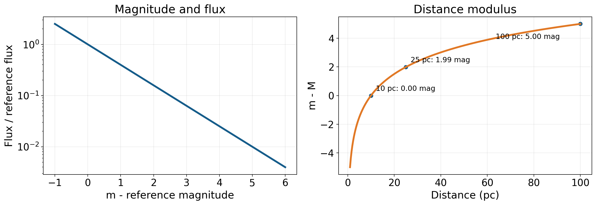
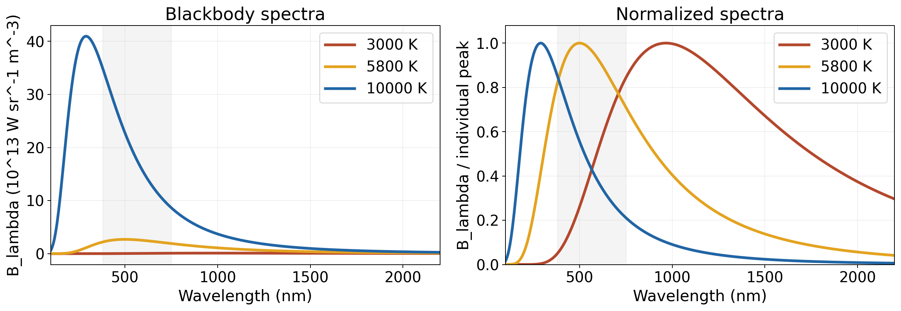
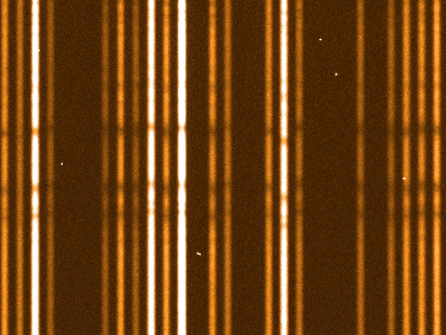

# 10 从星光测量恒星

望远镜对准一颗恒星后，探测器留下的首先是一小团光。延长曝光，可以积累更多信号；换上滤镜，可以分别测量几个波段；将光送入光谱仪，则能得到亮度随波长变化的曲线。继续观测几个月，星点的位置和谱线的位置还可能出现有规律的变化。天文学家正是从这些记录出发，逐渐量出恒星的距离、发光功率、表面温度、大小、化学组成与运动。

这些性质需要不同测量相互配合。收到的光越多，可能是恒星发光越强，也可能是距离越近；光谱偏向较短波长，提供了温度的线索；某组谱线出现，则将我们引向特定原子及其所处的状态。可以沿着一颗恒星的观测过程，把这些关系逐步接起来。下面使用一组假设观测贯穿计算：某颗星在 V 波段的视星等约为 5.83，该通带的星际消光可忽略，年视差为 0.020 角秒；经传播损失校正及未测波段补足后，总辐射通量约为每平方米 $1.28\times10^{-10}$ 瓦。先从最直接的亮度测量开始。

## 收到的光与星等刻度 {#L10-C01}

光穿过单位面积时，每秒带来多少辐射能量，称为辐射通量密度，本文简称通量，记作 $F$，常用单位是 $\mathrm{W\,m^{-2}}$。相机实际记录的是光子引起的电子计数。将计数除以曝光时间，再结合望远镜收光面积、滤镜透过率、探测器响应和标准星校准，才能把仪器读数转成可比较的通量。同一颗星用不同滤镜观测，得到的是不同波段内的辐射份额；通量的数值因此总要与通带一起给出。

恒星亮度跨越很大范围，天文学沿用星等来表达这些比值。古代目视分类把明亮的星列为一等，把最暗的肉眼可见星列为六等。现代定义保留数值越小越亮的方向，并约定五个星等对应一百倍通量比。设两颗星在同一通带、同一校准体系中的通量为 $F_1$、$F_2$，则

$$
m_1-m_2=-2.5\log_{10}\!\left(\frac{F_1}{F_2}\right).
$$

这条定义使相同的星等差总对应相同的亮度比。若第一颗星收到的光是第二颗的一百倍，星等就小五；相差一等，对应约 $10^{0.4}=2.512$ 倍；相差两等，对应约 6.31 倍。零等的位置由测光系统的参考零点确定，太阳和明亮行星等目标可以具有负星等。对数将光强的乘法关系变成星等的加法关系，便于在同一张表中记录差异悬殊的对象。[星等的历史与定义](https://openstax.org/books/astronomy-2e/pages/17-1-the-brightness-of-stars)

通量比 $F_1/F_2$ 是无量纲量，适合取对数；星等差也由这个比值确定。实际测光系统还规定滤镜响应及零点，所以一个完整的观测结果通常形如 $m_V=5.83$。下标 V 表明使用了视觉波段滤镜，它在可见光中选取一个有限范围。蓝光 B 波段、近红外波段与全波段总辐射各有自己的含义。保留这种区分，稍后才能利用不同波段之间的差别研究温度。

## 距离把接收亮度变成恒星光度 {#L10-C02}

恒星每秒向外辐射的总能量称为光度 $L$，单位为瓦。将它近似看作向各个方向均匀发光的源，并先取传播途中无吸收的情形，同一秒发出的能量会穿过以恒星为中心、半径为 $d$ 的球面。球面积为 $4\pi d^2$，单位面积分到的能量便是

$$
F=\frac{L}{4\pi d^2}.
$$

距离增加到两倍，同一份能量分摊到四倍面积，通量降为四分之一；距离增加到十倍，通量降为百分之一，在星等刻度上恰好暗五等。若两颗星在地球上看起来同样亮，其中一颗远十倍，它便需要一百倍光度。测出距离以后，亮点的明暗才转成恒星每秒真正发出多少能量的比较。

附近恒星的距离可以从几何测量得到。地球绕太阳公转，使观测位置每年沿轨道移动。近星相对于更远背景呈现微小的周期位置变化。取与视线垂直的一天文单位基线，也就是地球轨道半径，其在恒星处张开的角称为年视差 $p$；在最大位移方向上，相隔半年的位置差约为 $2p$。小角度关系给出 $p\simeq1\,\mathrm{AU}/d$，其中角用弧度。将单位安排成角秒和秒差距，就得到特别简洁的形式：

$$
d\ (\mathrm{pc})=\frac{1}{p\ (\mathrm{arcsec})}.
$$

一秒差距对应一角秒年视差，约等于 3.26 光年。这里的假设恒星 $p=0.020$ 角秒，距离便是 50 秒差距，约 163 光年。视差随距离增大而缩小，因而越遥远的恒星越需要精密的位置测量。[视差几何与秒差距](https://openstax.org/books/astronomy-2e/pages/19-2-surveying-the-stars)

为了比较不同距离的恒星，可以把它们都换算到十秒差距处。恒星在这个标准距离的星等称为绝对星等 $M$，当前测到的称为视星等 $m$。将反平方关系代入星等定义，可得

$$
m-M=5\log_{10}\!\left(\frac{d}{10\,\mathrm{pc}}\right).
$$

对 50 秒差距的假设恒星，右侧为 $5\log_{10}5\simeq3.49$；它的 $m_V=5.83$，于是 $M_V\simeq2.34$。这一步将距离造成的暗淡从接收亮度中分离出来。更远的同类恒星即使在望远镜里很暗，换到相同距离后仍可以具有相近的绝对星等。

*图 1｜左图表示同一通带、同一测光体系下的星等差与相对通量，纵轴为对数刻度；右图取同一光源、传播途中无消光，表示距离模数随距离的变化。课程原创计算图；[模型与生成源](../../assets/rewrite-20261025/10/SOURCES.md)。*

星际尘埃会吸收和散射光，使穿过它的星光进一步减弱。在某个通带中，把这份衰减用消光星等 $A$ 表示，关系成为 $m-M=5\log_{10}(d/10\,\mathrm{pc})+A$。一等消光使通量再乘以 $10^{-0.4}\simeq0.398$。若仅用亮度估距，这份衰减相当于把距离增加到原来的 $10^{1/5}\simeq1.585$ 倍；几何视差与多波段消光估计因此能帮助分清距离和传播损失。

对开头那颗星，假定总通量已经作了消光校正，并补足未观测到的紫外和红外贡献。50 秒差距约为 $1.54\times10^{18}$ 米，代入 $L=4\pi d^2F$，得到约 $3.83\times10^{27}$ 瓦，即约十个太阳光度。若只使用 V 滤镜，就只能先得到 V 波段光度；由它换到总光度，需要知道恒星的光谱分布。接下来测量温度，正是为了理解这些能量怎样分布在不同波长中。

## 连续谱的形状与温度

将恒星的光按波长分开，许多波段都能收到辐射，整体形成一条宽广的连续分布。恒星表层的温度决定这条曲线的大体形状。一个有用的起点是黑体：它理想地吸收入射辐射，在热平衡下发出的光谱仅由温度决定。较高温度使整条曲线升高，并使主要能量分布向较短波长移动。恒星大气中的吸收、散射与谱线在这一基础上继续塑造实际光谱。

*图 2｜按普朗克函数计算的 3000、5800、10000 K 黑体光谱，横轴为波长，可见区约 380—750 nm 用阴影标出。左图保留同一发光面积、同一立体角条件下的谱辐射亮度；右图将每条曲线除以各自峰值，突出形状。模型取理想黑体，谱线与星际消光另行处理。课程原创计算图。*

左图中，10000 K 曲线在红光区也高于 3000 K 曲线，短波一侧增加得尤其明显。右图把绝对高低消去以后，这种相对变化更容易观察：热源的曲线更靠左，冷源更靠右。实际用颜色估温时，也在做类似的比较。常用色指数 $B-V=m_B-m_V$ 表示蓝光与视觉波段的星等差。展开星等定义，它等于 $-2.5\log_{10}(F_B/F_V)$ 再加上两个通带零点决定的常数。对同一颗星，改变距离会给两项通量乘上相同因子，这个因子在比值中消去，颜色便主要保留了光谱形状的信息。[恒星颜色与温度](https://openstax.org/books/astronomy-2e/pages/17-2-colors-of-stars)

按每单位波长的谱辐射亮度表示黑体分布时，峰的位置满足维恩位移律：

$$
\lambda_{\max}T\simeq2.898\times10^6\ \mathrm{nm\,K}.
$$

3000 K 的峰约在 966 纳米，落在近红外；5800 K 的峰约在 500 纳米；10000 K 的峰约在 290 纳米，落在紫外。宽广的曲线说明，每个温度都在峰两侧发出大量辐射。人眼的颜色感觉来自不同感光细胞对整段可见光的响应，太阳接近 5800 K 的连续谱因此综合色觉接近白色。改变为每单位频率的谱密度时，横轴小区间的宽度也随之改变，峰的位置需要按新的分布重新计算。[连续谱与辐射定律](https://openstax.org/books/astronomy-2e/pages/5-2-the-electromagnetic-spectrum)

实际恒星的温度估计使用多个波段和光谱信息共同拟合。尘埃通常更强地削弱短波光，使星光变红；大气中的金属吸收线、分子带和表面重力也会影响颜色。观测覆盖更宽波段后，可以比较这些因素对曲线造成的不同形状变化。例如，连续谱提供总体斜率，某些谱线的相对强度提供温度与电离状态的约束，再结合独立的消光信息，可以逐步收紧温度范围。开头那组假设观测若由这样的分析得到约 5800 K，就有了进一步求半径所需的第二个量。

## 从温度和光度得到半径

对黑体，各波长辐射相加后，单位表面积每秒向外发出的能量为 $\sigma T^4$，$\sigma$ 是斯特藩—玻尔兹曼常数。球形恒星的表面积为 $4\pi R^2$，其总光度写成

$$
L=4\pi R^2\sigma T_\mathrm{eff}^4.
$$

天文学用这条关系定义有效温度 $T_\mathrm{eff}$：它表示一个同样大、每秒辐射相同总能量的黑体所具有的温度。真实恒星大气不同深度的温度可以逐层变化，有效温度则为整颗星的辐射输出提供一个统一参数。

温度固定时，半径增加到两倍，发光面积和总光度都增加到四倍；半径固定时，温度增加到两倍，光度增加到十六倍。我们已经从距离与通量求出 $L$，又从光谱估计 $T_\mathrm{eff}$，于是可以反过来求

$$
\frac{R}{R_\odot}=\sqrt{\frac{L}{L_\odot}}
\left(\frac{T_\odot}{T_\mathrm{eff}}\right)^2.
$$

对光度约十倍太阳、有效温度与太阳相近的假设恒星，半径约为 $\sqrt{10}\simeq3.2$ 个太阳半径。望远镜里它仍可能只是一个点，但辐射能量与单位面积辐射能力已经共同给出其发光表面的大小。同样的关系也解释赫罗图中大而冷的巨星与小而热的白矮星为何能有很不相同的光度。恒星结构与演化会进一步解释这些半径和温度怎样形成。

这条测量链还告诉我们误差怎样传递。由 $L\propto d^2F$ 可知，距离估计对光度很重要；由 $R\propto d\sqrt F/T_\mathrm{eff}^2$ 可知，温度误差又会明显影响半径。提高测光精度、改善视差、校正消光和选择合适的大气模型，各自在链条的不同位置发挥作用。几项观测合在一起，使我们得到一颗具有确定尺度和表面状态的恒星。

## 能级把物质写进光谱

连续谱给出辐射的大体分布，进一步提高光谱分辨率，会看见许多较窄的结构：某些波长比附近连续谱暗，形成吸收线；稀薄气体也常在特定波长出现突出的发射线。线的位置来自原子、离子与分子内部允许的能量状态。设两能级之差为 $\Delta E$，相应光子的能量和波长满足

$$
\Delta E=h\nu=\frac{hc}{\lambda},
$$

其中 $h$ 为普朗克常数，$c$ 为光速。物质吸收具有合适能量的光子，可以从低能态跃迁到高能态；由高能态回到低能态，则可发出相应的光子。不同原子结构具有不同的能级组合，实验室中测得的谱线位置因而为天体物质提供了可重复使用的参照。[原子能级](https://openstax.org/books/astronomy-2e/pages/5-4-the-structure-of-the-atom)

氢的巴耳末系涉及第二能级与更高能级之间的跃迁。Hα 对应第三能级与第二能级之间的能量差，波长约 656.3 纳米；Hβ 对应第四能级与第二能级，约 486.1 纳米。氢气可以吸收这些波长，也可以在适当激发条件下发出它们。辨认一组谱线时，其共同排列比单条线提供更强的约束；精密比较还需使用同一空气或真空波长约定，并考虑各条线的精细分量。[氢的实验室参考波长](https://physics.nist.gov/PhysRefData/Handbook/Tables/hydrogentable2.htm)

恒星大气给这些跃迁提供了具体环境。深处较热、较不透明的气体产生强连续辐射，光向外传播时，会在外层气体能够吸收的跃迁波长上受到较强作用。被吸收的能量可以经过重新发射或其他能量交换继续传播，重新发射的方向也会分散。对我们所在的方向，这些波长的出射强度低于附近连续谱，于是出现暗线。从背景较暗的方向观察受激发的稀薄气体时，气体自己的线辐射又会突出为亮线。吸收与发射的外观，因而取决于气体状态以及它与背景光源的相对关系。[谱线的形成](https://openstax.org/books/astronomy-2e/pages/5-5-formation-of-spectral-lines)

*图 3｜VLT FLAMES/GIRAFFE 首光观测的多目标恒星光谱局部。明亮的纵向谱迹来自不同目标，谱迹上的暗区包含恒星吸收特征；发布说明标出其中约 517 nm 附近的镁三重线。橙色用于显示探测器计数，本图保留机构发布的局部画幅及显示方式。Credit: ESO；[原发布页](https://www.eso.org/public/images/eso0219b/)，CC BY 4.0。*

这类二维记录要先沿每条谱迹提取信号、估计旁边的背景，再使用参考光源给像素位置标上波长。仪器响应校正完成后，才得到可与物理模型比较的一维光谱。图中的暗痕已有丰富结构，测量中则还会给每一点附上不确定度，并处理相邻谱线重叠的问题。颜色、光度和温度的初步结果，也在此时为光谱分析提供参数范围。

## 从谱线强度读出气体状态与组成 {#L10-C03}

一条吸收线的强度取决于有多少粒子能够参加这一跃迁。以巴耳末吸收为例，氢原子需要先处于第二能级，才能吸收光子跃迁到更高能级。低温时，大多数中性氢处于基态，第二能级上的粒子比例较低；温度升高，激发增加，巴耳末吸收变强；温度进一步升高，大量氢被电离，留在中性原子各束缚态中的比例又下降。这两个变化相互竞争，使巴耳末线在约一万开尔文的恒星中尤其显著。[谱型与电离、激发状态](https://openstax.org/books/astronomy-2e/pages/17-3-the-spectra-of-stars-and-brown-dwarfs)

其他元素也有各自的激发与电离规律。高温星中可以出现高电离态的谱线，较冷恒星中金属线和分子带逐渐突出。观察这些特征的共同变化，可以将恒星按温度由高到低排成 O、B、A、F、G、K、M 序列，并在每个字母下面再用数字细分。安妮·坎农从大量光谱记录中整理和简化分类，形成了这一沿用至今的体系。太阳的谱型常写成 G2 V，其中 G2 表示温度序列中的位置，罗马数字 V 属于光度分类。[光谱分类的历史](https://platestacks.cfa.harvard.edu/annie-jump-cannon/astronomy-and-spectroscopy)

光度分类利用了大气压力与表面重力对谱线的影响。在相近温度下，巨星较低的表面重力与主序星较高的表面重力，会对应不同的大气密度和压力条件；碰撞造成的展宽及某些线的相对强度因而有所不同。通过标准光谱比较，可以从光谱中识别与恒星大小相关的特征。这与前面由光度和温度求半径的方法形成互相支持的约束。[光谱中的半径、组成与运动信息](https://openstax.org/books/astronomy-2e/pages/17-4-using-spectra-to-measure-stellar-radius-composition-and-motion)

确定化学丰度时，天文学家在给定温度、压力和辐射场的模型中，计算某种元素含量将产生怎样的谱线，再与整组观测比较。含量增加会改变吸收，但强线逐渐饱和以后，线心可吸收的背景光已经很少，进一步增加原子更可能改变线翼和总宽度。因而线深、线宽以及相对于连续谱的总缺失量，都能提供不同约束。塞西莉亚·佩恩将恒星光谱与电离理论联系起来，使氢和氦占主导的组成图景获得了定量依据；光谱分类中的丰富差别，也由此与温度和物质状态联系起来。[佩恩的研究与影响](https://library.cfa.harvard.edu/cecilia-payne-gaposchkin/work-process-and-continuing-impact)

## 谱线的位置与恒星运动

实验室谱线还给出了运动测量的基准。光源与观测者沿视线的相对运动，会改变相邻波峰抵达的间隔。远离时，测得波长增加，形成红移；接近时，波长缩短，形成蓝移。在速度远小于光速的条件下，径向速度 $v_r$ 与波长位移满足

$$
\frac{\Delta\lambda}{\lambda_0}\simeq\frac{v_r}{c},
\qquad \Delta\lambda=\lambda_\mathrm{obs}-\lambda_0,
$$

其中约定远离为正，$\lambda_0$ 为静止参考波长。若同一波长约定下，一条 656.3 纳米的参考线测在 656.5 纳米，位移为 0.2 纳米，就对应约 $3.00\times10^5\times0.2/656.3\simeq91$ 千米每秒的远离速度。相对变化约为万分之三，精密谱线比较能够清楚测量这种微小的尺度变化。[低速多普勒关系](https://openstax.org/books/astronomy-2e/pages/5-6-the-doppler-effect)

观测地点随地球自转和公转而运动，所以测得的位移还带有观测平台的贡献。选择参考系并校正这部分运动后，连续观测就能得到恒星自身的径向速度曲线。双星中的恒星绕共同质心运行，沿视线速度会周期变化；若两颗星的光谱都能分辨，两组谱线可以一前一后地交替红移和蓝移。这样，天球上仍混成一个光点的系统，也能显露出轨道运动。

谱线形状还记录天体内部的速度分布。热运动使原子具有一系列朝向和背离我们的速度，形成热展宽；旋转恒星的两侧具有相反的视线速度，使吸收分布向两边展开；大气压力和仪器响应又贡献其他展宽。整体位移主要约束平均径向运动，线宽和不对称形状则帮助研究温度、旋转及表面活动。联合多条谱线，可以将共同位移与某些特定谱线的形状变化分开。

## 精密测量怎样继续向前推进

光谱仪把邻近波长分开的能力常写成分辨本领 $\mathcal R=\lambda/\delta\lambda$，其中 $\delta\lambda$ 是按仪器线宽约定定义的波长尺度。在 600 纳米处，$\mathcal R=10000$ 对应 $\delta\lambda=0.06$ 纳米，换成速度尺度约为 30 千米每秒。这描述了仪器把窄谱线展成多宽的结构。对于光子充分、形状可建模的谱线，中心位置可以估计得比这条宽度更精细；许多谱线共同移动，又为同一个速度参数提供了重复约束。

ESO 的 HARPS 技术说明给出约 115000 的分辨本领，同时介绍了在适当目标和标定条件下达到米每秒量级径向速度精度的设计。它将光谱仪置于稳定的真空环境，控制温度和机械变化，并使用参考光源监测波长刻度。仪器线宽、光子统计和长期稳定性各自决定测量的不同方面。[HARPS 技术概述](https://www.eso.org/sci/facilities/lasilla/instruments/harps/overview.html)

恒星运动还包含横向分量。长期记录它相对于遥远背景的角位置变化，可测得自行，通常以角秒每年表示。周期视差提供距离，自行提供角速度，两者结合便能换算横向速度；再与光谱的径向速度合起来，就得到空间运动。由视差测量发展而来的精密天体测量，在这里与光谱学重新会合。[自行与恒星运动](https://www.esa.int/Science_Exploration/Space_Science/Gaia/Proper_motion)

开头的那团星光，如今已有一套相互关联的物理描述：约 50 秒差距的距离，使校正后的通量对应约十个太阳光度；约 5800 K 的有效温度，又将它的半径约束在三个多太阳半径；光谱中的线组、强度、位移与展宽，继续提供组成、大气状态和运动的信息。将这些量用于一颗颗恒星，再放到共同坐标中比较，就能研究恒星结构怎样随质量变化、不同阶段的恒星怎样形成群体，以及银河中的恒星怎样运动。遥远的光点由此成为可以测量、比较和解释的物理系统。
