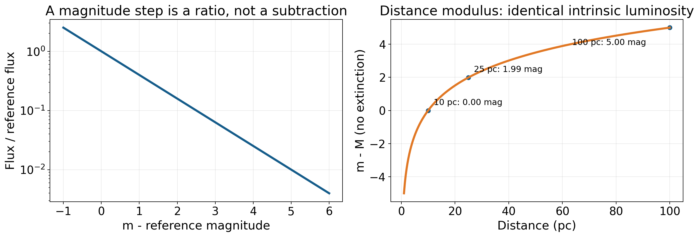
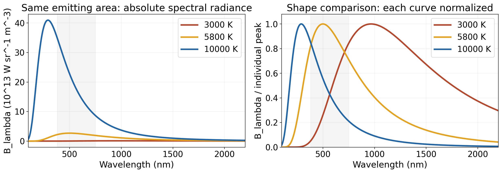

# 一束星光里藏着什么：亮度、温度、元素与运动

站在夜空下，恒星首先呈现为亮点。有些显得明亮，有些勉强可见；认真比较，还会发现颜色差异。我们没有接触那颗星，没有把温度计插进它的表面，也没有取回一瓶恒星气体。关于它的知识，几乎都要从抵达地球的光里寻找。一个亮点之所以能够变成一个可研究的世界，在于光不仅携带能量，也保留了产生和传播过程留下的结构。

这束光可以先被计数，回答“收到多少”；也可以按波长分类，回答“哪些颜色更强”；还可以把波长分得足够细，寻找谱线的位置、强弱和形状。三种观察并不是同一张漂亮照片的不同风格，而是对光提出不同问题。它们分别受到距离、温度、组成、大气和运动的影响。要读懂星光，关键是知道每种证据究竟约束什么，又有哪些因素能够产生相似结果。

## 为何越亮的星，星等反而越小 {#L10-C01}

古代分类从肉眼印象出发，把明亮的星列为一等，把最暗的可见星列为六等。这是一份亮度等级表，不是温度、质量或重要程度的排名。现代天文学保留了“数字小表示亮”的方向，却用一个严格的比值关系取代主观分档：星等相差五，接收到的光通量相差一百倍。这个选择延续了历史体系的大致范围，也使相同差值处处代表相同比值。[OpenStax 对星等历史与定义的介绍](https://openstax.org/books/astronomy-2e/pages/17-1-the-brightness-of-stars)说明了从目视等级到测量尺度的转变。

如果在同一波段中，两颗星的通量分别为 $F_1$ 和 $F_2$，星等为 $m_1$ 和 $m_2$，定义关系是 $m_1-m_2=-2.5\log_{10}(F_1/F_2)$。这里通量指单位面积、单位时间收到的辐射能量，或者经校准后与它对应的计数；相除的两项必须采用同一套测量与校准。通量比没有单位，因此能放进对数。它不是把一个带单位的瓦每平方米直接取对数。

星等差一，对应通量比约为 $10^{0.4}=2.512$；差二，约为六点三一；差五，恰为一百。若第一颗星的通量是第二颗的一百倍，公式给出 $m_1-m_2=-5$。负号正好表示更亮的那颗星具有更小的数值。零等也没有“完全不发光”的意思，它只是校准体系选定的参考位置；足够亮的目标自然可以得到负星等。

*图 1｜课程原创计算。左图的纵轴使用对数刻度：相差五等只剩百分之一通量。右图为没有消光时的距离模数；十秒差距处为零，一百秒差距处为五。不是实际恒星样本，也不是探测器灵敏度曲线。*

对数尺度把跨度巨大的亮度放进可操作的数值范围，也把乘法变成加法：连续两次削弱通量，各自造成的星等增量可以相加。但“几等星”仍需要说明波段。蓝光滤镜、可见光滤镜和近红外滤镜测到的通量不同，各自还有零点约定。把两个不同波段的星等直接当作同一种总亮度，可能比较了光谱形状而不自知。天文学家报告一个数值时附上波段与校准，并不是仪器术语上的繁琐，而是让这个数值有明确意义。

## 看起来亮，究竟是近还是强 {#L10-C02}

恒星每秒向外发出多少辐射能量，称为光度 $L$，单位可以是瓦。观测者收到的通量 $F$，则是这些能量抵达某个距离后分摊到单位面积上的份额。若恒星向各方向近似均匀发光，中途没有吸收，半径为 $d$ 的球面面积为 $4\pi d^2$，便有 $F=L/(4\pi d^2)$。这是一条能量守恒与几何共同给出的关系，不需要先知道恒星内部靠什么供能。

同一颗星的距离增加一倍，通量变成四分之一；增加十倍，变成百分之一，星等增加五。反过来，两颗看起来同样亮的星，一颗若远十倍，就需要约一百倍光度才能得到同样通量。天空没有自动给亮点标出距离，因此目视亮度排序不能直接变成恒星本身发光能力的排序。这里的 $L$ 和 $F$ 可以都指总辐射，也可以都限定同一个波段；把总光度与某一滤镜的通量混在一起，公式就缺少了光谱转换。

距离有一种几何入口：地球沿轨道运行时，我们从不同位置观看近星，它相对于更远背景的位置会略微变化。在基线垂直视线的定义几何中，恒星视差 $p$ 是地球轨道半径、即一 AU 基线在恒星处所张的角；它也是最大半年位置总移的一半，不能再把一 AU 对应的角除以二。在小角近似中，距离 $d$ 以秒差距计、视差 $p$ 以角秒计时，$d=1/p$。一秒差距就是产生一角秒视差的距离，约为三点二六光年。视差十分之一角秒对应十秒差距；百分之一角秒对应一百秒差距。光年用于表示光一年走过的距离，秒差距则把测角与距离直接联系起来。[视差几何的具体定义](https://openstax.org/books/astronomy-2e/pages/19-2-surveying-the-stars)保证我们不会把基线或角度误用一倍。

知道距离以后，天文学家可以问：若把这颗星放到十秒差距，它会有多亮？这个标准位置的星等称为绝对星等 $M$，对应实际接收亮度的则称为视星等 $m$。没有消光时，$m-M=5\log_{10}(d/10\ \mathrm{pc})$。括号里的距离比没有单位，十秒差距只是统一比较的约定，不是某种特殊物理边界。距离模数 $m-M$ 越大，同一颗星相对于标准位置就显得越暗。

假设一颗星在某个波段的绝对星等为一，视星等为六，且暂时忽略消光，差值五给出一百秒差距。若途中尘埃额外造成一等消光，关系应写成 $m-M=5\log_{10}(d/10\ \mathrm{pc})+A$，$A$ 是同一波段的消光星等。仍把全部暗淡都解释为距离，就会高估距离约 $10^{1/5}=1.585$ 倍。一项亮度测量因此可能包含至少三种解释：本身弱、位置远、途中损失多。完整的推断要设法拆开它们。

绝对星等也不会自动等于质量或年龄。一颗面积很大的冷星，可以比面积小的热星发出更多总能量；不同波段还会偏爱不同温度。为了区分这些情况，我们需要把“有多少光”扩展成“光怎样分布”。这正是颜色与光谱开始提供帮助的地方。

## 恒星的颜色是一项比值测量

日常语言会把恒星叫红星、蓝星或黄星，仪器则通过滤镜给出可重复的比值。常见的色指数 $B-V$，是蓝光 B 滤镜通带的星等减去视觉 V 滤镜通带的星等；两者均在可见范围，V 并不是把所有可见光一起收进来。展开星等定义后，它与两波段通量比的对数有关，同时包含各自的零点常数。因而 $B-V=0$ 表示该校准体系的特定颜色，不表示两滤镜收到完全相同瓦数，也不表示恒星没有颜色。[星等颜色与温度的说明](https://openstax.org/books/astronomy-2e/pages/17-2-colors-of-stars)给出这种从视觉印象到定量指标的转变。

对于同一颗没有额外消光的星，距离改变会把各波段通量同时乘以相同的平方反比因子，这个公共因子在通量比中消去。因此颜色通常比视亮度更直接地反映光谱形状。它仍然不是温度计的直接读数：星际尘埃对短波长的削弱常更明显，会使同一颗星看起来更红；恒星大气里的谱线、化学组成与表面重力，也会影响宽波段颜色。颜色适合提供线索，几种证据共同使用才容易排除歧义。

理解颜色与温度的基本关系，可以先看理想黑体。黑体能够有效吸收落到它上的辐射；在热平衡下，其发出的光谱形状只由温度决定。它名字里有“黑”，并不意味着升温以后不会发光。恒星大气不是完美黑体，不过黑体连续谱提供了非常有用的第一近似：热星的能量分布更偏向短波长，冷星更偏向长波长，温度改变的是整条分布，不只是涂上一种单一颜色。

*图 2｜课程原创普朗克函数计算，温度为 3000、5800、10000 K；横轴为波长，阴影仅标出约 380—750 nm 的可见范围。左图保留每单位波长、单位面积、单位立体角辐射强度的相对绝对大小，右图将每条曲线各自峰值归一，专看形状。曲线不是实际恒星光谱，不含谱线、尘埃或探测器响应。*

普朗克规律中的波长分布有一个峰。按每单位波长的辐射强度来表示时，维恩位移律给出 $\lambda_{\max}T\simeq2.898\times10^6\ \mathrm{nm\,K}$。三千开尔文的峰约在九百六十六纳米，五千八百开尔文约五百纳米，一万开尔文约二百九十纳米。较冷恒星的大量能量落在近红外，较热恒星的大量能量可以落在紫外；我们仍能看到它们，因为分布不是只在峰值处才有光。[连续谱与温度关系](https://openstax.org/books/astronomy-2e/pages/5-2-the-electromagnetic-spectrum)支持这一近似。

太阳的近似温度约五千八百开尔文，波长分布的峰在可见范围内，却不能据此说太阳应该是绿色。人眼接收了覆盖整个可见范围的光，各类感光细胞对整段光谱作加权响应，综合色觉不是简单挑出曲线最高点。换成“每单位频率”的图，峰的位置也不会只是把波长峰取倒数：改变横轴时，区间宽度的变换改变了分布密度。这提醒我们，图上一个峰的意义要连同纵轴定义一起阅读。

同样，热星偏蓝不表示它只发蓝光。保持单位发光面积不变，温度较高的黑体在红光波段也比较冷黑体发得更多，只是短波一侧增加得尤其明显。图中若将每条曲线分别归一，只能比较形状，不能再拿曲线高度比较总功率。观察恒星照片时，显示拉伸、白平衡与不同滤镜的合成也会改变颜色；适合展示结构的科学彩色图，不一定同时是精确的目视颜色标准。

把各波长的辐射相加，黑体单位面积的辐射功率为 $\sigma T^4$，其中 $\sigma$ 为斯特藩—玻尔兹曼常数。近似把恒星看作半径 $R$、有效温度 $T$ 的球面，便有 $L=4\pi R^2\sigma T^4$。有效温度是用这条总辐射关系定义的温度；它并不宣称星内部和大气各层都同样热。半径不变时，温度增加一倍，总光度增加十六倍；温度不变时，半径增加十倍，总光度增加一百倍。

这条关系把亮度和颜色连起来。若由距离与通量得到总光度，再从光谱估计有效温度，就能反推一个辐射半径。它需要校正消光、补足未测波段并使用合适的大气模型，结果不会仅凭一张彩色照片精确产生。但“很亮而偏冷”的星为何可能具有很大表面面积，已经有了物理理由。到下一讲讨论恒星如何变化时，这个半径—温度—光度关系会成为连接不同阶段的坐标，而不只是名称表上的注释。

## 光谱中的缺口，为什么比颜色更有内容 {#L10-C03}

把白光展开成连续彩带只是开始。实际恒星光谱上常有许多较暗的窄区间，称为吸收线；某些稀薄发光气体则会在特定波长呈现亮线，称为发射线。这些结构与原子、离子和分子的能级有关。原子能够处于一些允许的能量状态，状态之间的能量差决定可以吸收或发出哪种光子。光子的能量 $E=hc/\lambda$，$h$ 为普朗克常数，$c$ 为光速，$\lambda$ 为波长；短波长光子携带的能量更高。

这里的能级不是电子沿着一条可拍照的微型行星轨道奔跑。量子状态有自己的允许能量与转变规律。我们可以暂时不推导这些规律，却需要保留一个重要结果：不同原子结构给出不同的一组转变能量，因此给出不同的谱线组合。实验室测得的组合可以与天体光谱比较，组成辨认便有了可重复的参照。[原子结构](https://openstax.org/books/astronomy-2e/pages/5-4-the-structure-of-the-atom)与[谱线形成](https://openstax.org/books/astronomy-2e/pages/5-5-formation-of-spectral-lines)分别解释了能级与光子交换的联系。

氢的可见光巴耳末线中，Hα 的波长约为六百五十六点三纳米，Hβ 约为四百八十六点一纳米。它们来自不同高能级与同一个较低能级之间的转变。识别时应比较一组可能的线，而非在某个接近位置看到一条暗线就宣布“发现氢”；不同元素的线可能混合，仪器也有有限分辨能力。[NIST 的氢原子参考表](https://physics.nist.gov/PhysRefData/Handbook/Tables/hydrogentable2.htm)记录了具体分量和波长，精密研究还必须统一空气波长、真空波长及标定方式。

为什么一颗明亮恒星会出现暗线？深处较热、较不透明的物质产生近似连续的辐射，外层较冷气体在特定转变波长对向外传播的光产生较强作用。光子可以被吸收后重新发出，或者通过其他过程交换能量；重新发出的方向并不全部指向观测者。与附近连续谱相比，这些波长的向外强度较低，便形成吸收线。所谓“暗”是相对于附近波长，不能简单解释为那一份能量从宇宙中永久消失。

当我们从背景不那么亮的方向观看一团受激发、较稀薄的气体，气体自己的线辐射则能突出为发射线。同一种元素的同一转变，可以参与吸收或发射，区别在温度、激发、光学厚度和观看几何等条件。用一张“亮线等于热气体、暗线等于冷气体”的图可以帮助入门，真实恒星大气则需要沿视线同时计算产生、吸收和散射。光谱不是给元素贴标签的条形码，它记录的是处在特定状态中的物质。

*图 3｜ESO；[原发布页](https://www.eso.org/public/images/eso0219b/)，CC BY 4.0。VLT FLAMES/GIRAFFE 首光数据局部，展示多目标恒星光谱；发布说明指出可见的共同结构包括约 517 nm 附近的镁三重线。910×685 机构图，无改动。橙色是探测器数据的显示配色，不是这些恒星本身为橙色，也不是横跨整幅图的天然彩虹；本图没有提供可直接读取的完整坐标标定。*

这张图把“光谱证据”从一条理想曲线带回实际观测：多个目标的记录、暗痕、背景和仪器显示同时存在。把数据变成可比较的谱线，还要扣背景、标定波长、校正仪器响应，并处理相邻谱线混合。真实材料比一幅只有三条完美黑线的示意图更复杂，但其价值也在这里：它展示知识从有噪声的记录中逐步建立，而不是从预先印好的元素名称直接读出。

## 谱线强，不一定意味着这种元素更多

如果氢线很强，最直觉的解释是氢含量高；如果很弱，似乎就是氢少。这个推断忽略了一个问题：负责那条线的原子，是否处在能够参加转变的状态？以可见光巴耳末吸收线为例，氢原子需要在相应的较低能级上，才容易吸收通往更高能级的光子。温度低时，大量氢原子停在基态，能参与巴耳末吸收的比例小；温度很高时，氢被大量电离，失去束缚电子，也不再以同样方式贡献这组线。

因此巴耳末线常在约一万开尔文的恒星中比较强，在更热或更冷的星中减弱，不能把线强度简单排成氢含量次序。其他元素也有各自的电离与激发条件，温度改变会让一组线消退、另一组出现。氢和氦可以是最主要的物质组成，而少量重元素仍能产生显眼的线。[恒星谱型的温度解释](https://openstax.org/books/astronomy-2e/pages/17-3-the-spectra-of-stars-and-brown-dwarfs)明确区分谱线强弱与元素是否存在。

天文学家最初依照光谱外观分类，后来的物理解释才把分类与温度联系起来。沿用至今的主要序列写成 O、B、A、F、G、K、M，温度由高到低。这不是任意把字母从头重排的一道记忆题，而是分类历史留下的痕迹。早期类别曾更多，依据不同；安妮·坎农在大量恒星光谱中整理、简化了体系。A 型中氢巴耳末线显著，较冷型中金属线或分子带逐渐重要，较热型则出现相应的高激发与电离特征。[哈佛关于坎农与分类发展的历史材料](https://platestacks.cfa.harvard.edu/annie-jump-cannon/astronomy-and-spectroscopy)呈现了观察分类先行、物理解释随后完善的过程。

各字母下的数字进一步区分谱型，例如 G2 比只写 G 更细。太阳常写作 G2 V，其中罗马数字 V 是光度分类，关联大气压力与表面重力留下的光谱差异，不是第五种颜色。低表面重力的较疏松大气与高重力的较致密大气，可以对线宽和相对线强产生不同影响；在适当温度范围内，这些特征帮助区分巨星和主序星。谱型因此可以同时含有温度与大气状态的信息，而不只是“看起来偏黄”。[光谱用于辨认大小、组成与运动的说明](https://openstax.org/books/astronomy-2e/pages/17-4-using-spectra-to-measure-stellar-radius-composition-and-motion)给出这种分类依据。

真正测量化学丰度，需要在温度、压力、电离、激发和辐射传播模型中计算某种含量会产生怎样的谱线，再与观测比较。线很强时还可能接近饱和，含量翻倍也不让线深简单翻倍。塞西莉亚·佩恩在二十世纪二十年代把光谱与电离理论联系起来，成为理解恒星中氢、氦占主导的重要转折。重要的不是仅记住一个发现者姓名，而是看见推断方法的变化：不能把不同温度下的线外观，直接翻译成不同的元素份额。[哈佛保存的研究过程与影响记录](https://library.cfa.harvard.edu/cecilia-payne-gaposchkin/work-process-and-continuing-impact)展示了她如何利用记录与定量分析推进这一步。

## 一条谱线怎样告诉我们运动

除了强弱，谱线的位置也有信息。波源与观测者沿视线相对运动，会改变相邻波峰抵达的间隔；天体远离时，波长增加，称为红移；接近时，波长减小，称为蓝移。在速度远小于光速、并采用一致参考系的近似下，$\Delta\lambda/\lambda_0\simeq v_r/c$。$\lambda_0$ 是静止参考波长，$\Delta\lambda$ 是观测减参考的差，$v_r$ 是径向速度，约定远离为正。这里测的是沿视线的分量，而不是空间总速度。[多普勒关系及适用近似](https://openstax.org/books/astronomy-2e/pages/5-6-the-doppler-effect)说明了波长位移为何能成为运动证据。

举一个假定算例：参考线在六百五十六点三纳米，测得六百五十六点五纳米，同一波长约定下差零点二纳米。用 $c\simeq3.00\times10^5\ \mathrm{km\,s^{-1}}$，得到约九十一千米每秒的远离速度。这个变化只占原波长的约万分之三，肉眼不一定会觉得恒星突然变红；谱线与参考位置的精密比较，却能把它测出来。恒星本身较冷而偏红，与运动导致的红移，是两个不同机制。

地球也在自转和绕日运行，所以观测到的位移包含观察平台的运动。报告恒星径向速度，需要说明并校正使用的参考系；不同时刻的变化也可能来自恒星绕伴星公转、表面活动或仪器漂移。可靠测量通常结合许多谱线，让共同的位移与个别线形变化相互检查。谱线位移提供了一条看不见横向运动时仍可测运动的路线，也让无须直接分开两个亮点的双星研究成为可能。

线的宽度又不是整体位移的同义词。气体热运动让不同原子具有不同视线速度，产生一组稍有差别的波长；旋转恒星的一侧朝向我们、另一侧背离我们，也会把吸收分散到两侧；压力作用与仪器响应还能继续加宽。整组线一致平移与一条线变宽，代表不同证据。分析先要分清测量的是线中心、深度、宽度还是不对称形状，再讨论这些量如何约束物理过程。

## 分开两条线，与测准一条线的位置

望远镜在天空中有角分辨率，光谱仪在波长方向也有分辨能力。常用光谱分辨本领 $\mathcal R=\lambda/\delta\lambda$，$\delta\lambda$ 是仪器能分开的一个波长尺度，具体值须按仪器的线宽定义解释。若在六百纳米处 $\mathcal R=10000$，该尺度约为零点零六纳米，按低速多普勒关系相当于约三十千米每秒。它描述相邻结构被混合到什么程度，却不表示任何速度测量都只能以三十千米每秒为一步。

一条清楚、光子数充分的谱线，其中心能够被拟合得比整条仪器线宽精细；同时使用许多谱线还能约束共同位移。就像一把宽笔画出的圆，圆心仍可比笔画宽度定位得更细，分辨结构与估计参数是不同任务。不过，这种收益依赖足够信号、正确模板与稳定标定，不能从数学拟合小数位数直接获得。ESO 的 [HARPS 技术概述](https://www.eso.org/sci/facilities/lasilla/instruments/harps/overview.html)给出的分辨本领约十一万五千，仪器却以合适目标和标定条件下约米每秒的径向速度测量为设计任务。前者对应几千米每秒的线宽尺度，后者能小得多，两者并不矛盾。该页是仪器历史规格说明，不是所有恒星与每次曝光都达到的保证。

因此，光谱仪把稳定性放在与分辨本领同样重要的位置。温度、空气压力或机械位置改变，即使恒星没有动，也会移动仪器内的谱线；参考光源提供独立的位置刻度，帮助识别这种漂移。HARPS 使用稳定结构与真空环境，是为了减少这些变化。靠提高显示图像的放大倍数，既不能增加真实分辨能力，也不能代替稳定标定。精密测量需要在光子统计、仪器响应与恒星自身变化之间建立可检查的联系。

还有一部分运动完全不沿视线。恒星相对于远处背景的长期角位置变化，称为自行，常用角秒每年表示。它与地球绕日造成的周期视差不同：一个主要反映恒星横向运动，一个提供几何距离。知道距离以后，角运动才能转成横向速度；再与光谱给出的径向分量合起来，才获得三维运动的描述。[ESA 对自行的解释](https://www.esa.int/Science_Exploration/Space_Science/Gaia/Proper_motion)强调了这种多种测量的配合。只知道谱线没有明显位移，不能断言恒星在空间中静止，它可能主要横着走。

我们终于可以回到夜空中的一个亮点。视星等描述这里收到多少某种波段的光；距离使它转成自身光度；颜色与连续谱帮助估计温度；谱线组合与强度限制气体状态和组成；谱线位置记录视线运动。这些信息相互支持，也彼此提醒：亮不一定大，红不一定冷，线弱不一定元素少。恒星仍然遥不可及，但只要把接收到的光组织成有明确单位、校准与适用条件的证据，距离就不再阻止我们理解它。

---

**来源与素材记录。** 具体核验范围、假定算例及本地素材见[批次 B 来源表](../../assets/v02-batch-B-SOURCES.md)与[素材表](../../assets/v02-batch-B-ASSETS.csv)。正文为内容初稿；已有投影片仍是上一版本，尚未同步。人工审校与真实试讲均待进行。
