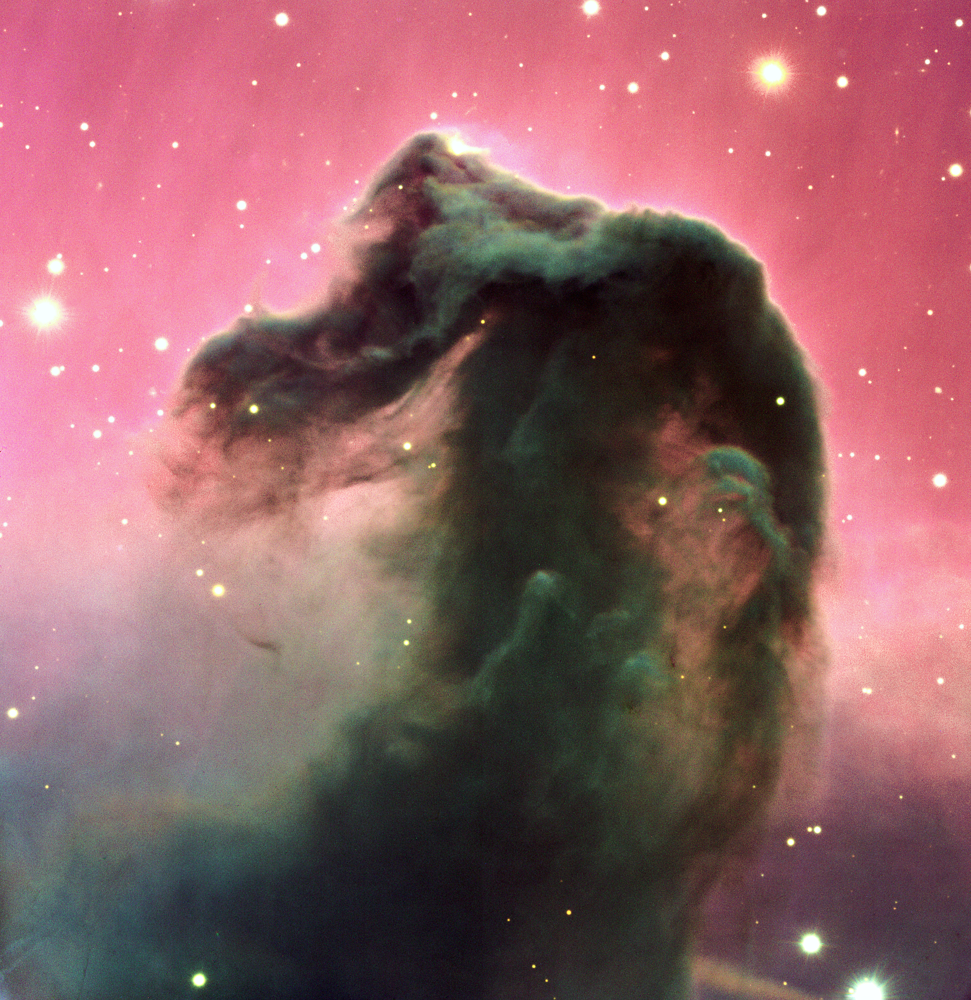
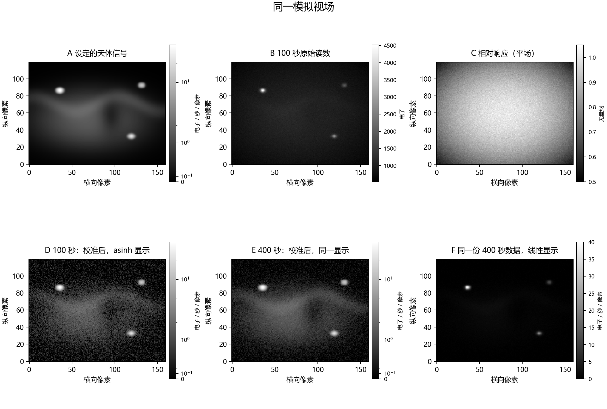
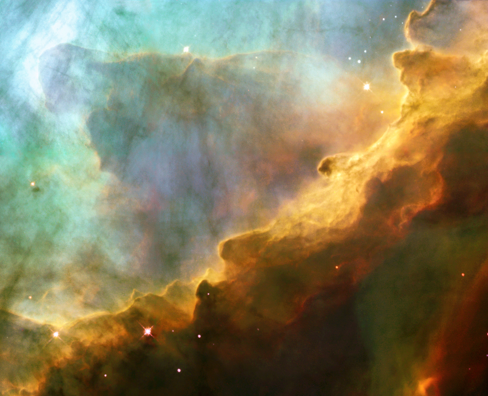
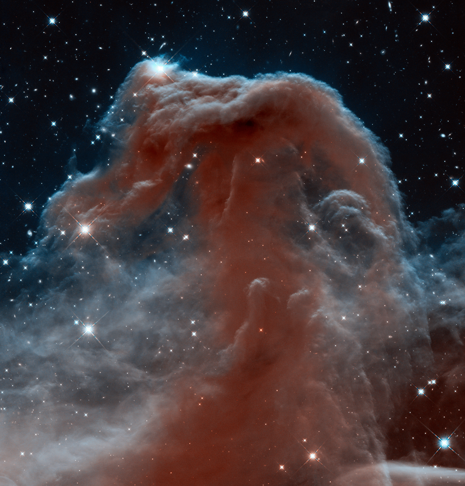
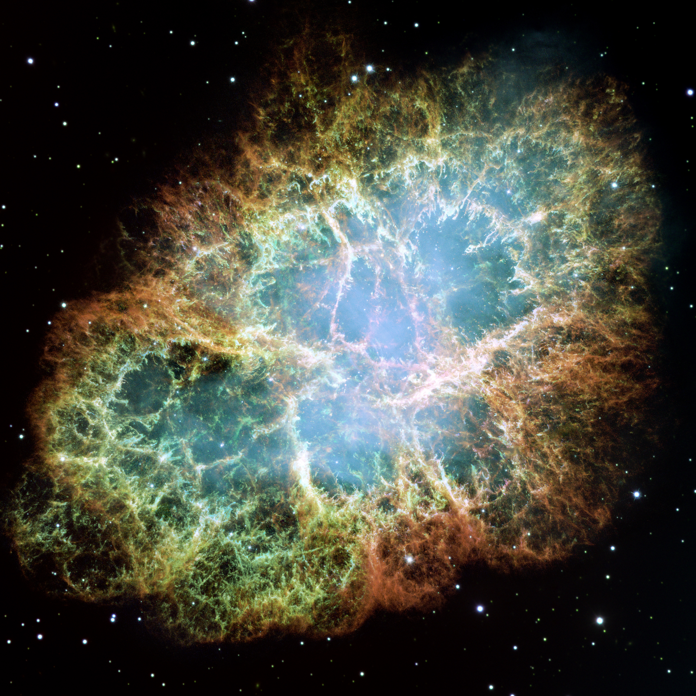

# 11 天文图像中的光、数字与颜色

马头星云的轮廓来自一片含尘埃的云。它位于较亮的背景之前，可见光穿过云时受到吸收和散射，照片中便留下一个突出的暗影。将望远镜换到近红外波段，部分原来被遮住的结构和恒星又会显露出来。同一片天空可以提供很不相同的图像，因为不同波长在物质中的产生与传播方式各有特点。

这片天区适合用来追踪一张天文照片的形成。气体与恒星发出辐射，尘埃改变沿视线传播的光；望远镜和滤镜选择其中一部分，探测器把它积累成电荷与数字；校准、配准和组合使多次记录能够比较，最后才把数值映射为屏幕上的明暗与颜色。沿这条路线走，照片里的轮廓和色彩就会逐渐对应到可解释的物理过程。

## 一个视场中的发射、散射与遮蔽

*图 1｜马头星云 B33 及周围区域，ESO VLT/FORS2 于 2000 年 2 月 1 日获得的 B、V、R 三波段数据，分别赋为蓝、绿、红。暗轮廓来自含尘埃的云对背景光的遮蔽，周围同时存在发光气体与恒星。Credit: ESO；[原图与通带信息](https://www.eso.org/public/images/eso0202a/)，CC BY 4.0。*

先选照片中一个很小的天区。抵达我们的光可能由这段视线上的恒星直接发出，也可能来自受激发的气体，或者由尘埃将其他方向的星光散射过来。继续向前传播时，其中一部分光还会被吸收或散射到别处。亮度记录了这些过程共同作用后的结果。马头的突出轮廓尤其依赖前后关系：云遮在明亮背景前方时，受损失的背景光使它显出清楚的形状。

可以用一个简单模型描述这份衰减。设某波长原来的强度为 $I_{\lambda,0}$，沿途每一薄层都移走经过它的一小部分光，层层相乘后得到指数衰减：

$$
I_\lambda=I_{\lambda,0}e^{-\tau_\lambda}.
$$

无量纲量 $\tau_\lambda$ 称为光学厚度，累积了沿视线物质的消光作用。$\tau_\lambda=1$ 时，直达光剩下约 37%；$\tau_\lambda=3$ 时，剩下约 5%。这个式子描述背景直达光，云自身的发射、向视线内的散射和前景光需要另外加上。对同一片云，光学厚度还随波长改变，于是不同波段显示的遮蔽深浅会不同。

光谱将这些成分进一步分开。恒星的连续辐射分布在较宽的波长范围，稀薄气体则常在特定谱线上明显发光。年轻大质量恒星发出的紫外光可以使氢电离，游离电子随后与质子复合，并经过一系列能级跃迁释放辐射。其中从第三能级降到第二能级的跃迁产生 Hα，波长约 656.3 纳米。气体的可见光由此与附近恒星提供的紫外能量联系起来。[星际气体的电离与辐射](https://openstax.org/books/astronomy-2e/pages/20-2-interstellar-gas)

氧和硫等离子也提供重要的发射线。[OIII] 的一条强线位于约 500.7 纳米，[SII] 常用的一对线位于约 671.6 和 673.1 纳米。光谱记号中，I 表示中性原子，II 表示失去一个电子，III 表示失去两个电子；方括号表示跃迁概率较低的禁戒线。在稀薄气体里，激发态粒子有较长时间通过辐射退激发，这些跃迁便能够显现；密度升高时，碰撞会与辐射竞争。于是不同谱线的空间分布，同时受到元素含量、温度、密度及电离状态影响。

对一团发光气体，只要沿视线增加可辐射物质，就可能增强信号；改变温度和电离状态，也会改变某些谱线的强度。成像能够显示线辐射集中在哪里，进一步量出丰度或温度，则要比较多条线并建立气体模型。拍摄窄带图像所做的选择，正是从这些物理差异开始的。

## 探测器把光积累成数值

望远镜将不同方向的光映到焦平面。科学相机的每个像素覆盖一小块天区，在曝光期间累积落入其中的信号。可见光 CCD 等探测器通过光子在材料中产生的电荷记录光，随后将电荷读出并转换为数字。一次通过某个滤镜的曝光，首先给出一张二维数值表。我们可以将这张表显示成灰度图，使较大数值更亮，也可以将它分配到彩色图的某个通道。[CCD 的工作与性能](https://hst-docs.stsci.edu/stisihb/chapter-7-feasibility-and-detector-performance/7-3-ccd-operation-and-feasibility-considerations)

计数既取决于天体，也取决于系统选择。设望远镜有效收光面积为 $A$，曝光时间为 $t$，从选定天区收到的谱通量密度为 $F_\lambda$，光学系统及滤镜的透过率为 $T(\lambda)$，光子产生可测电子的效率为 $\eta(\lambda)$。在探测器线性工作区，预期天体电子数可写成

$$
N_e=At\int F_\lambda T(\lambda)\eta(\lambda)
\frac{\lambda}{hc}\,\mathrm d\lambda.
$$

式中的 $hc/\lambda$ 是单个光子的能量，因此乘以 $\lambda/(hc)$ 把能量通量转为光子通量；其余因素分别表示收光面积、累积时间和最终被探测的比例。这个式子也解释了测光校准的必要性：换滤镜、换相机或改变曝光时间，都可能改变同一目标的计数。

宽带滤镜收集较宽波长范围内的光，适合测连续谱和较亮的整体结构。窄带滤镜围绕某条谱线选取较窄区间，可以突出该线的气体发射，同时减少区间之外的连续背景。对于发射主要集中在通带内的目标，这有利于提高目标相对背景的信号；具体收益取决于线强、通带宽度和背景光谱。目标速度引起的谱线位移，以及滤镜随入射角等条件的变化，都需要与实际通带一起考虑。

曝光时间增加，更多光子会进入计数。暗弱星云的色彩与细丝因此能够在长时间累积后显现。人眼观看则有较短的时间整合，在低照度下还更多依靠对颜色不敏感的杆细胞。目镜里的观感与长曝光图像各自对应不同的接收条件。照片把长期到达的微弱信号保存下来，便为后续比较和测量留下了资料。[探测器与曝光](https://openstax.org/books/astronomy-2e/pages/6-3-visible-light-detectors-and-instruments)

## 校准分离仪器响应与天空信号

原始数值中还包含探测器自身的贡献。读出电子线路通常带有偏置水平；暗电流在曝光期间持续积累；不同像素对相同入射光的响应略有差别；镜头和附件也可能使视场边缘的光量降低。它们在图像上形成加法与乘法两类影响，校准需要分别处理。

偏置帧测量读出的电子基准，暗场在相应温度、增益和曝光条件下测量暗信号，平场则用较均匀照明测量各位置的相对响应。将这些参考资料组合为稳定的校准帧后，可以用一个简化模型说明运算。假定原始数据已经统一为电子数，第 $i$ 个像素的读数为 $R_i$，偏置为 $B_i$，暗电流率为 $d_i$，相对响应为 $q_i$，则校准后的光信号率为

$$
C_i=\frac{R_i-B_i-t\,d_i}{t\,q_i}.
$$

先减去按数值叠加的偏置和暗信号，再除以响应与曝光时间，就把不同像素放到共同尺度上。若两处天空实际同样亮，而某个像素只产生参考响应的八成信号，除以 $q_i=0.8$ 后，便能补偿这份响应差。实际仪器会规定参考帧类型、单位和处理顺序；例如已包含偏置的暗场需要与偏置扣除方式配合。[STIS 数据校准](https://hst-docs.stsci.edu/stisdhb/chapter-3-stis-calibration/3-4-descriptions-of-calibration-steps)

校准后，天空背景仍在图中，因为气辉、散射的月光及其他背景也确实向探测器送来了光子。测量恒星时，可以在周围没有明显目标的区域估计背景，按面积换算后从测光区域中扣除。研究延展星云时，背景的选择更需结合视场：云可能延伸到画面边缘，十分平滑的结构也可能属于天体。宽视场观测、邻近空场和不同曝光之间的比较，有助于约束背景的空间变化。

多次曝光还带来额外信息。宇宙射线可以在一次读出里留下亮点或短痕；坏像素固定在探测器位置；恒星和星云则随着望远镜指向变化落到不同像素。略微改变指向的抖动观测，把同一处天空放到不同探测位置，配准后即可综合这些差别，剔除部分异常并填补坏像素。研究快速变化天体时，还会保留时间顺序，区分短暂天文事件与探测器异常。[多次曝光的配准与组合](https://hst-docs.stsci.edu/drizzpac)

*图 2｜课程原创模拟。A 为设定的天体信号率，包含三个星点及暗弱云状结构；B 为加入均匀天空、暗电流、偏置、读出噪声和相对响应后的 100 秒原始读数；C 为已知相对响应。D、E 经校准并扣除已知平均天空，分别为 100、400 秒，使用与 A 相同的 asinh 显示范围；F 与 E 使用同一数组，改为线性显示。模拟假定校准量与平均背景已知，保留光子和读出涨落；像素坐标仅对应本模拟。[生成源与参数](../../assets/rewrite-20261025/11/SOURCES.md#simulation)。*

图 2 的 B 中，天空背景、偏置与响应不均共同参与了原始亮度。校准将 D、E 的像素数值统一为每秒每像素的电子信号，曝光时间不再直接决定平均数值的大小；更长曝光的收益主要表现为数值围绕真实信号的起伏变小。相同显示下，E 的微弱云状结构比 D 更连贯，这就引向了信噪比。

## 长曝光积累信号，也积累背景的涨落

在简单泊松计数模型中，若某次测量预期积累 $N$ 个独立到达的光子，其计数方差为 $N$，典型涨落约为 $\sqrt N$。平均累计 100 个时，涨落约 10 个；累计 10000 个时，涨落约 100 个。绝对起伏增大，相对起伏却从十分之一降到百分之一。长曝光提高精度，来自信号随时间线性积累，而独立随机涨落按平方根增长。

天空背景也遵守同样的计数统计。即使平均背景已测得很准，某一次曝光里的实际背景光子数仍会在均值附近变化。扣除平均背景后，这些随机偏差会保留在天体信号中。在图 2 的 D、E 中，模型的天空均值已知，背景仍然留下可见颗粒；较暗的观测环境能从源头减少这部分方差。

对一个包含 $n_\mathrm{pix}$ 个像素的测量区域，把总曝光时间 $t$ 分为 $N_\mathrm{exp}$ 次曝光，设天体、天空和暗电流在整个区域的电子计数率分别为 $s$、$b$、$d$，单次每像素读出噪声的均方根为 $r$。当这些随机过程相互独立、校准误差较小、背景均值估计足够精确时，

$$
\mathrm{S/N}\simeq
\frac{s t}{\sqrt{s t+b t+d t+n_\mathrm{pix}N_\mathrm{exp}r^2}}.
$$

分子是预期天体电子数；分母中的前三项是相应泊松方差，最后一项将所有像素、所有读出的噪声方差相加。将各项统一到电子计数单位，才可以作这样的比较。若背景估计也有显著误差，或者重采样造成像素相关性，还需要在相应误差模型中加入它们。[信噪比与曝光时间](https://ssb.stsci.edu/cdbs/perigee/jyounger/PhaseI_IHB_JavaHelp/WFPC2/ch6_exposuretime10.html)

取一个便于计算的假设区域，天体计数率为每秒 1 电子，背景为每秒 9 电子，并暂略暗电流与读出项。100 秒积累 100 个天体电子，总泊松方差为 1000，信噪比约为 3.2；400 秒积累 400 个天体电子，方差为 4000，信噪比约为 6.3。曝光增加四倍，信噪比增加两倍。目标与背景稳定、这类随机噪声占主导时，信噪比便近似随 $\sqrt t$ 增长。

总时长相同，拆分方式会影响读出项。一次 400 秒与四次 100 秒具有近似相同的目标和背景光子预算，后者却读出四次。另一方面，分次曝光可以避开亮星饱和，减少追踪偏差在单帧中的累积，并为异常识别提供比较。实际曝光方案在这些条件之间选择合适的单帧时长，再用多帧组合获得所需信号。

观测足够深以后，平场残余、散射光或背景模型的偏差会成为更明显的限制。这些误差可能在许多曝光中以相似方式保留，累积时间增加便难以按独立噪声的规律消除它们。对很淡的星云边缘，采用怎样的背景模型会影响外部结构的测量，因而需要检查不同合理处理下结果的稳定程度。更长曝光与更准确的仪器和背景描述，共同决定能测到多暗的结构。

## 从数值到明暗的显示

校准数据可以覆盖很宽的动态范围。亮星核心与邻近暗云在同一幅图中，计数率可能相差数十、数百甚至更多倍。屏幕的可用亮度范围有限，直接把零到最大值线性排成黑到白，会将较小数值挤在很暗的一段。图 2 的 E 与 F 使用完全相同的数据，线性显示的 F 突出了星点，E 则把暗弱结构也呈现出来。

一种简单的压缩方式是对非负信号使用 $y=\log(1+C/C_0)$，再将 $y$ 归一到显示范围；$C_0$ 控制从哪里开始明显压缩高值。反双曲正弦函数 asinh 也常用于天文图像：低值附近接近线性，高值处逐渐接近对数，可以兼顾暗弱结构与亮区层次。改变显示映射后，数值差异转化成了新的视觉亮度差，定量测光仍回到校准数组。[Lupton 等的 RGB 合成与 asinh 方法](https://arxiv.org/html/astro-ph/0312483v1)

显示截断与探测器饱和发生在不同阶段。若原始像素仍工作在线性范围内，显示时把高值压成白色，可以通过重新选择映射找回其层次。若像素电荷容量或读出范围已经饱和，超过阈值的光强便无法继续被区分。高动态范围观测常用短曝光保存亮核心，再用长曝光积累外围信号，并在共同标定后合成相应区域。

成像分辨率也参与图像处理。光学系统与大气把点源展成有限光斑，可用点扩散函数描述。知道这种响应后，反卷积试图估计更接近原始天体的结构；细小尺度上的噪声也会被放大，所以结果需要合适的约束和误差检查。测量细丝宽度、星点亮度或两个结构的间隔时，处理后的模型应与原始数据的分辨率和信噪比相容。

## 用颜色比较不同谱线 {#L14-C03}

马头的可见光图使用 B、V、R 宽带，分别分配到蓝、绿、红显示通道。类似的三通道组合也可以用于窄带数据。选取硫、氢、氧的谱线各拍一组图，完成校准并对齐后，就得到三张描绘不同辐射成分的空间分布图。将它们分配到屏幕三个颜色通道，便能同时观察它们在哪里重合、在哪里分离。

*图 3｜M17 局部，Hubble/WFPC2 窄带数据合成。SII 赋为红，Hα 赋为绿，OIII 赋为蓝。Credit: European Space Agency, NASA, and J. Hester (Arizona State University)；[原图、滤镜与映射](https://esahubble.org/images/heic0305a/)，CC BY 4.0。*

常用的 SHO 正是这种对应：SII → R，Hα → G，OIII → B。Hα 与 SII 的主要谱线都位于可见红光附近，赋予不同显示颜色后，其空间差别更容易识别。若某位置的三个通道都很强，就会混合成较浅的颜色；若氢和硫较突出，红与绿的组合会偏黄；若氧相对突出，蓝色贡献会更明显。通道权重和拉伸会继续影响综合色彩，所以定量线比要由校准后的单通道数值计算。

这种颜色安排将谱线成分编码在同一画面中。图 3 的气体边界和云柱附近出现了不同色带，为辐射场与气体状态随位置变化提供线索。将线强写成电离状态、温度、密度和沿视线长度的函数，再与多条观测联合比较，才能进一步建立物理解释。一张窄带合成图因此可以帮助选出值得测光或取光谱的位置。

彩色图也可以承载可见光之外的数据。将红外波段分配到红、绿、蓝，颜色表示的是几个红外通带的相对信号；将射电谱线的速度绘成色图，颜色则对应速度刻度；X 射线图可以用颜色区分光子能量。数据的物理量、波段与映射一起决定颜色含义。发布图中的滤镜表和色标，使这种编码能够被读者重新还原。

## 从可见光马头进入近红外 {#L14-C02}

*图 4｜Hubble/WFC3 的马头星云近红外图，由约 1.1 和 1.6 微米数据赋色合成，视场约为 5.78 × 6.04 角分。其视场与朝向和图 1 分别保留各自发布版本。Credit: NASA, ESA, and the Hubble Heritage Team (AURA/STScI)；[原图与波段](https://esahubble.org/images/heic1307a/)，CC BY 4.0。*

近红外图中，马头区域显出了褶皱、透过部分云层的星点和不同的表面层次。对这片云，尘埃在近红外的消光较可见光弱，较长波长能够穿过一部分原来遮蔽背景的区域。前面衰减关系中的 $\tau_\lambda$ 随波长改变，于是相同物质对不同光的透明程度不同。较厚或粒径分布不同的尘埃区域仍可保留强遮蔽，近红外呈现的是一套新的穿透条件。[马头的近红外结构](https://esahubble.org/images/heic1307a/)

不同红外波段还偏向不同来源。近红外可以收到恒星光及散射光，较长波长则常适合研究冷尘埃的热辐射。尘埃先吸收恒星等光源送来的能量，再以与自身温度和辐射性质有关的光谱向外释放，光学遮蔽与红外发射由此属于同一物质系统的两个方面。扩大波长范围，会使原来主要以暗影出现的物质获得更多可测特征。

要将两张图中的某个位置作定量比较，需要先统一天空坐标、选取共同视场，并考虑各自的点扩散函数。假设一幅图能分辨 0.1 角秒，另一幅只能分辨 10 角秒，一束细丝在后者中会被平均到更大的区域；比较线比或颜色时，常将较清晰数据平滑到共同分辨率。配准与分辨率匹配完成后，剩下的结构差别才适合交给辐射模型解释。

## 辐射机制与空间尺度一起进入图像 {#L14-C01}

马头使尘埃的作用变得直观，其他天体又展示了新的能量来源。蟹状星云是超新星遗迹，细丝中的气体产生谱线辐射，中心区域还有与脉冲星供能相联系的高能粒子。相对论性电子在磁场中运动时产生同步辐射，提供宽广的连续光谱。不同波段和偏振观测可以帮助分离这些辐射成分。[蟹状星云中的同步辐射](https://imagine.gsfc.nasa.gov/science/objects/snr_crabneb.html)

*图 5｜蟹状星云 M1，Hubble/WFPC2 的 24 次曝光拼接。本版本采用 OI 约 631 nm、SII 约 673 nm 和 OIII 约 502 nm 的通道，横向视场约 6.41 角分。Credit: NASA, ESA and Allison Loll/Jeff Hester (Arizona State University). Acknowledgement: Davide De Martin (ESA/Hubble)；[原图与滤镜表](https://esahubble.org/images/heic0515a/)，CC BY 4.0。*

图 5 的细丝彼此交叠，背后包含三维的空间分布。二维成像记录了沿视线累积而来的光，光谱的多普勒位移则能补充视线速度，连续多年影像可以给出天球上的角运动。知道距离后，再把角运动换算为横向速度，就能约束遗迹的膨胀和流动。空间分布、速度与辐射模型共同参与三维重建，每种观测提供其中的一部分。

将视场扩大到星系尺度，照片里还会同时出现许多局部星云。星云通常指星际气体和尘埃形成的云状区域，其可见形态由发射、散射或吸收塑造；星系则是由大量恒星、气体、尘埃及暗物质共同构成的引力系统。M33 是银河系之外的旋涡星系，其旋臂包含恒星群和发光气体区，画面中也叠加着银河系前景恒星。宽带光描绘恒星分布，Hα 通道突出部分气体发射，二者结合，使这个系统中的局部活动显现出来。

*图 6｜M33，VST/OmegaCAM 的 g、r 和 Hα 数据合成，横向视场约 68.01 角分。Credit: ESO；[原图与通带](https://www.eso.org/public/images/eso1424a/)，CC BY 4.0。*

图 6 的横向天区比图 5 宽十倍以上。知道距离后，小角度关系 $\ell\simeq d\theta$ 又将角尺换成空间尺，其中 $\theta$ 用弧度。暂取 M33 距离 840 千秒差距，68 角分约为 0.0198 弧度，整个横向画幅便对应约 16.6 千秒差距，约五万四千光年。这是画幅对应的尺度，恒星与气体实际延伸到哪里，还要由相应深度的观测决定。[M33 的距离研究](https://arxiv.org/abs/2304.00037)

星系的这张大图里，发射、遮蔽、采样和赋色仍沿用前面相同的原理。一个红色斑块可以继续分解为具体谱线和气体状态；一条暗带可以结合其他波段测量尘埃；明亮恒星和暗弱外缘则要求不同曝光与显示尺度。天文图像将这些过程压在同一平面上，保留观测波段、标定、尺度与显示规则，就能从画面逐层返回产生它的物质、能量和空间结构。
