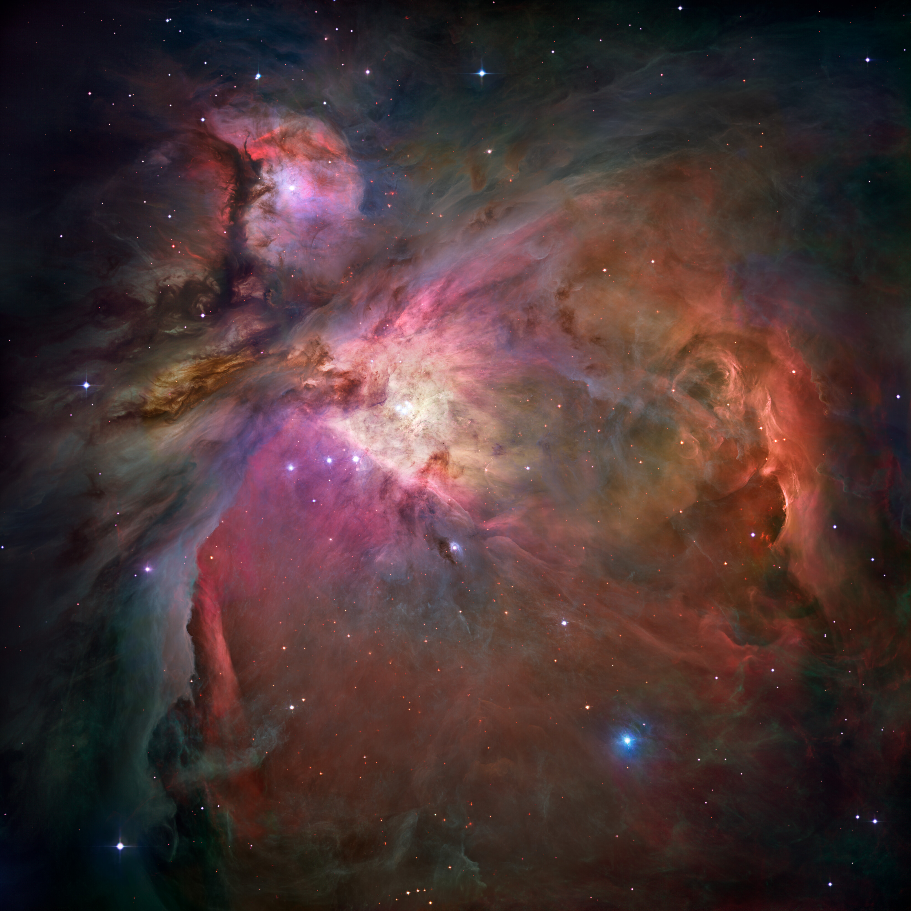
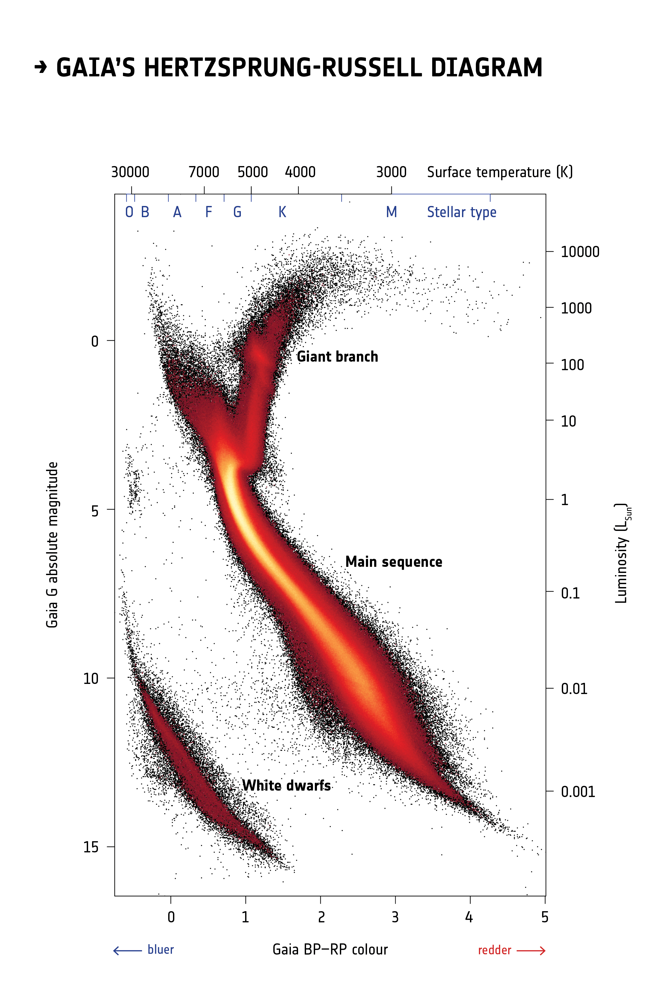
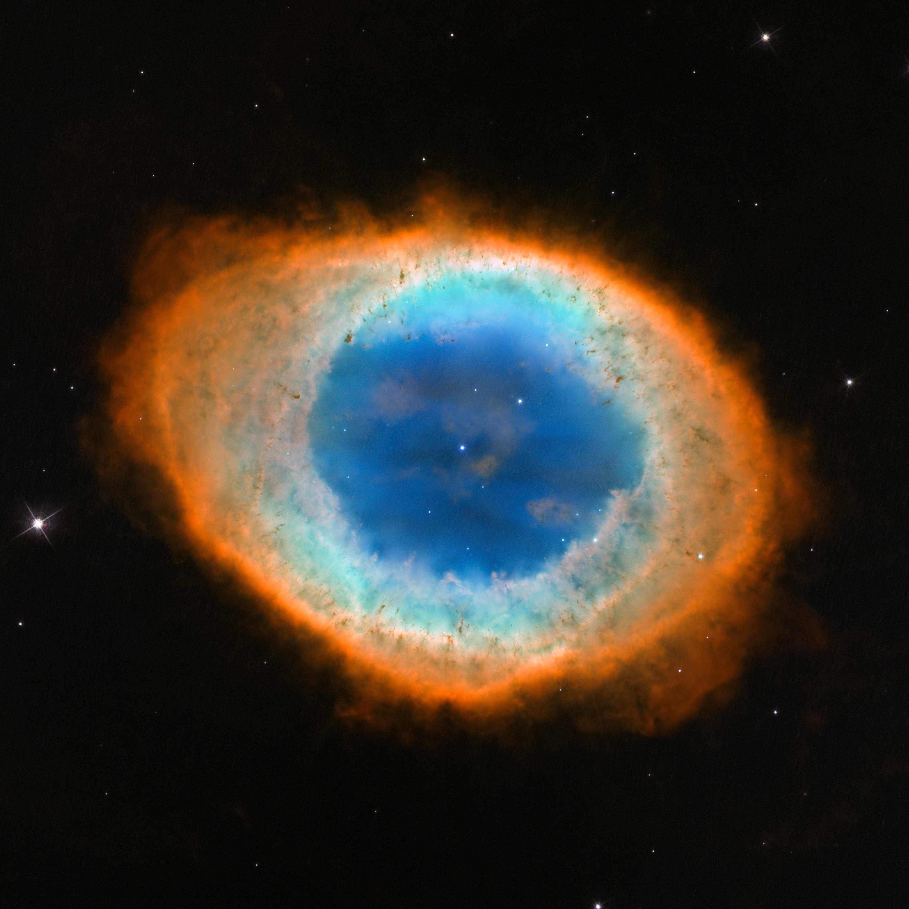

# 恒星为什么能活几十亿年，又为什么一定会改变

太阳每秒向空间送出约 $3.83\times10^{26}$ 焦耳能量，地球只接到其中极小的一份，却足以维持气候、驱动大部分生态系统。如此庞大的输出，已经持续了几十亿年。如果太阳是一团普通的火，它早该烧完；如果只是一个冷却的热球，它也不可能维持这么久。恒星演化首先要回答的，正是这个能量账本的问题：能量从哪里来，为什么输出没有迅速耗尽它，以及当提供能量的过程改变时，整颗星如何回应。[太阳的能量来源](../../assets/v02-batch-C-SOURCES.md#c11-01)

“气体云、主序、红巨星、白矮星”这条路线，是这些问题的结果。只有知道每次转变背后的物理，名称之间的箭头才有内容。一颗恒星的中心和表面不必同时变大、变热：核心收缩时，外层可能膨胀；表面变冷时，总光度反而可能上升。恒星的生命不是一团火渐渐变小，而是一个自引力系统不断重建内部结构的过程。

## 从冷暗的云中，怎样造出热亮的星 {#L11-C01}

恒星的原料主要是氢与氦，也含少量较重元素和尘埃。许多恒星形成于冷而密的分子云，温度只有十几开尔文，部分氢结合成分子，尘埃让内部难以在可见光中直接看见。低温恰好有利于引力取得优势：气体的随机运动产生压力，抵抗压缩；较冷的云，在相同密度下具有较小的热压力。[恒星诞生区](../../assets/v02-batch-C-SOURCES.md#c11-02)

把云粗略看作质量为 $M$、半径为 $R$ 的气体球，引力束缚能的量级为 $GM^2/R$，热运动能量则与粒子数和温度成正比。增加质量、提高密度或降低温度，可以让引力更有机会压过热运动。不过湍流、磁场、旋转与外部压力也参与决定哪些区域真正坍缩。分子云往往碎裂成多个致密核心，一个星形成区因而会产生许多恒星。

收缩还需要散热。气体被压缩时会升温，如果热量立即积累，压力就会阻碍继续收缩；分子谱线和尘埃辐射能够带走部分能量。随着中心密度升高，辐射越来越难直接逃出，内部终于形成热而致密的原恒星。它已经发光，却还没有进入稳定的核心氢聚变阶段。物质落向中心释放的引力能，以及内部收缩释放的能量，都可以先让它明亮起来。

云原本微弱的旋转也会变得重要。角动量不能凭收缩消失，物质向更小半径集中时，绕行会加快；角动量较多的气体难以直接落入中心，便形成盘。盘中物质向内输运，需要把角动量交给其他物质或通过外流带走。年轻恒星盘与喷流，因而涉及恒星怎样实际获得质量；行星又可能在某些盘中继续形成。太阳系的共同起源，就这样接回了恒星诞生。

*图 1｜猎户座星云 M42 与 M43，435—850 nm 多波段观测拼接，包含地面补充数据。中央年轻大质量星使气体发光并侵蚀云，暗结构提示遮挡。不是肉眼所见。Credit: NASA, ESA, M. Robberto (Space Telescope Science Institute/ESA) and the Hubble Space Telescope Orion Treasury Project Team；CC BY 4.0；[图源 C11-I1](../../assets/v02-batch-C-SOURCES.md#c11-i1)。*

## 引力怎样暂时供能，聚变又怎样接班

自由落下的物质会加速；进入气体中的运动则可在碰撞、激波和压缩过程中转化成内能。原恒星收缩也有类似的能量账：引力势能降低，一部分转为内部热量，一部分向外辐射。在理想、近静力平衡的气体球中，维里定理给出内能约为引力势能绝对值的一半。于是它一边损失能量，一边收缩并升温。给一个自引力气体球“散热”，未必让它内部变冷。这种性质与固定容器中的气体完全不同。[引力供能](../../assets/v02-batch-C-SOURCES.md#c11-01)

把太阳的引力能量级除以当前光度，可估算只靠收缩能维持发光的时间：$t\sim GM_\odot^2/(R_\odot L_\odot)$。这里三个下标太阳的量分别是太阳质量、半径、光度，$G$ 是引力常数。代入约 $1.99\times10^{30}$ 千克、$6.96\times10^8$ 米和 $3.83\times10^{26}$ 瓦，得到约三千万年。结构系数会改变细节，却不足以把它变成几十亿年。因此引力收缩能解释原恒星发光，不能承担太阳整个长期能量预算。

太阳的长期能源来自核聚变。氢原子核是质子，带相同正电，会相互排斥；靠近到核力可以起作用的距离，需要高温下的碰撞以及量子隧穿。太阳中心温度约一千五百万开尔文，主要通过质子—质子链，将四个质子最终变成一个氦核，同时产生正电子、中微子和辐射。最终产物的总静质量略小于初始粒子质量，差额以 $E=\Delta m c^2$ 的形式成为能量。[核过程](../../assets/v02-batch-C-SOURCES.md#c11-03)

大约 0.7% 的相关质量能转成能量，远高于化学燃烧效率。若粗略假设太阳总质量的十分之一参与主序供能、其中约七成是氢，再按现在的光度输出，核燃料预算给出约七十亿年的量级。实际光度会变化，可参与反应的区域也要由恒星模型决定，所以这只是说明“为什么能够有十亿年尺度”的估算，不能当太阳未来寿命的精密预报。太阳已形成约 46 亿年，仍在主序，未来还有数十亿年的核心氢聚变阶段。

聚变并不等于直接把整颗星向外推的力。压力来自热粒子运动，也可有辐射的贡献；聚变提供维持温度的能量。把一层气体单独取出来，它的内侧压力必须略大于外侧压力，差额才能支撑这层物质受到的引力。这个从中心到表面逐层成立的关系，称静力平衡。压力本身处处都有，真正承担支撑的是压力随位置的变化。[太阳内部](../../assets/v02-batch-C-SOURCES.md#c11-04)

静力平衡回答“此刻为什么不整体坍塌”，热平衡回答“长期为什么不持续冷却或膨胀”。如果普通主序星的核心稍微收缩，温度升高，核反应会加快；产能增加有助于恢复支撑，使收缩减缓。如果核心膨胀冷却，反应减慢，又会削弱产能。这种负反馈使主序成为长而相对稳定的阶段。它并不保证恒星永远不变，因为聚变始终在改变核心成分。

## 表面照片之外，怎样知道内部真的如此

我们不能把探测器送入太阳中心，但内部过程留下了不同通道的证据。太阳中微子来自核反应；它们极少与物质相互作用，可以较直接地带出核心信息。早期探测数目少于简单预期，后来通过不同实验辨认中微子类型变化，才把“太阳模型是否错了”与“粒子在途中如何变化”区分开。核聚变的证据不只是“太阳很亮，所以猜它在聚变”。[太阳中微子](../../assets/v02-batch-C-SOURCES.md#c11-05)

太阳表面还在轻微振动。不同振动模式穿过不同内部区域，传播速度取决于温度、密度和组成。研究这些振动的日震学，能够检验内部声速分布、对流区深度等结构。中微子约束产能，振动约束结构，光谱与光度约束外部表现；多种证据要同时与同一个太阳相容。其他恒星也有星震学，但数据的精细程度和模型不确定性并不与太阳完全相同。

核心产生的能量也不是一束直通表面的光。高密度物质反复吸收、发射和散射辐射，能量通过大量小步向外传播；在某些区域，物质整体上升与下降，形成对流。太阳内侧主要靠辐射输运，外部较大一层靠对流。我们看见的光球，是可见光容易逃出的区域，并不等于产能核心的边界。光球约 5800 K，中心约一千五百万 K，这两个温度描述不同位置。[能量输运](../../assets/v02-batch-C-SOURCES.md#c11-04)

## 把几百万颗恒星放到同一张图上

夜空中的颜色与明暗已经提供线索，但视亮度还混入了距离。若量出距离、校正消光，就可以估计恒星真正的光度；再用颜色或光谱推断表面温度，把这两个量放在坐标图中，就得到赫罗图。它的横轴通常向左越来越热，纵轴向上越来越亮。Gaia 图采用颜色和绝对星等作为相应观测量，绝对星等越小的位置越靠上。[赫罗图](../../assets/v02-batch-C-SOURCES.md#c11-06)

*图 2｜超过四百万颗恒星的观测分布。左侧较蓝、表面较热，上方本征较亮。黑—红—黄表示各位置的恒星数量密度，不是恒星本色。它是数据图，不是一颗星的连续录像。Credit: ESA/Gaia/DPAC；Acknowledgement: Carine Babusiaux；CC BY-SA 3.0 IGO。图源 [C11-I2](../../assets/v02-batch-C-SOURCES.md#c11-i2)。*

图中的大多数点沿一条斜带聚集，称主序；上方偏右还有巨星，下方偏左有白矮星。为何低温天体能很亮，高温天体又能很暗？总光度既取决于每平方米发多少能量，也取决于有多少平方米。用有效温度 $T_{\rm eff}$ 定义辐射输出，便有 $L=4\pi R^2\sigma T_{\rm eff}^4$，其中 $R$ 为恒星半径，$\sigma$ 为斯忒藩—玻尔兹曼常数。

设一颗巨星半径为太阳的五十倍，表面温度为 3500 K，以太阳约 5770 K 作参照，它的光度比约为 $50^2(3500/5770)^4\approx340$。它比太阳表面冷，却因面积庞大而发出更多能量。若一个白矮星半径仅太阳的百分之一、有效温度为 10000 K，光度比约 $0.01^2(10000/5770)^4\approx0.0009$：它表面很热，却很暗。这两种位置差异由同一个面积与温度关系解释。

但不能顺着主序斜带画一支“时间箭头”，说所有星从左上沿带走到右下。主序上不同位置主要对应不同质量的星；一颗太阳质量星不会在成熟后依次变成 O、B、A、F、G、K、M。真正的演化轨迹，需要追踪一颗给定质量、组成的星，在燃料与结构变化时怎样穿行这张图。统计分布提供观测约束，轨迹则是用物理模型解释分布的一种方式。

## 燃料更多，为什么反而更短命

主序恒星的质量通常越大，中心温度越高，产能与光度就越大，而且上升速度远快于燃料总量。对太阳附近至若干太阳质量的一段主序，可以用 $L/L_\odot\sim(M/M_\odot)^{3.5}$ 粗略理解趋势。指数随质量范围与组成改变，不能套到所有恒星，更不能套到红巨星和白矮星。[质量、光度与寿命](../../assets/v02-batch-C-SOURCES.md#c11-07)

若可利用燃料粗略正比于质量，那么主序寿命约与 $M/L$ 成正比；上述近似给出 $t_{\rm MS}\propto M^{-2.5}$。三倍太阳质量有约三倍燃料，光度却约四十七倍，寿命尺度只剩太阳的约十五分之一。借太阳约百亿年的主序尺度估算，得到数亿年，而非三百亿年。这个算例真正说明的是消耗率比储量更快增长；精确寿命仍需考虑核心混合、成分与演化结构。

在高温大质量核心中，碳、氮、氧参与另一套把氢变成氦的循环，称 CNO 循环。它们在循环中充当中间参与者，净结果仍是氢变氦，但对温度的依赖更敏感。更大质量还可能带来强恒星风、显著辐射压力与更复杂的内部混合。因此“大质量星更短命”不是靠体积推断，也不是越大越不稳定的一句口号。

极低质量红矮星恰好相反：光度很低，部分对象内部对流范围很广，能够较充分地利用氢。它们的模型寿命可长过宇宙当前年龄很多倍；我们尚未看见一个从宇宙诞生以来自然走完如此漫长生命的最低质量红矮星。常见“恒星演化流程图”中，从红巨星到白矮星的左支，主要适合太阳类和相应中低质量星，不能把未发生过的所有极低质量晚年写成已观测历史。

## 核心收缩，为什么外层反而变大 {#L11-C02}

主序结束并不是整颗星的氢同时用尽。以太阳类星为例，中央逐渐积累氦，而外层仍有大量氢。核心氢供能减弱后，氦核心收缩并加热，核心外侧的氢壳层可以继续聚变。更强的壳层供能与包层结构变化，使外层膨胀，表面温度下降，进入红巨星阶段。这里同时发生的是核心更小更热、包层更大更冷。[红巨星的结构](../../assets/v02-batch-C-SOURCES.md#c11-08)

“变成红巨星”也不要求总质量变大。恒星风正不断带走物质，星体可以一面失质量，一面扩大半径。半径扩大又降低了外层束缚程度，影响后续失质量。观测中的巨星光谱、表面振动、风与尘埃，提供了结构变化的线索；内部的收缩与壳层反应，则靠符合这些线索的模型连接起来，不能把彩色剖面图当作直接拍到了核心。

当氦核心温度达到约一亿开尔文，三个氦核可以经过中间步骤形成碳，称三氦过程；后续部分碳又能与氦核反应生成氧。太阳类星在首次氦点火前，核心已经受电子简并影响，温度与压力的关系不同于普通理想气体，可能发生氦闪。它主要是核心内部的快速能量释放和结构调整，通常不会把整颗星炸成可见的超新星。对更大质量而尚未进入核心坍缩支路的星，氦点火条件又有不同。[氦燃烧](../../assets/v02-batch-C-SOURCES.md#c11-09)

稳定核心氦燃烧结束后，太阳类星进入更复杂的晚期巨星阶段，中心形成碳氧核心，周围可能有氦、氢壳层交替重要的供能。脉动、热脉冲与风把包层送回星际空间。留下的热核心可以用紫外光电离周围气体，使抛出物发出谱线，形成行星状星云。这个名字来自早期观测中某些星云圆盘状的外观，与正在制造行星没有直接关系。[恒星的晚年](../../assets/v02-batch-C-SOURCES.md#c11-10)

*图 3｜环状星云 M57 的多条光学谱线合成。圆环是三维结构的投影，不是薄平面圆环；中央热遗迹与周围抛出气体共同说明“核心留下、包层离开”。颜色不能直接读成物质温度。Credit: NASA, ESA, and C. Robert O’Dell (Vanderbilt University). CC BY 4.0；[图源 C11-I3](../../assets/v02-batch-C-SOURCES.md#c11-i3)。*

太阳没有足够大的核心条件继续完成大质量星那种连续重元素燃烧；它最后会留下白矮星。今天的太阳质量约一个太阳质量，而未来遗迹只会保留原来的部分质量。图中的两类对象必须一直分开：诞生时整颗星的质量，影响它能够走到哪些阶段；最后核心遗迹的质量，则决定遗迹以什么方式获得支撑。

## 一颗不再聚变的星，靠什么不继续塌下去 {#L11-C04}

白矮星可将相当于太阳的部分质量装入地球尺度的体积。设质量为 $0.6M_\odot$、半径为 9000 千米，平均密度 $3M/(4\pi R^3)$ 约为 $3.9\times10^8$ 千克每立方米，是水的约四十万倍。这是用于理解尺度的代表性算例，不是所有白矮星的统一半径与密度。它的内部已不适合按普通岩石、液体或稀薄气体想象。[白矮星结构](../../assets/v02-batch-C-SOURCES.md#c11-11)

电子遵守泡利不相容原理：完全相同的量子态不能被两个电子重复占据。把大量电子压进越来越小的空间，意味着它们必须占据更高动量的状态，形成抵抗压缩的压力，这叫电子简并压力。它不是电子彼此电斥力的一种别名，也不要求不断聚变来维持。白矮星因此能在逐渐冷却时仍保持致密结构；它会发光，却主要在消耗储存的热能，而非像主序那样靠核心氢聚变供能。

在非相对论简并近似下，压力随密度大致按 $P\propto\rho^{5/3}$ 增长；这让更重的白矮星通过更强压缩建立支撑，半径反而较小。当电子动量增大到必须考虑相对论时，压力增长变为约 $\rho^{4/3}$，对继续加重的引力不再有足够的优势。对典型碳氧组成、冷而非旋转的理想模型，会出现约 $1.4M_\odot$ 的钱德拉塞卡极限。

这个上限限定的是白矮星本身，不是主序星的初始质量。诞生时两三个太阳质量的恒星，可以在晚年抛出足够物质，留下小于此上限的遗迹；诞生超过 1.4 就“必变黑洞”因而没有依据。温度、旋转、组成、吸积和核反应也会影响实际演化。上限表达电子简并支撑的能力范围，不会独自规定超限后必然出现某一种爆发。

白矮星还给出极长时间尺度的证据。模型预言，它们冷却时内部可以结晶；某些温度区间的冷却因释放能量而变慢，统计上便可能积累较多对象。Gaia 的颜色—绝对星等分布中出现相应结构，是用大批遗迹检验物态与冷却历史的机会。恒星研究在这里连接到了高密度物理，并不只是在给晚年天体改名。[冷却与结晶](../../assets/v02-batch-C-SOURCES.md#c11-12)

## 更大的核心，为什么会走向更剧烈的结局 {#L11-C03}

对足够大初始质量的恒星，氦燃烧留下的核心还能收缩到碳燃烧所需的温度，继而进入更重元素参与的阶段。其后期内部会出现分层：不同半径处温度不同，中心与各壳层可以进行不同反应。常见的“洋葱结构”示意表达这种层次，不意味着每颗大质量星都严格具有同样厚度、同样元素比例的七层。[大质量星的核反应](../../assets/v02-batch-C-SOURCES.md#c11-13)

这些阶段越来越快，不只是剩余燃料越来越少。高温核心中，中微子能够高效带走能量，需要更快的核反应补偿损失；在铁族核心形成后，继续将铁族核聚合成更重核也不再能提供净放能的长期能源。核的平均结合能在铁镍附近达到高值，因此“把更重原子核制造出来”与“给恒星供能”不再等价。这是演化转折的原因，不是恒星完成元素周期表后自觉退休。

核心仍可短暂依靠电子简并支撑，但核心质量增长、电子俘获与高能光子拆解原子核等过程，会破坏这一支撑。它随后快速坍缩。在足够高密度时，核物质的性质与相互作用可以使核心建立新的支撑，形成中子星；若遗留质量和后续回落物质使它不能保持稳定，就可能形成黑洞。坍缩与向外爆发的联系，需要冲击波、中微子加热和多维流动共同解释，不能简单写成核心“反弹一下”便自动炸掉包层。

中子星的尺度约为十余千米半径，却能具有一个多太阳质量；它主要由高度致密、富中子的物质组成，内部详细状态仍有研究空间。支撑不只是“中子之间挤不开”的一句类比，还涉及核相互作用与广义相对论。其最大稳定质量也不是白矮星的 1.4 上限。白矮星、中子星和黑洞是不同结构，不能把三者放在一条必然逐项经过的冷却路线中。[中子星](../../assets/v02-batch-C-SOURCES.md#c11-14)

坍缩前的核心与快速旋转、磁场也有关。原恒星通过盘处理角动量，晚年核心又把收缩继承的角动量带向小得惊人的体积。若磁轴与自转轴不重合，旋转中子星的辐射束扫过地球，就会收到周期脉冲，成为脉冲星。稳定而极短的脉冲周期是致密、快速旋转天体的重要线索；不是整颗星每次闪一下就膨胀、收缩一次。蟹状星云内的脉冲星，正把历史爆发与今天的紧致遗迹连接起来。

大质量星的结局还不保证有一场明亮超新星。爆发能否成功把外层物质推出去，受坍缩前核心结构、失质量、旋转、双星影响；有些对象可能形成黑洞而没有通常明亮的可见光爆发。常用约八个太阳质量划分白矮星支路与可能核心坍缩支路，是初始质量的粗略尺度，边界附近的电子俘获、碳燃烧与失质量尤其复杂。把它写成一条不可移动的精准界线，会把模型仍需研究的部分隐藏掉。

## 没有等上百亿年，怎样检验一生的故事

恒星演化的大部分时间比人类历史长得多，证据因而不是一部从出生拍到死亡的连续影片。星团提供了一种自然实验：成员近似同时形成，距离和初始组成相近，质量却不同。把星团成员放入赫罗图，就能看见大质量星已经离开主序，而较小质量成员仍在主序。主序转折位置因而能够约束年龄。若模型宣称某类星应该活很久，却预测一个年轻星团里它们全已离开主序，便需要检查模型或星团成员选择。[星团检验](../../assets/v02-batch-C-SOURCES.md#c11-15)

这项方法也有条件。未分辨双星会把两个光源当一个，使本征亮度估计偏高；尘埃会改变颜色；初始成分、旋转和核心混合会影响转折位置。与星团距离、星震、双星质量等独立约束相结合，才可能分辨这些因素。一张与观测大致相似的轨迹图，不能单独证明每段内部历史都正确。

双星则直接提醒我们，“质量决定命运”必须说明指哪一个阶段的质量。伴星可能把包层剥去，使一个原本会成为红超巨星的对象外观完全不同；转移来的物质能增大核心、改变旋转，甚至让一颗已经成为白矮星的遗迹再次经历剧烈事件。因此单星两支流程适合作为基本地图，而双星相互作用是在地图上添加真实存在的道路，不是只需写在最后一行的小例外。

恒星也改变下一代星的原料。大质量星的风与爆发把物质送回星际空间，晚年巨星的风也可携带碳与某些重元素。铁以上许多元素涉及中子俘获等过程，不能一律归为普通核心聚变的最后一步，更不能断言每一种都来自同一类超新星。星际云、恒星和遗迹之间的循环，使“恒星一生”超出了一个发光球自身的范围。[物质回馈](../../assets/v02-batch-C-SOURCES.md#c11-13)

回看开头的太阳，它之所以能长时间稳定发光，是引力、内部压力、核反应与能量输运建立了可以自我调节的结构；它之所以终究改变，是产能过程不断改变核心组成，原来的结构无法永久维持。冷云诞生、主序供能、巨星膨胀和致密遗迹，不是四个互不相干的天体分类，而是同一套能量与支撑问题，在不同条件下得到的回答。

太阳类星留下白矮星，大质量核心可能留下中子星或黑洞；两类质量、两类支撑与不同物质去向贯穿整个故事。观测没有让我们直接剖开恒星，却让这些解释接受光谱、距离、振动、粒子与星团统计的共同检验。恒星演化的深度，就藏在这些看似安静的光点怎样向我们透露内部历史之中。

