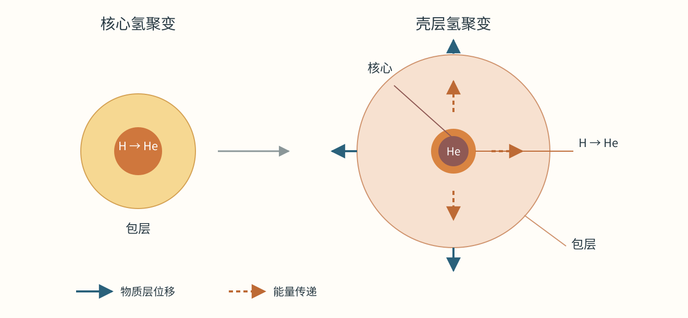

# 12 恒星的能量与演化

太阳每秒向周围空间辐射约 $3.83\times10^{26}$ 焦耳能量。以这样的功率发光一天，送出的能量就达到约 $3.3\times10^{31}$ 焦耳；而太阳已经存在约46亿年。要维持如此漫长的输出，恒星必须拥有充足的能源，还要有一种内部结构，把能量不断送到表面，并在扰动后重新取得平衡。

聚变承担了太阳长期供能的任务，也一直在改变太阳：反应消耗氢，在中心积累氦，改变了单位质量物质所含的粒子数和产生压力的方式。今天维持恒星发光的过程，逐渐为下一阶段准备条件。沿着能量怎样产生、怎样输运、怎样改变结构这条线，可以从冷暗的分子云一直走到巨星、白矮星和坍缩核心。

## 从分子云到原恒星 {#L11-C01}

猎户座星云里，年轻恒星已经照亮周围气体，更深处仍藏着寒冷、致密的云团。恒星的原料主要是氢与氦，也含较少的重元素和尘埃。分子云内温度常在十几开尔文的量级，较低的温度减弱了气体的热运动，使引力更容易把某些区域聚拢。[恒星形成的观测与模型](../../assets/v02-batch-C-SOURCES.md#c11-02)

把一块云近似看成质量为 $M$、半径为 $R$ 的气体球，引力势能的绝对值约为 $GM^2/R$；若平均每个粒子的质量为 $\mu m_{\mathrm{H}}$，热运动能量约为 $3Mk_{\mathrm{B}}T/(2\mu m_{\mathrm{H}})$。$G$ 是引力常数，$k_{\mathrm{B}}$ 是玻尔兹曼常数，$m_{\mathrm{H}}$ 是氢原子质量，$\mu$ 描述组成对平均粒子质量的影响。在同样的温度和大小下，增加质量会使引力能比热能增长得更快；在同样质量下，降温则减弱热压力的抵抗。云内的湍流、磁场、旋转和外部压力共同影响哪些区域开始收缩，因而一个大星形成区常会分裂出许多致密核心。

收缩的气体同时需要散热。压缩做功使内部升温，升温又增强压力；分子谱线和尘埃的红外辐射能把部分能量带走，使收缩继续进行。随着中心密度升高，辐射越来越难直接穿过物质，内部温度和压力增长，形成一颗具有近静力结构的原恒星。它的外面仍可有气体落入，落入物质的动能在激波中转成热，内部的缓慢收缩也持续供能。

角动量决定了物质怎样抵达中心。云中原本很弱的旋转，在收缩时加快；具有较多角动量的物质先在中心周围绕行，形成盘。盘内相互作用把角动量向外输运，盘风与喷流也能带走角动量，余下物质才能进一步向内移动。这使恒星形成与行星形成连在一起：中心星获得质量的同时，部分盘物质开始经历凝聚、碰撞和聚集。

*图1｜猎户座星云 M42 与 M43，435—850 nm 多波段观测拼接，包含地面补充数据。中央年轻大质量星的辐射使周围气体发光；深色结构包含遮挡星光的尘埃。图像以多波段数据显示颜色。Credit: NASA, ESA, M. Robberto (Space Telescope Science Institute/ESA) and the Hubble Space Telescope Orion Treasury Project Team；CC BY 4.0；[素材与许可](../../assets/v02-batch-C-SOURCES.md#c11-i1)。*

## 收缩释放能量，聚变维持长期发光

一个自引力气体球收缩时，引力势能变得更负，释放出的能量一部分成为内能，一部分向外辐射。对由非相对论理想气体主导、表面压力可忽略、缓慢变化的球体，维里定理给出

$$2U+\Omega=0,\qquad E=U+\Omega=\frac{\Omega}{2}=-U.$$

这里 $U$ 是热运动内能，$\Omega<0$ 是引力势能，$E$ 是总能量。向外辐射使 $E$ 下降，下一平衡状态便有更负的 $\Omega$、更小的半径和更大的 $U$。因此原恒星可以一边向外散失能量，一边使内部升温。辐射损失通过收缩获得补偿，而收缩又为中心创造更高的温度。[引力能源与维里关系](../../assets/rewrite-20261025/12/SOURCES.md#stellar-structure)

用引力能量级除以光度，可以估计收缩供能的时间：

$$t_{\mathrm{KH}}\sim\frac{GM^2}{RL}.$$

取太阳质量 $M_\odot=1.99\times10^{30}\ {\mathrm{kg}}$、半径 $R_\odot=6.96\times10^8\ {\mathrm{m}}$、光度 $L_\odot=3.83\times10^{26}\ {\mathrm{W}}$，得到约 $3.1\times10^7$ 年。引力收缩能支持原恒星阶段，却只能承担太阳已知年龄中很短的一段。太阳长期发光所需的能源，在中心升温到约一千五百万开尔文后，由氢聚变提供。[太阳能源](../../assets/v02-batch-C-SOURCES.md#c11-01)

太阳主要通过质子—质子链，把四个质子经过一系列反应变成一个氦核，同时产生正电子、中微子和辐射。带同种电荷的原子核相互排斥，高温提供快速碰撞，量子隧穿提高原子核进入短程核力作用范围的机会。最终产物的总静质量比初始物质略小，差额按 $E=\Delta m c^2$ 转成释放的能量。氢转成氦的质量转化效率约为0.7%。

设参与主序供能的质量份额为 $f$，其中氢的质量分数为 $X$，粗略燃料预算为

$$t_{\mathrm{nuc}}\sim\frac{0.007fXM c^2}{L}.$$

代入 $f=0.1$、$X=0.7$ 和太阳当前光度，得到约73亿年。这个估算采用固定光度和固定可用燃料份额，给出了核能源能够支持十亿年尺度的原因。演化模型还要计算光度的变化、反应区的大小与物质混合，得到太阳约百亿年的主序寿命尺度。[聚变与质量亏损](../../assets/v02-batch-C-SOURCES.md#c11-03)

## 一层层的支撑，一层层的能量输运

在恒星内部截取一小层气体。它受到内侧较大的压力和外侧较小的压力，压力差产生的向外作用平衡了向内的引力。若 $r$ 是到中心的距离，$m(r)$ 是半径 $r$ 内的质量，$\rho(r)$ 是密度，薄层的静力平衡写成

$$\frac{dP}{dr}=-\frac{Gm(r)\rho(r)}{r^2}.$$

负号表示压力由内向外降低。中心必须有足够高的压力，才能支撑上方各层的重量；每一层又把自己的重量加到下方。对主要由普通热气体构成的区域，$P\simeq\rho k_{\mathrm{B}}T/(\mu m_{\mathrm{H}})$，压力便把密度、温度和组成联系起来。大质量星中，辐射对总压力的贡献也越来越重要。

核反应为内部补充热能，能量通过辐射和对流向外输运。在太阳较深的辐射区，光子经过大量吸收、再发射与散射，把能量逐步传向较冷处。外层某些区域若仅靠辐射传走同样的功率，需要很陡的温度下降：一团上升的气体在周围压力下膨胀冷却后，仍比环境热、密度更小，便继续上升。下降的较冷气体补充它的位置，于是形成对流，物质的循环运动也参与运热。太阳外部的对流区延伸到可见表面附近，光球有效温度约5800 K。[太阳内部与输运](../../assets/v02-batch-C-SOURCES.md#c11-04)

结构、产能和输运会相互调节。普通主序星核心若稍微收缩，压缩使温度升高，核反应加快；增加的产能使系统趋向膨胀，降温又减慢反应。这样的调节能把恒星维持在长久、缓慢变化的主序阶段。建立一颗恒星的模型，需要同时满足质量怎样分布、每层怎样支撑、每层产生多少能量以及能量怎样通过四组关系。质量、初始组成和反应速率给定后，半径、光度和内部温度分布便受到共同约束。

在这个结构中，质量影响供能速度。质量较大的主序星需要更高的内部压力，核心通常更热，核反应更加迅速。对太阳附近至若干太阳质量的一段主序，$L/L_\odot\sim(M/M_\odot)^{3.5}$ 可作趋势估计。若可用燃料近似与质量成正比，就有 $t_{\mathrm{MS}}\propto M/L\propto M^{-2.5}$。三倍太阳质量的星约有三倍燃料，光度却约为47倍，寿命尺度只剩太阳的约十五分之一，即数亿年。质量—光度关系的指数会随质量区间和组成改变，模型据此分别计算各类星的寿命。[质量与光度](../../assets/v02-batch-C-SOURCES.md#c11-07)

在更热的核心中，碳、氮、氧原子核参与 CNO 循环，催化氢转成氦；反应率对温度很敏感。低质量红矮星则以很小的光度缓慢消耗氢，其中充分对流的对象还能把外部燃料混入产能区。最低质量恒星的预计寿命远长于宇宙年龄，今天观测到的这类星仍处在漫长的演化早期。

## 核心组成改变后的内外响应 {#L11-C02}

聚变使氦在核心积累。完全电离的氢，每个质子配一个电子；四份氢转成一份氦后，同样近似质量的物质只剩一个氦核和两个电子。因此单位质量所含的自由粒子数减少，平均粒子质量 $\mu m_{\mathrm{H}}$ 上升。由理想气体关系可见，在相同密度和温度下，它能提供的压力会降低。核心于是缓慢收缩，密度和温度上升，恢复支撑的同时提高反应速率，太阳类星的光度也在主序期间逐渐增长。

当中心氢含量很低，核心逐渐成为富氦区域。在仍富含氢的物质中，紧邻氦核心的一层温度最高、反应最快，于是形成氢聚变壳层。氦核心此时尚未达到大量氦聚变所需的温度；它通过收缩和压缩继续改变结构。壳层生成的氦不断加入核心，使核心质量增加。对于太阳类低质量星，核心越来越致密，电子简并逐渐承担重要支撑，壳层位于一个质量集中、温度很高的中心之外。

这时核心与包层有各自的能量变化。收缩核心释放引力能，壳层提供核能，能量从包层底部进入，最终从光球离开。在包层调整期间，输入与输出之间很小的差额就能长期积累，并改变气体的内能和做功。气体获得的能量可用于克服引力、把物质移到更大的半径；膨胀做功消耗内能，因此受热与温度下降能够同时发生。对于核心和包层组成的整个理想化气体球，维里关系约束其总能量；具体到包层各层，则还要计算层间压力做功和能流。核心的收缩与包层的膨胀，通过这些能量交换和共同的静力结构相互联系。

这种响应还受到壳层和表面条件的约束。核心越来越集中，壳层附近的压力、密度和温度随之改变，壳层供能在红巨星支上总体增强。包层外部膨胀冷却后，电离状态和不透明度发生变化，深厚的对流区建立起来。对流把内部各层的温度与压力变化联系得很紧，而光球处的物态和辐射条件把太阳类红巨星的有效温度限制在数千开尔文的较窄范围。增加的光度因而主要通过扩大辐射面积送出；在有效温度变化较慢时，$R\propto L^{1/2}$。核心—壳层提供的内边界和对流—光球提供的外边界，共同选定了庞大、稀疏的包层。[红巨星结构与能量响应](../../assets/rewrite-20261025/12/SOURCES.md#giant-envelope)

把包层吸能写得更局部一些，跟随一小份质量为 $dm$ 的气体，能量守恒可写成

$$du+P\,d(1/\rho)=dq.$$

$u$ 是单位质量内能，$dq$ 是这份物质从净能流获得的热量。右侧为正时，获得的能量可同时改变内能并用于膨胀做功。恒星计算正是逐层跟踪这种变化；在主序到巨星的转变中，成分分层、核心集中、壳层反应与包层的输运一起改变。太阳类星在红巨星支上的缓慢膨胀可以始终十分接近热平衡，长期的小差额仍足以改变半径。

*图2｜太阳类星的结构变化示意，圆的大小与各层厚度均作示意。左侧核心氢聚变；右侧富氦核心更集中，氢聚变位于外围壳层，包层向更大半径展开。实线箭头表示物质层位移，虚线箭头表示能量传递。*

巨星扩大半径时，还可能通过恒星风失去质量。外层距离中心更远，引力束缚较弱，脉动、气体运动和尘埃与辐射的作用使物质更容易离开。于是核心继续积累氦，包层却在逐渐变薄，整颗星的总质量也缓慢下降。

## 氦点火与太阳类星的晚年

氦核带两个正电荷，要使它们有效反应，需要比氢聚变更高的温度。核心达到约一亿开尔文后，三个氦核可以经过中间步骤合成碳；部分碳继续俘获氦核，形成氧。太阳类星的氦核心在点火前已有明显电子简并，压力对温度的依赖较弱。初始放热迅速升温，温度升高又加快三氦反应，形成氦闪。随后加热解除强简并状态，核心膨胀，温度调节恢复，进入较稳定的核心氦燃烧阶段。[氦燃烧](../../assets/v02-batch-C-SOURCES.md#c11-09)

氦闪的能量主要用于核心内部升温、解除简并并调整结构。核心扩大后，氢壳层的环境也发生变化，包层可以收缩，恒星从红巨星支顶端移到较低的光度。更高质量恒星的氦核心较热，常在尚未形成强简并时平稳点火。两者都能以氦供能，但达到这一步时的密度和压力来源不同，决定了点火过程的速度。

核心氦耗尽后，太阳类星形成碳氧核心，外围依次有氦和氢聚变壳层，进入渐近巨星支。薄壳层的产能与膨胀调节使氦壳层经历热脉冲；对流混合把部分产物带向表面，强风逐渐剥去包层。余下的热核心发出大量紫外光，电离已经离开的气体，气体复合和碰撞激发产生明亮谱线，形成行星状星云。这个历史名称来自早期望远镜中某些对象呈现的圆盘外观。[晚期巨星与行星状星云](../../assets/v02-batch-C-SOURCES.md#c11-10)

*图3｜环状星云 M57 的光学多谱线合成，显示中央热遗迹与周围抛出气体。明亮圆环是三维气体分布的投影，显示颜色区分不同谱线通道。Credit: NASA, ESA, and C. Robert O’Dell (Vanderbilt University)；CC BY 4.0；[素材与许可](../../assets/v02-batch-C-SOURCES.md#c11-i3)。*

太阳类星的核心质量和温度不足以继续启动长期碳燃烧，包层离开后留下白矮星。初始恒星的质量决定它能建立怎样的核心，而失质量决定多少物质留到最后。太阳将来的白矮星遗迹只保留今天太阳质量的一部分。

## 白矮星的压力与冷却 {#L11-C04}

取一颗质量为 $0.6M_\odot$、半径为9000千米的白矮星，平均密度为

$$\bar\rho=\frac{3M}{4\pi R^3}\simeq3.9\times10^8\ {\mathrm{kg\,m^{-3}}},$$

约为水密度的四十万倍。在这样的环境中，电子的量子状态决定了主要压力。电子遵守泡利不相容原理：每个量子态只能容纳有限数目的电子。将大量电子压进更小体积，会迫使它们占据更高动量的状态，产生抵抗进一步压缩的电子简并压力。即使白矮星逐渐冷却，这种压力仍能维持致密结构。

简并压力的密度依赖可以说明质量与半径的关系。在电子运动尚不需相对论修正时，$P\propto\rho^{5/3}$；把 $\rho\sim M/R^3$ 与静力支撑所需的压力量级 $P\sim GM^2/R^4$ 比较，便得到 $R\propto M^{-1/3}$：增加质量，平衡半径缩小。压缩到电子运动接近光速时，关系趋近 $P\propto\rho^{4/3}$，两边的半径依赖相同，继续缩小体积不再能为任意大的质量提供新的平衡。对冷、非旋转、典型碳氧组成的理想白矮星，得到约 $1.4M_\odot$ 的钱德拉塞卡质量上限。[白矮星结构](../../assets/v02-batch-C-SOURCES.md#c11-11)

白矮星的发光主要消耗储存的热能。冷却过程中，内部离子可逐渐结晶，并释放潜热；组成重新分布也能提供能量，使某些阶段的冷却放慢。一个恒星群如果形成白矮星的速率变化不大，那么冷却较慢的阶段会积累更多对象。Gaia 的颜色—绝对星等分布中出现了相应的积累结构，提供了白矮星结晶的统计证据。[Gaia 的白矮星冷却证据](../../assets/v02-batch-C-SOURCES.md#c11-12)

## 大质量核心的后续反应与坍缩 {#L11-C03}

初始质量更大的恒星在氦耗尽后，核心还能收缩到碳反应所需的温度，并继续经历氖、氧、硅参与的后续阶段。核心每次转向新的燃料，外层仍可保留较早阶段的反应，形成分层供能结构。高温核心大量产生中微子，中微子带走能量，使核反应必须更快地补偿损失，晚期各阶段因而急剧缩短。[大质量星的核反应与核心演化](../../assets/v02-batch-C-SOURCES.md#c11-13)

铁镍附近的原子核具有很高的平均结合能。核心达到铁族成分后，继续向更重核聚合无法提供支撑长期发光所需的净放能，核心的质量却仍可由壳层燃烧继续增加。电子俘获降低电子数目，高能光子拆解重核消耗热能，支撑随之减弱，核心快速坍缩。达到核物质密度后，致密物质的压力和核相互作用可以建立中子星；若遗留质量及后续回落超过稳定结构能够承担的范围，则继续形成黑洞。

中子星把约一个至数个太阳质量压在十余千米半径的尺度内，核心物态由核相互作用和强引力共同决定。核心原有的角动量随收缩集中，常形成快速自转；磁场相关的辐射区域随自转扫过视线，可产生周期脉冲。白矮星与中子星的质量上限来自不同物态，分别需要对应的结构模型。[中子星与脉冲星](../../assets/v02-batch-C-SOURCES.md#c11-14)

通常以初始质量约八个太阳质量作为进入核心坍缩支路的粗略分界。边界附近，碳燃烧、电子俘获与包层损失相互竞争；更大质量范围里，风、旋转和双星质量交换又会改变核心和外层结构。伴星能剥去包层，也能转移物质、增加另一颗星的质量。最终留下的遗迹和是否产生明亮爆发，要由坍缩时的核心与外层共同决定。超新星中的冲击波与能量传递，在下一篇继续展开。

## 用恒星群和太阳内部信号检验演化

光度与有效温度为内部变化提供了可测的外部坐标。取纵轴为光度、横轴为有效温度，就得到赫罗图；温度通常向左增大，光度向上增大。Gaia 使用颜色与绝对星等展示相应的观测分布。主序、巨星和白矮星占据不同位置，半径把这些位置联系起来：

$$L=4\pi R^2\sigma T_{\mathrm{eff}}^4.$$

一颗半径为太阳50倍、有效温度3500 K的巨星，相对于有效温度5770 K的太阳，光度约为 $50^2(3500/5770)^4\simeq340$ 倍。一颗半径为太阳百分之一、有效温度10000 K的白矮星，光度则约为 $0.01^2(10000/5770)^4\simeq9.0\times10^{-4}$ 倍。庞大的面积让较冷巨星明亮，小面积让高温白矮星暗淡。[赫罗图](../../assets/v02-batch-C-SOURCES.md#c11-06)

*图4｜Gaia DR2 中超过四百万颗恒星的分布。左侧较蓝、表面较热，上方本征较亮；黑、红、黄表示点的数量密度。不同质量主序星形成斜带，巨星位于右上区域，白矮星位于左下区域。Credit: ESA/Gaia/DPAC；Acknowledgement: Carine Babusiaux；CC BY-SA 3.0 IGO；[素材与许可](../../assets/v02-batch-C-SOURCES.md#c11-i2)。*

不同质量恒星在主序上占据不同位置；给定质量的恒星随年龄变化，则沿自己的演化轨迹移动。星团把这两种差异分开得尤其清楚。成员通常近乎同时形成、距离和初始组成相近，质量却不同。较大质量成员先离开主序，仍留在主序的最高质量附近形成转折。通过转折位置可以约束星团年龄，同时检验巨星分支、核心氦燃烧群体与白矮星冷却序列能否由同一年龄模型解释。[星团对演化理论的检验](../../assets/v02-batch-C-SOURCES.md#c11-15)

距离、尘埃消光和未分辨双星会改变观测图中的位置；旋转与核心混合会改变理论轨迹。星团研究把这些量与光谱、几何距离和双星动力学质量共同拟合，逐步限制模型能够调整的范围。观测中主序转折与晚期种群的相互位置，因而比单独找到一颗红巨星包含更多信息。

太阳还提供了通向内部的两种信号。核反应产生的中微子与物质相互作用很弱，能把核心产能的信息带出。探测不同类型的中微子，并计入传播中的味转变，可以检验聚变模型预测的通量。太阳振动则通过另一条途径约束结构：不同振动模式在不同深度传播，频率受声速、密度和组成分布影响。日震学由此测量对流区深度和内部声速轮廓，与中微子、光度和表面成分共同检验太阳模型。[中微子与日震观测](../../assets/v02-batch-C-SOURCES.md#c11-05)

恒星晚年释放的物质又改变下一代星的原料。巨星风带走碳及部分中子俘获产物，大质量星的风与爆发把更深处的合成物送回星际介质，冷却后又能进入新的分子云。恒星把引力收缩建立的高温条件用于核反应，核反应改变组成与结构，结构变化决定物质最终怎样返回周围空间。一颗星的演化因而同时写在它的核心、它的光以及下一代恒星的组成里。
