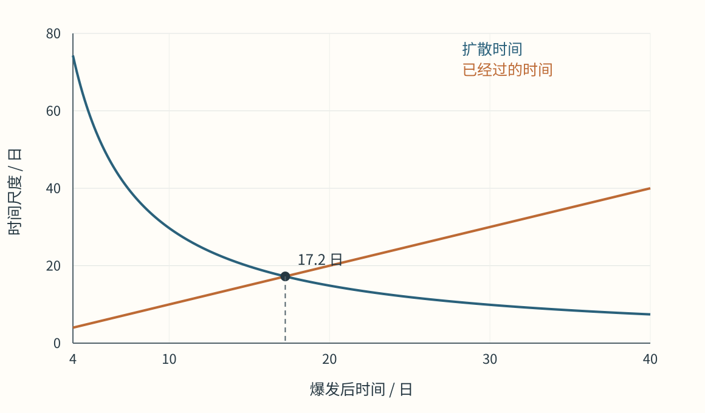
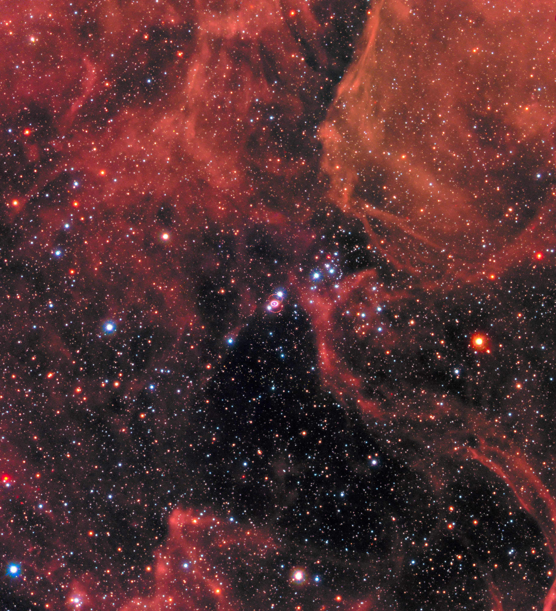
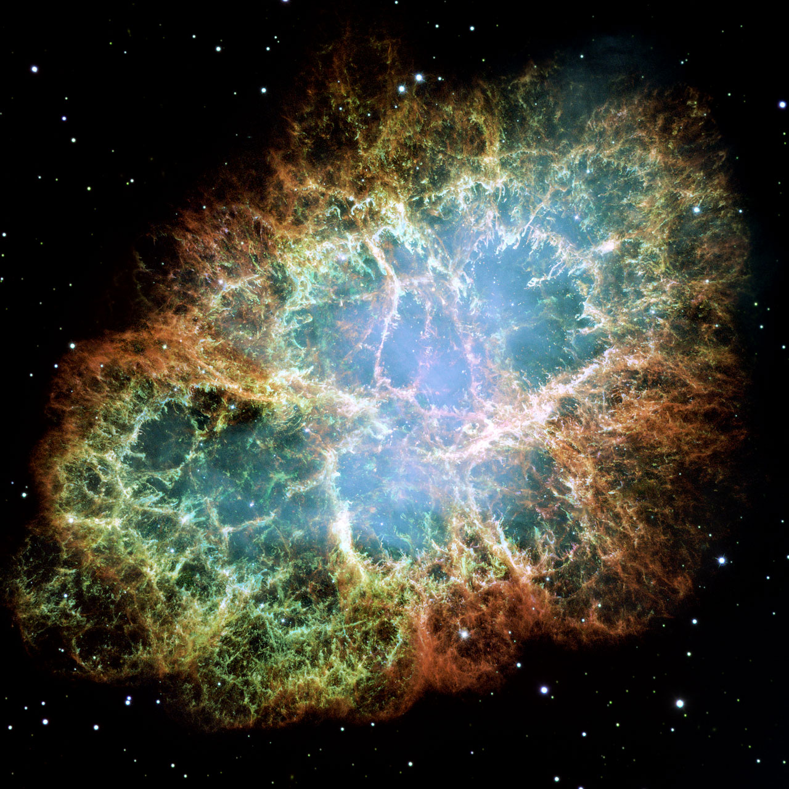

# 13 恒星爆发与超新星遗迹

1987年，大麦哲伦云里的一颗恒星突然增亮，成为 SN 1987A。地下探测器先接到一阵持续数秒的中微子信号，随后光学望远镜记录到明亮的爆发。此后数十年，望远镜又追踪到不断膨胀的物质、逐渐变亮的气体环，以及中心附近的高电离谱线。同一个事件在秒、日、年和几十年的尺度上，显露出不同部分的变化。

这些记录把超新星从一次闪光展开成了一段物理过程：内部怎样释放能量，能量怎样使物质向外运动，辐射又怎样穿过膨胀的物质抵达我们。恒星可以通过两条主要道路进入这种剧烈变化。一条起于碳氧白矮星的热核失控，另一条起于大质量恒星核心的引力坍缩。两种起点产生不同的核产物、遗留物和外层结构，随后共同面对辐射输运与物质膨胀的问题。

## 碳氧白矮星中的热核失控 {#L12-C03}

一颗碳氧白矮星是较早一代恒星留下的致密核心，主要由电子简并压力支撑。若它处在双星系统中，伴星可以输送气体，两颗白矮星也可能逐渐接近、发生合并。新增物质、压缩和碰撞改变内部的密度与温度，使某些区域达到碳反应显著进行的条件。

普通热气体受热时，压力明显上升，膨胀会降低温度，减慢核反应。在强简并物质中，电子压力主要由密度决定，对初始温度变化的响应较弱。碳反应放热后，气体可先在近似相同密度下迅速升温；温度越高，反应越快，单位时间释放的热量越多。加热的时间一旦短于通过膨胀和输运散去热量的时间，就形成热核失控。[白矮星爆发的物理模型](../../assets/rewrite-20261025/13/SOURCES.md#thermonuclear)

反应还必须传播，才能影响整颗星。较慢的燃烧前沿由热传导把邻近物质加热到反应温度，称为爆燃；爆燃产生的轻热物质会向上运动，湍流使燃烧面卷曲，扩大同时参与反应的面积。另一种传播是爆轰：高速冲击先压缩、加热前方燃料，随后的核放能维持冲击推进。若高密度物质先快速发生大范围反应，会生成较多铁族核；若恒星已经膨胀、密度降低，再进行的反应则更容易留下硅、硫、钙等中等质量元素。燃烧速度与膨胀速度的竞争，因此同时决定爆发动力和元素分布。

将碳氧转成结合更紧的原子核，每单位质量可释放约 $10^{14}\ {\mathrm{J\,kg^{-1}}}$ 量级的能量。约一个太阳质量的物质充分参与反应，就能提供约 $10^{44}$ 焦耳的能量，与白矮星的引力束缚能及超新星抛出物动能处于相近尺度。核放能使物质升温、压力骤增，整颗白矮星迅速膨胀，正常 Ia 型超新星通常由此破坏原白矮星，抛出新合成的元素。[热核能量与爆发产物](../../assets/v02-batch-C-SOURCES.md#c12-09)

具体触发条件随双星经历而变。接近钱德拉塞卡质量的白矮星可以在内部点火；质量较低的白矮星也可能先在表面氦层爆轰，再由冲击触发碳氧核心；两颗白矮星的合并又能建立另一组温度与密度条件。各通道贡献的比例仍是研究问题，模型通过爆发率、伴星搜索、光谱和遗迹组成接受检验。发生在吸积白矮星表面氢层的新星爆发，主要涉及一层较少的积累物质，主体能保留下来并再次吸积；它的能量与物质规模对应着另一类双星现象。

## 从向内坍缩到向外抛射

大质量恒星走到演化晚期，中心已经形成铁族核心，外面仍有不同燃料的反应壳层。铁族核心继续积累质量时，电子简并压力逐渐接近支撑能力的极限。高密度下的电子俘获减少了电子数目，同时把质子转成中子并产生中微子；高温光子拆解重核又消耗热能。支撑减弱使核心进一步压缩，压缩加强这些过程，最终进入快速坍缩。

动力学时间可以估计这个过程有多快。一个平均密度为 $\rho$ 的自引力结构，整体自由落下的时间量级为

$$t_{\mathrm{dyn}}\sim\frac{1}{\sqrt{G\rho}}.$$

取坍缩前致密核心的代表密度 $\rho=10^{12}\ {\mathrm{kg\,m^{-3}}}$，得到约0.12秒。它由当时的密度决定，与恒星此前维持了几百万年还是几十亿年发光属于不同的时间尺度。内核可以在不到一秒内改变尺度，外部包层则要经过更长时间才收到由中心传来的冲击。[核心坍缩与时间尺度](../../assets/v02-batch-C-SOURCES.md#c12-07)

当内核接近核物质密度，致密物质的状态方程明显变硬，继续压缩需要更大的压力。内核减速并发生回弹，外围仍在落入的物质与之相遇，形成向外传播的冲击波。冲击经过铁族物质时，需要消耗能量把重核拆成更轻的核子；冲击后的热物质还发射中微子。两种损失削弱冲击，落入物质的动量又持续向内压迫它，冲击常在中心外数百千米以内进入暂时停滞的状态。

与此同时，新生原中子星及其附近的吸积物质发出极强的中微子流。中微子穿过上方较稀薄的区域时，其中一部分被物质吸收，给停滞冲击后的气体补充能量。受热物质浮升，较冷物质继续落入，多维对流和湍流改变气体停留在受热区的时间，也为冲击提供额外支撑。若加热足以使气体获得正的外流能量，冲击便可恢复向外扩展，把恒星外部推开。旋转很快、磁场很强的核心还可能通过磁场与旋转能参与驱动爆发。[中微子加热与流体运动](../../assets/rewrite-20261025/13/SOURCES.md#collapse)

能量预算显示了中微子的作用尺度。把质量 $M=1.4M_\odot$ 的核心收缩到半径 $R=12\ {\mathrm{km}}$，引力能量级为

$$\frac{GM^2}{R}\simeq4.3\times10^{46}\ {\mathrm{J}}.$$

真实中子星的束缚能要由相对论结构计算确定，这个量级已经足以与抛出物比较。若 $5M_\odot$ 的物质以代表速度 $5000\ {\mathrm{km\,s^{-1}}}$ 膨胀，其动能约为

$$E_{\mathrm{k}}\sim\frac12M_{\mathrm{ej}}v^2\simeq1.2\times10^{44}\ {\mathrm{J}}.$$

大部分核心引力能被中微子带走；传给外部的较小份额，已经能够参与建立强大的抛射。是否成功取决于加热效率、吸积速率和坍缩前的密度结构。部分恒星留下中子星并产生明亮超新星，部分核心形成黑洞，已经向外运动的物质也可能有一部分回落。遗迹质量与外层能否离开，需要在同一段流体演化中求得。

## 抛出物膨胀时，光怎样走出来

超新星启动后的很短时间内，核反应或核心坍缩已经释放主要能量，物质却仍十分稠密，内部辐射需要经过大量散射与吸收才能离开。随着抛出物扩大，密度降低，光传播变得容易；在典型正常 Ia 中，爆发生成的镍-56还继续衰变为钴-56，再衰变为铁-56，释放伽马射线和带电粒子。它们在抛出物中沉积能量，成为后续多日乃至多月的热源。

设抛出物的特征半径为 $R$，质量为 $M_{\mathrm{ej}}$，平均不透明度为 $\kappa$，单位为 ${\mathrm{m^2\,kg^{-1}}}$。在均匀球的简化模型中，平均密度 $\rho=3M_{\mathrm{ej}}/(4\pi R^3)$，光子的平均自由程约为 $\ell=1/(\kappa\rho)$。每次相互作用会重新改变传播方向，因此跨越半径 $R$ 所需的步数约为 $(R/\ell)^2$，扩散时间量级便是

$$t_{\mathrm{diff}}\sim\frac{R^2}{c\ell}=\frac{\kappa\rho R^2}{c}=\frac{3\kappa M_{\mathrm{ej}}}{4\pi cR}.$$

抛出物越多、越不透明，光被困得越久；同样质量膨胀到更大半径后，密度下降得比路程增加更快，扩散时间反而缩短。进入近似匀速膨胀阶段，$R\simeq vt$，于是扩散时间约与 $1/t$ 成正比。[膨胀与辐射扩散](../../assets/rewrite-20261025/13/SOURCES.md#diffusion)

早期 $t_{\mathrm{diff}}$ 远大于爆发后的年龄，大量能量仍留在内部。经过一段时间，光能从更深处扩散出来，观测光度上升。当扩散时间与年龄相近时，释放效率发生显著变化；将两者相等可得到一个光变时间尺度：

$$t_*\sim\left(\frac{3\kappa M_{\mathrm{ej}}}{4\pi cv}\right)^{1/2}.$$

取 $M_{\mathrm{ej}}=1.4M_\odot$、$v=10^4\ {\mathrm{km\,s^{-1}}}$、$\kappa=0.01\ {\mathrm{m^2\,kg^{-1}}}$，得到约17天。这是采用固定不透明度、均匀密度和单一速度的尺度估计。实际光变曲线还取决于镍的分布、电离变化和各层速度，但这个计算已经解释了为何一次迅速发生的爆发可以用数周达到明亮的峰值。

*图1｜均匀膨胀球模型中，横轴为爆发后时间，蓝线为当时从中心扩散出来的时间尺度，橙线为已经经过的时间。参数取正文算例，曲线在约17天相交。该图展示辐射释放的时间竞争，纵轴为时间。*[模型与绘图说明](../../assets/rewrite-20261025/13/SOURCES.md#figure)

能量还会在膨胀中做功。抛出物的热能变化可以概括成“热源补充，辐射带走，膨胀消耗”：$dE_{\mathrm{th}}/dt=\dot Q-L-P\,dV/dt$。其中 $\dot Q$ 是沉积到物质中的加热功率，$L$ 是逃出的光度。一个已经下降的放射性热源，仍能对应一段上升的光变，因为早先储存在内部的能量开始有效释放。晚期物质稀薄后，一部分伽马射线直接逃走，沉积效率又随时间改变。[放射性加热与能量守恒](../../assets/rewrite-20261025/13/SOURCES.md#diffusion)

在保留厚氢包层的部分核心坍缩超新星中，冲击储存的热和氢的复合对早期光变特别重要。随膨胀冷却，电离氢重新形成中性原子，电子散射减少，辐射较容易穿过已经复合的外层。有效发光表面向更深的质量层移动，其温度在复合温度附近变化较慢，产生持续一段时间的光度平台。爆发前半径、氢包层质量和放射性产物，共同决定平台长度和后续衰减。与致密星周气体相撞时，抛出物的动能还会转成新的辐射，进一步改变光变形状。[包层与超新星光变](../../assets/rewrite-20261025/13/SOURCES.md#light-curves)

## 光谱记录组成，也记录速度

扩展中的抛出物包含从内到外不同速度的气体，谱线因此十分宽。运动速度远小于光速时，多普勒关系为 $\Delta\lambda/\lambda\simeq v_{\mathrm{los}}/c$；若一条静止波长600 nm的谱线由沿视线约 $10^4\ {\mathrm{km\,s^{-1}}}$ 的物质形成，其位移尺度约20 nm。这样的宽度将原本狭窄的原子跃迁展成明显的吸收或发射结构。

爆发早期，靠近我们的抛出物可以吸收从较深处来的连续辐射，其向我们运动使吸收偏向蓝端；同时，周围更大范围的气体向各个方向发射同种谱线，形成覆盖多种速度的发射部分。随着外层变稀薄，能看到的深度增加，光谱依次采样不同的质量层。到了更晚的星云阶段，发射线能显示核心产物及其速度分布。将多时刻光谱放在一起，便可以追踪核产物随空间和时间怎样出现。

超新星的传统分类首先来自光谱。早期光谱有显著氢线的归为 II 型，缺少显著氢线的归为 I 型；其中 Ia 具有典型硅吸收特征，Ib 显示氦特征，Ic 的氢、氦特征都弱。正常 Ia 通常对应白矮星热核爆炸，Ib、Ic及 II 型主要对应核心坍缩，外观差异反映前身星保留了多少氢和氦包层。双星剥离与恒星风可以改变包层，因此爆发光谱也带着此前演化的记录。[分类与前身结构](../../assets/v02-batch-C-SOURCES.md#c12-06)

观测者测得一套光变和光谱，模型则给出核产物质量、速度和密度分布，并通过辐射输运计算相应的观测量。硅和铁族谱线出现的时序约束燃烧层次，光变宽度约束扩散条件，尾部衰减约束放射性热源和能量沉积。Ia 型的光变形状与峰值亮度还存在可校准的统计联系，经过颜色等修正后可用于远距离测量；这条用途将在宇宙膨胀篇展开。

## SN 1987A：从核心信号到星周环境

SN 1987A发生在大麦哲伦云，距离约十几万光年。它提供了一次把核心、中间包层和外部环境连续联系起来的机会。1987年2月，多个地下探测器在很短时间里记录到中微子事件；首批可见光观测出现在约两小时后。中微子主要来自刚坍缩的核心，能较快带出内部信息；冲击波则必须穿过恒星外层，抵达表面附近，才使强烈辐射逃出。两种信号的发射地点与生成过程不同，抵达时序因而记录了爆发内部的传播时间。[SN 1987A 的中微子与后续观测](../../assets/v02-batch-C-SOURCES.md#c12-08)

冲击刚穿出表面时可产生短促的高温辐射，随后是膨胀冷却与内部热源控制的光变。SN 1987A的前身是一颗较紧致的蓝超巨星，包层半径和密度分布使它的早期光变有别于典型红超巨星爆发。将前身星资料、光变、谱线速度和中微子共同分析，能够约束核心坍缩释放了多少能量，以及多少能量进入抛出物和辐射。

*图2｜SN 1987A 所在区域的 Hubble 多波段图。中心遗迹附近的亮环主要由爆发前约两万年流失的物质形成，随后受到爆发辐射及抛出物作用。中心区域采用2017年 WFC3 观测，周围恒星颜色结合 WFPC2 数据；B、V、Hα、I 通道合成。Credit: NASA, ESA, and R. Kirshner (Harvard-Smithsonian Center for Astrophysics and Gordon and Betty Moore Foundation) and P. Challis (Harvard-Smithsonian Center for Astrophysics)；CC BY 4.0；[素材与许可](../../assets/v02-batch-C-SOURCES.md#c12-i2)。*

爆发前的风和质量流失已经把气体布置在恒星周围。最初的强辐射能电离原有气体；后来快速抛出物追上较慢的环状结构，冲击加热形成明亮热点。不同年份影像记录了热点出现和变化的位置，光谱又给出冲击速度及气体状态。遗迹图像因而同时包含爆发前的失质量历史和爆发后的传播过程。

中心遗留物也在影响抛出气体。2024年发表的 Webb 研究在遗迹中心探测到高电离氩等谱线；产生这些离子需要高能光子，研究通过电离模型比较，支持那里有一个新生中子星及其相关高能辐射源。观测测到的是被照亮气体的光谱，核心物体通过它对周围物质的作用显现出来。[Webb 光谱与中心能源](../../assets/rewrite-20261025/13/SOURCES.md#sn1987a)

## 蟹状星云：持续运转的遗迹 {#L12-C05}

金牛座方向的蟹状星云 M1，与1054年地球上记录到的客星相联系。今天它呈现出交织的气体细丝和较平滑的弥散光，中心有一颗约每33毫秒自转一周的脉冲星。细丝保留了部分被抛出的物质，弥散区域则明显受到中心脉冲星的持续供能。[蟹状星云的观测背景](../../assets/v02-batch-C-SOURCES.md#c12-10)

*图3｜蟹状星云 M1，Hubble/WFPC2 多次观测拼接。图中 OI、SII、OIII 谱线通道记录不同气体成分的发光，连续辐射也贡献背景亮度；通道经赋色显示。Credit: NASA, ESA and Allison Loll/Jeff Hester (Arizona State University). Acknowledgement: Davide De Martin (ESA/Hubble)；CC BY 4.0；[素材与许可](../../assets/v02-batch-C-SOURCES.md#c12-i3)。*

脉冲星储存着巨大的自转能。若转动惯量为 $I$、自转周期为 $P$，则

$$E_{\mathrm{rot}}=\frac12I\left(\frac{2\pi}{P}\right)^2=\frac{2\pi^2I}{P^2}.$$

自转逐渐变慢，周期随时间增加。在转动惯量近似恒定的短期内，失去自转能的功率为 $-\dot E_{\mathrm{rot}}=4\pi^2I\dot P/P^3$。通过精密计时测出 $P$ 与 $\dot P$，配合中子星结构对 $I$ 的估计，就能计算一个可与星云辐射和膨胀相比较的能源预算。磁场和高速带电粒子把这部分能量送入周围区域，形成脉冲星风。

高速电子在星云磁场中改变运动方向，发出同步辐射，产生从射电到高能波段的连续谱；较冷的细丝通过激发和复合发出谱线。不同波段把粒子、磁场和热气体分别显示出来。中心继续输入的能量还影响细丝运动，所以用今天的速度回推爆发时刻，需要把后续加速纳入模型。[脉冲星风与同步辐射](../../assets/rewrite-20261025/13/SOURCES.md#crab)

遗迹继续向外膨胀，遇到的星际物质越来越多。外向冲击加热周围气体，另一道相对于膨胀物质向内推进的反向冲击又加热抛出物。X射线谱线可以由此追踪高温重元素，光学细丝显示密度较高、冷却较有效的区域，射电连续谱示踪被加速的粒子和磁场。随着被扫过的外部质量增长，环境对遗迹形态和运动的影响越来越强。

从白矮星点火或恒星核心坍缩开始，到放射性衰变、辐射扩散，再到遗迹中的冲击与脉冲星供能，每个阶段都把前一阶段留下的物质和能量重新组织。超新星的峰值亮度、宽谱线、环上热点和千年后的细丝，分别记录这段连续过程中的不同环节。沿着它们回溯，可以重建恒星曾经拥有的核心、包层及周围环境，也能追踪新合成元素怎样进入星际空间。
