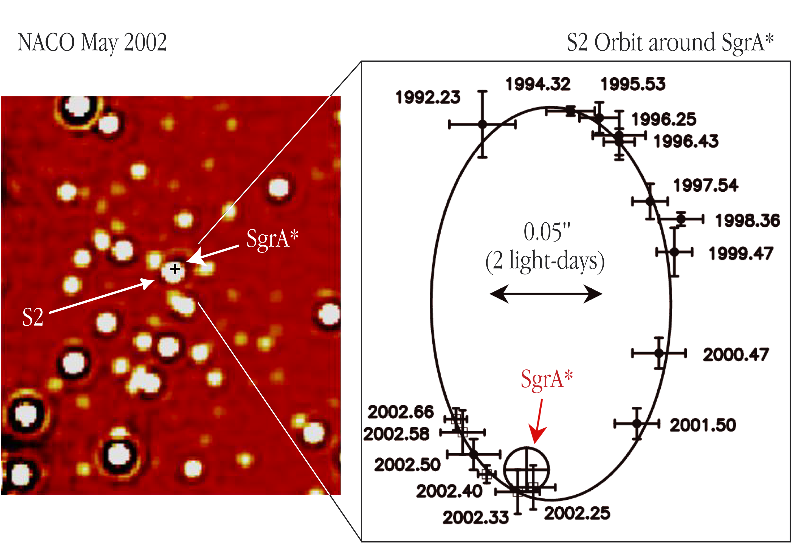
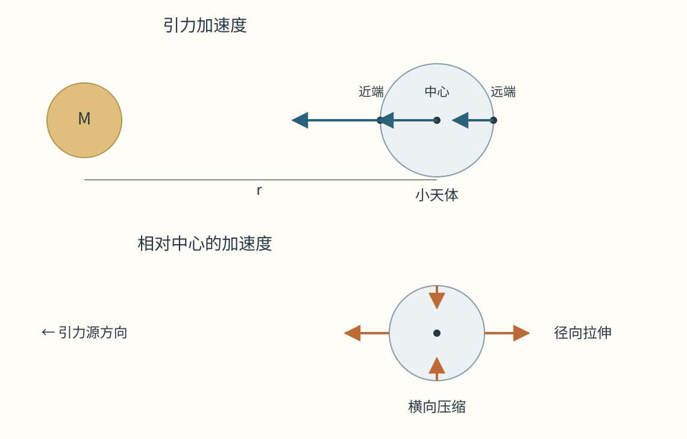
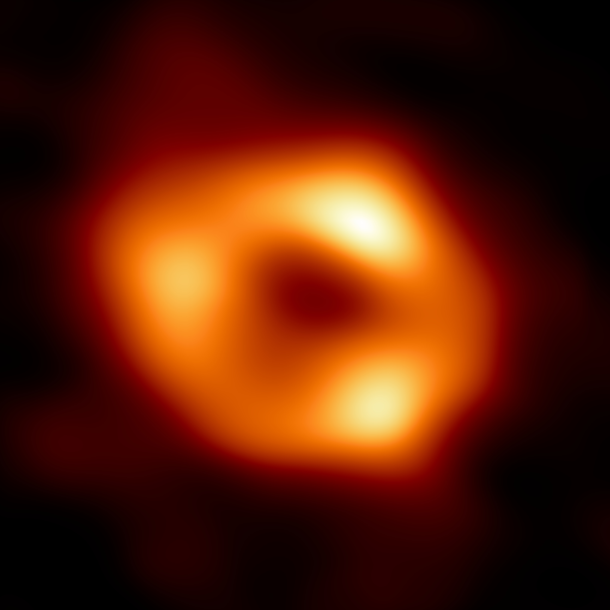

# 14 潮汐、致密天体与黑洞

银河系中心的恒星 S2 大约每16年绕行一周。它在远离中心时移动较慢，经过近心点时速度急剧增加，随后又沿轨道向外行进。持续记录这颗星的位置与光谱，就能研究一个集中在极小区域内、质量约为太阳四百万倍的天体。

同一组观测还引出更深的问题。轨道反映中心有多少质量，恒星能否保持完整取决于它各处受到的引力差，而光能否从更内侧传出又取决于时空结构。沿着轨道向中心接近，我们需要依次研究质量分布、潮汐、物质的内聚能力和光的传播。黑洞的观测证据也沿这些尺度逐渐展开。

## 用恒星轨道测量银河中心 {#L16-C02}

在中心质量 $M$ 占主导、轨道接近圆形的牛顿模型中，引力提供向心加速度：$GM/r^2=v^2/r$。测得轨道半径 $r$ 与速度 $v$，即可得到 $M=v^2r/G$。椭圆轨道需要用半长轴 $a$ 和周期 $P$，两体关系为

$$P^2=\frac{4\pi^2a^3}{G(M+m)}.$$

$m$ 是绕行天体的质量，$a$ 是两者相对轨道的半长轴。对于 S2 与银河中心，$m$ 远小于 $M$，可以在量级计算中略去。取 $a$ 用天文单位 AU、$P$ 用年，再以太阳质量为单位，就有

$$\frac{M}{M_\odot}\simeq\frac{(a/{\mathrm{AU}})^3}{(P/{\mathrm{yr}})^2}.$$

以约1000 AU和16年为圆整代表值，得到 $1000^3/16^2\simeq3.9\times10^6$，即约390万太阳质量。这个数量级来自运动与尺度；天体是否明亮，只影响我们使用哪种方法追踪它的周围环境。

银河中心方向有大量星际尘埃，红外观测能穿过较多遮挡。大口径望远镜配合自适应光学和干涉技术，可以把拥挤区域的恒星逐个分开。多年位置测量给出天空中的轨道投影，光谱的多普勒变化给出视向速度。联合拟合能求得轨道倾角、真实半长轴、距离和中心质量，精密模型再加入相对论修正及其他物质的引力影响。[银河中心轨道观测](../../assets/v02-batch-D-SOURCES.md#l16)

*图1｜ESO于2002年发布的 S2 历史观测图。左侧为约2.1 μm近红外成像，右侧为1992—2002年位置数据及椭圆拟合，十字符号表示位置误差。正文的1000 AU、16年是用于说明现代质量量级的圆整算例；本图展示早期轨道测量如何逐步建立。Credit: ESO；CC BY 4.0；[原图与说明](https://www.eso.org/public/images/eso0226c/)。*

S2近心点距中心约120 AU，速度达到约7650千米每秒。如此多的质量必须集中在比近心距离更小的范围内，才能产生观测到的运动。长期精密测量进一步探查了势场的形状：2018年的数据测到引力红移和横向多普勒效应的共同贡献，2020年发表的结果测到每周约12角分的史瓦西进动，即椭圆长轴在相邻轨道之间缓慢转向。这些变化符合广义相对论对中心引力场的预言。[S2 的相对论测量](../../assets/rewrite-20261025/14/SOURCES.md#s2)

质量与距离在拟合中紧密相连。若周期不变，而由角尺度换算的半长轴增加10%，单纯按开普勒关系得到的质量会增加 $1.1^3-1\simeq33\%$。将位置和速度一起使用，可以约束这种耦合。更内侧的辐射观测则提供另一种尺度，稍后会与这里测得的质量相比较。

## 整体自由落下时，身体各处仍有相对运动 {#L12-C02}

一个小天体绕大天体运动时，整体处在自由落体中。若把观察位置放在小天体中心，中心受到的引力加速度可以作为共同运动扣除，剩下的就是各部分相对于中心的加速度。近端离中心质量更近，引力较强，趋向加速离开小天体中心；远端受到的引力较弱，跟不上中心的落下速度，相对运动也使它离开小天体中心。小天体因而沿径向被拉长。

设外部中心质量为 $M$，小物体径向长度为 $\ell$，其中心距大天体中心为 $r$，且 $\ell\ll r$。引力加速度大小 $g(r)=GM/r^2$，在小物体两端相减，得到

$$\Delta a\simeq\left|\frac{dg}{dr}\right|\ell=\frac{2GM\ell}{r^3}.$$

距离减半，整体引力增强四倍，径向差异却增强八倍。潮汐对接近中心特别敏感。横向两侧的引力方向略向中间会聚，于是相对于中心表现为横向压缩。在中心质量之外的真空区，局部牛顿潮汐的径向拉伸与两个横向压缩共同决定形变。

*图2｜固定中心质量，比较一个小天体不同位置受到的加速度。上图箭头均指向引力源，近端较长；下图扣除了天体中心的共同加速度，显示径向拉伸与横向压缩。箭长只表示相对趋势，天体大小作了放大。*

若将 $r$ 换成两颗星的实际距离，公式即可估计一颗星对另一颗的形变；把中心换成行星，便对应卫星潮汐。在缓慢、反复的形变中，物质内部的摩擦和黏滞能把机械能转成热，逐渐改变自转和轨道；在一次很近的掠过中，差异加速度则可能迅速超过小天体维持完整的能力。

## 自引力、材料强度与洛希极限

设小天体半径为 $s$、平均密度为 $\rho$，质量约为 $m=4\pi\rho s^3/3$。它把表面物质拉向自身中心的加速度是

$$g_{\mathrm{self}}=\frac{Gm}{s^2}=\frac{4\pi}{3}G\rho s.$$

外部潮汐在从中心到表面的尺度上约为 $GM s/r^3$。两者相当时，得到特征距离

$$r_{\mathrm{tide}}\sim\left(\frac{M}{\rho}\right)^{1/3}.$$

小天体密度越大，自引力越能抵抗潮汐，可以接近得更深。半径 $s$ 在比较中约去，是因为这一模型中的自身表面引力和外部差异加速度都随 $s$ 成正比。这里把天体视为主要靠自引力聚合的结构，几何系数留待形变与轨道模型确定。

对质量远小于主星、均匀密度、不可压缩、同步自转并沿圆轨道运动的流体卫星，允许形状随潮汐调整后，可得经典流体洛希极限

$$r_{\mathrm{R}}\simeq2.44R_{\mathrm{p}}\left(\frac{\rho_{\mathrm{p}}}{\rho}\right)^{1/3}.$$

$R_{\mathrm{p}}$ 和 $\rho_{\mathrm{p}}$ 分别是主星半径与平均密度，$r_{\mathrm{R}}$ 从主星中心计量。若两者平均密度相同，这个极限约为主星半径的2.44倍。系数来自对变形平衡的求解，立方根依赖则已经包含在刚才的引力比较中。[流体洛希模型](../../assets/rewrite-20261025/14/SOURCES.md#roche)

小岩块还受到材料内部键合作用的维系。粗略估算，潮汐作用在长度 $s$ 内产生的应力量级为 $\sigma_{\mathrm{tide}}\sim\rho GM s^2/r^3$，应力的单位是帕斯卡。尺寸越小，这项应力下降越快，而材料能承受的应力主要由组成、裂隙与结构决定。因此同一距离处，大型、松散、自引力主导的天体可能解体，较小的坚固碎块却能够保留。真实小天体的孔隙、摩擦和自转，会进一步改变失稳与剥落的方式。[材料强度的作用](../../assets/v02-batch-C-SOURCES.md#c12-04)

碎裂后的物质继承了原天体的运动。不同碎片获得略有差异的轨道能量与角动量，逐渐沿轨道拉开；其中一些碰撞中心天体，一些保留在轨道上，还有一些可以逃离。若碎片之间频繁碰撞，随机运动和轨道倾斜中的机械能会耗散，总角动量则引导它们保留共同的绕行方向，形成较薄的盘或环。潮汐限制了碎片重新聚成大天体的能力，碰撞和角动量输运则决定环怎样形成和继续演化。

把小天体换成一颗恒星，同样的比较给出恒星潮汐瓦解的常用尺度：

$$r_{\mathrm{t}}\sim R_*\left(\frac{M}{M_*}\right)^{1/3},$$

其中 $M_*$、$R_*$ 是恒星质量与半径。恒星内密度并不均匀，较稀薄外层可以先被剥去，更深处的核心则可能保留。完全破坏所需的近心距离因而还取决于内部密度分布。碎片流沿不同轨道运动，部分物质返回近心区，流与流相撞并耗散能量，随后可能形成明亮的吸积过程。[恒星潮汐瓦解](../../assets/rewrite-20261025/14/SOURCES.md#disruption)

## 质量集中到黑洞尺度 {#L12-C01}

白矮星和中子星依靠致密物质的压力维持结构。当一个核心继续坍缩，质量集中到足够小的尺度，光的传播也必须由广义相对论决定。在这个理论里，质量与能量决定时空几何，自由物体与光沿几何允许的路径运动。研究黑洞，因而需要追踪从某个事件发出的信号将来能到达哪些地方。

事件视界是能够向远方外部传递信号的区域与不能传递的区域之间的边界。对孤立、无电荷、不旋转的球对称黑洞，视界的面积半径为

$$r_{\mathrm{s}}=\frac{2GM}{c^2}.$$

这里的面积半径意味着视界面积为 $4\pi r_{\mathrm{s}}^2$。每个太阳质量对应约2.95千米；十个太阳质量的黑洞有约30千米的视界尺度，四百万太阳质量对应约1180万千米，即约0.079 AU。旋转会改变视界和附近轨道的结构，球对称解为比较质量与长度提供了清楚的起点。[黑洞结构](../../assets/v02-batch-C-SOURCES.md#c12-01)

这个尺度同时给出引力紧致程度。对于半径 $R$ 的天体，$2GM/(Rc^2)=r_{\mathrm{s}}/R$ 越接近1，相对论效应越强。太阳的这个比值只有约 $4.2\times10^{-6}$；中子星已经达到几分之一的量级。远离紧致物体、$r\gg r_{\mathrm{s}}$ 时，牛顿轨道仍然是很好的近似，S2便在这样的尺度上先提供了中心质量。

靠近视界时，光的出射方向和传播时间受到强烈影响。在球对称解中，视界外某些向外光路能通向远处，越接近视界，能够向外逃出的方向范围越小；在视界内，所有朝向未来的因果路径都通向更小的面积半径。视界由这些路径的整体性质定义，局部物质则仍按当地物理定律运动。

不同位置的钟可以通过交换光信号比较。对于在视界外固定半径悬停的发射者，频率为 $\nu_{\mathrm{em}}$ 的光传到无穷远处时，在理想球对称模型中满足

$$\nu_\infty=\nu_{\mathrm{em}}\sqrt{1-\frac{r_{\mathrm{s}}}{r}}.$$

发射位置越深，远处接到的频率越低，信号间隔越长；这种引力红移反映了不同位置的时间尺度。自由落入者还带有运动产生的多普勒效应，它发出的最后一串可逃出信号会逐渐红移、变稀疏、变暗；落入者自身的钟则可在有限时间内到达并穿过视界。[光信号与自身时间](../../assets/v02-batch-C-SOURCES.md#c12-13)

## 视界尺度上的潮汐

视界半径随黑洞质量成正比，潮汐在固定距离处却随 $M/r^3$ 增长。把比较位置选在各自的视界 $r=r_{\mathrm{s}}$，同样长度 $\ell$ 对应的径向潮汐尺度为

$$\Delta a_{\mathrm{h}}\sim\frac{2GM\ell}{r_{\mathrm{s}}^3}=\frac{c^6\ell}{4G^2M^2}.$$

在非旋转黑洞径向自由落体的局部参考系中，径向相对加速度具有相应的 $2GM/r^3$ 依赖，因此这里的质量反比平方关系也适用于近视界比较。质量大一百万倍，视界处同长度物体承受的潮汐尺度就小约一万亿倍。巨大黑洞的视界离中心更远，在那里的曲率和有限尺寸物体所受的差异作用可以小得多。[视界处的潮汐](../../assets/rewrite-20261025/14/SOURCES.md#disruption)

取一颗与太阳质量和半径相同的恒星，围绕四百万太阳质量的黑洞，前面的潮汐尺度为 $r_{\mathrm{t}}\sim0.74\ {\mathrm{AU}}$，约为球对称视界半径的九倍。它在非常靠近黑洞时，可以先在视界外发生强烈形变和瓦解。若保持恒星性质固定，继续增大黑洞质量，$r_{\mathrm{t}}$ 只按 $M^{1/3}$ 增长，而 $r_{\mathrm{s}}$ 按 $M$ 增长，潮汐瓦解尺度相对视界便越来越小。真实事件是否留下可见碎片，还取决于自转、轨道和相对论捕获条件。

S2的近心距离约120 AU，比上述太阳型恒星算例的潮汐尺度大得多。S2有自己的质量和半径，但同样的比较解释了为何恒星能在中心附近反复绕行，以及为何只有进入更深轨道的一部分恒星会发生瓦解。一个物体的中心轨迹和它能否保持完整，需要分别由轨道与内部结构计算，再在同一段运动中结合起来。

## 吸积把轨道能转成辐射

黑洞周围的气体通常带有角动量。气体在相应轨道上绕行时，向内移动需要转移角动量；盘中的磁场、湍流和相互作用把角动量向外传递，使一部分物质能够逐渐进入更小的轨道。轨道越小，总机械能越低，释放出的能量可以加热物质并成为辐射。

在远离视界的牛顿圆轨道近似下，一小份质量 $m$ 的物质具有动能 $GMm/(2r)$、势能 $-GMm/r$，总能量为 $-GMm/(2r)$。从半径 $r_1$ 移到更小的 $r_2$，可以释放

$$\Delta E=\frac{GMm}{2}\left(\frac1{r_2}-\frac1{r_1}\right).$$

越靠近中心，同样质量每缩小一点轨道所释放的能量越大。进入强引力区后，具体效率要用相对论轨道和吸积模型计算。常把可见辐射输出写成 $L=\eta\dot M c^2$，其中 $\dot M$ 是质量吸积率，$\eta$ 是进入辐射的效率。气体有多少能量被带进黑洞、有多少被风或喷流带走、有多少辐射出去，共同决定 $\eta$。

吸积流发出的波段取决于温度、密度和磁场。较冷的外部盘可发出光学与紫外辐射，内部高温气体和高能粒子能产生X射线及射电辐射。磁化等离子体还可将旋转系统的能量传给外流，沿轴向形成喷流。物质经过视界之前的这些过程，把一个几乎不直接发光的引力源变成了可研究的环境。[吸积盘与喷流](https://science.nasa.gov/universe/black-holes/anatomy/)

## 从射电亮环到近视界尺度

人马座 A* 周围热等离子体在毫米波段发光。2017年，事件视界望远镜 EHT 把地球多处的射电望远镜联成甚长基线干涉阵列，在1.3毫米波长接收信号。阵列对小角尺度的响应大致由 $\theta\sim\lambda/B$ 决定，$B$ 是望远镜间基线。取 $B=10^7\ {\mathrm{m}}$，可得到约27微角秒的尺度，足以探查银河中心视界附近的辐射结构。

干涉仪记录各望远镜接收波的相关关系，采样源图像在不同方向和尺度上的信息。研究者把这些采样与仪器校准、星际散射和源本身随时间变化一起处理，重建出亮环及较暗的中央区域。2022年发表的首批结果给出环直径约 $51.8\pm2.3$ 微角秒，误差对应研究采用的68%可信区间；与约四百万太阳质量黑洞周围吸积流的模拟相比，整体尺寸和形态相符。[EHT 的观测与物理解释](../../assets/rewrite-20261025/14/SOURCES.md#eht)

*图3｜EHT对2017年1.3毫米观测的重建结果，2022年发布；图像由多种重建结果平均得到。亮环来自视界外等离子体辐射及光路弯曲，中央较暗区域体现光的捕获与引力透镜效应。橙黄色为射电强度的显示配色。Credit: EHT Collaboration；CC BY 4.0；[素材与许可](../../assets/v02-batch-C-SOURCES.md#c12-i1)。*

光在黑洞附近受到强烈偏折，一部分光路进入黑洞，一部分可绕行后到达我们。映到天空的暗区尺度因而由光路决定，通常大于视界的简单几何投影。亮环的宽度和亮暗不对称又受到发光气体的速度、磁场与视角影响。观测先约束图像结构，再通过辐射与时空模型把它与质量、自转等量联系起来。

这项观测与 S2 形成跨尺度检验。恒星轨道先在较远处测得质量，黑洞模型据此预测视界附近应该有怎样的角尺度；毫米波成像再测得实际辐射结构。两种测量使用不同仪器和不同物理过程，却指向同一中心对象。它们共同限制了把数百万太阳质量安排在该处的其他方案。

## 合并中的黑洞与引力波

另一些黑洞以双星形式相互绕行。系统质量分布随时间变化，向外辐射引力波，轨道能量逐渐减少，轨道收缩。由圆轨道近似 $\Omega^2=G(M_1+M_2)/r^3$ 可见，间距越小，角频率越高；辐射加强又使收缩加速，形成频率和振幅一起上升的啁啾信号。两者合并后，留下的黑洞经过短暂振荡，逐渐趋于稳定。

地面激光干涉仪比较两条长臂的光传播变化，以应变 $h\sim\Delta L/L$ 表示极小的相对长度变化。2015年9月14日，LIGO两处探测器记录到 GW150914。信号在约0.2秒内由约35赫兹上升到振幅峰值附近的约150赫兹；两地到达时刻相差约7毫秒，与波在台址间传播的时间尺度相容。[首次双黑洞并合信号](../../assets/rewrite-20261025/14/SOURCES.md#gw)

从较早的啁啾阶段可以推断两颗天体质量的组合；频率增长得越快，对应的质量组合通常越大。临近合并时的频率又限制轨道能缩小到什么程度。几十个太阳质量的天体能够彼此接近到数百千米并继续产生这样的信号，要求它们极其致密。完整波形的旋近、合并和衰荡各阶段共同与广义相对论黑洞并合计算比较，给出两颗黑洞及最后遗迹的质量和自转等参数。

银河中心的恒星轨道探查外部势场，EHT探查一个超大质量黑洞附近的发光物质和光路，GW150914则记录遥远双黑洞系统快速变化的时空。每种观测都从实际测得的量出发，经由相应的动力学或辐射模型推断结构。质量集中、潮汐形变、吸积发光和引力波辐射由此连成可逐段检验的物理过程，让我们研究恒星坍缩后留下的最致密天体。
