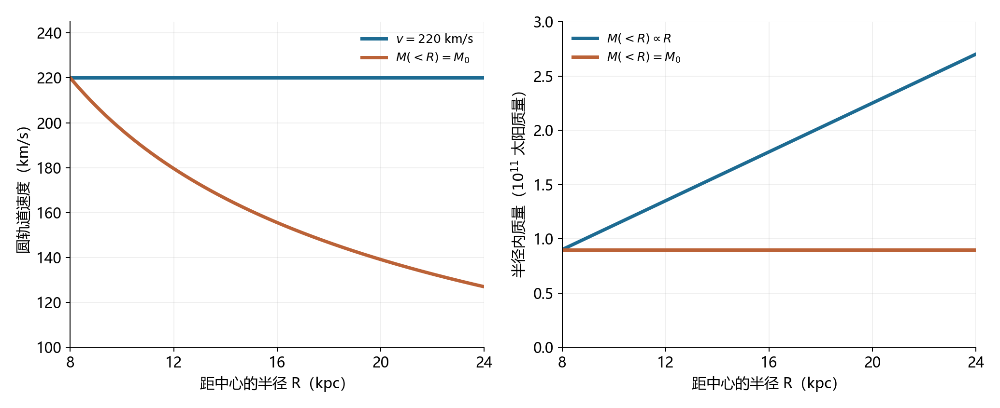
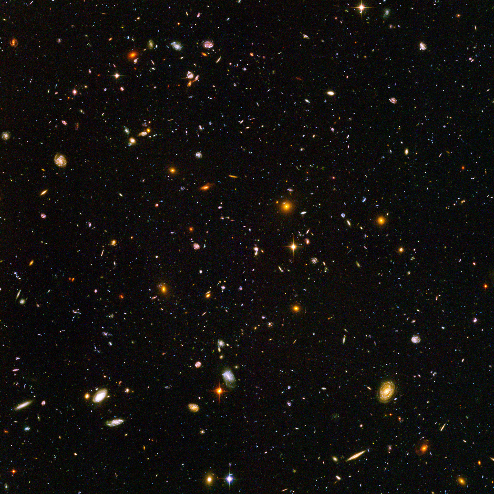

# 15 银河系与星系的结构和演化

在足够暗的夜空里，银河是一条宽窄不一、夹杂暗纹的亮带。双筒望远镜沿着它扫过，会分辨出许多肉眼无法单独看清的恒星；更远处的星光仍混合成柔和的背景。我们看到的是自己所在星系的一部分。太阳、行星以及平时认识的众多恒星，都处在这个由引力联系起来的巨大系统中。

银河系的俯视图却常画着中央的棒和向外延伸的旋臂。要从头顶的亮带得到这样的地图，需要给恒星补上距离，穿过尘埃寻找气体，再把各处的运动放回同一个空间模型。地图逐渐完整以后，新的问题又会出现：这些恒星怎样保持运动，支配运动的质量分布在哪里，盘和旋臂又是怎样形成的？外部星系提供了另一种观察位置，让我们能够把银河系的局部细节与整座星系的形态相互参照。

## 从盘内望向银河 {#L13-C01}

银河系的大量恒星分布在一个扁平的盘中，太阳位于盘内，距银心约八千秒差距，也就是约两万六千光年。沿盘面方向望去，视线在恒星密集区域内穿行很长一段；转向盘面上方或下方，视线很快离开这一层。于是，沿盘面分布的星光在天空中连成一条带。地球自转和公转改变这条带在夜空中的位置，我们因此在不同季节、不同钟点看到银河的不同部分。[银河系结构](../../assets/v02-batch-C-SOURCES.md#c13-01)

在透明、恒星分布大致均匀的区域，可以进一步理解视线路径为何影响亮度。取天空中一小块固定角面积，越远处的一薄层空间，其横截面积越大，包含的恒星也越多；每颗恒星传来的光则按距离平方减弱。这两种距离效应恰好相抵，使每一段等厚的路径贡献相近的总光量。穿过的恒星层越长，累计的表面亮度就越高。真实银河还叠加了密度变化、不同恒星的光度差异以及尘埃吸收，亮带因而呈现丰富的明暗结构。

*图1｜Gaia EDR3 数据构成的全天投影。银河盘方向形成横向亮带，中央较宽的亮区对应银心方向，暗纹主要受前景尘埃影响。颜色由蓝、红测光数据组合，亮度反映所收集的恒星光。Credit: ESA/Gaia/DPAC; Acknowledgement: A. Moitinho。CC BY-SA 3.0 IGO；[图源与版本](../../assets/v02-batch-C-SOURCES.md#c13-i1)。*

图1的暗纹把星际尘埃带进了银河结构。尘粒吸收和散射星光，削弱后方恒星的信号；在常见的星际尘埃条件下，短波可见光受到的消光通常更强，透过来的光也会变红。因此，某一方向能数到多少恒星，同时取决于恒星的实际分布与沿途的透明度。越向尘埃浓厚的区域望去，可见光样本越容易偏向近处和明亮的恒星。

银河盘本身也有不同层次。冷气体、尘埃和年轻恒星集中在较薄的区域，具有较大垂直运动的恒星可以到达盘面上下更远处。中央的恒星分布更密集，并具有核球和棒状结构；盘外的恒星晕比较稀疏，其中有球状星团和许多古老恒星。再向外延伸，还有通过引力作用测得的暗物质晕。气体、恒星晕和暗物质的分布各自延伸到不同范围。[银河各组成部分](https://www.esa.int/Science_Exploration/Space_Science/Gaia/Guide_to_our_galaxy)

## 给天空上的方向补上距离 {#L13-C02}

一颗星在天空中的方向给出两个角坐标，距离提供第三个坐标。附近恒星的几何距离可以从周年视差获得：随着地球绕太阳运行，观测位置改变，近星相对于更远背景的方向会出现一年周期的微小变化。传统视差角 $p$ 对应一条天文单位的基线；选择视差位移最大的相隔半年时刻，总摆幅约为 $2p$。小角度几何给出

$$
d\;(\mathrm{pc})=\frac{1}{p\;(\mathrm{arcsec})}.
$$

pc 表示秒差距，约合3.26光年；角秒为一度的三千六百分之一。例如，视差为0.0005角秒，即0.5毫角秒时，距离约为2000秒差距。距离越远，地球轨道张开的角度越小，测量就越依赖精密的位置记录。Gaia 将多年的观测结合起来，分离恒星的周年视差与长期自行，再据此重建大量恒星的空间分布和运动。

在这样的空间地图上，银心位于天空的人马座，也称射手座方向，太阳与它相隔约两万六千光年。银河系的恒星盘直径约为十万光年量级，中央恒星棒与盘中的旋臂使它归入棒旋星系。方向、距离、尺度和形态各自承担一部分描述，合起来确定了太阳在这座星系中的位置。

把所有恒星放在同一张地图上，还需要考虑它们各自适合追踪什么。年轻的大质量星明亮而短命，比较接近最近发生恒星形成的区域；年轻星团和经典造父变星也能追踪盘中的结构。红巨星更适合在较大范围研究恒星分布和速度。Gaia DR3 的银河盘研究便分别选取这些星族：年轻恒星展示旋臂相关的空间聚集，红巨星的速度场则显示棒和盘中流动的影响。不同样本共同描述银河，同时保留各自对年龄、亮度与尘埃的敏感性。[Gaia DR3 银河盘研究](https://arxiv.org/abs/2206.06207)

尘埃遮蔽较强的方向，需要换用能够传播得更远的波段。近红外受到的星际消光通常比可见光小，可以帮助研究中央恒星结构；射电的中性氢21厘米谱线和分子谱线能够描出气体，并通过多普勒位移测得沿视线的速度。恒星和气体的观测由此互补：一方告诉我们哪些地方已经形成了恒星，另一方追踪仍在星际空间中的物质。[旋臂的多波段示踪](../../assets/v02-batch-C-SOURCES.md#c13-02)

某些星形成区含有明亮而紧致的脉泽源。特定条件下，谱线辐射在介质中受到放大，使这些小区域成为精密射电位置测量的目标。2017年，研究者利用甚长基线阵列测量银河远侧一处水脉泽的周年视差，得到约 $20.4^{+2.8}_{-2.2}$ 千秒差距的距离。这个位置在银心另一侧，约合六万六千光年；它为远侧旋臂提供了一个直接的几何约束。[远侧银河的脉泽测距](https://arxiv.org/abs/1710.06489)

气体的谱线速度还可以与银河旋转模型结合，估计距离。设气体大致沿绕银心的圆轨道运动，它在某个方向上的径向速度便与所在的银心半径有关。朝内银河的一些方向看，一条视线会先后穿过同一个银心半径的近侧和远侧，两处气体可能具有相同的模型径向速度。这就是运动学测距中近、远距离歧义的几何来源。吸收关系、其他距离指标和几何视差可以帮助选择位置；气体受棒、旋臂扰动产生的非圆运动，也要纳入速度模型。

银河的俯视地图便这样逐步建立：方向确定视线，距离确定位置，年龄和化学组成区分星族，速度检验这些位置能否组成一致的运动系统。几何测距点越多，越能校准气体的间接距离；较完整的空间结构，又帮助解释速度场中的变化。

## 旋转揭示质量的分布

太阳也在绕银心运动。取轨道半径 $R=8$ 千秒差距、近圆轨道速度 $v=220$ 千米每秒，绕行周期为

$$
P\simeq\frac{2\pi R}{v}\simeq2.2\times10^8\ \mathrm{年}.
$$

一千秒差距约为 $3.09\times10^{16}$ 千米，因此这样高速的运动仍需要两亿多年才能绕行一周。太阳约46亿年的年龄，大约相当于二十来个这样的公转周期。真实太阳轨道还包含径向和垂直运动，这里用近圆轨道抓住银河转动的时间尺度。

维持圆轨道需要向心加速度 $v^2/R$。若先用球对称质量分布作近似，半径 $R$ 以内的质量产生 $GM(<R)/R^2$ 的引力加速度，两者相等便得到

$$
M(<R)\simeq\frac{v^2R}{G}.
$$

$M(<R)$ 表示半径以内包含的质量。代入太阳轨道的代表参数，得到约 $9\times10^{10}M_\odot$，即九百亿太阳质量。银河盘的引力几何与球体不同，精确计算需要把各处质量对轨道的引力贡献相加；这个球对称估算给出了所需质量的量级。中央人马座A*的质量约为四百万太阳质量，支配其附近恒星的紧凑轨道；到太阳所在尺度，广泛分布的恒星、气体和暗物质共同构成主要引力环境。[银河动力学质量](../../assets/v02-batch-C-SOURCES.md#c13-04)

把同样的测量推广到不同半径，就得到旋转曲线 $v(R)$。如果绝大部分质量集中在内侧，继续向外移动时，$M(<R)$ 增加很少，速度便按 $R^{-1/2}$ 下降。若某一段半径范围内的圆轨道速度大致保持不变，公式要求 $M(<R)$ 随 $R$ 增长：半径扩大一倍，其中包含的质量也要大致扩大一倍。两种速度曲线因而对应两种不同的质量分布。

*图2｜球对称、圆轨道近似下的两组模型。两者在8 kpc处都有220 km/s的速度和约 $9\times10^{10}$ 太阳质量的包围质量。向外延伸时，蓝线保持速度不变，包围质量随半径增加；橙线保持包围质量不变，速度逐渐下降。曲线由图示关系计算；[模型与绘图源](../../assets/rewrite-20261025/15/SOURCES.md#rotation)。*

许多盘星系的气体旋转曲线在恒星光已明显变淡的外部仍保持较高速度。恒星光可以结合星族模型估计恒星质量，原子和分子谱线可以估计气体分布；这些可见物质所提供的引力，常不足以解释所测运动。在标准引力描述下，需要加入范围更广的暗物质分布。银河系的晕恒星、球状星团和卫星星系也提供外部引力的测量，使质量研究延伸到明亮恒星盘之外。

这里的暗物质是由引力效应约束的物质成分，其微观身份仍待确定。测量工作可以先回答它如何分布、需要多少质量、不同对象的运动是否相容，再将这些结果与粒子物理候选联系起来。旋转曲线尤其有力之处，在于它把空间分布转成了可以逐个半径检验的数量关系：观测速度与模型预测必须在整条曲线上相互符合。

## 盘、旋臂与正在流动的气体

银河的扁盘与物质如何失去能量、保留角动量有关。气体在引力作用下聚集，气流相遇形成冲击，部分有序或随机运动转化为热；气体辐射又能将能量带走。具有整体转动的气体在收缩过程中保留相当一部分角动量，转动越来越重要，物质逐渐集中到盘状结构中。后来形成的恒星承接了气体的运动。冷气体容易聚集成薄层，已经形成的恒星则沿各自轨道运行，长期扰动会改变其轨道形状和垂直运动。[气体耗散与星系形成](https://imagine.gsfc.nasa.gov/educators/galaxies/imagine/formation.html)

盘中的转动速度与角速度需要分开考虑。角速度为 $\Omega=v/R$，即每单位时间绕银心扫过的角度。即使一段范围内 $v$ 大致相同，较小半径的恒星也会更快转过一圈。如果把一列恒星最初排成径向直线，内侧很快领先，直线便会被拉成弯曲的形状。这种差异转动不断改变物质在盘中的相对位置，是理解旋臂的重要条件。

旋臂呈现为密度和恒星形成活动增强的区域。引力扰动可以组织出盘中的波动图样，棒或邻近星系的作用也能激发旋臂。气体经过较强的压缩区时，一些云更容易形成致密结构，随后产生年轻恒星。年轻大质量星具有很高光度，而且寿命短，它们在形成区附近就能把旋臂照得格外明亮。较老、较暗的恒星则广泛分布在盘中。因此，蓝色星光和发射星云描出的旋臂，往往比整体恒星质量分布更鲜明。

旋臂图样与组成它的恒星可以具有不同的运动：恒星进入某段高密度区域，也会沿轨道离开。密度波模型用这样的集体运动解释持续存在的图样；另一些模型中，旋臂由盘内不稳定性不断形成、演化和消散。实际星系可能包含多种过程，判别它们需要比较恒星、气体的空间位置和速度。银河系中央的棒则是另一种非轴对称结构，它的引力可改变气体的角动量，驱动流动，并与盘中的旋臂发生联系。[旋臂的动态结构](https://www.esa.int/Science_Exploration/Space_Science/Gaia/Five_fascinating_Gaia_revelations_about_the_Milky_Way)

比较不同年龄对象在旋臂中的位置和速度，可以进一步研究气体压缩、恒星形成与盘中运动的先后关系。

## 从外部观看另一座星系

三角座星系M33提供了一个可供对照的外部视角。它距离我们约数百万光年，照片中的旋臂属于一座独立星系，其中包含大量恒星和星际物质。和银河全天图相比，M33的盘被完整投到一小片天空中；旋臂、暗尘埃和发光气体区之间的相对位置更容易辨认。银河系则让我们能够近距离测量大量单颗恒星，细致研究它们的年龄、组成和运动。两种观察位置各自提供了不同尺度的信息。

*图3｜M33，VST/OmegaCAM宽视场图，使用g、r和Hα数据。旋臂中的红色斑块突出发光气体区，弥散星光勾勒恒星盘，画面上也叠加了银河系内的前景恒星。Credit: ESO。CC BY 4.0；[图源与通道](https://www.eso.org/public/images/eso1424a/)。*

图3中的红色斑块把星系结构与恒星生命连接起来。新生大质量恒星发出紫外光，使附近氢气电离；电子随后与离子复合，产生包括Hα在内的谱线。于是，气体的发光区域显示近期恒星形成的活动。周围较平滑的星光则包含不同年龄恒星的叠加。将窄带图、宽带颜色和光谱联合起来，可以比较气体、年轻恒星与较老恒星的分布，研究它们怎样共同构成一条旋臂。

观测角度同样改变形态。正面观看一个盘，旋臂较容易展开；从侧面看，盘变成细长结构，尘埃集中成一道明显暗带。以倾斜角 $i$ 表示视线与盘轴的夹角，薄圆盘投影的短长轴比在简单几何下约为 $b/a=\cos i$。面向盘面时 $i$ 接近零，投影接近圆形；接近侧视时 $i$ 接近直角，投影变窄。真实盘有厚度，棒和旋臂也会影响轮廓，因而精细研究通常要同时拟合形状与速度场。

外部星系展示了比盘更多的结构。椭圆星系的恒星光往往比较平滑，恒星在许多方向上的轨道运动共同维持整体；其中常以较老星族为主，近期恒星形成较弱。透镜状星系有盘和中央隆起，盘内的旋臂及恒星形成活动较弱。不规则星系呈现更多样的气体和恒星分布，其中一些具有活跃的恒星形成。形态分类将这些外观有序地记录下来，而颜色、气体含量和动力学则帮助解释外观背后的物理状态。[星系形态与组成](https://science.nasa.gov/universe/galaxies/types/)

## 星系怎样改变形态与恒星群

一座星系形成新恒星的能力，首先取决于是否有能够冷却并聚集的气体。气体补给增加，可以为后续恒星形成提供原料；恒星风、超新星和活动星系核释放的能量，又会加热或推动气体，改变它继续聚集的条件。新一代恒星形成后，部分气体暂时进入恒星，随后通过失质量和爆发返回星际空间，并带回核反应制造的元素。星系的颜色、气体含量和化学组成，便在这种循环中逐渐变化。

若新恒星形成活动减弱，原有的大质量蓝星会在较短时间内离开其明亮阶段，星系的整体星光逐渐更多地由寿命较长的恒星贡献。观测上的颜色变化因此携带恒星形成历史。具体推断还结合光谱吸收线、尘埃影响和恒星演化模型：年龄、元素组成与尘埃都影响颜色，多种观测共同约束它们各自的贡献。

星系之间的接近和并合也会改变这一过程。两座星系相遇时，引力在各处的作用不同，可以拉出长长的潮汐尾，并改变恒星轨道。恒星之间的间距远大于恒星自身尺度，整体结构的变化主要通过引力相互作用传递；气体则能发生碰撞、冲击与压缩，部分区域因此出现增强的恒星形成。某些气体向中心流入，还会增加中央黑洞的吸积活动。[星系相互作用与并合](https://science.nasa.gov/universe/galaxies/evolution/)

并合过程中，随时间迅速变化的引力场使恒星重新分配轨道能量，原有盘的有序结构可能被显著改变。最终形态取决于两者的质量比、轨道、气体含量以及后续补给。富气体系统能够在相互作用后继续冷却并形成盘，缺少冷气体的系统则更容易保持由较老恒星和较无序运动主导的状态。星系形态因此记录了历史的一部分，而这段历史还需要从星族和运动中进一步读取。

银河系保留了可以逐颗恒星调查的并合痕迹。小星系或星团受到潮汐剥离时，脱离的恒星沿相关轨道铺开，形成恒星流。它们在天空中可能相隔很远，却仍在速度、轨道或化学组成上保留联系。Gaia提供的位置与运动数据，使这些相关性更容易识别；光谱测得的元素组成则提供另一种来历线索。把空间、运动和化学信息合在一起，可以重建银河吸收小系统的部分历史。[Gaia与银河的组成历史](https://www.esa.int/Science_Exploration/Space_Science/Gaia/Gaia_s_decade_of_discoveries_unravelling_the_intricacies_of_our_galaxy)

## 从银河邻居走向深场

银河系、仙女座星系、M33以及许多较小星系共同构成本星系群。更大的尺度上，星系组成群、团和丝状结构，星系之间也分布着气体和暗物质。这个环境影响气体能否持续进入星系，以及相互作用发生的机会。星系的演化由内部物理和周围环境共同推动。

*图4｜Hubble Ultra Deep Field，2003—2004年ACS多次曝光构成，视场约3.1角分宽，包含可见及近红外数据。大量扩展光斑属于不同距离和时代的星系。Credit: NASA, ESA, and S. Beckwith (STScI) and the HUDF Team。CC BY 4.0；[图源与版本](../../assets/v02-batch-C-SOURCES.md#c13-i2)。*

超深场把一小片天空中的微弱光积累起来，显出大量外部星系。光的传播需要时间，远处对象带来更早宇宙时期的信息。测量它们的红移，再比较不同阶段的形态、恒星质量和恒星形成活动，便能研究星系群体如何随宇宙时间改变。近处星系提供细节丰富的物理样本，深场则提供跨越很长历史的群体样本。

这样的比较需要将观测条件一起纳入。距离较远时，低光度和低表面亮度结构更难探测；固定的观测滤镜也会对应不同的发射波段。研究者通过探测效率、分辨率和光谱信息建立可比样本，才能把仪器造成的差别与星系自身的变化分开。深场中的一块红色光斑，可能受到恒星年龄、尘埃以及红移的共同影响，光谱和多波段测量帮助确定它在演化中的位置。

从银河亮带到超深场，我们逐渐获得两种互补的时间记录。银河恒星的年龄、轨道和化学组成保存了过去作用在本地留下的痕迹；遥远星系的光则直接来自更早的时代。把这些资料放在共同的引力、气体和恒星演化物理中，才可能解释一座星系怎样积累物质、形成结构，并在漫长时间里改变自己的样貌。
