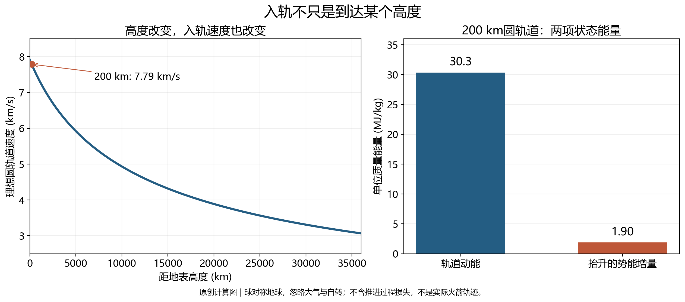
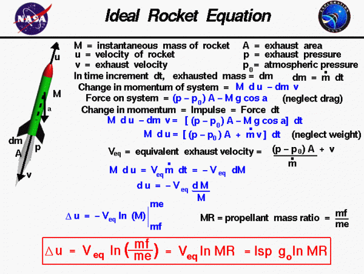
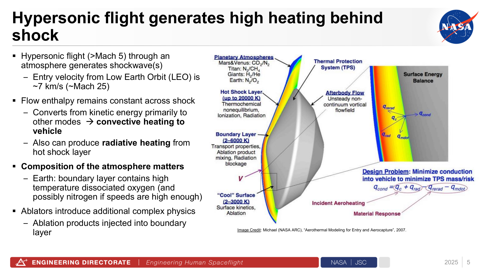

# 15 一枚火箭回来之后：读懂航天与天文新闻

一枚细长的火箭在火焰中升空，几分钟后，一段箭体从天空返回，发动机喷出最后一束火焰，箭体稳稳停在平台上。这样的画面很有冲击力，但它究竟完成了什么？载荷是否进入轨道，回来的是否是整枚火箭，这件硬件是否已经第二次飞行，未来发射成本能降低多少，都不是单凭这一段视频可以回答的问题。要理解新闻中的“成功”，必须先理解它所跨越的物理门槛，再把事实与门槛一项项对应起来。

航天的困难很适合作为入口：高度、速度、能量、质量和控制，全都能在一次发射中找到具体位置。由此走向天文新闻，我们也会发现相似的结构。一个光谱特征不是生命已经找到，一次亮度下降不是行星已经确定，一幅漂亮图像不是理论已经完成检验。文字中的结论，需要有一条能够回到测量的路线。

## 到了很高的地方，为什么还没有入轨 {#L15-C01}

“飞进太空”听上去像爬过一堵高墙，越过某个高度便大功告成。但绕地球运行，关键还包括足够的横向速度。把一个球向远处抛出，它一面前进一面下落；若横向速度足够大，地球表面向下弯曲的速度恰好与它的下落配合，球可以持续绕地球自由下落，而不撞上地面。这就是轨道的基本图景。卫星没有失去引力，轨道也不靠持续点火“托住”卫星。[NASA：引力与轨道](https://science.nasa.gov/learn/basics-of-space-flight/chapter3-2/)

在球对称地球、圆轨道、忽略大气与其他天体扰动的近似下，引力提供向心加速度：

$$
\frac{GM_\oplus}{r^2}=\frac{v^2}{r},\qquad
v=\sqrt{\frac{GM_\oplus}{r}}.
$$

$r$ 是到地球中心的距离，不能直接填卫星距地表的高度；$GM_\oplus$ 约为 $3.986\times10^{14}\ \mathrm{m^3\,s^{-2}}$。取地球半径约6371 km，高度200 km时，$r$ 约6571 km，得到速度约7.79 km/s，绕行一周约88分钟。这些数值是理想圆轨道的估算，不是某一枚火箭的任务要求。它们已经说明，入轨需要每秒前进近八公里，仅仅上升两公里或一百公里，都没有完成同样的运动状态。[NASA：轨道力学](https://science.nasa.gov/learn/basics-of-space-flight/chapter3-2/)

这也澄清了一种常见错觉：离开地面以后，人能飘浮，似乎是引力已经很小。200 km高度处的引力加速度约为地表的 $(6371/6571)^2$，即94%。宇航员与空间站一起自由下落，彼此之间不需要像地面一样用地板托住，才产生失重感。由此判断一项试验时，“高度达到某值”“飞行时间多久”“载荷入轨”描述的不是同一件事；新闻若只给前两项，不应该被读者悄悄补上第三项。

*图1：依据正文圆轨道近似计算的原创数据图。左图横轴为距地表高度，纵轴为圆轨道速度；右图分开比较200 km圆轨道的单位质量动能与从地表抬升至该高度所需的引力势能增量。不含大气、地球自转及推进过程损失，不是实测火箭轨迹；绘图源与SVG同目录。*

单位质量的动能为 $v^2/2$，200 km圆轨道约为30 MJ/kg；从地表到该高度的势能增量是 $GM_\oplus(1/R_\oplus-1/r)$，约1.9 MJ/kg。抬高确实需要能量，但与最终轨道横向速度对应的动能相比，它只占较小一部分。这是原创的两项状态能量比较，不表示实际火箭只要输入两者之和就能完成任务：推进剂本身要被加速，发动机有能量转换限制，还存在重力损失与空气阻力。它说明的是为什么“到达同样高度”的两次飞行，难度与任务状态可以很不一样。

轨道形状也有意义。若速度与方向不合适，飞行器可能进入一个近地点穿入大气甚至地面的椭圆轨迹，仍会返回；足够高的远地点不能证明轨道稳定。反过来，已经进入近地轨道，也不等于可以抵达月球或火星，改变轨道还需要额外速度增量和正确时刻。入轨通报中常见的“预定轨道”，背后包含高度、倾角和其他轨道参数，绝非仅仅一个“太空”地点。

## 火箭为什么必须带着自己要烧掉的大部分质量

飞机依靠大气中的氧气，火箭在真空里必须携带完成反应所需的推进剂组分。发动机把推进剂转变成高速向后喷出的气体，火箭获得向前的动量变化；不需要气体撞到空气或地面才能前进。液体发动机常把燃料与氧化剂分别存放，泵入燃烧室，再经喷管把高温气体的能量转成有方向的高速喷流。新闻只说“甲烷发动机”时，并不意味着甲烷可以在没有氧化剂的空间里自己燃烧。[NASA：火箭推力](https://www1.grc.nasa.gov/beginners-guide-to-aeronautics/rocket-thrust/)

喷流速度越高，每一千克推进剂能提供的动量变化一般越大。工程里常用比冲描述推进剂利用效果：在相应定义下，等效排气速度 $v_e=I_{\rm sp}g_0$，$I_{\rm sp}$ 的常用单位是秒，$g_0$ 是标准重力加速度，约9.81 m/s²。这里的秒不是发动机可以工作多久，而是推力与推进剂重量流率的比值所形成的单位。推力与比冲也不相同：很省推进剂的发动机仍可能推力很小，无法从地面举起一枚巨大的火箭。[NASA：比冲](https://www1.grc.nasa.gov/beginners-guide-to-aeronautics/specific-impulse/)

火箭每喷出一点推进剂，剩下的质量便减小，后续同样的推力会使它更容易加速。在等效排气速度不变、忽略外力的理想条件下，总速度增量为

$$
\Delta v=v_e\ln\frac{m_0}{m_f}.
$$

$m_0$ 是这段点火开始时的总质量，$m_f$ 是结束时仍与火箭一起运动的质量，包括结构、载荷及尚未烧掉的推进剂；$\ln$ 是自然对数。这是理想火箭方程。它的突出特点是对数：把推进剂加倍，并不能让可获得的速度增量简单加倍，因为新加的推进剂在被喷出前，也必须由前面烧掉的推进剂带着一起运动。[NASA：理想火箭方程](https://www1.grc.nasa.gov/beginners-guide-to-aeronautics/ideal-rocket-equation/)

*图2：NASA Glenn对变质量火箭的示意和方程推导原图，保留英文符号，不是某型号结构图。Credit: NASA Glenn Research Center。[原页](https://www1.grc.nasa.gov/beginners-guide-to-aeronautics/ideal-rocket-equation/)。原图 $m_f$ 指full、即初始满质量，对应本文 $m_0$；原图 $m_e$ 指empty、即结束质量，对应本文 $m_f$。两套下标定义不同。正文的 $g_0$ 指标准重力加速度，与引力常数 $G$ 不同。*

取假设等效排气速度3 km/s。质量比为3时，理想速度增量约3.30 km/s；质量比为10时，约6.91 km/s。若希望达到9 km/s的理想速度增量，所需质量比为 $e^3$，约20，结束时质量只有初始质量的5%左右。这里9 km/s只是显示指数代价的假设预算，不能直接当成所有发射的固定需求。实际需要克服持续飞行中的重力影响和阻力，还要考虑地球自转提供的初速度、目标轨道和飞行路径。

这5%还要容纳发动机、贮箱、管路、结构和有效载荷，而不是全部给卫星。一个部件增重，可能要求更多推进剂；更多推进剂又要求更大的贮箱与结构。这种耦合解释了为什么火箭工程对质量如此敏感，也说明不能仅凭箭体高大、喷焰壮观就预测有效载荷。材料、发动机、结构和任务目标需要放在同一个质量预算里比较。

## 分级把已经用完的东西留在身后

一枚单级火箭必须一直带着已空的贮箱和早期发动机。多级火箭在某一级完成工作后抛下它，让后面的级只加速剩余系统。每一级的理想速度增量可以相加，但各级的初末质量要分别计算，不能把整枚火箭粗略的满空质量比填一次就获得准确性能。已经分离的一级不计入二级的初始和结束质量，这正是分级带来的重要收益。[NASA：多级火箭](https://solc.gsfc.nasa.gov/modules/launch/mainMenu_textOnly.php)

于是视频里回来的一子级，通常没有随载荷完成整段入轨。它先帮助上面的级加速，随后分离；上面继续点火，将载荷送入所需轨道，一子级则沿另一条路线返回。两者面对的速度、能量、热环境都不同。“入轨运载火箭的一子级回收”，不等于“这段一子级自己绕地球一圈再回来”。同一次发射可以载荷任务成功而回收失败，也可以回收阶段表现正常但载荷任务存在问题；最终评价需要分别看各阶段结果。

回收又把质量预算变得复杂。着陆腿、栅格舵、气动控制装置、热防护、额外传感器都可能增加干质量；用于返航、再入或着陆的推进剂，在上升阶段必须保留。火箭方程里的结束质量因此变大，给定初始质量和发动机性能，可用于向上加速的速度增量会减少。复用的价值不是无需付出物理代价，而是用部分性能、结构和操作代价换取硬件回收后的再次使用机会。

可以用一个与具体型号无关的算例看这个代价。假设某段点火 $v_e=3$ km/s、$m_0=100$ t。若原末质量为10 t，理想速度增量约6.91 km/s；若为了回收把末质量提高到15 t，则约5.69 km/s，减少1.22 km/s。末质量中的5 t可能是保留推进剂或回收设备，不意味着任何实际火箭恰好付出这个比例。算例显示的是，回收方案必须与任务性能一起设计，不能在发射方案完成之后再免费附加一项“回来”。

返航地点也进入预算。返回发射场需要改变水平运动，使落点回到附近；在下游海上平台着陆，往往可以减少某些返航要求，却增添海况、定位、运输与海上作业问题。网系捕获、着陆腿垂直着陆、海面软着陆等方案，承担载荷和处理箭体的方式并不一样。看见几种“回收”方法，不应该把所有方案压成同一种技术动作，更不能仅凭一次结果给它们排出长期成本名次。

## 返回时，必须把速度和能量交给谁

上升时获得的动能，在下降过程中要以某种方式转移出去。发动机反向减速，把动量和能量带到喷流中；气动阻力把飞行器的机械能转移到空气和热环境中。高速再入前方会形成强激波，气体被急剧压缩加热；热量通过复杂的流动、辐射和表面过程传向飞行器。把再入发热只解释为日常物体在空气里擦过的“摩擦”，会漏掉压缩和激波所起的重要作用。[NASA作者：高超声速热防护技术报告，第5页](https://ntrs.nasa.gov/api/citations/20250006125/downloads/NASA_TPS_Perspectives_ReusableRocketsWorkshop_RevB.pdf)

速度差异对这笔能量尤其重要。若只比较单位质量动能，3 km/s对应4.5 MJ/kg，8 km/s对应32 MJ/kg，后者超过前者七倍；这些是假设速度的比较，不是某一子级或飞船的实测再入速度。轨道级回收与一级回收因此面临不同难度，结构和热防护不能照搬。也不能把机械能总量直接当成全部传入箭体的热量，能量分配到周围空气、辐射和飞行器的比例，需要气动热模型与实际试验约束。

工程中还会利用姿态和轨迹改变受热与减速。空气稀薄的高处，气动舵面能提供的作用有限，可能需要其他姿态控制；进入更稠密空气以后，栅格舵等装置可以调节方向，却同时受到高速气流和热环境。返回不是一条按下“倒放”按钮的上升影片。飞行器质量已经减小，发动机工作状态不同，气流从另一个方向作用，环境也连续变化。

接近落点时，终端制导必须同时控制位置、水平速度、竖直速度与倾斜。只在几何上对准平台，并不保证能站住；只把下降速度降得很小，也可能漂到平台以外。发动机再次启动时，推进剂供应、燃烧室状态和推力建立需要在有限时间内可靠工作；推力调节与姿态控制随后要协同。箭体接触地面或捕获装置时，剩余载荷还要被结构承受。这些环节解释了低空试验为什么有价值：它可以专门验证后半程的关键技术，即使尚未承担完整入轨任务。

着陆最后几秒还可用一个简单动力学关系理解。暂忽略阻力，取竖直向上为正，箭体的加速度是 $a=T/m-g$，$T$ 为向上推力，$m$ 为此刻质量。下降中的箭体要减小下降速度，需要向上的净加速度，因而推力必须超过重量；推力恰好等于重量，只能使已有下降速度近似保持，不能把它自动降为零。若假设下降速度为50 m/s、可维持的向上净加速度为10 m/s²，匀减速停止距离约为 $v^2/(2a)=125$ m。这是忽略质量变化与推力建立时间的假设算例，但已说明为什么点火过晚，即使发动机推力很大也可能来不及。[NASA：火箭受力](https://www1.grc.nasa.gov/beginners-guide-to-aeronautics/rocket-thrust/)

反过来，点火过早也不必然安全。若最小稳定推力仍然大于此刻重量，飞行器无法无限悬停在平台上方；它可能在到达地面之前就把下降速度减到零，随后重新向上运动。实际控制必须把高度、速度和剩余质量一起纳入，并考虑发动机调节范围。质量较大的起飞阶段与质量较小的返回阶段，对同一发动机的要求不同：起飞需要足够总推力，落地还需要合适的最小推力和快速可靠的再启动。多台发动机的选用、节流以及点火时刻，都服务于这组具体条件，不能用一个“发动机很强”的形容词替代。

这让低空回收试验有了准确的位置。它可以积累终端控制、发动机再启动和承载机构的证据，而长时间高速返回还要验证另一组热与结构条件。同一套控制软件在某次短程验证中运行成功，是重要进展；把它放到更高速度、更强气流以及不同剩余推进剂状态下，仍需要扩大验证范围。工程中的阶段成功，可以为下一阶段提供可靠基础，同时保留尚未覆盖的环境范围。

*图3：2025年6月18日NASA作者研讨报告第5页，示意激波层、对流、辐射、烧蚀等相互关联的过程，并非实际返回照片。报告作者：Adam Sidor、Nate Olson、Stan Bouslog（NASA JSC）；图中示意 credit 原文：Michael (NASA ARC), “Aerothermal Modeling for Entry and Aerocapture”, 2007。整页渲染，未裁切；报告说明作者观点不代表NASA正式立场。[原报告](https://ntrs.nasa.gov/api/citations/20250006125/downloads/NASA_TPS_Perspectives_ReusableRocketsWorkshop_RevB.pdf)。*

## 一次落地与再次飞行之间，还隔着一项工程

*图4：2020年12月6日NASA发布的CRS-21一子级海上平台着陆画面截帧，Credit: NASA。它显示回收动作；同一硬件已第四次飞行的结论来自[通报正文](https://www.nasa.gov/blogs/spacexcrs21/2020/12/06/falcon-9-first-stage-sticks-the-landing/)，不是由照片外观判断。*

一子级站在平台上，证明不了它还具有怎样的剩余寿命。上升时的振动和载荷、发动机燃烧室和涡轮泵的工作、再入的加热、着陆冲击，都可能影响结构和部件。回收后的检查、维修、更换和再试验，才将“带回来”接到“再次可飞”。型号设计允许复用、发动机在地面多次点火、某件硬件真正完成第二次发射，是三种不同的证据；它们都值得报道，却不应使用同一个结论替代彼此。

CRS-21通报明确写出，这件一子级是第四次飞行，其中包括此前载人的Demo-2任务。这比单独一张着陆照片提供了更强的复飞信息，因为文字把硬件历史与当前任务联系起来。[NASA：CRS-21回收通报](https://www.nasa.gov/blogs/spacexcrs21/2020/12/06/falcon-9-first-stage-sticks-the-landing/)

但即便知道飞了四次，也不能直接得到单位发射成本降低了多少。可用一个简化成本模型理解需要哪些数据：每次发射的相关成本约等于可复用硬件制造成本除以实际使用次数，再加维护、推进剂、地面操作及仍需消耗的硬件成本。若制造成本是 $C$、实际飞行次数为 $N$、平均整修为 $R$、其他每次成本为 $O$，则可写成 $C/N+R+O$。这是分析关系，不是企业报价模型；保险、研发、闲置时间与风险仍可能另外进入。

当 $N$ 很小时，硬件摊销下降很明显；当 $N$ 已很大，继续增加次数的收益逐渐变小，维护与操作部分会越来越重要。若回收降低了载荷能力，完成同样的运输任务可能需要更多发射，也影响最终成本。新闻中的“复用降低成本”因此有明确的工程理由，但“已经降低某个百分比”需要给定比较对象和实际数据。复用次数的纪录可以很振奋，却不会替代可靠性、周转和任务适应性这几项长期指标。

## 让三则通报回到各自实际支持的位置 {#L15-C02}

截至本稿检索日2026年10月2日，国家航天局2026年7月10日通报写明：长征十号乙发射，卫星送入预定轨道，一子级在“领航者”号回收船上通过网系捕获方式垂直回收。8月19日通报写明朱雀三号遥二发射，一子级按程序完成陆地回收；页面另一段介绍型号具备完成轨道发射后垂直回收与再利用的能力。前一页直接陈述此次载荷入轨结果，后一页的型号能力介绍不能被自动改写成此次载荷入轨的独立证据。[7月10日原通报](https://www.cnsa.gov.cn/n6758823/n6758838/c10761540/content.html)、[8月19日原通报](https://www.cnsa.gov.cn/n6758823/n6758838/c10768762/content.html)

另一篇北京经开区报道发表于2025年5月30日，所述元行者一号验证型飞行发生于5月29日，约2.5 km高度、125秒，并完成海面软着陆。结合前面的轨道速度讨论，这些数据很清楚地指向一种验证飞行；报道也把将来“入轨+回收”描述为后续目标。这次试验不是因为尚未入轨就毫无价值，但不能被搬到2026年名下，也不能被称为已经完成其未来目标。[原报道](https://kfqgw.beijing.gov.cn/zwgkkfq/ztzl/lqztkfq/lqzx/zxxx/202506/t20250604_4105322.html)

发布日、事件日、检索日，分别描述三个时刻。原试卷的“今年”若按2026年理解，仍需要知道截止日、是否包括验证型飞行以及回收的口径。以上几篇通报支持几次具体事件，没有穷尽全年所有型号；2026年在10月2日也尚未结束。缺少某个型号的当年报道，不等于证明它当年绝无进展。这项原题的年度穷尽状态仍为partial，稳定的物理解释无需等待这个局部问题解决。[本批核验记录](../../assets/v02-batch-D-SOURCES.md#l15)

## 从火箭的视频，到遥远天体的一条谱线 {#L15-C03}

天文发现不像火箭那样总有清楚的“点火、分离、落地”画面，但结论也由不同层级组成。一个探测器在某些波长收到额外或较少的信号，是测量结果；经过仪器校准与光谱拟合，认为信号来自某种分子，是解释；进一步认为该分子说明生物活动，就又加入了化学环境、形成通道与其他可能来源。每上升一层，所需的前提都增加了。新闻只保留最后一句时，读者便难以看见它依赖哪些条件。[NASA：系外行星研究方法](https://science.nasa.gov/exoplanets/how-we-find-and-characterize/)

凌星光谱提供一个具体例子。行星经过恒星前方，一小部分星光穿过行星大气，不同波长的遮挡深度可能略有差别。研究者用模型从这些差别推断大气成分，但恒星自身活动、云和霾、不同分子的相似特征，以及仪器误差都可能影响解释。可靠的“检测到某种分子”通常需要光谱特征、统计显著性、物理模型及替代解释一起讨论；更强的生命判断还要额外证据。它的思想结构与“着陆—可复飞—低成本运营”很相似，每一箭头都是一个需要证明的联系。

质量、半径和距离的新闻也一样。看到一颗行星的黑点与恒星面积比，可以约束半径比；若恒星半径估计变了，行星绝对半径也变。视向速度的振幅可以约束质量，却受到轨道倾角影响。将几项方法结合，才可能得到密度，而密度仍不唯一决定内部组成。科学新闻中“首次发现某类世界”往往是经过这条测量链得出的分类，不是一台相机直接在图上显示了内部剖面。[NASA：探测与刻画系外行星](https://science.nasa.gov/exoplanets/how-we-find-and-characterize/)

将这个测量链写成一个数量关系，就更容易看清新闻遗漏的前提。在恒星表面亮度均匀、行星不透光且完全进入恒星投影圆盘的简化情况下，凌星相对深度约为 $\delta=(R_p/R_*)^2$。假设半径比为0.1，光会减少约1%；假设半径比为0.01，减少的便只有万分之一。行星半径小十倍，遮挡信号小一百倍。这些是假设比例，不是某颗行星的实测结果；真实分析还要处理恒星临边昏暗、行星轨道经过圆盘的路径和其他恒星的混入。[NASA：凌星观测方法](https://science.nasa.gov/exoplanets/how-we-find-and-characterize/)

即使重复出现万分之一的下降，也还需要排除其他来源。未能分开的食双星可能只贡献画面总光的一小部分，其本来较深的食被另一个亮星稀释后，就显出浅浅的下降。周期性有助于定位轨道过程，却没有独自确定究竟是哪颗星被哪种物体遮挡。不同波段的变化、光谱、图像中的位置偏移以及后续观测，可以帮助区分这些图景。这里的核心困难不是“有没有看到黑点”，而是由整组光度数据确认信号属于怎样的系统。[O'Donovan等：被食双星伪装的凌星候选](https://arxiv.org/abs/astro-ph/0603005)

得到半径以后，再与质量结合，平均密度为 $3M/(4\pi R^3)$。半径如果估计大10%，在质量不变时，推出的密度会降为原来的 $1/1.1^3$，约75%。所以“像地球一样大小”“平均密度相近”“内部结构相同”“表面条件宜居”之间，仍然隔着不同物理问题。报道若给出质量与半径及其误差，我们能够判断密度约束到了哪里；只给一个亲切的地球类比，便不足以支撑所有后续想象。它与回收新闻的道理再次相连：一个直接测得的量可以很有价值，价值来自它实际连接到的推理。

## 一个有内容的解释，应该留下怎样的问题 {#L15-C04}

谈一次发射，可以从具体任务出发：它需要把什么载荷送到怎样的轨道，回收哪一部分，为回收付出了怎样的性能代价，目前证明了哪一阶段。谈一次天文观测，可以从信号出发：仪器实际测了什么，这个信号为何支持某种机制，还有哪一种解释尚未排除。这样组织以后，兴趣不会只剩“我觉得宇宙很神秘”，观点也不必依赖夸张的首次或全面领先。

个人经历则有另外一种价值。说“那晚月亮很亮，我没看见预期的暗星云”，并解释背景亮度为何影响对比度，已经是一段有内容的天文叙述；没有远途或昂贵仪器不会削弱其真实性。未亲历的航天事件，可以准确引用通报，而无需给自己添加观测身份。真正值得追问的地方常很具体：再点火为什么难，几次回收后哪些部件需要更换，某条谱线能否被第二台仪器重复测到。

火箭回来的画面仍然值得激动，新的天文信号也仍然值得期待。把高度与速度、回收与复飞、测量与解释说清楚，让这种兴趣获得了更长的寿命：新闻热度过去以后，我们仍然能够理解它完成了怎样的事，以及下一次进展将怎样改变现有认识。

---

具体事件核验、算例口径、素材版本与局部访问问题见[本批来源记录](../../assets/v02-batch-D-SOURCES.md#l15)。本稿未经过人工科学审校或真实试讲。
