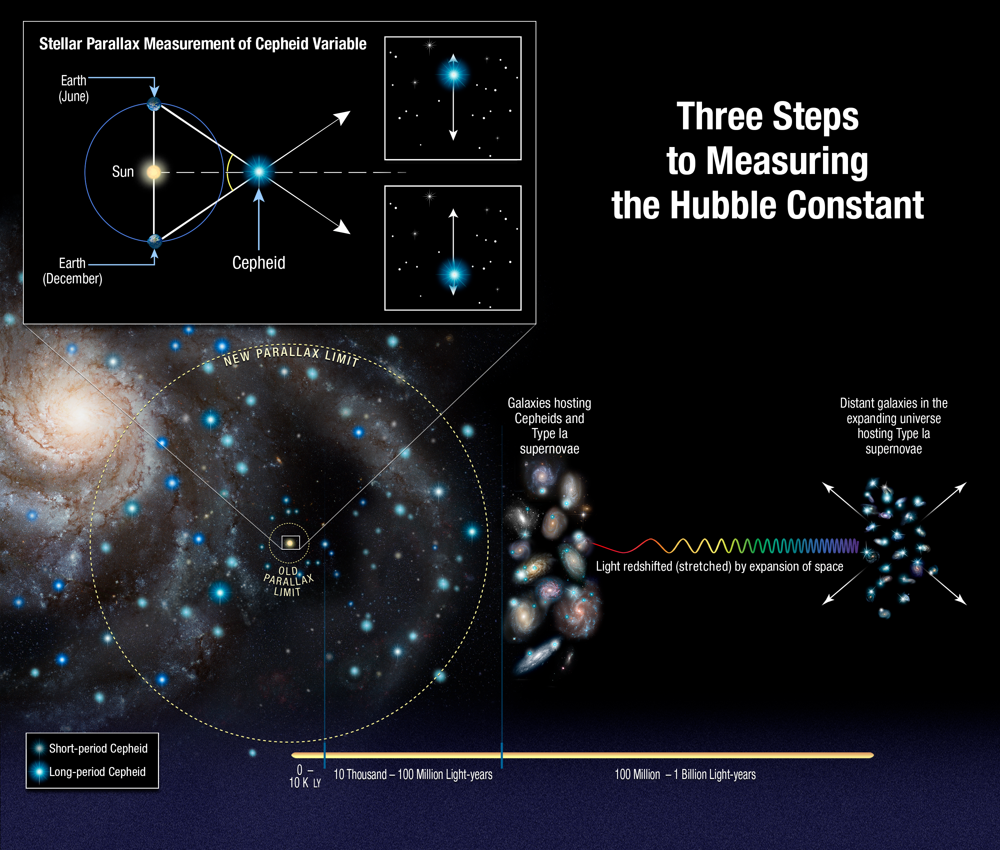
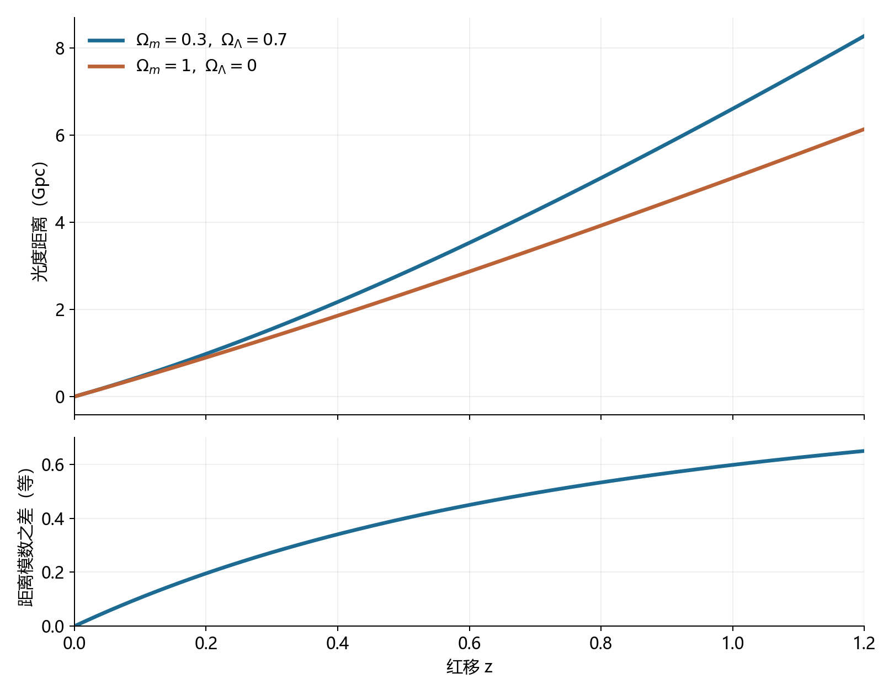
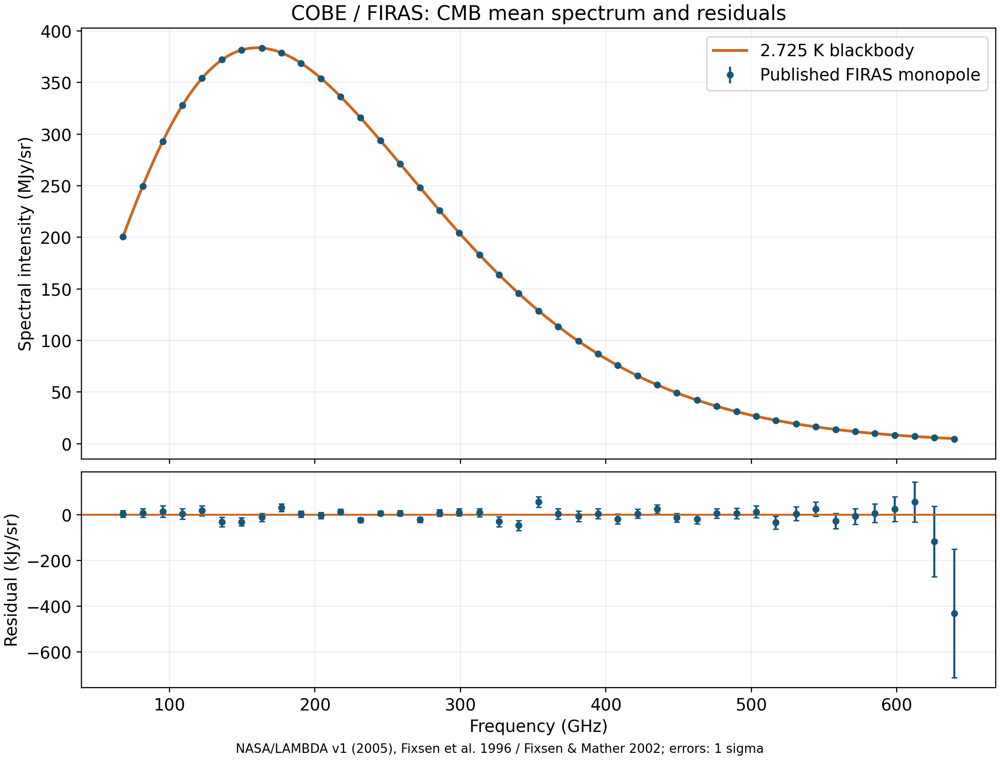
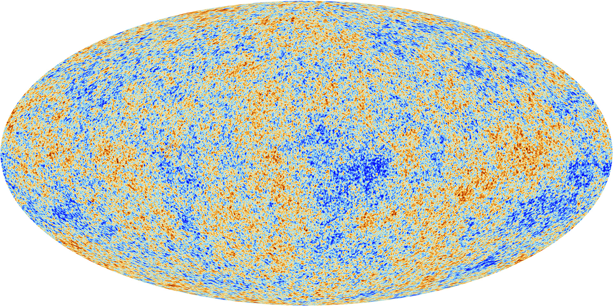
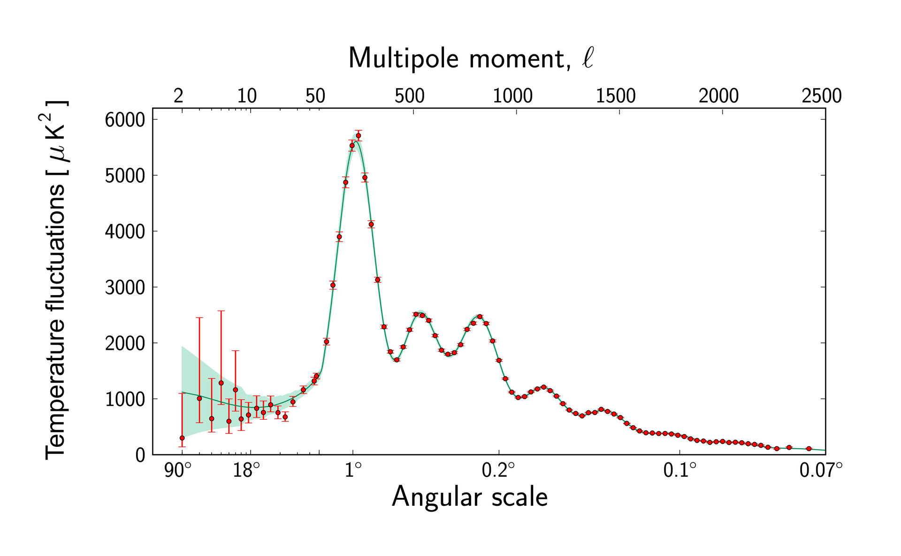

# 16 宇宙的距离、膨胀与早期光

遥远星系传来的光保存了它们过去的状态。距离越远，光通常走得越久，我们也就看到越早的宇宙。可是，把一幅深场照片变成宇宙历史，需要先知道各个星系有多远、光在途中经历了什么，以及不同年代之间怎样建立共同的尺度。

宇宙学有两类格外重要的观测。一类来自恒星和星系：变星的周期、超新星的亮度与谱线红移，帮助测量距离和膨胀。另一类来自遍布天空的微波背景：它保留了恒星与星系形成以前，宇宙处于高温、高密状态时的辐射。我们可以先沿着近处的几何测距逐步向外，再让红移把空间尺度接到时间，最后追踪这片早期辐射怎样来到今天。

## 从几何距离建立远处的光度标尺

附近恒星的周年视差提供了一条几何基准。地球在轨道上改变位置时，恒星相对远处背景的方向随之摆动。以一条天文单位为基线定义视差角 $p$，若 $p$ 用角秒表示，距离 $d$ 用秒差距表示，就有 $d=1/p$。0.1角秒对应10秒差距，约32.6光年；0.001角秒对应1000秒差距。向更远处延伸时，视差越来越小，恒星本身的运动和仪器测量误差也要从多时刻观测中分离。

距离一旦测得，恒星实际放出多少能量就能由它在地球上显得多亮来计算。对于近似各向同性辐射的光源，在已处理沿途吸收的情况下，

$$
F=\frac{L}{4\pi d^2}.
$$

$L$ 是光源每秒放出的总能量，即光度；$F$ 是我们每单位面积、每单位时间接收到的能量，即通量。已知 $d$ 与 $F$，就可以求出 $L$。将这类有几何距离的恒星当作样本，便能研究其他可测性质与光度的关系。

经典造父变星在这里发挥了重要作用。它们的亮度随着脉动周期性变化，周期与平均光度之间存在稳定的统计关系，同类造父变星中周期较长的通常更亮。附近样本的距离帮助标定这条关系；到远处星系中测量同类变星的周期，就能估计其光度，再与实际通量比较，求出距离。周期从连续观测的光变曲线中取得，使远处一颗微弱的变星也能联系到附近的几何标尺。[造父变星与测距](https://starchild.gsfc.nasa.gov/docs/StarChild/questions/cepheids.html)

标定时要选取相同类型的变星，并处理金属丰度、尘埃和邻星混杂对测光的影响。例如，分辨率有限时，邻星的光进入同一个测量区域，会使目标显得更亮；采用相同光度解释这份额外通量，得到的距离就偏小。多波段观测提供颜色信息，更好的空间分辨率减轻混杂，多颗变星共同建立星系距离。这些条件直接决定标尺能有多精确。

*图1｜2018年发布的距离阶梯示意。附近造父变星的几何距离标定周期—光度关系，含造父变星和Ia超新星的星系把标尺传给超新星，再由更远事件研究膨胀。图中示意范围对应这一历史版本；Ia亮度的标准化见下文。Credit: NASA, ESA, A. Feild (STScI), and A. Riess (STScI/JHU)。CC BY 4.0；[图源与版本](../../assets/v02-batch-D-SOURCES.md#l16)。*

图1中间的星系承担了关键的连接作用：其中既能观测造父变星，又发生过Ia型超新星。造父给出宿主星系的距离，超新星的通量便可以转换为光度。超新星远比单颗普通恒星明亮，于是经过这一次连接，测距范围就大幅延伸。视差、造父与Ia之间逐级传递的是校准信息，这构成了距离阶梯。

## Ia超新星的标准化测距 {#L12-C04}

Ia型超新星来自白矮星的热核爆炸。爆炸合成的镍-56及其后续衰变提供热源，辐射经过膨胀抛出物的吸收、散射和扩散后逃出。不同事件的核产物、抛出物质量和透明度有所差异，光变曲线因此有不同的峰值和宽度。对正常Ia样本，较亮事件通常衰减较慢，光变曲线较宽；颜色又提供另一组相关信息。将这些观测性质与峰值亮度的关系一起标定，可以把不同事件转换到共同的亮度标准。[Ia光变与标准化](https://newscenter.lbl.gov/2014/03/03/standard-candle-supernovae/)

这样的标准化需要连续的多波段观测。一次峰值测光给出亮度，一段光变曲线给出上升、峰值与衰减的时间结构，光谱帮助识别事件类型和演化阶段。研究者据此估计每次事件的校正后光度，再利用通量求距离。爆炸的物理模型解释这些关系为何出现，近处样本则直接检验关系在实际事件中有多大散布。

在较近、可使用静态空间近似的范围，距离由

$$
d=\sqrt{\frac{L}{4\pi F}}
$$

求得。两个具有相同标准化光度的事件，如果一个通量只有另一个的四分之一，距离就是后者的两倍。对数星等把这一关系写成距离模数：

$$
\mu=m-M=5\log_{10}\!\left(\frac{d}{10\ \mathrm{pc}}\right).
$$

这里的 $m$ 和 $M$ 分别是相同波段、已校正吸收后的视星等与绝对星等；绝对星等定义为光源放在10秒差距处的视星等。距离增加十倍，光分摊的面积增加一百倍，视星等便增加五等。测光和标准化最终提供 $\mu$，它再转换为距离。

距离标尺的误差会沿这条关系传递。保持测得通量不变，把本征光度估计提高10%，距离就提高 $\sqrt{1.10}-1$，约4.9%。单个事件的随机误差可以通过增加样本逐渐减小；共同的测光零点或光度标定若向同一方向偏移，则会带动整批距离一起改变。因此，不同仪器之间的校准、不同距离指标之间的比较，与收集更多超新星同样重要。

尘埃与样本选择也参与这个过程。尘埃使光减弱并改变颜色，超新星本身又有固有的颜色差异，二者需要借助多波段与宿主环境信息共同约束。随距离增加，较暗的事件越来越难进入样本，观测到的事件分布会偏向较亮者；调查的探测效率必须进入统计模型。造父变星之外，红巨星分支顶端等距离指标也可用于校准宿主星系，使不同观测方法在同一距离尺度上交叉检验。[距离校准与系统误差](../../assets/v02-batch-C-SOURCES.md#c12-11)

## 红移给距离加上一条时间线

星系的光谱中有来自原子和离子的谱线。在实验室测得某条线的波长 $\lambda_\mathrm{em}$，在星系光谱中测得对应波长 $\lambda_\mathrm{obs}$，便可定义红移

$$
z=\frac{\lambda_\mathrm{obs}-\lambda_\mathrm{em}}{\lambda_\mathrm{em}}.
$$

红移是直接由波长比得到的量。对距离较近、速度远小于光速的对象，径向多普勒速度近似为 $v\simeq cz$。星系既参与大尺度宇宙膨胀，也受周围引力影响而有额外运动，这部分称本动；仙女座星系在本星系群内的运动便使它相对我们接近。将距离范围扩大，统计平均的大尺度趋势逐渐显现：更远的星系通常具有更大的红移。[红移与膨胀](../../assets/v02-batch-C-SOURCES.md#c13-05)

在低红移范围，这个趋势可写成哈勃—勒梅特关系

$$
v\simeq H_0d.
$$

$H_0$ 是今天的膨胀率，常用单位为千米每秒每百万秒差距。以 $70\ \mathrm{km\,s^{-1}\,Mpc^{-1}}$ 作量级示例，每增加1 Mpc距离，平均退行速度增加约70 km/s；100 Mpc对应约7000 km/s。使用本动影响相对较小的一批对象，才能较稳定地测量这条关系的斜率。

这条距离—速度关系可以从均匀膨胀的几何中得到。用无量纲的尺度因子 $a(t)$ 描述宇宙在时刻 $t$ 的整体尺度，约定今天 $a=1$。两个随平均膨胀运动的地点，其共动间隔 $\chi$ 保持不变，而在同一宇宙时刻测得的物理距离为

$$
d(t)=a(t)\chi,\qquad
v(t)=\dot a(t)\chi=H(t)d(t),\qquad
H(t)=\frac{\dot a(t)}{a(t)}.
$$

圆点表示对时间的变化率。距离较大的两点之间包含更多同样伸长的空间间隔，所以距离增长率也较大。换到另一个随平均膨胀运动的星系，仍会得到同样形式的关系。局部已经由引力束缚的星系、恒星系统，则主要按照各自的局部动力学保持结构。

光在这种变化的几何中传播，波长与尺度因子成正比：

$$
1+z=\frac{a_\mathrm{now}}{a_\mathrm{emit}}.
$$

例如 $z=1$ 表示光发出时的尺度因子约为今天的一半。在这一约定下，红移把测得的波长变化连接到一个宇宙时期。将某一时期转换成距今多少年，还需要知道 $a(t)$ 怎样随时间增长；这正是膨胀历史要回答的问题。

## 光度距离与膨胀历史

传播中的膨胀也会使遥远天体显得更暗。光子波长增加 $1+z$ 倍，单个光子能量 $E=hc/\lambda$ 便减少到原来的 $1/(1+z)$；连续两个信号抵达的时间间隔也增加 $1+z$ 倍，于是单位时间接收到的光子数减少。再加上光在空间中的几何扩散，通量就同时携带距离与膨胀的信息。

宇宙学用光度距离 $d_L$ 保留熟悉的通量关系：

$$
F=\frac{L}{4\pi d_L^2}.
$$

此处 $F$ 与 $L$ 是对所有波长积分后的量。在空间平直的均匀宇宙中，若发射源与我们随平均膨胀运动，光度距离等于其今天物理间隔乘以 $1+z$。这个额外因子综合了光子能量和抵达速率的变化。实际固定滤镜测得的是一段波长内的通量，研究者还要按照红移将观测波段与发射波段对应起来，这项处理称为K校正。[光度距离与波段转换](https://ned.ipac.caltech.edu/level5/Hogg/Hogg7.html)

现在，同一次超新星观测提供了两个相互联系的量：标准化光变给出光度距离，谱线给出红移。不同膨胀历史对 $d_L(z)$ 有不同预测，因为光从发射到今天所经过的空间伸长过程不同。把大量超新星放到距离—红移图上，便可以比较这些预测。

*图2｜两种空间平直模型预测的光度距离。蓝线含物质与宇宙常数，密度参数分别为0.3和0.7；橙线为物质密度参数1、宇宙常数为零的模型。密度参数是各成分今天的密度与临界密度之比。两者均取 $H_0=70\ \mathrm{km\,s^{-1}\,Mpc^{-1}}$，在图示红移范围内忽略辐射密度。下图为蓝线模型减去橙线模型的距离模数差；[计算关系与绘图源](../../assets/rewrite-20261025/16/SOURCES.md#distance-models)。*

两条曲线在低红移处接近，因为今天的 $H_0$ 取值相同；随红移增加，过去的演化差别逐渐积累。到 $z=0.5$，蓝色模型的光度距离约为2.83 Gpc，橙色模型约为2.36 Gpc，1 Gpc为十亿秒差距。对相同光度的光源，前者预测的通量更小，视星等约大0.40等。观测就可以检验哪一类距离—红移关系更接近真实宇宙。

1998年，Riess等人的研究将高红移Ia与近处样本比较，发现远处事件比当时所比较的某些无宇宙常数模型预期更暗、光度距离更大；结合光变标准化、吸收和样本系统误差分析，结果支持宇宙晚期加速膨胀。这里的加速指尺度因子的增长速度随时间增加，即 $\ddot a>0$。宇宙常数是在广义相对论中描述这种晚期演化的一种简洁方式；其物理本质，以及更一般的暗能量描述，需要进一步观测约束。[超新星加速膨胀证据](https://arxiv.org/abs/astro-ph/9805201)

时间尺度也从膨胀率进入。$H_0$ 的量纲是时间的倒数，取上述示例值，$1/H_0$ 约为140亿年。它描述当前膨胀的特征时间。宇宙年龄则需要累计过去各阶段经历的时间，因此取决于完整的膨胀历史。物质、辐射和暗能量随尺度变化的方式不同，决定了早期与晚期的演化差别。

## 膨胀中的物质与辐射 {#L13-C03}

向过去追踪尺度因子时，同一共动区域包含的普通物质集中在更小的体积内。在粒子数大致守恒的阶段，体积随 $a^3$ 改变，物质数密度便随 $a^{-3}$ 改变。辐射还多一层变化：光子数密度随体积稀释，单个光子能量又因红移随 $a^{-1}$ 减小。因此，自由传播辐射的能量密度随 $a^{-4}$ 下降。反向追溯，辐射的能量密度增长得更快，在足够早的宇宙中发挥更重要的作用。

当时的普通物质处于炽热的等离子体状态，电子与原子核大量分离。自由电子频繁散射光子，辐射与普通物质之间不断交换动量；更早、更密的阶段还存在足够有效的能量交换和光子产生、吸收过程，使辐射接近热平衡。热平衡辐射具有黑体频谱，其形状由温度确定。随着宇宙膨胀，粒子密度和辐射温度下降，原子的形成与光的传播条件逐渐改变。

温度降到几千开尔文时，电子与原子核越来越能够保持结合，自由电子的比例迅速降低。对背景辐射而言，平均两次散射之间的传播距离因此增长。大约在宇宙年龄38万年、温度约3000 K的阶段，许多光子经历最后一次主要散射，随后长距离传播。这一过程涉及原子的复合和光子与物质的退耦，发生在一个有限的时间范围内。[热宇宙的复合与退耦](https://www.esa.int/Science_Exploration/Space_Science/Planck/Planck_and_the_cosmic_microwave_background)

这些光子今天仍在各个方向到来，构成宇宙微波背景，简称CMB。其温度随尺度因子反比下降：

$$
T\propto\frac{1}{a},\qquad
T_\mathrm{emit}=(1+z)T_\mathrm{now}.
$$

取退耦时期红移约1100，今天约2.725 K的辐射温度便对应当时约3000 K。早期近可见光和红外尺度的热辐射，在传播期间被拉长到今天的微波范围。K是开尔文温标，0 K为绝对零度；温度换算为 $t\;({}^\circ\mathrm{C})=T\;(\mathrm{K})-273.15$，所以2.725 K约为−270.425 ℃。描述热辐射时使用绝对温度。

科幻作品中“3K眼镜”的名称，借用了这一背景辐射的温度量级。现实中的微波仪器把它转化为可测量的信号，分别记录不同频率、不同方向上的辐射强度。

## 在频谱中读出热宇宙

黑体辐射给出一个非常具体的预测。按单位频率、单位立体角表示，其谱辐射强度为

$$
B_\nu(T)=\frac{2h\nu^3}{c^2}\,
\frac{1}{\exp\!\left(h\nu/k_\mathrm{B}T\right)-1}.
$$

$\nu$ 是频率，$h$ 是普朗克常数，$k_\mathrm{B}$ 是玻尔兹曼常数，$c$ 是光速。温度确定低频段怎样上升、峰值在哪里以及高频端怎样下降。测量多个频率的辐射强度，便可以检验整条谱形是否与同一个温度相容。

黑体形状能够在自由膨胀中保持。所有光子的频率按同一比例降低，温度也按相同比例降低，公式中决定频谱形状的比值 $h\nu/(k_\mathrm{B}T)$ 保持对应；光子分布随体积的稀释又使整体强度相应改变。由此，早期已经建立的热谱可以演变为一个温度更低的黑体谱，即使后来光子已能自由传播。

*图3｜依据NASA/LAMBDA发布的COBE/FIRAS数据表绘制。上图显示发布的平均频谱与2.725 K黑体，下图显示相对黑体的残差和1σ不确定度。上图单位为MJy/sr，下图为kJy/sr，二者相差千倍。发布的总谱由黑体加测得残差构成，并经过标定与银河前景分离。Credit: NASA/LAMBDA; Fixsen et al. 1996; Fixsen & Mather 2002；[数据与绘图源](../../assets/v02-batch-C-SOURCES.md#c13-i3)。*

FIRAS测得的平均频谱与黑体形状极其接近。图3上方给出整体分布，下方放大了实际偏离：每个点及其误差条都可以与零残差比较。强度峰值约在160 GHz附近，对应约1.9毫米的波长。这一峰值属于按单位频率表示的频谱。如果改为按单位波长表示，区间权重随转换而变化，维恩定律 $\lambda_{\max}T\simeq2.90\times10^{-3}\ \mathrm{m\,K}$ 给出的峰值约为1.06毫米。两种表示记录同一份辐射，只是分别在相等频率间隔或相等波长间隔内累计能量。[FIRAS发布产品](https://lambda.gsfc.nasa.gov/product/cobe/firas_monopole_spect.html)

谱形本身也是历史证据。大量来自不同温度、不同环境的发射通常会形成各成分的叠加；如此接近单一温度的黑体，则与早期高密环境中建立热平衡的图景相符。之后若有过程显著向辐射注入能量，且无法重新恢复热平衡，就可能留下频谱畸变。因此，对微小残差的测量还能约束早期能量释放，而平均温度给出宇宙冷却的尺度。

朝不同方向收到的背景光，来自不同位置、相近早期时段的最后散射事件。对今天的观察者而言，这些事件构成最后散射面。它是由光的传播和宇宙透明度共同选出的观测范围；位于另一处的观察者有自己的最后散射面。我们沿各个方向看到的都是早期宇宙的一部分，光走过的历史将这些区域与今天的观测联系起来。

## 从温度花纹到角功率谱

CMB的平均温度近乎均匀，微小差异却携带了丰富信息。先扣除平均温度，再处理由观测者运动造成的主要偶极变化，天空中仍留下约十万分之一量级的温度各向异性。对于2.7 K的背景，这对应几十微开尔文量级的典型变化。下图用强烈的颜色反差显示这些细小温差。

*图4｜Planck于2013年发布的全天CMB温度各向异性投影。颜色表示平均温度附近的微小差异。地图由多个频率的观测经过前景分离获得。Credit: ©ESA and the Planck Collaboration；ESA Standard Licence；[图源与版本](../../assets/v02-batch-C-SOURCES.md#c13-i4)。*

产生这些差异的过程要追溯到退耦前。普通物质与光子紧密耦合，组成能够传播声学扰动的流体。引力推动物质向较密区域聚集，压缩提高辐射压力，压力梯度又推动流体向外运动。在引力与压力的共同作用下，不同空间尺度的扰动经历压缩和稀疏。到光子退耦时，不同尺度的振荡处于不同阶段，这些差别被保存在随后传播的辐射中。[早期声学振荡](https://www.esa.int/Science_Exploration/Space_Science/Planck/History_of_cosmic_structure_formation)

温度图上的信号还综合了光子发出区域的温度、物质的运动，以及光子离开引力势阱时的能量变化。要将这种复杂图样用于定量研究，可以把全天温度分布分解为不同角尺度的波动，再分别计算其强度。大角尺度描述跨越大片天空的缓慢变化，小角尺度描述细碎的结构。这样得到的角功率谱保留了每一类尺度上有多少波动，而不必逐个追踪红色或蓝色斑块。

*图5｜Planck于2013年发布的温度角功率谱。横轴从左到右对应越来越小的角尺度，上方标出多极矩 $\ell$；红点与误差条为观测估计，绿线为相应标准宇宙学模型的最佳拟合。纵轴以微开尔文平方表示温度波动强度。Credit: ©ESA and the Planck Collaboration；ESA Standard Licence；[原图与使用条件](../../assets/rewrite-20261025/16/SOURCES.md#planck-spectrum)。*

图5中的多极矩 $\ell$ 表示球面波动的尺度，粗略对应 $\theta\simeq180^\circ/\ell$；$\ell$ 越大，结构越细。功率谱常画为 $D_\ell=\ell(\ell+1)C_\ell/(2\pi)$，其中 $C_\ell$ 是该尺度球面分解系数的平均平方。纵轴因而具有温度平方的单位。图中的第一个明显高峰约在一度尺度，后面还跟着一系列峰和谷。它们显示某些尺度的温度波动比相邻尺度更强。

声学振荡解释了这一系列结构。在退耦时接近压缩或稀疏极值的一组尺度，保留了较大的温度波动；处在中间阶段的尺度，波动较弱。不同尺度在相同时间内完成不同程度的振荡，于是功率谱出现多个峰。普通物质增加了耦合流体的惯性，改变压缩与稀疏两类极值的相对强度；暗物质通过引力形成势阱，并以不同方式影响振荡的演化。因此，峰的相对高度包含普通物质与暗物质比例的信息。

峰在天空中的位置还联系到传播几何。早期声音能够传播的距离提供一个物理尺度，将这个尺度投影到今天的天空，得到一个角尺度。若以退耦时期的实际声学长度为 $s_*$，以该时期到我们的角直径距离为 $D_A$，投影关系为 $\theta_*=s_*/D_A$。早期流体性质决定 $s_*$，整个传播途中的膨胀历史和空间几何决定 $D_A$。所以，整组峰的位置、形状和高度可以共同约束宇宙模型的参数。

## 将早期辐射与今天的宇宙接起来

从仪器观测到图4和图5，需要分辨银河前景与CMB。银河尘埃、高能电子和其他物质在不同频率发出不同强度的辐射，CMB则有自己的频谱。多频率观测利用这种差异估计各成分，再结合仪器角分辨率和噪声建立温度地图与功率谱。大角尺度上，可供统计的独立结构数量较少，即使仪器很精确，功率估计仍有来自有限天空样本的不确定性；图5左端较大的误差条就包含这一影响。

退耦以后，普通物质与辐射的紧密耦合减弱，气体更容易在引力势阱中聚集。暗物质已参与建立引力结构，普通气体继续下落、加热，再通过辐射冷却，逐渐形成高密区域和恒星。恒星与黑洞随后释放能量，改变气体的状态；星系的形成和演化便接上了前一篇讨论的过程。CMB提供早期扰动的统计条件，星系分布和星系内部物理展示这些条件经过漫长演化后的结果。

背景光在途中也保存了后来的作用。引力透镜改变它的传播方向，星系团内的热电子可以与它交换能量，早期恒星使气体再电离后产生的自由电子也会散射一部分背景光。这些效应各自留下特征，可以用来研究较晚时期的物质分布和演化。分析工作据其物理来源，将早期声学信息与后来的传播效应联系起来。

标准的空间平直 $\Lambda$CDM 模型用普通物质、冷暗物质、辐射和宇宙常数描述背景演化，并给早期扰动指定一组统计性质。Planck 2018年的参数研究在这个模型中联合解释温度、偏振和引力透镜资料，得到约138亿年的宇宙年龄。年龄来自模型与多项观测的联合约束；平均背景温度、声学尺度和物质组成分别在推断中承担不同作用。[Planck宇宙学参数研究](https://arxiv.org/abs/1807.06209)

这类比较也揭示了具体分歧。用早期CMB资料和模型推算今天的 $H_0$，与部分近距离阶梯对今天 $H_0$ 的测量存在差别，这被称为哈勃张力。2024年的一项Webb与Hubble交叉研究专门检查造父变星的邻星混杂，新的红外观测支持了所检验样本的距离标定。这类工作把分歧落实到具体环节：逐项检验测距校准，并研究宇宙学模型怎样连接早期辐射与晚期膨胀。[造父测距的交叉观测](https://www.esa.int/Science_Exploration/Space_Science/Webb/Webb_Hubble_confirm_Universe_s_expansion_rate)

超新星的距离—红移关系提供晚期膨胀的观测，CMB声学图样提供早期物理与传播几何的约束，两者可以在同一模型内相互检验。再加入星系分布、原初轻元素丰度等信息，就能检查这段历史能否同时解释不同信使留下的证据。更早阶段的暴胀模型尝试解释原始扰动和大尺度均匀性，其具体机制仍需要由扰动统计和偏振等观测继续辨别。

一颗附近变星的视差、一场遥远超新星的光变，以及几乎铺满全天的微波背景，分别提供几何标定、膨胀历史和早期热状态。它们之间的联系来自清楚的物理关系：距离将通量变成光度，膨胀改变波长与抵达时间，光子与物质的相互作用决定哪些时代能够被看见。沿着这些关系，星系照片中的远方逐渐成为有尺度、有温度、也有演化过程的宇宙历史。
