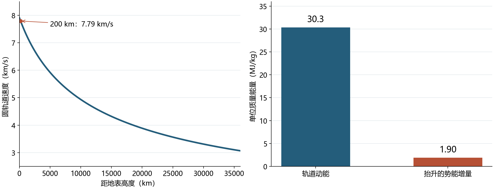
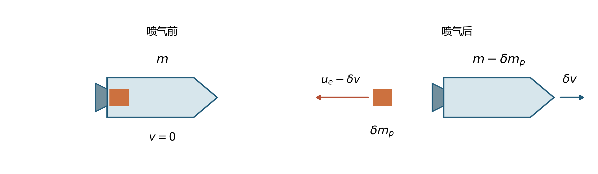
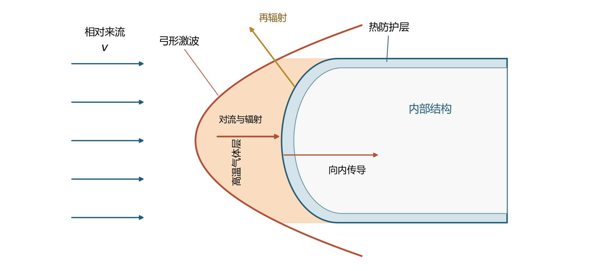
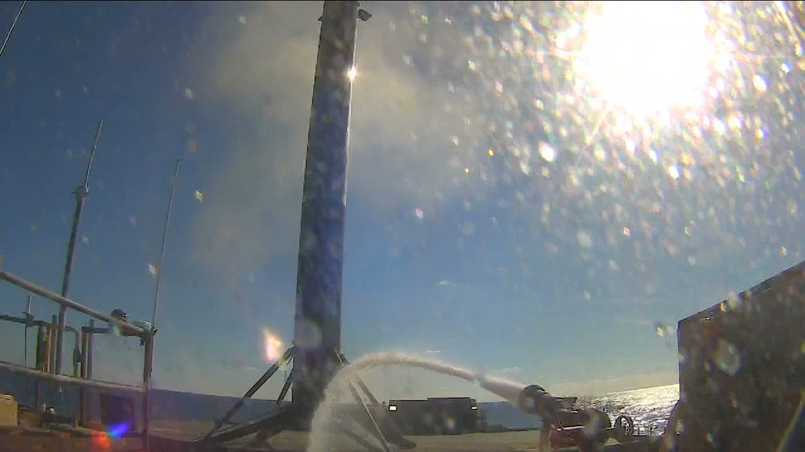

# 17 火箭的入轨、返回与复用

2020年12月6日，猎鹰9号从美国佛罗里达州肯尼迪航天中心升空，执行CRS-21货运任务。火箭顶端的龙飞船装载着空间站所需的物资、科学实验设备和气闸舱。一子级完成工作后与上面分离，二子级继续推动飞船；几分钟后，一子级在大西洋的平台上着陆。龙飞船则继续绕地球飞行，并在12月7日与国际空间站对接。同一次发射由此展开成两条路线：一条把货物送到轨道上的目的地，一条把已经完成上升任务的硬件带回地面。[NASA任务记录](https://www.nasa.gov/blogs/spacestation/2020/12/07/new-spacex-cargo-dragon-docks-to-station/)

这两条路线共用同一枚火箭的初始质量和推进剂。为载荷多提供一点速度，就会改变一级分离时的状态；为返回多留一些推进剂，上升阶段就要一直携带这些质量。理解这次飞行，需要先看轨道要求火箭达到怎样的运动状态，再追踪发动机怎样改变动量、分级怎样改变需要加速的质量，最后研究返回时怎样消除速度并保存硬件。

## 把货物送到一条轨道上 {#L15-C01}

国际空间站一边绕地球前进，一边受到地球引力作用。假如把它在某一时刻的速度方向画出来，这个方向近似沿轨道切线；引力则指向地心，不断使速度方向偏转。两者配合，使空间站持续绕地球自由下落。舱内的人和物也几乎具有相同的下落加速度，因此地板对身体的支持力很小，出现微重力环境。

在球对称地球和圆轨道的近似下，地心距离为$r$的飞行器需要向心加速度$v^2/r$。令它等于引力加速度，得到

$$
\frac{GM_\oplus}{r^2}=\frac{v^2}{r},\qquad
v=\sqrt{\frac{GM_\oplus}{r}},\qquad
P=\frac{2\pi r}{v}.
$$

其中$G$是引力常数，$M_\oplus$是地球质量，$P$为轨道周期；$r=R_\oplus+h$，由地球半径与距地表高度相加得到。取$GM_\oplus=3.986\times10^{14}\ \mathrm{m^3\,s^{-2}}$、$R_\oplus=6371\ \mathrm{km}$，一个高度200 km的理想圆轨道要求约7.79 km/s的速度，绕行一周约88分钟。此处的地球引力仍约为地表的94%。[NASA轨道力学](https://science.nasa.gov/learn/basics-of-space-flight/chapter3-3/)

这个速度也决定了能量的分配。按每千克飞行器计算，轨道动能为$v^2/2$，从地表抬升到高度$h$所增加的引力势能为

$$
\Delta\Phi=GM_\oplus\left(\frac{1}{R_\oplus}-\frac{1}{R_\oplus+h}\right).
$$

在200 km的例子中，两者分别约为30.3 MJ/kg和1.90 MJ/kg。建立轨道速度占据了这两项状态能量增量中的大部分。因此火箭离开发射台以后，会逐渐把飞行方向转向接近水平，使后续推力主要用于积累沿轨道方向的速度。最初向上飞行帮助它离开地面和较稠密的大气，随后弯曲的上升路径则把高度与横向速度一同建立起来。

*图1：球对称地球模型的计算结果。左图给出圆轨道速度随高度的变化；右图以每千克飞行器为单位，比较200 km圆轨道的动能与相对地表的势能增量。计算忽略地球自转和大气，源代码及参数保存在本图同目录。*

真实发射还要加速不断消耗的推进剂，承受空气阻力，并在发动机工作期间持续受到重力影响。上升时，重力沿飞行方向的反向分量会抵消一部分推力带来的速度增长；把这一影响沿燃烧时间累加，就得到速度预算中的重力损失。因此设计时通常用速度增量预算来组织任务：各段点火能够提供多少速度改变，目标轨道需要多少，路径中的各种影响又占去多少。发动机推力方向、飞行时间和气动载荷都参与决定这笔预算。提高推力可以缩短部分上升时间，减小某些重力损失，但同时会增加结构承受的加速度，也会改变通过稠密大气时的载荷。

轨道还包含方向。进入国际空间站所在的轨道平面，要求发射场位置、发射时刻与飞行方向协调；进入适合交会的轨道以后，飞船还要调整与空间站的相对位置。在近圆轨道中，较低轨道通常具有较短周期，一艘位于较低轨道的飞船可以逐渐追上前方的空间站，再通过点火抬高轨道，完成接近。轨道高度、轨道平面与沿轨道的相位共同决定会合条件。CRS-21的龙飞船在一级返回后仍继续飞行一天多，这段时间用于完成轨道飞行和交会。

## 喷流如何推动一枚质量不断减小的火箭

液体火箭把燃料和氧化剂送入燃烧室，燃烧产生高温高压气体。气体通过喷管膨胀，获得指向箭体后方的速度；箭体受到向前的推力。以箭体和刚喷出的气体为一个系统，气体带走的向后动量对应着箭体获得的向前动量。燃料、氧化剂和作为喷流的物质都由火箭携带，因此这一过程可以在真空中继续进行。

推力的大小同时取决于每秒喷出多少质量和每千克喷流获得多大速度。计入喷管出口与外界的压力差，有

$$
T=\dot m_p u_e+(p_e-p_a)A_e.
$$

$\dot m_p$取正值，表示每秒消耗的推进剂质量；$u_e$是相对火箭的排气速度，$p_e$和$p_a$分别是喷管出口与外界压力，$A_e$是出口面积。将推力除以质量流率，可定义等效排气速度$v_e=T/\dot m_p$，把喷流动量和压力作用合并到一个量中。比冲则是$I_\mathrm{sp}=v_e/g_0$，其中$g_0=9.80665\ \mathrm{m\,s^{-2}}$为标准重力加速度。[NASA推力公式](https://www1.grc.nasa.gov/beginners-guide-to-aeronautics/rocket-thrust/)、[比冲定义](https://www1.grc.nasa.gov/beginners-guide-to-aeronautics/specific-impulse/)

等效排气速度为3 km/s时，比冲约为306 s。若推进剂质量流率为100 kg/s，相应推力为300 kN。同一种发动机提高流量可以增大推力，而提高等效排气速度能让相同推进剂提供更大的冲量。起飞阶段首先需要足够推力来加速整枚火箭；在比较同样速度增量所需的推进剂时，等效排气速度和质量比便成为关键。

随着燃烧进行，火箭逐渐变轻。同样一份向前冲量，施加在后期较小的质量上，会引起较大的速度改变。把这一过程分成许多很短的时间段：某一瞬间火箭质量为$m$，喷出一小份推进剂$\delta m_p$，忽略外力并把$v_e$视为常量，动量守恒给出$m\,\delta v\simeq v_e\delta m_p$。火箭自身质量减少，$\mathrm dm=-\delta m_p$，于是

$$
\mathrm dv=-v_e\frac{\mathrm dm}{m}.
$$

将每一小段的速度改变相加，从点火开始的$m_0$积到结束的$m_f$，得到理想火箭方程：

$$
\Delta v=v_e\ln\frac{m_0}{m_f}.
$$

这里的$m_f$包含点火结束时仍一起运动的全部物质：发动机、贮箱、结构、载荷，以及为后续动作保留的推进剂。对数来自加速过程中不断变化的分母$m$。靠近开始时喷出的推进剂要推动较重的火箭；靠近结束时，同量推进剂推动的质量已减小。[NASA火箭方程推导](https://www1.grc.nasa.gov/beginners-guide-to-aeronautics/ideal-rocket-equation/)

*图2：取喷气前火箭静止的惯性系，橙色表示即将喷出的一小份推进剂。喷气后，箭体获得向右的速度$\delta v$，气体以$u_e-\delta v$向左运动；$u_e$是相对箭体的排气速度。示意取外力和喷口压力推力可忽略的情形，此时$v_e=u_e$。动量关系见[NASA Glenn推导](https://www1.grc.nasa.gov/beginners-guide-to-aeronautics/ideal-rocket-equation/)。*

在$v_e=3\ \mathrm{km/s}$的模型中，质量比$m_0/m_f$分别为3、10和20时，理想速度增量约为3.30、6.91和8.99 km/s。最后一项意味着点火结束时只剩初始质量的5%，而这5%还要容纳所有留下来的结构与载荷。若从另一方向求解，便得到$m_0/m_f=\exp(\Delta v/v_e)$：所需速度增量逐步增加，质量比会以指数形式增长。

推进剂因此既提供动力，也构成正在被加速的负担。增加推进剂需要更大的贮箱，更大的贮箱又需要结构来承受压力和载荷。发动机、材料与结构设计都在这一相互牵连的质量关系中发挥作用。火箭设计中的一个重要办法，是在某部分完成任务以后及时将其分离。

## 分级之后，两段箭体走向不同的终点 {#L15-C02}

CRS-21升空后，一子级的九台发动机完成燃烧，一二级分离，二子级继续携带龙飞船前进。[当次分离记录](https://www.nasa.gov/blogs/commercialresupply/2020/12/06/main-engine-cutoff-first-stage-separates-6/) 此刻，一子级的大部分推进剂已经消耗，它的发动机和贮箱也完成了主要的上升任务。分离以后，二子级只需加速自身、剩余推进剂和飞船，承担的质量随之显著减少。

可以用一组假设质量把分级收益算出来。设一级有70 t推进剂和10 t干质量，上面整段质量20 t；上面这20 t又由15 t推进剂与5 t结构及载荷组成。令两级的$v_e$都为3 km/s。一级燃烧时，总质量从100 t减到30 t，贡献$3\ln(100/30)=3.61\ \mathrm{km/s}$。随后分离10 t的一级干质量，二级从20 t烧到5 t，贡献$3\ln(20/5)=4.16\ \mathrm{km/s}$，合计约7.77 km/s。若让这10 t空结构始终随行，相同总推进剂烧尽后仍剩15 t，对应的理想速度增量为$3\ln(100/15)=5.69\ \mathrm{km/s}$。这组模型取相同等效排气速度并忽略外力，专门显示抛掉已完成任务的结构怎样改变质量比。

分离以后，上面的一段继续建立轨道速度，下面的一段转入返回轨迹。一级的分离速度通常显著小于载荷最终的入轨速度，因此两者接下来的能量和热环境也不同。CRS-21的一级落到海上平台时，龙飞船仍位于二子级上；随后飞船与二子级分离，独立前往空间站。[龙飞船分离记录](https://www.nasa.gov/blogs/commercialresupply/2020/12/06/dragon-separates-from-second-stage-3/)

回收系统从发射之前就参与了质量分配。着陆腿、控制舵面、传感器和防护装置增加干质量；返回与着陆所用的推进剂在上升时也必须保留。设某一段的初始质量仍为100 t、$v_e=3\ \mathrm{km/s}$，若结束质量从10 t增加到15 t，理想上升速度增量便从6.91 km/s减为5.69 km/s，减少约1.22 km/s。这个简化比较把保留质量的作用单独列出，实际方案还会同时调整各级推进剂、载荷与飞行路径。

落点决定着另一部分预算。一级分离时已具有沿发射方向的速度，若落在下游海上的平台，可以利用这段自然向前的运动；若要返回发射场附近，则需要额外改变水平运动。平台回收随后需要海上定位、天气判断与运输，返回发射场则把硬件直接带回较近的地面设施。任务要在运载能力、返回推进剂与地面操作之间作整体选择。CRS-21采用的大西洋平台，为这条具体飞行路线提供了终点。

## 将返回的速度转移给喷流和大气

一级返回时，原先获得的机械能需要逐渐转移出去。发动机点火使喷流沿与所需推力相反的方向离开箭体，改变箭体动量；气动阻力则把飞行器的机械能转移到周围空气中。高速飞行器前方的空气来不及平缓绕开，会形成激波。空气跨过激波时被压缩、减速，定向运动的能量转入气体的内能，温度显著上升。热气体通过边界层向表面传热，温度足够高时还会产生重要的辐射加热。

用单位质量动能比较两个速度：3 km/s对应4.5 MJ/kg，8 km/s对应32 MJ/kg，后者约为前者的7.1倍。这组速度用于比较能量尺度；具体任务的热流还取决于大气密度、外形、姿态和飞行轨迹。空气获得的能量有相当部分留在尾流中，进入箭体的部分则由气动热过程决定。轨道飞行器和早期分离的一级面对不同的速度范围，因此需要分别设计热防护与返回路径。

*图3：飞行器参考系中的钝头物体截面示意。来流越过弓形激波后形成高温气体层，向表面传热；表面向外再辐射，部分热量穿过热防护层传入内部。箭头区分气流与能量传递方向，形状及箭长为定性表示。依据Sidor、Olson与Bouslog的2025年[气动热与热防护报告](https://ntrs.nasa.gov/api/citations/20250006125/downloads/NASA_TPS_Perspectives_ReusableRocketsWorkshop_RevB.pdf)第5—8页绘制。*

热防护可以让表面在较高温度下向外辐射，使用低导热材料延缓热量传入内部，也可以让材料受热分解或烧蚀，消耗材料并带走能量。不同方法对应不同的质量、耐温和维护需求。发动机舱、舵面、接缝以及大面积箭体表面承受的气流各不相同，各处的防护因而需要按局部环境安排。飞行以后，表面粗糙度、接缝和损伤又会影响下一次返回时的气流与传热。[热防护与复用研究](https://ntrs.nasa.gov/citations/20250006125)

下降轨迹还影响机械载荷。气动作用常以动压$q=\tfrac12\rho v^2$衡量，其中$\rho$是空气密度，$v$是相对空气的速度。下降时空气逐渐变稠密，速度也在变化；较大的动压会同时增强阻力和舵面的控制能力，并提高结构载荷。飞行器需要在进入较稠密空气前建立合适姿态，必要时用发动机减速，随后利用气动装置调整落点。高处空气稀薄时，可用的气动力很小，姿态控制更多依靠推进系统；进入较稠密空气后，舵面才逐渐获得足够作用。

姿态、速度、温度与落点就这样联系起来。姿态改变受热部位和气动阻力，阻力改变速度和航程，发动机点火又消耗最终着陆需要的推进剂。返回过程必须沿着这些相互影响的量连续推进，最后才进入靠近平台的精细制导阶段。

## 在有限高度内完成减速和着陆

终端着陆需要让箭体在到达平台时具有很小的竖直速度和水平速度，同时保持合适姿态。发动机提供推力，转动喷管或改变姿态可以调整推力方向；制导系统则根据位置、速度、姿态和剩余推进剂不断更新动作。竖直减速与水平校正共用有限推力，向侧面分配的分量会相应减少向上的分量。

先取竖直向上为正，忽略阻力，把最后一段近似为一维运动。质量为$m$的箭体受到向上推力$T$和向下重力$mg$，因此

$$
a=\frac{T}{m}-g.
$$

下降中需要向上的净加速度来减小下降速度。假设初始下降速度大小$u=50\ \mathrm{m/s}$，能够维持向上净加速度$a=10\ \mathrm{m/s^2}$，则停止所需时间为$u/a=5\ \mathrm{s}$，下降距离为

$$
s=\frac{u^2}{2a}=125\ \mathrm m.
$$

速度越大，所需停止距离按平方增加：同样净加速度下，100 m/s需要500 m。这种关系让点火时刻与高度、速度直接相连。真实发动机还要经历启动和推力建立，质量则随推进剂消耗而下降；制导计算因此需要沿实际变化的推力与质量预测轨迹。

发动机的最小稳定推力也决定可用的动作。若最小推力仍大于此刻重量，发动机工作时箭体便具有向上的净加速度。控制系统可以选择点火时刻和节流过程，使下降速度在接触平台附近减至很小。与此同时，水平风、初始落点误差和平台运动也需要修正。着陆腿最后把剩余运动转化为结构形变和缓冲载荷，使整段箭体保持稳定。

*图4：2020年12月6日CRS-21一子级在“Of Course I Still Love You”平台着陆的画面截帧。Credit: NASA。[当次回收通报](https://www.nasa.gov/blogs/spacexcrs21/2020/12/06/falcon-9-first-stage-sticks-the-landing/)。*

CRS-21完成着陆的这段一级，已经经历了第四次飞行，其中一次是此前载人的Demo-2任务。这样的硬件经历把制造、飞行、回收和再次准备连接在一起。箭体抵达平台后，还要经过固定、运输与检查，才能重新进入发射流程。

## 飞行之间的检查与再次使用

一次飞行给部件留下多种经历：贮箱经历加注和增压，结构承受振动与弯曲，发动机经历高温、高压与高速旋转，再入带来加热，着陆带来冲击。反复使用时，这些载荷按次数累积，部件也可能在某次飞行中出现局部损伤。因此回收后的工程工作，要把飞行遥测与硬件检查联系起来：记录曾达到的温度、压力、振动和载荷，检查对应部位，再决定哪些部件继续使用、维修或更换。

部件能否承受下一次飞行，取决于其材料状态、受力位置和后续任务。结构中的裂纹、密封件的磨损和防护层的损伤，需要分别采用适合的检查手段。复用设计因而需要同时考虑可检查性与可维护性。把易损部件安排在便于接近的位置，给关键状态留下测量手段，建立每件硬件的飞行记录，都能减少两次发射之间重新判断状态所需的工作。对热防护而言，表面损伤与内部隔热性能同样需要关注；外形和接缝保持在要求范围内，下一次的受热预测才有可靠基础。

制造成本可以随实际使用次数分摊。设一件可复用硬件的制造成本为$C$，完成$N$次飞行，每次平均检查整修成本为$R$，其余每次任务成本为$O$，则一个简单的平均成本关系为

$$
\bar C=\frac{C}{N}+R+O.
$$

这个模型把提高使用次数的直接收益显示出来：制造成本逐渐摊薄。随着$N$增加，$C/N$继续下降，但检查、推进剂、地面操作以及仍需消耗的硬件所占比例变大。若较晚几次飞行需要更长整修，就应把$R$写成随飞行次数变化的量，再按总成本求平均。回收造成的运载能力变化也要放入运输任务中比较：一次能送多少货物、多久完成一次发射，都会影响同样运输需求对应的成本。

CRS-21的一子级最终站在平台上，龙飞船随后与空间站对接。这两个终点由起飞前同一份质量预算连接：上升需要积累速度，分级减少后续需要加速的质量，返回需要保留推进剂和承载能力，复飞需要了解硬件经历并维持其状态。一枚火箭的完整工作，就发生在这些连续的物理过程和飞行之间的工程操作之中。

---

参考资料与图像署名见[本篇来源](../../assets/rewrite-20261025/17/SOURCES.md)；保留素材的许可记录见[原素材记录](../../assets/v02-batch-D-SOURCES.md#l15)。
