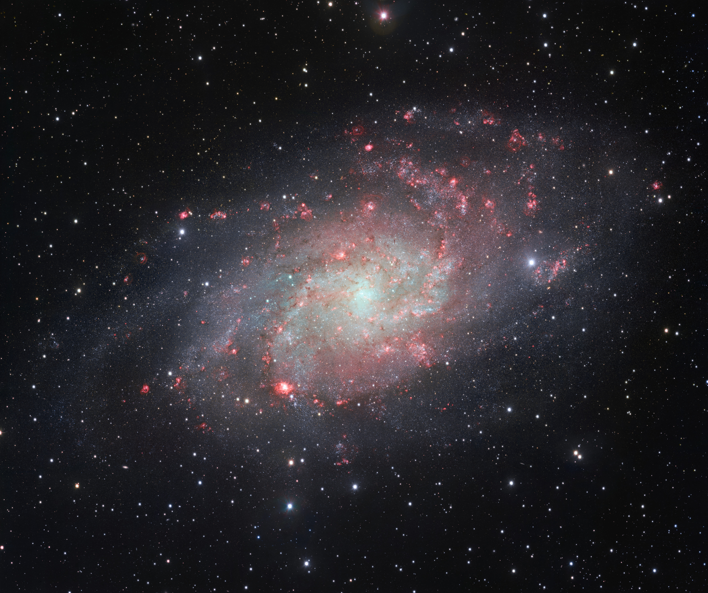
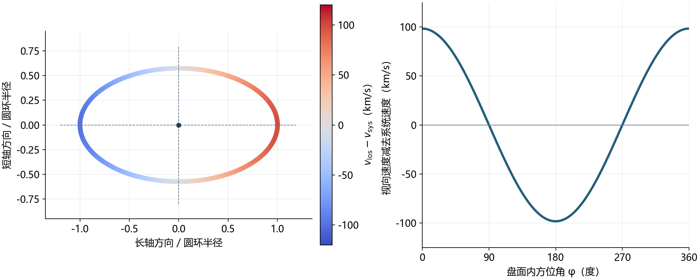
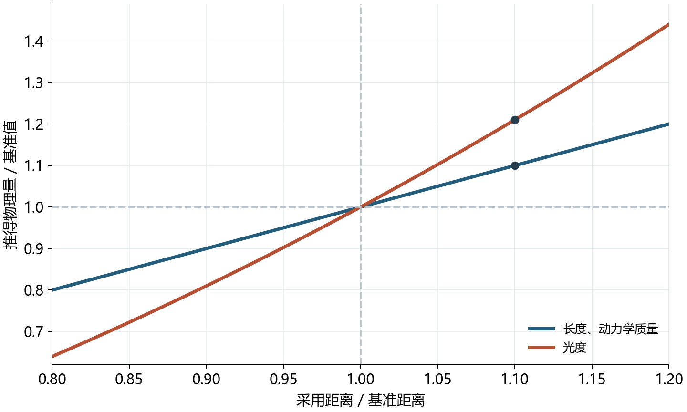

# 18 从观测建立一座星系的物理图景

三角座方向有一座旋涡星系M33。它在长曝光照片中铺开成一片宽阔的星光，旋臂上散布着明亮的恒星聚集区和红色气体云。把照片放大，还能看见尘埃形成的暗纹、局部拥挤的星点，以及逐渐变淡的外侧盘面。研究这样一个对象，可以从同一幅图像依次追问下去：这些结构离我们多远，实际有多大，发出多少光，其中的物质怎样运动，又经历了怎样的形成过程？

每一个问题需要在前一步得到的量上加入新的观测。照片首先给方向、角尺度和不同波段的亮度；连续拍摄给变星的周期；光谱给气体与恒星的运动；大量恒星的颜色和光度则保存着年龄分布的信息。把这些测量接起来，M33便从天空中的一个图案逐渐成为具有尺度、质量分布和历史的物理系统。

## 从照片建立第一组观测量

*图1：VST/OmegaCAM的M33影像，使用光学g、r与Hα滤镜，横向视场68.01角分，纵向57.04角分。画面左方为北。Credit: ESO；[发布页及滤镜信息](https://www.eso.org/public/images/eso1424a/)，CC BY 4.0。这里使用原有4000×3355像素发布版。*

图1的画幅宽约一度。在天球上测量两个结构的间隔，可以先数它们相隔多少像素，再用经过校准的像素角尺度换成角秒。每颗星的坐标还可与其他时刻、其他仪器的图像对应，使多组观测始终落到同一个对象上。整个星系在天空中的宽度、星团之间的间隔和局部气体云的宽度，最初都以角度表达。

另一方面，经过偏置、暗信号、平场和背景处理的图像可以用于测光。围绕某颗星或某片区域选定范围，将其中的信号相加，再扣去背景，便得到相应波段的通量。以两个滤镜的星等相减得到颜色，可以比较不同位置的恒星群；加入Hα窄带，则能突出电离氢气体的发射。最后显示在屏幕上的颜色和亮度经过拉伸，定量测光使用的是校准后的数据。

这些测量共同留下了一个尚未确定的量：距离。假如一个对象在天空中宽一角分，它可能是较近的星团，也可能是较远星系中的一大片区域；同样的通量也可以来自近处较暗的对象或远处较亮的对象。M33内部恰好有许多亮度周期性变化的恒星，时间记录提供了求距离的入口。

## 造父变星把周期接到距离 {#L16-C03}

对同一片星场连续拍摄，把一颗星在各个日期的通量排在时间轴上，就得到光变曲线。经典造父变星的半径和表面温度随脉动变化，因而出现可重复的亮暗循环。把数据按不同候选周期折叠：若所选周期恰当，多个周期中相同阶段的观测会落在相近位置，光变曲线的形状就清楚显现。距离会使整条曲线变暗，而在M33这样的近邻星系中，它对所测周期的影响很小。[NASA造父变星介绍](https://starchild.gsfc.nasa.gov/docs/StarChild/questions/cepheids.html)

周期之所以有测距用途，是因为同一类造父变星的周期与平均光度相关。恒星脉动涉及引力和压力的竞争，其特征时间具有$\sqrt{R^3/(GM)}$的尺度；半径较大、平均密度较低的恒星通常脉动得较慢。在造父变星所处的演化阶段和温度范围内，半径、质量与光度又相互联系，最终形成可以用观测校准的周期—光度关系。在选定波段中，它常写成

$$
M_X=a_X\log_{10}\left(\frac{P}{1\ \mathrm{day}}\right)+b_X,
$$

其中$M_X$是该波段的平均绝对星等，$P$是周期，$a_X$和$b_X$由已经知道距离的同类变星样本确定。系数$a_X$通常为负，表示较长周期对应较高光度、较小的绝对星等。波段、化学组成和脉动类型会影响关系的具体形式，因此校准样本与待测样本需在同一测光和分类体系下比较。

绝对星等表示把对象放到10 pc处时的亮度，视星等$m_X$表示我们实际收到的亮度。先用消光量$A_X$校正途中尘埃造成的变暗，由通量随距离平方反比衰减，可得

$$
\mu=m_X-A_X-M_X
=5\log_{10}\left(\frac{d}{10\ \mathrm{pc}}\right),
\qquad
 d=10^{(\mu+5)/5}\ \mathrm{pc}.
$$

$\mu$称为距离模数。对于距离相近的一组造父变星，它们的周期不同，固有亮度也不同，但由各自周期估计绝对星等后，视星等与绝对星等之间应有相近的差值。许多颗星共同确定这一个差值，使测距不必依赖某颗星的单次测光。

校准所需的距离可以从其他测量取得。M33的一项2023年研究采用大麦哲伦云的造父变星关系，而大麦哲伦云的距离由食双星提供基准。对于双星系统，光谱中的视向速度随时间变化给出轨道的速度尺度；周期把速度接到长度，食的形状与时长又约束倾角和恒星半径。结合经过校准的恒星表面亮度—颜色关系，可以由收到的光估计角直径，再用真实直径除以角直径求距离。2019年的研究用20个食双星系统，得到约49.59 kpc的大麦哲伦云距离。[食双星测距研究](https://arxiv.org/abs/1903.08096)

在M33一侧，Breuval等人结合地面光变曲线与哈勃空间望远镜测光，使用154颗造父变星，得到$\mu=24.622\pm0.030$，对应$d=840\pm11\ \mathrm{kpc}$。地面观测提供周期与光变形状，哈勃较高的角分辨率帮助减少拥挤星场中邻星混光；多个波段共同限制消光。该研究还处理了测光系统、探测器响应和化学组成的校准，并将这些误差纳入距离结果。[2023年研究全文](https://arxiv.org/html/2304.00037v1)

代入距离模数公式，$10^{(24.622+5)/5}\ \mathrm{pc}$约为$8.40\times10^5\ \mathrm{pc}$，即274万光年。距离模数的不确定度可以用$\delta d/d\simeq(\ln10/5)\delta\mu$换算；0.030等对应约1.4%的距离变化。这里的关系也说明校准为何重要：所有变星若因同一个零点偏移而一起变亮，增加恒星数量仍会保留这个共同偏移。独立测距方法提供的基准，则能够约束这种全体移动。

## 距离让角尺度和通量变成物理量

现在回到图1。一个垂直于视线、张角很小的结构，其投影长度$s$满足

$$
s\simeq d\theta,
$$

其中$\theta$用弧度。采用$d=840\ \mathrm{kpc}$，一角秒对应约4.07 pc，一角分对应约244 pc。因此图1横向68.01角分的画幅，在M33的距离处覆盖约16.6 kpc，约5.4万光年。这是图像画幅的投影宽度。要描述星系的大小，还需选定所讨论的成分和测量边界，例如恒星盘在某个表面亮度处的范围，或中性氢在某个柱密度处的范围。

像素尺度也随之有了含义。角分辨率为一角秒时，对应M33中约4 pc的尺度；在这样的图像上，一个亮斑可能包含一个紧密星群。改善到0.1角秒后，尺度降到约0.4 pc，邻近亮星更容易分开。这直接影响造父变星测光：邻星混入的光会使变星的平均通量增加，且使光变的相对振幅减小。更高角分辨率让距离测量中的具体对象得到更清楚的隔离。

距离还把通量转换为光度。对经过消光校正、可近似各向同性辐射的源，选定波段中的光度$L_X$与通量$F_X$满足

$$
L_X=4\pi d^2F_X.
$$

例如，取一个位于M33的假设发射区，其校准后某条谱线通量为$10^{-15}\ \mathrm{W\,m^{-2}}$。以$d=840\ \mathrm{kpc}=2.59\times10^{22}\ \mathrm m$代入，得到这条谱线的光度约为$8.4\times10^{30}\ \mathrm W$。这里特意选定谱线通量作为算例，结果描述的是这一条线每秒辐射的能量。要研究对象的总辐射，还需要覆盖其他波段并补足未观测到的部分。

对于单颗恒星，距离和通量给出总光度，光谱约束有效温度，便可通过

$$
L=4\pi R_*^2\sigma T_\mathrm{eff}^4
$$

估计半径$R_*$，其中$\sigma$是斯特藩—玻尔兹曼常数，$T_\mathrm{eff}$是由恒星表面总辐射定义的有效温度。对于整个星系，更有用的办法是把不同区域的光度分别求出，研究恒星与气体怎样分布。年龄和化学组成不同的恒星群，每单位质量发出的光也不同，因此光度分布接下来还需要与恒星群模型结合，才能用于估计恒星质量。

总通量之外，照片中淡淡的外盘还涉及表面亮度。在角分辨率足以分开局部结构的条件下，对同一小块发光区域，收到的总通量随$d^{-2}$减小，所占立体角也随$d^{-2}$减小；在附近宇宙的欧几里得近似下，两者之比保持不变。于是一个延展天体即使总亮度可观，光分散在较大天区内时，仍可能在明亮天空背景中难以辨认。深曝光、背景估计和足够暗的观测条件共同决定我们能追踪多淡的外盘。

## 光谱把旋涡图案接到运动

星系内部的物质在运动，照片中旋臂的位移却很难在短时间内直接量出。若在半径10 kpc处以120 km/s绕转一周，周期约为$2\pi R/v\simeq5.1\times10^8$年。光谱提供了更直接的速度测量：发射谱线相对实验室波长的位移，包含发射气体沿视线运动的速度信息。

在速度远小于光速时，可使用多普勒近似

$$
v_\mathrm{los}\simeq c\frac{\lambda-\lambda_0}{\lambda_0}.
$$

$\lambda_0$为静止波长。天文观测会先把不同日期和台站的速度校正到统一参考系，再从星系各处的视向速度中分出整体运动与内部运动。对于旋转盘，一侧的气体相对星系中心朝向我们运动，另一侧背离我们，谱线因此呈现有空间规律的位移。

M33的中性原子氢会发出21 cm谱线。射电望远镜在天空每个位置记录这条线的谱形，形成一个有两个空间坐标和一个频率坐标的数据立方。沿频率轴求和，可以得到中性氢分布；比较各处谱线的中心频率，则可得到速度场。中性氢延伸到光学照片较淡的外侧，为测量更大半径处的引力提供了示踪物。

从视向速度到真实旋转速度，需要知道盘面倾角。定义$i=0$为正面朝向我们的盘，$i=90^\circ$为侧立的盘。对几何上很薄的圆盘，投影轴比近似为$b/a=\cos i$。盘越接近正面，其旋转速度越多落在天球面内；盘越接近侧立，越多速度投影到视线上。

对盘内圆周运动，若$\phi$为盘面内从退行侧长轴方向量起的方位角，则

$$
v_\mathrm{los}-v_\mathrm{sys}=v_c(R)\sin i\cos\phi.
$$

$v_\mathrm{sys}$是星系整体的视向速度，$v_c(R)$是半径$R$处的圆周速度。长轴两端的$\cos\phi$分别为$+1$和$-1$，速度投影最大；短轴附近的投影趋近于零。因而同一条圆环上的气体可以有不同的谱线位移，整幅速度场需要与其几何位置一同拟合。

*图2：薄圆环模型，固定真实圆周速度120 km/s、倾角55°。左图颜色表示减去系统速度后的视向速度；右图给出同一圆环上视向速度随盘内方位角的变化。数值用于展示投影关系，图中点为模型取样。*

图2的模型中，长轴两侧最大视向速度差约为$2\times120\sin55^\circ\simeq197\ \mathrm{km/s}$。若从单侧量得相对中心约98 km/s，除以$\sin55^\circ$便恢复约120 km/s的圆周速度。倾角进入分母，因此近乎正面的星系在用视向速度恢复旋转时，对倾角误差尤其敏感。

M33的外层盘还存在翘曲，不同半径的盘面方向会逐渐变化。Corbelli等人把VLA和GBT的21 cm观测结合，用一组方向可以随半径变化的倾斜圆环拟合谱线数据，得到M33的旋转曲线。其结果在内侧约4 kpc达到100 km/s，外侧仍维持约120—130 km/s的速度量级，测量延伸到约23 kpc。这组研究所采用的距离也是840 kpc。[动力学研究，第4节](https://arxiv.org/pdf/1409.2665)

## 从旋转曲线推到质量分布

圆周运动要求向内的加速度$v_c^2/R$。只要能求出各处引力，便能计算相应的圆周速度；反过来，测得$v_c(R)$就能约束产生引力的质量分布。先考虑球对称模型：半径$R$内的质量$M(<R)$产生向内引力，半径之外球壳的合力抵消，于是

$$
\frac{GM(<R)}{R^2}=\frac{v_c^2}{R},\qquad
M(<R)=\frac{v_c^2R}{G}.
$$

用$G=4.301\times10^{-6}\ \mathrm{kpc\,(km/s)^2}\,M_\odot^{-1}$，取与M33外侧曲线相近的一组圆整数值$R=15\ \mathrm{kpc}$、$v_c=120\ \mathrm{km/s}$，得到球对称等效包围质量约$5.0\times10^{10}M_\odot$。这一数量级估算把测得的速度与长度接到了质量。对扁平的恒星盘和气体盘，圆环内外的物质都会对某处产生引力，精细质量模型则要按盘形分布逐项计算。

旋转曲线的形状提供进一步信息。若绝大部分质量集中在有限的内区，外侧$M(<R)$趋于常量，圆周速度便按$R^{-1/2}$下降。如果在球对称近似下速度近乎恒定，公式要求$M(<R)$近似随$R$增长；相应密度在这一范围内约按$R^{-2}$变化。持续较高的外侧速度，因而要求在更大范围内仍有重要质量分布。

接着需要计算可观测物质提供多少引力。恒星的各波段亮度与颜色，通过恒星演化和群体合成模型约束其质量光度比；21 cm谱线强度在适当光学深度条件下给出原子氢柱密度；分子气体可以借助CO等谱线估计，另需采用相应转换关系。将这些分布换算为引力，便能分别计算恒星盘、气体盘对旋转速度的贡献。

在轴对称的圆周运动模型中，各成分引力相加，表现为

$$
v_c^2(R)=v_*^2(R)+v_\mathrm{gas}^2(R)+v_\mathrm{halo}^2(R).
$$

这里每个平方项表示相应质量成分单独产生的径向引力乘以$R$。对M33，恒星与气体模型的贡献不足以解释整条观测曲线，牛顿引力框架中的质量拟合需要加入广泛分布的暗物质晕。恒星质量光度比、盘的几何与暗晕密度形状会共同影响拟合，因此研究会把光度信息与动力学信息联合使用。[Corbelli等人的质量模型，第5—6节](https://arxiv.org/pdf/1409.2665)

这样的质量测量与近处卫星轨道遵循同一个引力原则，却利用不同的观测量。木卫一的周期和真实轨道尺度可以给出$GM\simeq4\pi^2a^3/P^2$；银河中心恒星的轨道也可使用类似关系。对M33，绕转周期长达亿年量级，实际采用的是光谱速度和空间分布。距离如何进入最后结果，也由这些具体观测决定：固定周期的角轨道法中，$a\propto d$使质量随$d^3$变化；固定光谱速度与倾角时，$R\propto d$使这里的动力学质量随$d$变化。

## 恒星群把空间分布接到形成历史

质量模型中的恒星质量光度比依赖恒星群年龄，这又使问题转向M33的过去。年轻的大质量恒星光度很高，单位质量可以贡献大量光；经过较长时间，大质量恒星先结束明亮的演化阶段，仍存活的较低质量恒星和遗迹在质量中占有更大比例。因此同样亮度的两个区域，所包含的恒星总质量可以不同。

M33足够近，哈勃能把其中大量恒星分开测量。PHATTER巡天提供从紫外到近红外的多波段测光，并发布了包含约2200万颗恒星的目录。每颗星在两个波段的星等差给颜色，一个波段的星等给亮度，把所有星放在同一张图上，便得到颜色—星等图。[PHATTER数据档案](https://archive.stsci.edu/hlsp/phatter)

已知距离后，整张颜色—星等图可以换到绝对星等；消光模型则说明尘埃怎样把恒星移向较暗、较红的位置。恒星演化模型预测不同质量的恒星随时间如何改变温度和光度，于是在给定年龄和化学组成下，可以算出一条等龄线。一个近似同龄的星团适合与单组等龄线比较；星系的一片区域则通常包含许多代恒星，需要把不同年龄的群体按形成数量相加。

这种相加有直接可见的结果。某个年龄段形成了较多大质量恒星，就会在它们仍存活时给颜色—星等图增加一批明亮蓝星；经过更长时间，主序上相应质量的星减少，后续演化阶段的星数改变。把不同年龄群体的预测分布组合起来，比较它们在颜色—星等图各个区域预计出现多少颗星，便可估计过去不同时间段形成了多少恒星。

观测深度也决定能追溯多远。年轻的大质量恒星很亮，容易在M33中测到；较老族群的主序转折更暗，需要更深测光。拥挤区域又会漏掉一部分暗星。实际分析会把已知亮度和颜色的人造星点加入图像，沿同样的数据处理流程重新测量，从而估计测光偏差与检出概率，再把这些影响施加到模型上。这样，模型与真实观测就在同样的检出条件下比较。

PHATTER的一项研究将内盘分成2005个小区域，每块在天空上约24角秒、对应约100 pc，并分别拟合颜色—星等图，把近期恒星形成历史追溯到约6.3亿年前。年轻于约8000万年的族群显出较零碎的多臂结构，较老族群中的两条旋臂和中央棒更清楚。研究范围是巡天覆盖的内盘，所给形成史也对应这些区域。[M33近期恒星形成史研究](https://arxiv.org/html/2206.11393v1)

进一步按不同演化阶段选择恒星，可以为不同年龄范围绘制密度图。2023年的PHATTER结构研究发现，年轻主序星与星际介质的零碎旋臂分布接近，而较老的族群显出更平滑的盘、两条主要旋臂以及尺度约1 kpc的中央棒。[按恒星群研究M33结构](https://arxiv.org/html/2308.11618v1) 星系的形态因此与被选择的发光群体有关：照相时最醒目的年轻亮星描述近期活动，较老恒星的分布则让更持久的结构浮现出来。

## 气体与年轻恒星记录着正在进行的过程

图1旋臂上的红色发射区，将这些年龄判断接到星际气体。大质量年轻恒星辐射大量紫外光，能够电离周围的氢。电子与质子复合后，原子经过一系列能级跃迁，产生包括Hα在内的谱线。能够持续提供大量电离光子的恒星寿命较短，因此明亮电离区通常指向近期形成的大质量星群。

M33中的NGC 604就是这样一个巨大电离区。它包含大量年轻大质量恒星，强烈星风在周围气体中开出空腔，紫外辐射使邻近气体发光。红外观测进一步显示尘埃与分子成分，研究者可以把年轻恒星、热气体、较冷气体和尘埃在空间上的位置联系起来。[NASA对NGC 604的观测介绍](https://science.nasa.gov/missions/webb/peering-into-the-tendrils-of-ngc-604-with-nasas-webb/)

这些成分代表物质循环的不同环节。冷气体在足够致密的区域形成分子云，其中部分气体坍缩形成恒星；新生大质量恒星的辐射和星风使周围气体受热并获得动量；后续超新星又抛出物质和新合成元素，改变周围气体状态。将Hα、紫外、红外和射电图像配准，可以研究不同环节在何处出现，气体集中处与年轻星群之间有多大空间间隔，以及这些关系怎样随星系半径变化。

化学组成给这一过程增加了历史约束。恒星形成时继承气体中的元素比例，演化后又把加工过的物质送回星际空间。测量气体发射线和恒星光谱，便能比较不同位置的元素丰度。丰度梯度同时受到恒星形成、气体流入流出和混合影响；把它与年龄分布、气体储量和动力学结构放在一起，能检验一个形成历史是否同时满足多组观测。某段时间产生很多恒星的模型，也要能够解释留下了多少恒星质量、消耗和补充了多少气体。

## 距离在整幅物理图景中的作用 {#L16-C04}

距离贯穿着前面的推断。固定角尺度时，真实长度随$d$变化；固定通量时，光度随$d^2$变化；固定光谱速度、倾角和角半径时，动力学质量随$d$变化。把采用的距离增加10%，同一个结构会大10%，同一个源会亮21%，相同速度场对应的动力学质量则增加10%。若保持恒星群模型给出的质量光度比，测光推得的恒星质量会随光度增加21%。不同方法对距离的依赖不同，联合拟合时这些量需要一起调整。

*图3：固定角尺度、接收通量、光谱速度和盘面倾角，比较采用距离相对基准值变化时，长度、光度及球对称等效动力学质量的变化。横纵轴均为相对基准值的比值；线性关系与平方关系来自正文公式。*

840 kpc也对应约274万年的光传播时间。在M33这样的近邻尺度上，用$d/c$就能很好地估计这一时间。因此我们今天看到的星群与气体，呈现的是约274万年前发出的光；用恒星演化推得某颗星当时已有多大年龄，描述的则是它在发出这束光时的演化状态。光行时和恒星年龄由不同过程确定，合在一起才能把观测状态放到时间轴上。

连续观测仍然能够跟踪变化。相隔十年收到的光，在这一近邻近似下对应M33中相隔约十年的状态；周期为十天的造父变星，也会在我们的记录中一轮轮变化。远距离提供了共同的传播延迟，观测时间序列则保留源自身的时间间隔。正因为如此，周期可以参与测距，短期变化也可以在遥远星系中被测量。

再看图1，那片旋涡星光已经具有一组彼此联系的量：造父变星给出距离，距离使画幅宽度对应到千秒差距；校准通量转成光度，恒星群模型再估计恒星质量；谱线位移结合盘面几何给出旋转，旋转约束更广范围的总质量；不同年龄恒星和不同状态的气体，把当前结构接到形成与反馈过程。进一步提高测距精度，会改变整幅图景的尺度；改进外盘的速度和几何测量，会收紧质量分布；更深的恒星测光，则能把形成史追溯到更早的年代。同一座星系可以继续接纳这些测量，使各部分的物理解释逐渐相互约束。

---

研究论文、计算条件与图像许可见[本篇来源](../../assets/rewrite-20261025/18/SOURCES.md)；M33原图的素材记录见[原来源表](../../assets/v02-batch-D-SOURCES.md#l14)。
